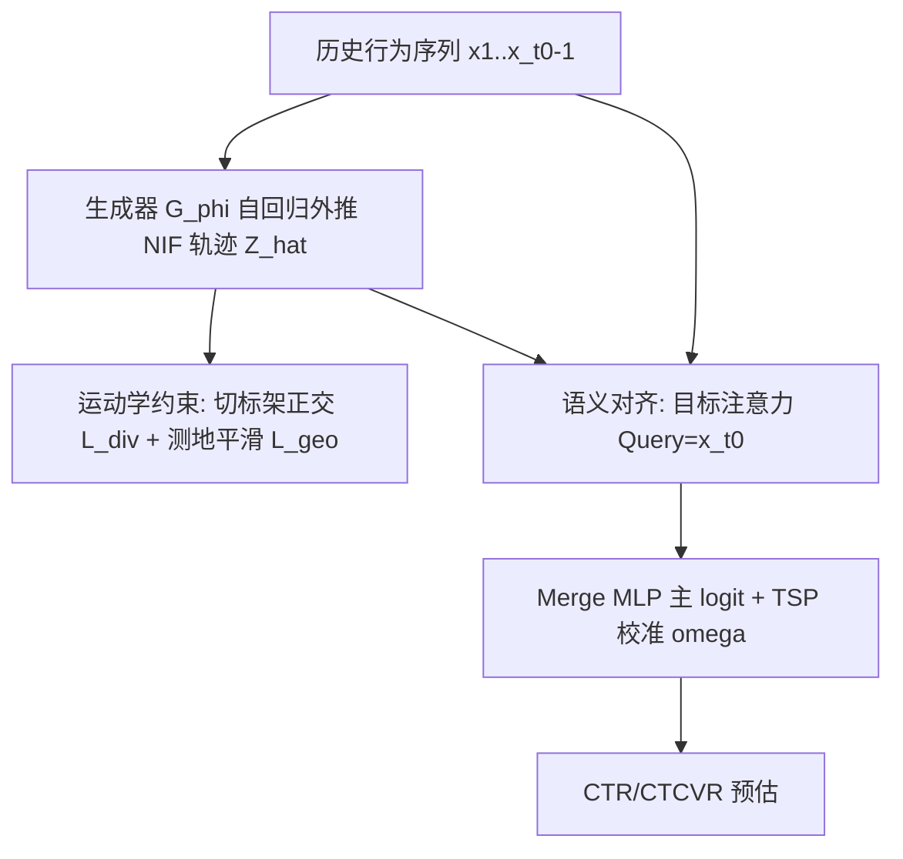
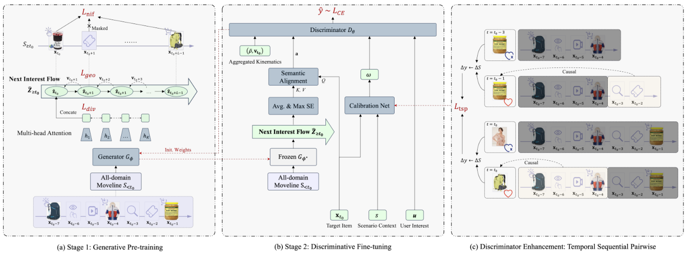

# Next Interest Flow: A Generative Pre-training Paradigm for Recommender Systems by Modeling All-domain Movelines (下一兴趣流：建模全领域运动线的推荐系统生成式预训练范式)

- **会议/期刊**: SIGIR 2026
- **作者与机构**: Chen Gao, Zixin Zhao, Lv Shao, Tong Liu（阿里巴巴集团 / 淘宝）
- **推荐链路定位**: 精排（生成式预训练 + 判别式微调两阶段）
- **研究方向**: 生成式推荐与离散语义ID / CTR预估与特征交叉
- **论文原文**: [https://arxiv.org/abs/2510.11317v2](https://arxiv.org/abs/2510.11317v2)
- **开源代码**: 暂未开源

## TL;DR (1分钟核心速览)

判别式 CTR 模型只在候选子空间内优化局部决策边界，无法刻画全领域用户运动线的全局联合分布；而 P5/TIGER 等离散生成式方法把细粒度电商信号量化成语言/ID token，造成"离散化信息坍缩"，丢失兴趣轨迹的拓扑保真度。本文提出 Next Interest Flow (NIF)：把用户意图视为高维隐兴趣流形上的连续演化轨迹，用切空间正交约束保证兴趣多样性、测地正则保证演化平滑，再以双向对齐 + 时序成对 (TSP) 机制桥接生成预训练与判别精排。在 6.7B 条淘宝工业数据上 AUC 相对生产基线 MEDN 提升 +0.87pt，线上 Feeds 场景 CTCVR +11.6%、GMV +11.24%。

## Background & Motivation (背景与核心矛盾)

- **主流范式**: 工业 CTR 长期由 Wide&Deep、DIN、SIM 等判别式模型主导，在推荐漏斗限定的样本空间内学习超平面划分，优化边际决策边界。
- **前人局限**: ①判别式模型无法重建全领域运动线的联合概率分布，也捕捉不到兴趣演化的长程结构依赖；②LLM/ID 类生成式方法（P5、TIGER）经非双射量化把连续信号映射为离散 token，牺牲轨迹拓扑信息，且推理吞吐极低（单 A100 日约 60K 样本）。
- **核心洞察 (Key Insight)**: 用户兴趣空间本质是一个光滑黎曼子流形 $\mathcal{M}\subset\mathbb{R}^D$，行为序列只是其上的离散采样点；直接在连续嵌入空间外推"流"，可同时保留拓扑结构与全局 Next-Item 连通性，为长尾与营销不敏感用户提供流形动力学先验。
- **本文切入点**: 用微分几何的运动学约束（切标架正交 + 测地平滑）治理连续流，再用双向对齐与 TSP 消除生成/判别目标错配。

## Method (核心方法设计)

### 1. 整体框架 (Overall Architecture)

AMEN 分两阶段闭环：阶段一，Transformer 解码器 $\mathcal{G}_\phi$以"历史真值 + 已生成流状态"的混合输入自回归外推未来$L$步隐流状态$\hat{\mathbf{Z}}\in\mathbb{R}^{L\times D}$，并以 InfoNCE 对齐真实未来观测，同时施加切空间正交与测地平滑两项运动学正则；阶段二，冻结生成器，用目标注意力把轨迹投影到候选物品的局部决策上下文，与用户历史兴趣、聚合运动学量（多样性得分$\bar{\rho}$、速度$\mathbf{v}_{t_0}$）经 merge MLP 输出主 logit，再由 TSP 校准分数$\omega$ 修正。生成器与判别器独立部署，线上仅增 1~2 ms 延迟。

<figure class="paper-figure" markdown="span">
  <figcaption>图1：全领域运动线演化网络（AMEN）的整体架构。(a) 阶段1：生成式预训练。(b) 阶段2：判别式微调。(c) 判别器增强：时间序列成对（TSP）任务。</figcaption>
</figure>

### 2. 关键设计拆解 (Key Designs)

1. **Next Interest Flow 连续轨迹生成**：痛点是把推荐当"孤立量化端点预测"导致拓扑坍缩 $\to$改为在连续嵌入空间自回归外推，输入为$\hat{\mathbf{z}}_t=\mathcal{G}_\phi(\mathbf{x}_1,\dots,\mathbf{x}_{t_0-1},\hat{\mathbf{z}}_{t_0},\dots,\hat{\mathbf{z}}_{t-1})$，预训练目标为$\mathcal{L}_{\text{nif}}=-\sum_{t}\log\frac{\exp(\langle\hat{\mathbf{z}}_t,\mathbf{x}_t\rangle/\tau)}{\sum_{\mathbf{x}'\in\{\mathbf{x}_t\}\cup\mathcal{N}_t}\exp(\langle\hat{\mathbf{z}}_t,\mathbf{x}'\rangle/\tau)}$。混合输入让模型既锚定真实历史、又凭自身预测动量外推，避免离散 token 的非双射信息损失。

2. **运动学约束（多样性 + 平滑）**：将 $K$个注意力头输出视为切空间$T_{\gamma(t)}\mathcal{M}$的局部标架$\mathbf{W}_t\in\mathbb{R}^{K\times D_k}$，由 Hadamard 不等式，表示体积$\mathrm{Vol}(\mathbf{W}_t)=\sqrt{\det(\mathbf{W}_t\mathbf{W}_t^\top)}$在$\mathbf{W}_t\mathbf{W}_t^\top=\mathbf{I}_K$时最大，故用 Frobenius 松弛$\mathcal{L}_{\text{div}}=\sum_t\|\mathbf{W}_t\mathbf{W}_t^\top-\mathbf{I}_K\|_F^2$逼近似正交标架，防止子空间坍缩；平滑性由 Holladay 定理导出——自然三次样条最小化弯曲能量，离散化为二阶差分$\mathcal{L}_{\text{geo}}=\|\boldsymbol{\Delta}^2\hat{\mathbf{Z}}\|_F^2$，抑制随机噪声与不稳定加速度。阶段一总损失$\mathcal{L}_{\text{stage1}}=\mathcal{L}_{\text{nif}}+\alpha\mathcal{L}_{\text{div}}+\beta\mathcal{L}_{\text{geo}}$。

3. **双向对齐与 TSP 时序因果**：生成预训练建模分布、判别微调做点式分类，存在目标错配 $\to$跨阶段权重初始化同步语义原点，目标注意力$\mathbf{a}=\mathrm{Attention}(\text{Query}=\mathbf{x}_{t_0},\text{Key}=\hat{\mathbf{Z}},\text{Value}=\hat{\mathbf{Z}})$动态投影轨迹；TSP 在同一运动线$L$窗口内取异标签 diff 样本，施加 BPR 式$\mathcal{L}_{\text{tsp}}=-\frac{1}{|\mathcal{P}|}\sum\log\sigma(\ell_{t_1}(\omega_1-\omega_0))$，最终$\mathcal{L}_{\text{stage2}}=\mathcal{L}_{\text{CE}}+\lambda\mathcal{L}_{\text{tsp}}$。负采样为 InfoNCE 内 batch/集合负样本，无需额外难负挖掘；推理侧生成器与判别器解耦，12,800 核 CPU 集群日处理 1 亿样本。

## Experimental Setup & Evaluation Protocol (实验设置与评估协议)

- **数据集与预处理**: 淘宝工业全领域运动线数据，训练 6.7B 条（180.7M 用户、21.9M 物品），测试 0.6B 条（23.2M 用户、7.7M 物品）。

| 数据集 | #Users | #Items | #Interactions | 稀疏度/密度 | 特征/场景说明 |
| :--- | :---: | :---: | :---: | :---: | :--- |
| Taobao Train | 180.7M | 21.9M | 6.7B | 极稀疏 | 全领域运动线，含 Feeds/Floor 多场景 |
| Taobao Test | 23.2M | 7.7M | 0.6B | 极稀疏 | 同分布留出测试 |

- **数据划分与防穿越 (Splitting Strategy)**: 工业级按时间留出划分（训练/测试实例分离），测试集 0.6B 条独立采样，避免未来信息穿越。
- **排名评测协议 (Ranking Protocol)**: 以 AUC 为主指标，在 0.6B 全量测试实例上评估（近似全库打分），非采样排序；线上以 CTCVR/CTR/GMV 多日分层 A/B 验证。
- **对比基线与超参设置**: 判别式 Wide&Deep、DIN、MEDN（SIM 变体 + 上下文侧信息，生产基线）；生成式 P5、TIGER。最优超参 $\tau=0.1,\alpha=0.05,\beta=0.01,\lambda=0.1$，预测窗口$L=48$，头数$K=16$；因样本量达 0.6B，$p\ll0.001$ 平凡成立，作者转而强调实际业务显著性。

## Key Experimental Results (实验关键数据)

### 1. 主实验对比 (Main Results)

| 类别 | 模型 | AUC | ΔAUC (vs. MEDN) |
| :--- | :--- | :---: | :---: |
| 判别式 | Wide&Deep | 0.7216 | -4.05pt |
| 判别式 | DIN | 0.7410 | -2.11pt |
| 生成式 | P5 | 0.7565 | -0.56pt |
| 判别式 | MEDN (生产基线) | 0.7621 | - |
| 生成式 | TIGER | 0.7638 | +0.17pt |
| **本文** | **AMEN (Full)** | **0.7708** | **+0.87pt** |

线上 A/B（淘宝大促期间）：Feeds 场景仅判别增强（TSP+对齐，w/o NIF）即带来 CTCVR **+11.6%**；叠加完整 NIF 后再获 CTCVR **+2.28%**、CTR **+0.98%**、GMV **+11.24%**；Floor 场景 w/o NIF 相对 MEDN 获 CTCVR +4.2%、CTR +20.6%、GMV +20.1%。

### 2. 消融实验 (Ablation Study)

| 配置 | AUC | ΔAUC (vs. MEDN) | 相对 Full 掉点 |
| :--- | :---: | :---: | :---: |
| AMEN (Full) | **0.7708** | +0.87pt | - |
| w/o NIF | 0.7694 | +0.73pt | -0.14pt |
| w/o TSP | 0.7683 | +0.62pt | -0.25pt |
| w/o Semantic Alignment | 0.7702 | +0.81pt | -0.06pt |
| w/o Weight Initialization | 0.7698 | +0.77pt | -0.10pt |
| w/o $\mathcal{L}_{\text{div}}$ | 0.7697 | +0.76pt | -0.11pt |
| w/o $\mathcal{L}_{\text{geo}}$ | 0.7699 | +0.78pt | -0.09pt |

### 3. 关键实验发现 (Key Findings)

1. **连续流显著优于离散生成**：AMEN 比 TIGER 高 0.70pt、比 P5 高 1.43pt，直接验证"隐流形连续外推"优于"量化符号预测"，离散化信息坍缩是生成式推荐的真实瓶颈。
2. **NIF 与 TSP 是主驱动，几何正则做精修**：移除 NIF 掉 0.14pt、移除 TSP 掉 0.25pt（TSP 贡献最大），而 $\mathcal{L}_{\text{div}}/\mathcal{L}_{\text{geo}}$各掉约 0.1pt；但探针实验显示$\mathcal{L}_{\text{geo}}$使速度范数分布标准差从 0.69 收敛到 0.21，$\mathcal{L}_{\text{div}}$使标架 Gram 偏离度$\|\mathbf{G}-\mathbf{I}\|_F^2=0.89$，移除后冗余相关性激增 3.4 倍并引发子空间坍缩——几何约束的价值在表征质量而非直接 AUC。
3. **判别增强与生成先验可叠加**：线上仅 TSP+对齐已带来 +11.6% CTCVR，完整 NIF 再叠加 +2.28% CTCVR 与 +11.24% GMV，说明生成式全局先验与判别式局部校准互补而非替代，且工程上仅 +1~2 ms 延迟即可落地。

## Highlights & Limitations (亮点、对比与审稿批判)

- **与代表作对比 (vs. Prior Work)**: 相比 TIGER/P5 的离散语义 ID 自回归，本文在连续嵌入空间建模流，保留轨迹拓扑且吞吐高 3 个数量级；相比 DIN/SIM 的局部候选注意力，本文引入全领域运动线的全局演化先验；相比 CL4Rec/CoSeRec 的增广对比学习，TSP 不做表征增广而是校准时序错位、注入因果方向，二者概念正交。
- **可迁移亮点**: ①"切标架正交 = 多头表示去冗余"的 Frobenius 松弛可直接移植到任意多头注意力推荐模型做多样性正则；②二阶差分平滑正则可作为序列推荐轨迹的通用去噪项，几乎零额外推理成本。
- **审稿级局限批判**: ①实验仅限淘宝单一工业数据集，缺乏 Amazon/公开基准的可复现对比，且代码未开源，学术可验证性弱；②$L=48$、$K=16$等超参在 6.7B 规模下调优，小数据场景下$\alpha,\beta,\lambda$ 敏感度与流形假设是否成立未讨论；③AUC 提升 0.87pt 虽在工业上显著，但相对 TIGER 仅 +0.70pt，方法增益部分来自工程特征与两阶段管线而非纯几何创新。

## Rating (四维评分)

- **方法创新性 (Novelty)**: ⭐⭐⭐⭐ （以黎曼流形 + 运动学约束重构生成式推荐，切标架正交与测地正则均有命题与证明支撑，视角新颖）
- **评估协议与实验扎实度 (Protocol & Experiments)**: ⭐⭐⭐ （6.7B 工业数据与线上 A/B 极具说服力，但缺公开数据集复现、无采样排序对照、消融幅度偏小）
- **写作与数学规范度 (Clarity & Rigor)**: ⭐⭐⭐⭐ （两个 Proposition 证明简洁、符号统一，但部分记号如 $K\le D_k$ 表述含混、TSP 校准网络细节略欠）
- **工业落地与复现价值 (Industrial & Practical Value)**: ⭐⭐⭐⭐ （仅 +1~2 ms 延迟、CPU 集群日处理亿级样本，落地价值极高；但未开源削弱复现性）
