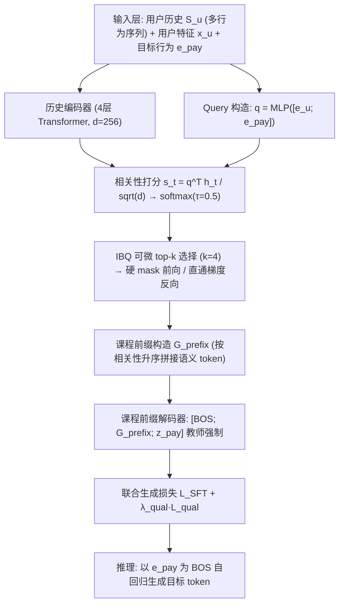
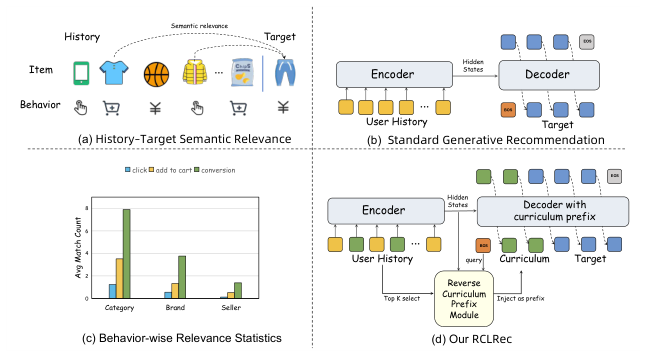
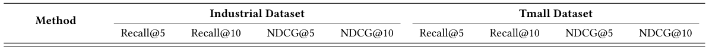
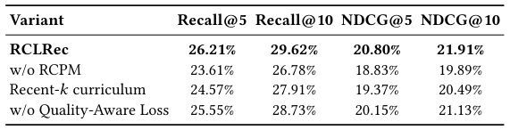
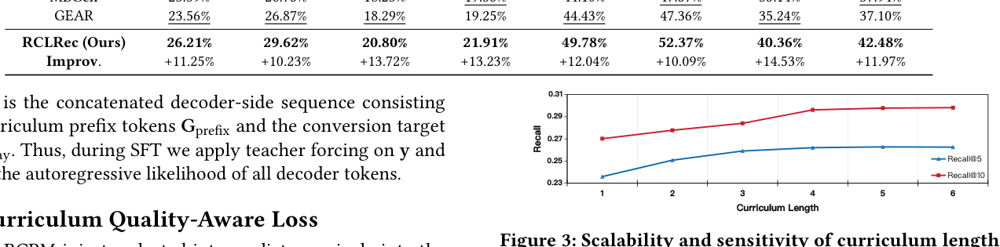

# RCLRec: Reverse Curriculum Learning for Modeling Sparse Conversions in Generative Recommendation (面向稀疏转化建模的逆向课程学习生成式推荐)

- **会议/期刊**: SIGIR 2026
- **推荐链路定位**: 端到端生成式 (End-to-End Generative) — 语义 ID 自回归生成式召回/检索
- **研究方向**: 生成式推荐与离散语义 ID (主) / 序列与会话推荐 (次)
- **论文原文**: [https://arxiv.org/abs/2603.28124v1](https://arxiv.org/abs/2603.28124v1)
- **开源代码**: 暂未开源（原文与预提取均未发现开源代码链接）

## TL;DR (核心速览)

针对大规模推荐中转化 (conversion) 目标极度稀疏、现有行为感知生成式推荐 (GR) 仅靠全历史标准注意力隐式挖掘关键行为、缺乏转化专属监督的痛点，本文提出 RCLRec：以 pay 条件化 query 从历史中逆向选取 top-$k$ 关键交互，将其语义 token 作为解码器前缀与目标转化 token 联合生成，并辅以课程质量感知 hinge 损失保证前缀有效性。在工业广告数据集与 Tmall 上，Recall@5 相对次优基线提升 +11.25% / +12.04%，线上 A/B 广告收入 +2.09%、订单 +1.86%。

## Background & Motivation (背景与动机)

- **领域背景与主流范式**: 基于语义 token 的生成式推荐 (TIGER 系) 将用户多类型行为 (曝光/点击/加购/购买) 组织为统一物品序列，用向量量化得到的共享离散语义 token 表示物品，通过编码器-解码器自回归生成目标物品 token 序列，在召回阶段取得强性能。近期行为感知 GR (MBGen、GEAR) 进一步在编码器注入行为类型、在解码器使用行为感知注意力。
- **现有方法局限 (Limitations of Prior Work)**:
  1. **行为分布极度不均衡**：转化行为远少于曝光与点击（工业数据集转化仅占 1.23%，Tmall 仅 0.95%），但转化直接决定收入与订单等核心业务指标。
  2. **缺乏转化专属监督**：行为感知 GR 仍依赖对**全历史**的标准 cross-attention 隐式发现有用中间行为，没有为转化目标提供任何额外监督信号，稀疏转化模式仍从极少数事件中学习。
  3. **关键信号被淹没**：真正决定购买的关键决策子序列埋在大量无关行为中，模型难以系统性识别与显式建模。
- **核心挑战 (Key Challenge)**: 简单增加行为类型编码或加深注意力无法解决——因为问题本质是**监督信号密度不足**而非表征容量不足；同时用户历史噪声大、异质性强，难以设计可靠的多阶段难度调度课程。
- **核心洞察与切入点 (Key Insight)**: 作者的经验观察（图 1(c)）表明，转化事件之前通常存在一个**语义连贯的相关物品簇**（如同类目），反映更聚焦的决策过程。因此对每个转化目标，历史中一小部分行为构成关键决策子序列，可作为稀疏转化目标的**集中监督来源**。据此借鉴稀疏奖励强化学习中的逆向课程思想，但放弃多阶段调度，改为**一次性 (one-shot) 解码器侧课程前缀**。

## Problem Formulation & Method (问题定义与方法架构)

### 1. 符号定义与输入表征 (Notations & Input Representations)

- 用户集 $\mathcal{U}$、物品集 $\mathcal{I}$、行为类型集 $\mathcal{B}=\{\text{clk},\text{atc},\dots,\text{pay}\}$。
- 用户 $u$ 的时序交互历史 $S_u=\{(b_1,i_1),\dots,(b_T,i_T)\}$，$b_t\in\mathcal{B}$，$i_t\in\mathcal{I}$，$T$ 为序列长度。
- 离散语义映射 $\phi:\mathcal{I}\to\{V^\ell\}_{\ell=1}^{L}$，每个物品映射为长度 $L=4$ 的 token 序列 $z_i=[z_i^1,\dots,z_i^L]$。
- 行为嵌入矩阵 $E\in\mathbb{R}^{|\mathcal{B}|\times d}$，$e_b\in E$ 作为行为条件 BOS 控制 token（如 $e_{\text{pay}}$）。
- 用户特征向量 $x_u\in\mathbb{R}^{d_x}$，经 $e_u=W_u x_u\in\mathbb{R}^{d}$ 投影到模型维度。
- 输入：历史 $S_u$ + 目标行为 $b$；输出：目标物品 token 序列 $z_{T+1}=\phi(i_{T+1})$。

### 2. 整体流水线 (Overall Architecture)

两阶段训练：(i) 在混合多行为数据上用标准 NLL（式 1）**预训练**编码器-解码器 GR 骨干，学习通用物品语义表征与行为嵌入（含 $e_{\text{pay}}$）；(ii) 仅在**转化样本**上做 SFT，联合优化 SFT 目标、RCPM 与课程质量感知损失。推理时以 $e_{\text{pay}}$ 为 BOS 自回归生成目标转化物品 token。

图 1 展示了 (a) 多行为历史-目标语义相关性、(b) 标准 GR、(c) 行为级相关性统计（转化前存在更连贯的相关物品簇）、(d) 本文 RCLRec 的核心差异。图 2 给出 RCLRec 整体架构：RCPM 选取转化相关交互作为解码器前缀，并以课程质量感知损失训练。

<figure class="paper-figure" markdown="span">
  <figcaption>图 1</figcaption>
</figure>

<figure class="paper-figure" markdown="span">
  <figcaption>图 2</figcaption>
</figure>

### 3. 核心模块设计与数学原理 (Key Designs & Formulations)

**(1) 逆向课程前缀模块 RCPM（Reverse Curriculum Prefix Module）**

- **pay 条件化 Query 构造**：将用户特征投影 $e_u=W_u x_u$ 与预训练得到的转化行为嵌入 $e_{\text{pay}}$ 拼接，经轻量 MLP 得到查询：
$$q=\mathrm{MLP}\big([e_u;\,e_{\text{pay}}]\big)\in\mathbb{R}^{d}$$
物理直觉：以“转化意图”为锚点，使后续打分偏向与购买决策相关的历史交互，而非泛化的用户兴趣。
- **相关性打分与分布归一化**：对编码器上下文状态 $H_u=[h_1,\dots,h_T]$ 做缩放内积并 softmax：
$$s_t=\frac{q^\top h_t}{\sqrt{d}},\qquad p_t=\frac{\exp(s_t/\tau)}{\sum_{j=1}^{T}\exp(s_j/\tau)}$$
其中 $\tau=0.5$ 为温度超参，$p=[p_1,\dots,p_T]$ 表示各历史行为的转化感知相关性。
- **top-$k$ 选择与前缀构造**：$\mathcal{K}=\mathrm{argmax}(p,k)$，$|\mathcal{K}|=k=4$。将选中物品的语义 token 序列按**相关性升序**拼接：
$$G_{\text{prefix}}=\big[\phi(i_{t_1});\dots;\phi(i_{t_k})\big]=\big[z_{i_{t_1}}^1,\dots,z_{i_{t_1}}^L,\dots,z_{i_{t_k}}^1,\dots,z_{i_{t_k}}^L\big]$$
其中 $p_{t_1}\le p_{t_2}\le\dots\le p_{t_k}$。**升序排列的物理直觉**：最相关的物品排在最后、最靠近目标 token，从而对转化预测形成更强条件约束（类似把最关键证据放在离答案最近的位置）。
- **解码器输入**：$[\text{[BOS]};\,G_{\text{prefix}};\,z_{\text{pay}}]$，SFT 阶段对拼接序列做教师强制。

**(2) 基于 IBQ 的端到端可微课程优化**

top-$k$ 不可微，作者引入 Index Backpropagation Quantization (IBQ) 的直通估计：前向用硬 $k$-hot 掩码 $m^{\text{hard}}_t=\mathbb{I}(t\in\mathcal{K})$；反向用连续代理掩码
$$m=m^{\text{hard}}-\mathrm{sg}[p]+p$$
其中 $\mathrm{sg}[\cdot]$ 为 stop-gradient。前向 $m$ 与硬掩码完全一致（前缀不变），反向梯度经 $p$ 回传，从而端到端优化选择分布。课程增强 SFT 损失为：
$$\mathcal{L}_{\text{SFT}}=-\sum_{\ell=1}^{|G_{\text{prefix}}|+L}\log p_\theta\big(y^\ell\mid S_u,e_{\text{pay}},y^{<\ell}\big),\quad y=[G_{\text{prefix}};z_{\text{pay}}]$$

**(3) 课程质量感知损失（Curriculum Quality-Aware Loss）**

仅注入前缀可能只提升预测置信度而非真实转化性能。作者将“课程质量”定义为前缀带来的转化 token 似然增益。固定预训练参数 $\theta_0$ 作为无课程基线：
$$\mathcal{L}^{\text{pay}}_{\text{curr}}(\theta)=-\frac{1}{L}\sum_{\ell=1}^{L}\log p_\theta\big(z^\ell_{\text{pay}}\mid S_u,e_{\text{pay}},G_{\text{prefix}},z^{<\ell}_{\text{pay}}\big)$$
$$\mathcal{L}^{\text{pay}}_{\text{base}}(\theta_0)=-\frac{1}{L}\sum_{\ell=1}^{L}\log p_{\theta_0}\big(z^\ell_{\text{pay}}\mid S_u,e_{\text{pay}},z^{<\ell}_{\text{pay}}\big)$$
$$\mathcal{L}_{\text{qual}}=\max\Big(0,\;m-\big(\mathcal{L}^{\text{pay}}_{\text{base}}-\mathcal{L}^{\text{pay}}_{\text{curr}}\big)\Big)$$
即要求带课程前缀的 NLL 至少比无课程基线低一个 margin $m$，否则施加 hinge 惩罚，从而驱动 RCPM 选出**真正有益于转化预测**的子序列。

### 4. 训练目标、负采样与推理复杂度 (Optimization, Negative Sampling & Complexity)

- **总损失**:
$$\mathcal{L}_{\text{total}}=\mathcal{L}_{\text{SFT}}+\lambda_{\text{qual}}\,\mathcal{L}_{\text{qual}}$$
超参：$\lambda_{\text{qual}}=0.1$，margin $m\ge 0$（原文未报告 $m$ 的具体取值），温度 $\tau=0.5$，课程长度 $k=4$。
- **训练负采样策略**: 生成式框架下**免负采样**——采用自回归 NLL / 教师强制逐 token 交叉熵，不使用 BPR/InfoNCE 负例。预训练阶段用混合多行为数据，SFT 阶段仅用转化样本。
- **时间与空间复杂度**:
  - 离线预处理：需先训练语义 ID 量化器（RQ-VAE/VQ 类，原文未报告具体码本层数与大小，仅说明每物品 $L=4$ 个 token）与预训练骨干。
  - 训练：RCPM 仅增加一次 query MLP 与 $O(Td)$ 的打分，以及一次 top-$k$；课程质量损失需额外一次无课程前向（固定 $\theta_0$），约增加一次前向开销。
  - 推理：与标准 GR 相同，以 $e_{\text{pay}}$ 为 BOS 自回归生成 $L=4$ 个 token，可用 Beam Search / 前缀树约束解码；RCPM 仅在训练期构造前缀，**推理期不增加额外开销**（原文未报告具体 ms/request 延迟与峰值显存）。

## Experimental Setup & Evaluation Protocol (实验设置与评估协议)

- **数据集统计与预处理**:

| 数据集 (Dataset) | 用户数 (#Users) | 物品数 (#Items) | 交互数 (#Interactions) | 稀疏度/密度 (Sparsity) | 模态/辅助特征说明 |
| :--- | :---: | :---: | :---: | :---: | :--- |
| Industrial (亚洲电商广告，自建) | 原文未报告 | 原文未报告 | > 1B | 转化占比 1.23% | 3 种行为类型；用户画像特征 |
| Tmall [27] | 原文未报告 | 原文未报告 | 原文未报告 | 转化占比 0.95% | 4 种行为类型；采用通用预处理与用户采样 |

> 注：原文仅报告交互总量与转化占比，未给出用户数、物品数及 5-core/10-core 等过滤细节。

- **数据划分方式 (Splitting Strategy)**: 原文未明确说明划分策略（未报告 LOO / Ratio / Global Temporal Split 的具体选择），仅说明所有基线在**相同数据划分**上训练以保证公平。**审稿视角**：未披露时序切分方式，存在潜在未来信息泄露风险，需作者补充。
- **排名评测协议 (Ranking Protocol)**: 原文未明确标注 Full-Ranking 还是 Sampled Ranking，仅说明在**转化目标集**上报告 Recall@5/10 与 NDCG@5/10。**审稿视角**：这是评估协议的关键缺口，若为采样排序则指标偏乐观。
- **评价指标与显著性检验**: Recall@5、Recall@10、NDCG@5、NDCG@10；Embedding 维度 $d=256$，4 层 Transformer 编码器 + 2 层解码器，8 头注意力，每物品 $L=4$ 语义 token。**原文未报告**多随机种子方差与配对显著性检验（$t$-test / Wilcoxon）。

## Key Experimental Results (核心实验结果)

### 1. 主实验对比 (Main Results)

<figure class="paper-figure" markdown="span">
  <figcaption>表 1</figcaption>
</figure>

表 1 主实验结果（转化目标集）：

| 数据集 | 指标 | 传统序列基线 (SASRec/BERT4Rec) | 行为感知 GR 最强基线 (MBGen/GEAR) | 本文方法 (Ours) | 相对提升 (Improv.) |
| :--- | :--- | :---: | :---: | :---: | :---: |
| Industrial | Recall@5 | 18.67% / 18.32% | 23.39% (MBGen) | **26.21%** | +11.25% |
| Industrial | Recall@10 | 21.25% / 21.68% | 26.87% (GEAR) | **29.62%** | +10.23% |
| Industrial | NDCG@5 | 14.49% / 14.41% | 18.29% (GEAR) | **20.80%** | +13.72% |
| Industrial | NDCG@10 | 16.22% / 16.34% | 19.35% (MBGen) | **21.91%** | +13.23% |
| Tmall | Recall@5 | 39.36% / 40.47% | 44.43% (GEAR) | **49.78%** | +12.04% |
| Tmall | Recall@10 | 44.79% / 45.18% | 47.57% (MBGen) | **52.37%** | +10.09% |
| Tmall | NDCG@5 | 30.66% / 31.39% | 35.24% (GEAR) | **40.36%** | +14.53% |
| Tmall | NDCG@10 | 32.72% / 33.25% | 37.94% (MBGen) | **42.48%** | +11.97% |

关键观察：(1) RCLRec 在全部 8 个指标上最优；(2) 传统序列模型 (SASRec/BERT4Rec) 明显落后，说明稀疏监督下难以利用转化相关信号；(3) 相较行为感知 GR (MBGen/GEAR)，RCLRec 通过显式构造转化相关前缀并在 SFT 中引导其有效性，取得更一致的增益。注意 MBGen 与 GEAR 互有胜负（如 Industrial NDCG@5 GEAR 18.29% > MBGen 18.23%，而 NDCG@10 MBGen 19.35% > GEAR 19.25%），说明次优基线并非单一模型。

### 2. 消融实验与控制变量分析 (Ablation Study)

<figure class="paper-figure" markdown="span">
  <figcaption>表 2</figcaption>
</figure>

表 2 工业数据集消融结果：

| 变体 | Recall@5 | Recall@10 | NDCG@5 | NDCG@10 |
| :--- | :---: | :---: | :---: | :---: |
| RCLRec | **26.21%** | **29.62%** | **20.80%** | **21.91%** |
| w/o RCPM | 23.61% | 26.78% | 18.83% | 19.89% |
| Recent-$k$ curriculum | 24.57% | 27.91% | 19.37% | 20.49% |
| w/o Quality-Aware Loss | 25.55% | 28.73% | 20.15% | 21.13% |

- **移除 RCPM 贡献最大**：Recall@5 从 26.21% 降至 23.61%（-2.60 pt），说明显式构造转化导向课程是核心增益来源。
- **Recent-$k$ 对照**：简单取最近 $k$ 个交互（24.57%）显著弱于 RCPM（26.21%），证明增益来自**转化导向选择**而非近因性 (recency)。
- **移除课程质量感知损失**：Recall@5 降至 25.55%（-0.66 pt），说明该正则提升了课程有用性与目标相关性。
- **审稿视角**：消融未报告参数量对齐或图拓扑度数匹配等控制变量；w/o RCPM 变体是否与基线骨干完全同参未说明。

### 3. 稀疏度/冷启动分桶与超参敏感度 (Sparsity Buckets & Hyperparameters)

- **课程长度 $k$ 敏感度**（图 3，工业数据集，$k\in\{1,\dots,6\}$）：$k\approx 4$ 时 Recall@5/10 显著优于更短前缀；继续增大 $k$ 仅带来边际增益，说明少量精选交互已捕获大部分转化相关上下文，更长前缀主要引入噪声。这为 $k=4$ 的默认设置提供了依据。

<figure class="paper-figure" markdown="span">
  <figcaption>图 3</figcaption>
</figure>

- **用户/物品交互频次分桶表现**: 原文未报告长尾/冷启动分桶实验。
- **其他超参敏感度**: 原文仅报告 $k$ 的敏感度；$\tau=0.5$、$\lambda_{\text{qual}}=0.1$、margin $m$ 的敏感度分析**原文未报告**。
- **线上 A/B 测试结果**: 2026 年 1 月 20 日至 1 月 27 日，在工业电商广告平台进行，基线为 TIGER，每桶随机采样 25% 用户。RCLRec 带来**广告收入 +2.09%、订单 +1.86%**。原文未报告 CTR/CVR/GMV/留存率等其他线上指标，也未报告实验周期内的统计显著性。

## Highlights, Limitations & Critiques (亮点、局限与审稿级批判)

- **核心亮点与可迁移性**:
  1. **逆向课程前缀**是一种通用的“稀疏目标增密监督”范式：将长历史中与目标最相关的子序列显式提取为解码器前缀，可迁移到加购、复购、订阅等任意稀疏目标行为，也可迁移到非生成式的序列推荐（作为辅助监督）。
  2. **IBQ 直通估计**优雅地解决了 top-$k$ 离散选择的不可微问题，前向保持硬选择、反向经分布回传，工程上易实现且不改变推理路径。
  3. **课程质量感知 hinge 损失**提供了“前缀是否有用”的显式判据，避免模型仅提升置信度而不提升真实转化，这一思路可推广到任何“辅助上下文注入”场景。
  4. **推理零额外开销**：RCPM 仅在训练期生效，线上部署成本与标准 GR 一致，工业落地友好。
- **局限性与审稿视角
