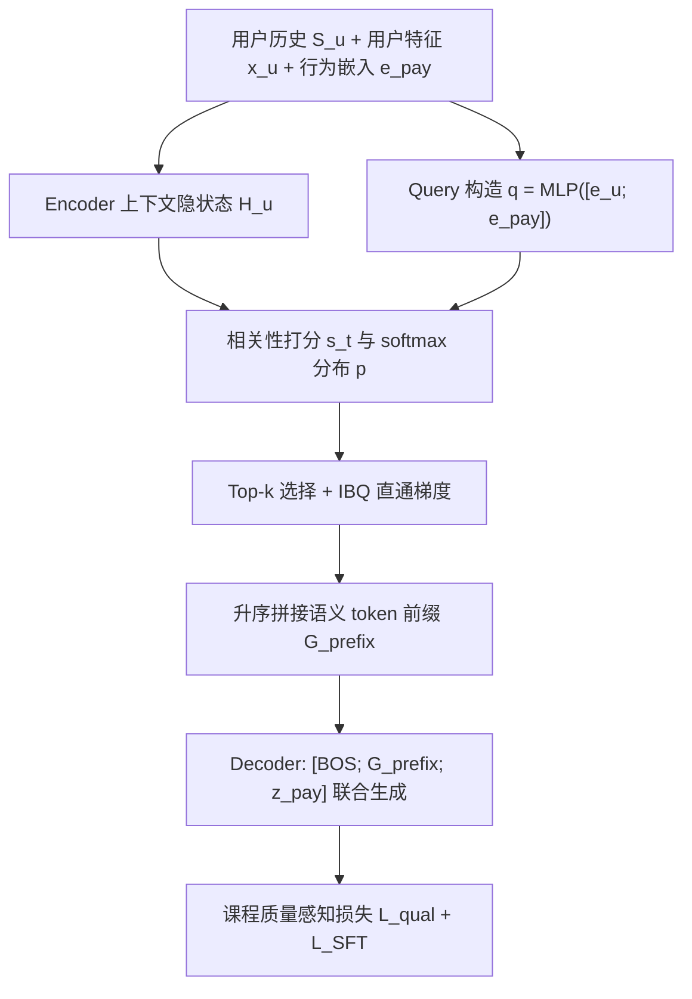
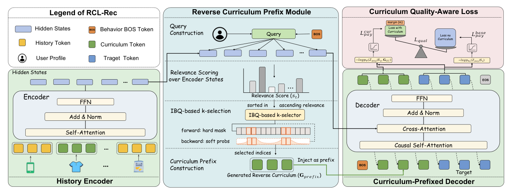

# RCLRec: Reverse Curriculum Learning for Modeling Sparse Conversions in Generative Recommendation (面向稀疏转化建模的逆向课程生成式推荐)

- **会议/期刊**: SIGIR 2026
- **作者与机构**: Yulei Huang, Hao Deng, Haibo Xing, Jinxin Hu, Chuanfei Xu, Zulong Chen, Yu Zhang, Xiaoyi Zeng（阿里巴巴国际数字商业集团 / 之江实验室 AI）
- **推荐链路定位**: 召回（生成式端到端检索）
- **研究方向**: 生成式推荐与离散语义 ID / 序列推荐
- **论文原文**: [https://arxiv.org/abs/2603.28124v1](https://arxiv.org/abs/2603.28124v1)
- **开源代码**: 暂未开源

## TL;DR (1分钟核心速览)

大规模推荐中转化（pay）行为极度稀疏（工业数据仅 1.23%、Tmall 仅 0.95%），现有行为感知 GR 仍靠全历史标准注意力隐式挖掘决策信号，且对转化目标**无任何额外监督**。RCLRec 提出逆向课程前缀模块（RCPM）：以 pay 条件化 query 从历史中反向选出 top-$k$ 个转化相关交互，将其语义 token 作为解码器前缀与目标 token 联合生成，从而为每个转化样本构造实例级中间监督；再用课程质量感知 hinge 损失保证前缀真正降低转化 NLL。在工业与 Tmall 两数据集上，Recall@5 相对次优提升 +11.25% / +12.04%，线上 A/B 广告收入 +2.09%、订单 +1.86%。

## Background & Motivation (背景与核心矛盾)

- **主流范式**: 生成式推荐（TIGER 系）将多类型行为压成统一语义 token 序列共享表征，行为感知 GR（MBGen、GEAR）进一步编码行为类型并用行为感知注意力突出决策相关中间行为。
- **前人局限**: 其一，模型仍对**全历史**做标准 cross-attention，关键决策子序列被大量无关行为淹没，未被显式识别；其二，转化样本极少且**没有任何针对转化目标的额外监督**，稀疏性本质未解。
- **核心洞察 (Key Insight)**: 作者统计发现转化前往往存在一个**语义高度连贯的物品簇**（同品类/同品牌，图 1(c)），即长历史中一小段子序列不成比例地决定了最终购买——这是一个被埋没的"密集监督源"。
- **本文切入点**: 借鉴稀疏奖励 RL 中的逆向课程思想，从转化目标**反向回溯**构造一次性（one-shot）解码器前缀，把"隐式注意力发现"改为"显式前缀注入 + 教师强制"。

## Method (核心方法设计)

### 1. 整体框架 (Overall Architecture)

RCLRec 采用两阶段训练。**阶段一**：在混合多行为数据上用标准 NLL（式 1）预训练 encoder-decoder GR 骨干，学到物品语义 token 与行为嵌入（含 $e_{pay}$）。**阶段二**：仅在转化样本上做 SFT，此时 RCPM 以用户特征$x_u$与$e_{pay}$构造 query，对编码器隐状态打分并 top-$k$选出转化相关交互，按相关性升序拼成前缀$\mathcal{G}_{prefix}$，与目标 token 序列$z_{pay}$拼接后送入解码器做教师强制联合生成；同时以固定参数$\theta_0$ 的无前缀模型为基线计算课程质量损失。推理时仅需一次前向生成目标 token 序列，再经语义 ID 反查候选。

<figure class="paper-figure" markdown="span">
  <figcaption>图2：RCLRec概览。它使用反向课程前缀模块（RCPM）从历史中选择与转化相关的交互作为解码器侧前缀，并使用课程质量感知损失进行训练。</figcaption>
</figure>

### 2. 关键设计拆解 (Key Designs)

1. **逆向课程前缀模块 RCPM（把隐式注意力变显式监督）**：痛点是从全历史学转化信号太稀。做法是用 pay 条件化 query 对编码器状态做缩放内积打分 $s_t = q^{\top}h_t/\sqrt{d}$，softmax 得分布$p_t$，取 top-$k$索引$\mathcal{K}=\mathrm{argmax}(p,k)$，再**按相关性升序**拼接$\mathcal{G}_{prefix}=[\phi(i_{t_1});\dots;\phi(i_{t_k})]$，使最相关物品紧邻目标 token。直觉：升序排列让"最像购买决策的那一步"离目标最近，条件化更强；同时前缀 token 本身参与自回归损失，等于给每个转化样本造了$k\times L$ 个中间监督位。

2. **IBQ 直通梯度实现端到端选择（解决 top-$k$不可导）**：前向用硬$k$-hot 掩码$m^{hard}_t=\mathbb{I}(t\in\mathcal{K})$构造前缀；反向用直通代理$m = m^{hard} - \mathrm{sg}[p] + p$，梯度经$p$ 回传至 query 与编码器。这样选择器与生成器联合优化，而非两阶段割裂的检索式挑选。

3. **课程质量感知损失（保证前缀"有用"而非"自信"）**：仅注入前缀可能只提升置信度而不提升转化预测。定义带/不带前缀的转化 token 平均 NLL 之差，加 hinge 约束：
$$\mathcal{L}_{qual}=\max\left(0,\; m-\left(\mathcal{L}_{pay}^{base}(\theta_0)-\mathcal{L}_{pay}^{curr}(\theta)\right)\right),\quad \mathcal{L}_{total}=\mathcal{L}_{SFT}+\lambda_{qual}\mathcal{L}_{qual}$$
其中 $\theta_0$为冻结的无前缀基线，$m$为 margin。**训练目标与负采样**：$\mathcal{L}_{SFT}$为对$[\mathcal{G}_{prefix};z_{pay}]$全序列的教师强制 NLL，属**免负采样**的 softmax 全词表生成目标；超参$k=4,\tau=0.5,\lambda_{qual}=0.1$，每物品$L=4$ 个语义 token。

## Experimental Setup & Evaluation Protocol (实验设置与评估协议)

- **数据集与预处理**:

| 数据集 | #Users | #Items | #Interactions | 稀疏度/密度 | 特征/场景说明 |
| :--- | :---: | :---: | :---: | :---: | :--- |
| Industrial（亚洲电商广告） | 未披露 | 未披露 | >1B | 转化占比 1.23% | 3 类行为，工业广告场景 |
| Tmall | 未披露 | 未披露 | 未披露 | 转化占比 0.95% | 4 类行为，通用用户采样预处理 |

- **数据划分与防穿越 (Splitting Strategy)**: 采用预训练 + SFT 两阶段流水线，SFT 仅在转化样本上微调；离线评测在**转化目标集**上计算指标（沿用 [22,26] 设定），未采用 Leave-One-Out 全目标划分。
- **排名评测协议 (Ranking Protocol)**: 报告 Recall@5/10 与 NDCG@5/10，属生成式语义 ID 检索下的目标集排序评测（非全库 Full-Ranking 显式声明，亦非采样负例排序）。
- **对比基线与超参设置**: 7 个基线覆盖序列模型（SASRec、BERT4Rec）、行为感知序列模型（PBAT）、工业级 GR（HSTU）、生成式检索（TIGER）与多行为 GR（MBGen、GEAR）；$d=256$、8 头、4 层 Encoder + 2 层 Decoder，$L=4$。

## Key Experimental Results (实验关键数据)

### 1. 主实验对比 (Main Results)

| Method | Industrial R@5 | Industrial R@10 | Industrial N@5 | Industrial N@10 | Tmall R@5 | Tmall R@10 | Tmall N@5 | Tmall N@10 |
| :--- | :---: | :---: | :---: | :---: | :---: | :---: | :---: | :---: |
| SASRec | 18.67 | 21.25 | 14.49 | 16.22 | 39.36 | 44.79 | 30.66 | 32.72 |
| BERT4Rec | 18.32 | 21.68 | 14.41 | 16.34 | 40.47 | 45.18 | 31.39 | 33.25 |
| PBAT | 19.35 | 22.85 | 14.96 | 16.89 | 40.21 | 45.58 | 31.16 | 33.47 |
| HSTU | 20.24 | 24.62 | 15.57 | 17.35 | 40.63 | 45.67 | 31.60 | 33.79 |
| TIGER | 21.40 | 25.23 | 16.28 | 17.56 | 42.61 | 45.92 | 32.96 | 35.47 |
| MBGen | 23.39 | 26.75 | 18.23 | 19.35 | 44.10 | 47.57 | 35.14 | 37.94 |
| GEAR | 23.56 | 26.87 | 18.29 | 19.25 | 44.43 | 47.36 | 35.24 | 37.10 |
| **RCLRec** | **26.21** | **29.62** | **20.80** | **21.91** | **49.78** | **52.37** | **40.36** | **42.48** |
| **Improv.** | +11.25% | +10.23% | +13.72% | +13.23% | +12.04% | +10.09% | +14.53% | +11.97% |

### 2. 消融实验 (Ablation Study)

| Variant | R@5 | R@10 | N@5 | N@10 |
| :--- | :---: | :---: | :---: | :---: |
| RCLRec | **26.21** | **29.62** | **20.80** | **21.91** |
| w/o RCPM | 23.61 | 26.78 | 18.83 | 19.89 |
| Recent-$k$ curriculum | 24.57 | 27.91 | 19.37 | 20.49 |
| w/o Quality-Aware Loss | 25.55 | 28.73 | 20.15 | 21.13 |

### 3. 关键实验发现 (Key Findings)

1. **前缀选择本身贡献最大**：去掉 RCPM 后 R@5 从 26.21% 跌至 23.61%（-2.60pt），几乎回落到 GEAR 水平，说明增益主体来自"显式构造转化相关子序列"，而非骨干或训练流程。
2. **增益来自"转化相关性"而非"近因性"**：Recent-$k$仅取最近$k$ 个交互，R@5 为 24.57%，比 RCPM 低 1.64pt，证明 pay 条件化 query 的语义筛选比时间近邻更有效。
3. **质量感知损失是"精修"而非"主引擎"**：去掉后 R@5 降 0.66pt、N@10 降 0.78pt，幅度小于 RCPM，但方向一致，说明 hinge 约束确实把选择器推向"降低转化 NLL"而非"提升置信度"；此外 $k$的敏感性实验显示$k\approx4$最优，$k>4$ 仅边际增益并引入噪声。

## Highlights & Limitations (亮点、对比与审稿批判)

- **与代表作对比 (vs. Prior Work)**: 相比 TIGER（纯单行为语义 ID 生成，无行为区分），RCLRec 引入行为条件化目标；相比 MBGen / GEAR（行为感知注意力 + 全历史 cross-attention，隐式挖掘中间行为、无转化专属监督），RCLRec 把"隐式发现"改为"显式前缀 + 教师强制"，将一段子序列转化为 $k\times L$ 个额外监督 token，这是本质差异。
- **可迁移亮点**: (1) "逆向构造 one-shot 前缀"可迁移到加购、复购、订阅等任意稀疏目标行为；(2) IBQ 直通梯度让 top-$k$ 硬选择可端到端训练，适用于任何"检索式前缀/提示选择"场景。
- **审稿级局限批判**: (1) 两阶段训练 + 前缀使解码序列变长（$k\times L$额外 token），在线推理延迟与显存开销未量化，且需额外维护冻结基线模型$\theta_0$ 做质量损失；(2) 评测仅在转化目标集上报告 Recall/NDCG，缺少全库 Full-Ranking 与采样排序协议的对照，且数据集统计（用户/物品数）披露不全，复现与公平比较受限。

## Rating (四维评分)

- **方法创新性 (Novelty)**: ⭐⭐⭐⭐ （把稀疏奖励 RL 的逆向课程迁移为解码器前缀监督，思路清晰且与行为感知 GR 形成明确区分，但组件本身多为已有技术的组合）
- **评估协议与实验扎实度 (Protocol & Experiments)**: ⭐⭐⭐⭐ （两数据集 + 7 基线 + 消融 + $k$ 敏感性 + 线上 A/B 齐全，但目标集评测协议与数据统计披露不足）
- **写作与数学规范度 (Clarity & Rigor)**: ⭐⭐⭐⭐ （RCPM 三步流程与 IBQ 直通梯度推导交代清楚，公式紧凑；质量损失中 $\theta_0$ 冻结角色的说明可更显式）
- **工业落地与复现价值 (Industrial & Practical Value)**: ⭐⭐⭐⭐ （十亿级工业数据 + 线上 +2.09% 收入 / +1.86% 订单的实证极具说服力，但未开源且推理开销未披露）
