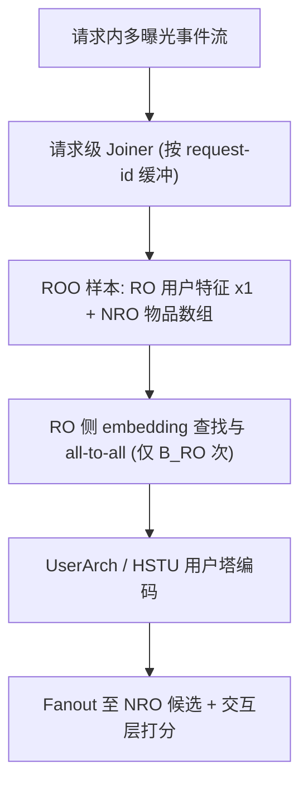
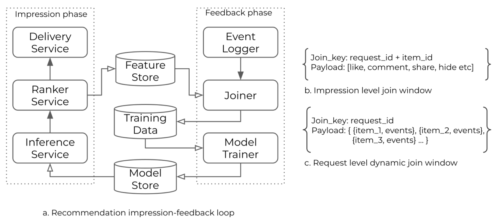

# Request-Only Optimization for Recommendation Systems (面向推荐系统的仅请求级优化)

- **会议/期刊**: SIGIR 2026
- **作者与机构**: Liang Guo, Wei Li, Jiaqi Zhai 等，Meta Platforms, Inc.
- **推荐链路定位**: 召回 / 粗排 / 精排（全链路训练范式）
- **研究方向**: 生成式推荐与离散语义ID / 工业架构与系统
- **论文原文**: [https://arxiv.org/abs/2508.05640v3](https://arxiv.org/abs/2508.05640v3)
- **开源代码**: 暂未开源

## TL;DR (1分钟核心速览)

工业 DLRM 长期以「单次曝光 (impression)」为训练样本单元，同一请求下 4–7 个曝光会重复存储与重复计算完全相同的用户侧长序列特征，成为存储、通信与 GPU 算力的主要浪费源。本文提出 Request-Only Optimization (ROO)：把一次用户请求作为训练样本单元，将特征拆为 RO（请求级，仅一份）与 NRO（曝光级，数组），在数据源头完成原生去重，并配套 UserArch 与 HSTU 序列架构。在 Meta 三个十亿用户产品上，同存储下样本量提升 43%–150%，召回/粗排训练吞吐提升 220%–570%，精排提升 32%–100%；同等算力下模型 FLOPs 扩大 7 倍，线上主消费指标最高 +4.77%。

## Background & Motivation (背景与核心矛盾)

- **主流范式**: 工业 DLRM 采用「曝光阶段 → 反馈阶段」两段式流水线，在曝光级 event-feature joiner 处把用户特征与每个候选物品拼接成独立训练样本（图 1b）。
- **前人局限**: 其一，同一请求内用户侧长序列特征被复制 4–7 份（图 2），违反数据库第二范式，存储、跨机通信与 embedding all-to-all 全部按 $B_{NRO}$ 规模膨胀；其二，推理侧虽已有 request-level 去重（You et al.），但仅作为推理包装层，训练与推理特征格式割裂，系统复杂度不降反升。
- **核心洞察 (Key Insight)**: 用户特征在请求内严格等价，且在现代模型中占据特征空间绝大多数；因此用户塔计算与通信可完全摊薄到请求级，理论加速比恰为 $B_{NRO}/B_{RO}$（即每请求曝光数）。
- **本文切入点**: 不做局部工程补丁，而是从数据 schema 根部重构——请求级样本 + RO/NRO 分离，使数据、系统、模型三层协同设计。

## Method (核心方法设计)

### 1. 整体框架 (Overall Architecture)

ROO 将反馈阶段的 joiner 从曝光级改为请求级：以 request-id 为键缓冲同一请求内的全部交互事件，窗口关闭后生成一条紧凑样本——RO 部分仅存一份用户稠密特征与用户 ID-list 序列，NRO 部分存物品特征数组及每样本曝光计数。预处理阶段 RO 张量批大小为 $B_{RO}$、NRO 为$B_{NRO}$，借助 TorchRec 变长分片共享同一 embedding 表，避免为用户特征做批对齐复制。模型侧用户塔/序列编码器只对 RO 计算一次，结果 fanout 给该请求内所有候选；训练与推理共用同一输入格式，消除客户端广播与服务端去重逻辑。

<figure class="paper-figure" markdown="span">
  <figcaption>图 1：传统训练数据流水线在数据生成源头即产生过多的特征重复，即曝光级事件-特征拼接器（b），在整个系统中浪费大量计算资源。请求级拼接器（本工作）取代传统拼接器，在单个样本中捕获属于同一请求的所有曝光（c）。</figcaption>
</figure>

### 2. 关键设计拆解 (Key Designs)

1. **请求级数据 Schema 与 RO/NRO 分离**：曝光级 schema 中用户特征是非键列对键子集的依赖，天然冗余。ROO 将 RO 特征抽出为请求键下的一张表，NRO 以数组形式内嵌，列式存储压缩率随之提升。效果是同一存储预算下可记录更多样本（+43%~150%），且无需 InverseKeyedJaggedTensor 之类自定义结构，模型改写成本极低。数据质量上，转化标签失配率仅 0.023%–0.16%，视频观看时长失配 ≤1.07%，分布基本无损。

2. **UserArch：RO 侧可摊销的算力扩张**：精排模型中用户-物品交互发生得早，ROO 收益被限制在 embedding 查找。UserArch 在进入 post-ROO 交互架构前，先用线性压缩嵌入 LCE 压缩用户特征维度：$f(X)=b+g(X)\odot W$，其中$X\in\mathbb{R}^{B,d_{in},n_{in}}$，$g(\cdot)$将$X$重排为$\mathbb{R}^{B\times d,n_{in}}$，$W\in\mathbb{R}^{n_{in},n_{out}}$；再由第二层线性映射到$d_{out}$。由于该模块只依赖 RO，其开销被请求内多曝光摊薄，因而可以放心纳入更多用户侧特征而不撑大下游交互网络。

3. **ROO 下的自回归序列建模与 HSTU**：传统曝光级下，对 $n$长历史、$m$个请求内目标的 Transformer 编码代价为$m\cdot(n^2d+nd^2)$；ROO 将历史与目标拼成单序列后降为$(n+m)^2d+(n+m)d^2$。在$n=1000,m=10,d=256$ 的中等设定下，序列编码器节省 9.82 倍。这正是生成式推荐 (GR) 此前在工业界算力上不可行的根因，ROO 使其变得可负担。训练目标沿用 HSTU 的下一 token 自回归损失，无需额外负采样；推理时 RO 编码可跨候选复用。

## Experimental Setup & Evaluation Protocol (实验设置与评估协议)

- **数据集与场景**: 非公开学术数据集，而是 Meta 三个十亿级用户产品（product-A/B/C/D）的真实工业日志，覆盖召回、粗排 (ESR)、精排 (LSR) 三类模型；对比实验严格保证数据源与网络结构一致，唯一变量为 ROO 数据与流水线。

| 场景 | 每请求曝光数 | 样本量增益 | 吞吐增益 | 评估指标 |
| :--- | :---: | :---: | :---: | :--- |
| Retrieval (B/C) | 4–7 | +43%~150% | +220%~570% | Recall@100 |
| ESR (A/B/C/D) | 4–7 | 同上 | +125%~266% | NE ↓ / 线上指标 |
| LSR (A/B/C/D) | 4–7 | 同上 | +32%~100% | NE ↓ / 线上指标 |

- **数据划分与防穿越**: 采用工业标准的**时间切分**（按事件时间先后划分训练/评估），请求级 joiner 的窗口关闭策略为固定时长或动态触发，实测最早与最末交互事件间隔 ≤16 分钟，落地延迟约为固定窗口的一半，未引入穿越。
- **排名评测协议**: 离线采用 **Full-Ranking 式全库评估**（召回用 Recall@100，排序用 Normalized Entropy），线上采用大规模 **A/B 测试**，并给出各产品逐指标的显著性阈值（如 product-A 的 topline 显著线为 0.03%）。
- **对比基线与超参**: 基线为同架构的曝光级训练版本（Baseline 1.0x FLOPs）；关键对照为 HSTU(Impression) 与 HSTU(ROO)；序列长度 $n$量级为千、请求规模$m$量级为十、$d=256$。

## Key Experimental Results (实验关键数据)

### 1. 主实验对比 (Main Results)

召回模型（product-B，Recall@100 相对基线提升）：

| Model | FLOPs/example | C-Task Recall@100 | E-Task Recall@100 | 线上 Consumption |
| :--- | :---: | :---: | :---: | :---: |
| Baseline | 1.0x | +0.0% | +0.0% | +0.0% |
| HSTU (Impression) | 6.8x | +3.53% | +2.35% | – |
| **HSTU (ROO)** | **0.99x** | **+3.87%** | **+2.41%** | **+4.77%** |

排序模型离线 NE 下降与线上指标提升（NE 越低越好）：

| Model | E-Task NE | C-Task NE | Topline | Consumption | Engagement |
| :--- | :---: | :---: | :---: | :---: | :---: |
| LSR-A UserArch | -0.41% | -0.42% | +0.04% | +0.08% | – |
| **LSR-A +HSTU** | **-0.53%** | **-0.57%** | **+0.12%** | **+0.18%** | **+4.8%** |
| ESR-B HSTU | -0.31% | -0.32% | +0.04% | +2.43% | +4.9% |
| **LSR-B UserArch+HSTU** | **-0.86%** | **-0.78%** | **+0.07%** | **+5.56%** | **+7.0%** |
| **LSR-C HSTU** | **-0.81%** | **-0.79%** | **+0.25%** | **+1.1%** | **+2.9%** |
| **LSR-D UserArch+HSTU** | **-0.60%** | **-0.64%** | **+0.04%** | **+2.51%** | **+6.9%** |

### 2. 消融实验 (Ablation Study)

| 配置 | 训练吞吐 | 离线 NE / Recall | 说明 |
| :--- | :---: | :---: | :--- |
| 曝光级 Baseline | 1.0x | 基准 | 用户特征重复 $B_{NRO}$ 次 |
| + ROO 数据格式 | 1.3x–6.7x | 持平 | 仅去重，质量无损 |
| + UserArch | 同上 | NE -0.41%~-0.42% | RO 侧特征扩容被摊薄 |
| + HSTU 序列编码 | 同上 | NE 再降 0.12%~0.45% | 长序列自回归建模 |
| 去掉 ROO 直接上 HSTU | 需 6.8x FLOPs | Recall +3.53% | 算力不可承受 |

### 3. 关键实验发现 (Key Findings)

1. **ROO 的收益与「每请求曝光数」强正相关**：召回/粗排因用户塔占比高，吞吐提升达 220%–570%；精排因早期交互限制了可去重比例，仅 32%–100%。极端情形下若每请求仅 1 个曝光，ROO 退化为曝光级、零收益——这划定了方法的适用边界。
2. **同等算力下模型容量可扩大 7 倍**：HSTU(ROO) 以 0.99x FLOPs 取得比 HSTU(Impression) 在 6.8x FLOPs 下更好的 Recall（+3.87% vs +3.53%），说明去重释放的算力被有效转化为建模能力，而非单纯省钱。
3. **离线 NE 与线上指标高度一致且增益叠加**：LSR-B 上 UserArch 与 HSTU 叠加后 NE 降 0.86%/0.78%，对应线上消费 +5.56%、互动 +7.0%，远超 0.24%/0.63% 的显著线；product-C 仅 HSTU 即带来 topline +0.25%（显著线 0.03%），验证了范式在异构产品上的普适性。

## Highlights & Limitations (亮点、对比与审稿批判)

- **与代表作对比 (vs. Prior Work)**: 相比 You et al. 的推理侧 request-level 去重，ROO 是覆盖数据、训练、推理的全链路方案并统一了特征格式；相比 RecD 依赖列式压缩与逆索引重建，ROO 在数据源头去重、无需自定义张量结构、不增加落地延迟；相比 DIN/Pi et al. 等长序列子序列选择方法，ROO 是正交的系统级摊销，可与任意序列架构叠加。
- **可迁移亮点**: ①「请求级样本 + RO/NRO 分离」的 schema 设计可直接迁移到任何存在单用户多候选的召回/粗排训练；② 用 $B_{NRO}/B_{RO}$ 估算理论加速比，可作为架构选型前的快速可行性判据。
- **审稿级局限批判**: ① 全部结论基于 Meta 内部闭源产品，无公开数据集与开源代码，学术界难以复现与横向对比；② 收益强依赖每请求曝光数（4–7），对曝光稀疏或单候选场景（如搜索精排）几乎无效；③ 请求级 joiner 引入窗口等待，虽实测 ≤16 分钟，但对强实时性场景仍是潜在延迟风险，论文未给出端到端 ATS 延迟的完整分布。

## Rating (四维评分)

- **方法创新性 (Novelty)**: ⭐⭐⭐⭐ （并非新模型而是数据范式的重构，洞察朴素但系统性极强，理论加速比推导清晰）
- **评估协议与实验扎实度 (Protocol & Experiments)**: ⭐⭐⭐⭐ （三产品四场景 + 离线 NE/Recall + 线上 A/B 与显著性阈值齐全，但缺公开数据集与开源复现）
- **写作与数学规范度 (Clarity & Rigor)**: ⭐⭐⭐⭐ （复杂度对比 $m(n^2d+nd^2)$vs$(n+m)^2d+(n+m)d^2$ 推导干净，LCE 公式明确；部分系统细节下放附录）
- **工业落地与复现价值 (Industrial & Practical Value)**: ⭐⭐⭐⭐⭐ （已在十亿用户产品全量部署，吞吐 2–6 倍、样本量 +43%~150%，是罕见的端到端生产级验证）

