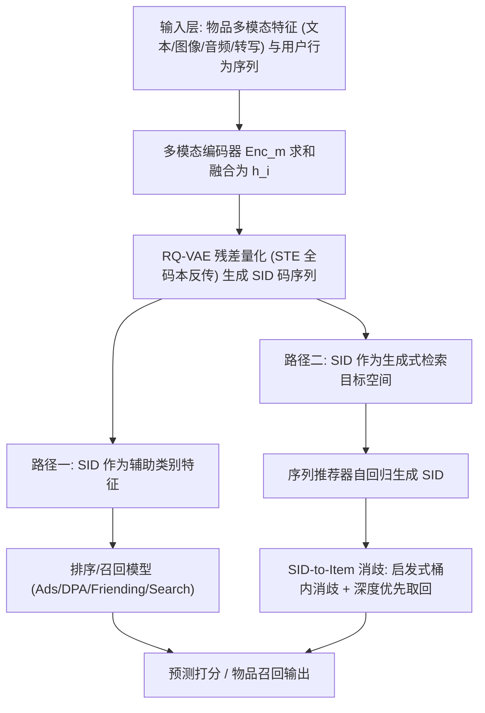
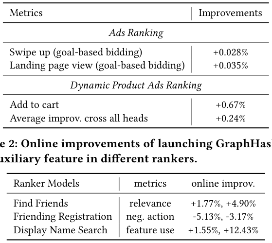
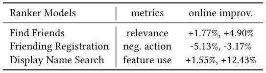
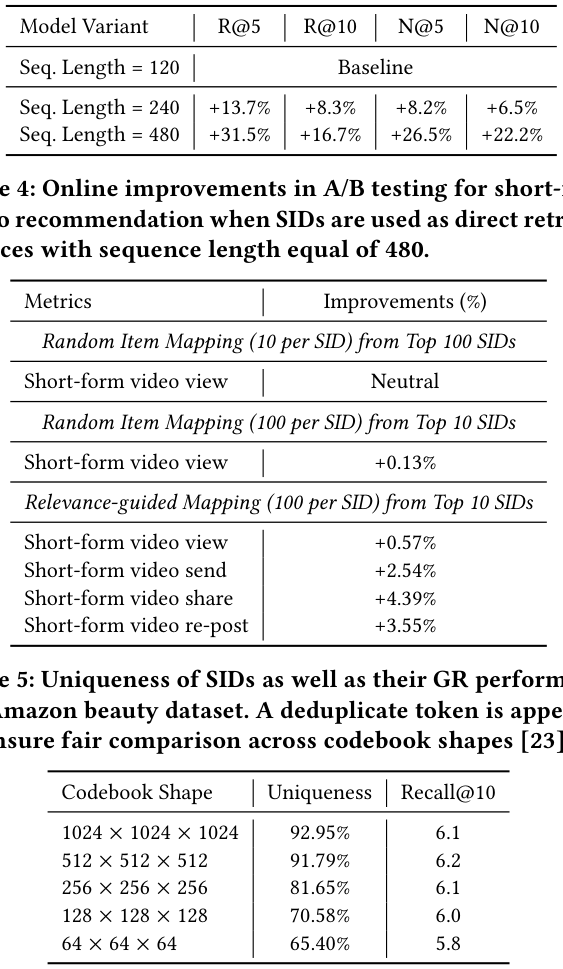
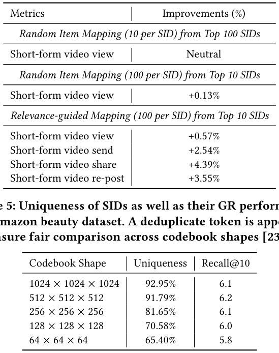
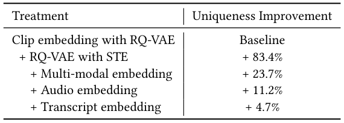

# Semantic IDs for Recommender Systems at Snapchat: Use Cases, Technical Challenges, and Design Choices (Snapchat 推荐系统中的语义 ID：应用场景、技术挑战与设计选择)

- **会议/期刊**: SIGIR 2026 (Industry Track)
- **推荐链路定位**: 召回 (Retrieval，生成式检索 GR) + 精排 (Ranking，SID 作为辅助类别特征)
- **研究方向**: 生成式推荐与离散语义 ID / CTR 预估与特征交叉
- **论文原文**: [https://arxiv.org/abs/2604.03949v1](https://arxiv.org/abs/2604.03949v1)
- **开源代码**: [https://github.com/snap-research/GRID](https://github.com/snap-research/GRID)

## TL;DR (核心速览)

本文是 Snapchat 在 SIGIR 2026 Industry Track 的工业实践报告，针对语义 ID (SID) 大规模落地中的两大痛点——RQ-VAE 训练时的**码本坍缩 (Codebook Collapse)** 与生成式检索推理时的 **SID-to-Item 碰撞消歧**，提出 STE 全码本反传 + 多模态嵌入融合 + 启发式桶内消歧 + 深度优先取回四项设计。SID 作为辅助特征在 Ads/DPA 排序上带来 +0.028%~+0.67% AUC 提升，作为直接检索源在短视频场景带来线上 +0.57% 播放、+4.39% 分享，并已在多个生产模型上线。

## Background & Motivation (背景与动机)

- **领域背景与主流范式**: 现代推荐系统普遍依赖**原子 ID (Atomic ID)**——每个用户/物品分配唯一离散 token，映射到可学习稠密嵌入，从而把稀疏交互压缩为连续隐向量。近年 **语义 ID (SID)** 成为新范式：由 RQ-VAE / VQ-VAE / Residual K-means 等 tokenizer 对基础模型（LLM/VLM）或协同信号提取的语义表征做残差量化，得到**有序离散码序列**，其单层基数远小于原子 ID，并在 ID 空间诱导语义聚类（相似物品共享前缀码）。
- **现有方法局限 (Limitations of Prior Work)**:
  1. **参数爆炸**：原子 ID 需为每个实体存储独立嵌入向量，用户/物品规模巨大时嵌入表参数量不可控；
  2. **缺乏归纳能力**：新用户/新物品在嵌入表中无条目，冷启动无表征可生成；
  3. **长尾泛化差**：热门 ID 获得绝大多数梯度更新，尾部实体表征欠训练。
- **核心挑战 (Key Challenge)**: SID 在学术基准上有效，但**工业级落地非平凡**。作者在 Snapchat 实践中遭遇两个具体矛盾：(a) RQ-VAE tokenizer 训练时出现严重码本坍缩，仅少量码字被使用，语义表达力被瓶颈化；(b) SID 作为检索目标时，因单层码本基数远小于原子 ID，大量相似物品映射到**完全相同的码序列 (collision)**，生成模型无法唯一确定应召回哪个物品。
- **核心洞察与切入点 (Key Insight)**: 作者并非提出全新模型，而是以**工业实践者视角**系统梳理"踩坑—实验—设计迭代"闭环：码本坍缩的根因是 argmax 离散化导致梯度只更新被选中码字（稀疏更新 + 初始化敏感 → 死码字），因此用 STE 让梯度流经整个码本；碰撞问题的根因是 SID 语义哈希的"粗粒度"本质，因此用**两阶段消歧**（生成模型定语义类别 + 轻量启发式定具体物品）替代强行追求唯一性。此外作者通过 Amazon Beauty 实验质疑了"SID 唯一性是黄金标准"的社区共识。

## Problem Formulation & Method (问题定义与方法架构)

### 1. 符号定义与输入表征 (Notations & Input Representations)

- 物品/用户 $i$ 的语义特征 $x_i$，经模态编码器 $\phi(\cdot): x \to \mathbb{R}^d$（LLM/VLM 等）得到隐表征 $h_i \in \mathbb{R}^d$，$d$ 为编码器输出维度。
- RQ-VAE 记为 $\text{RQ-VAE}(\cdot;\theta): \mathbb{R}^d \to \{0,1,\dots,K-1\}^L$，其中 $K$ 为每层码本码字数，$L$ 为码本层数，$\theta$ 含编码器、解码器与 $L$ 个码本。
- 编码器 $\text{Enc}(\cdot): \mathbb{R}^d \to \mathbb{R}^n$ 将 $h_i$ 映射为中间嵌入 $h_i^0$（第 0 层残差），$n$ 为 RQ-VAE 隐维度；第 $l$ 层码本 $\mathbf{C}^l \in \mathbb{R}^{K \times n}$。
- 输出：SID 码序列 $(\text{sid}^0, \text{sid}^1, \dots, \text{sid}^{L-1})$，每层取值于 $\{0,\dots,K-1\}$。

### 2. 整体流水线 (Overall Architecture)

数据流：原始多模态特征（文本/图像/音频/转写）→ 各模态编码器 $\text{Enc}_m$ → 求和聚合为统一表征 $h_i$ → RQ-VAE 残差量化得 SID → 下游两条使用路径：(1) 作为**辅助类别特征**喂入排序/召回模型；(2) 作为**生成式检索的目标空间**，序列推荐器自回归生成未来物品的 SID 序列，再经 SID-to-Item 消歧映射回具体物品。

### 3. 核心模块设计与数学原理 (Key Designs & Formulations)

**(1) RQ-VAE 残差量化基础与码本坍缩的 STE 修复**

第 0 层码字由余弦相似度 argmax 得到：

$$\text{sid}^0 = \arg\max_{c \in \{0,\dots,K-1\}} \| h_i^0 \cdot \mathbf{C}^0[c] \|_F,\quad h_i^0 = \text{Enc}(\phi(x_i))$$

后续层通过残差量化：

$$\text{sid}^l = \arg\max_{c} \| h_i^l \cdot \mathbf{C}^l[c] \|_F,\quad h_i^l = h_i^{l-1} - \mathbf{C}^{l-1}[\text{sid}^{l-1}]$$

解码时聚合各层质心重构：$\hat{h}_i = \text{Dec}\left(\sum_{l} \mathbf{C}^l[\text{sid}^l]\right)$。

**问题物理直觉**：标准 RQ-VAE 中 argmax 使码本优化本质离散，反向传播只更新被选中的码字行，形成稀疏更新；初始化不佳时大量码字成为"死码字"，永不获得梯度。作者用 **Straight-Through Estimator (STE)** 让梯度流经整个码本，将式 (3) 修改为：

$$\hat{h}_i = \text{Dec}\left(\sum_{l}\left[\mathbf{C}^l[\text{sid}^l] + \text{sim}(h_i^l, \mathbf{C}^l) \cdot \mathbf{C}^l - \text{sg}\left(\text{sim}(h_i^l, \mathbf{C}^l)\cdot \mathbf{C}^l\right)\right]\right)$$

其中 $\text{sim}(h_i^l, \mathbf{C}^l) \in \mathbb{R}^K$ 为第 $l$ 层残差与整层码本的余弦相似度，$\text{sg}(\cdot)$ 为 stop-gradient。这样损失可反传通过分配机制，**整个码本参与更新**，显著降低坍缩风险。

**(2) 多模态嵌入融合缓解坍缩**

作者观察到单一嵌入源（如纯文本）输入分布同质、方差低，RQ-VAE 只需少量质心即可重构，反而加剧坍缩。因此采用**求和聚合**的多源融合：

$$h_i = \sum_{m \in M} \text{Enc}_m(x_m),\quad \hat{h}_{i,m} = \text{Dec}_m\left(\sum_{l}\mathbf{C}^l[\text{sid}^l]\right)$$

多模态信号使输入空间方差与拓扑复杂度显著提升，量化过程被迫跨越更宽流形以最小化重构损失，从而提升码本利用率。

**(3) SID-to-Item 消歧：启发式桶内消歧 + 深度优先取回**

- **启发式桶内消歧 (Heuristic-based intra-code disambiguation)**：若一个生成 SID 关联多个物品，不将其视为等权相关，而是引入物品级元数据做二级排序。例如视频检索中用累计观看时长、内容新鲜度等历史相关性/时序特征优先高质量或业务指标相关物品。生成模型负责"定语义类别 (SID)"，轻量启发式负责"定具体物品"。
- **深度优先于广度 (Prioritize retrieval depth over breadth)**：固定检索预算下，从少数 top-ranked SID 中取回大量物品（深度）优于跨多个低排名 SID 各取少量（广度）。实验表明模型对 top SID 置信度高，最大化 top SID 的物品产出显著更优。

### 4. 训练目标、负采样与推理复杂度 (Optimization, Negative Sampling & Complexity)

- **损失函数**: RQ-VAE 由**重构损失 + commitment 损失**联合监督（原文引用 [17]），前者训练忠实重构输入，后者防止码本无界增长与坍缩。原文未给出具体权重系数与温度数值（**原文未报告**）。
- **训练负采样策略**: 本文为工业实践报告，生成式检索部分沿用作者前作 [11] 的序列推荐器架构，**原文未报告**具体负采样方案（如 in-batch / hard negative）；排序侧为常规 CTR 排序模型，负采样细节未披露。
- **时间与空间复杂度**: 原文未给出理论复杂度与单 epoch 耗时/峰值显存数值（**原文未报告**）。可定性说明：SID 单层基数 $K$ 远小于原子 ID 基数，嵌入表参数量大幅压缩；生成式检索推理需 beam search 或采样产出候选 SID，再经消歧映射，作者通过"深度优先取回"在固定预算下优化物品产出。序列长度从 120 增至 480 带来显著离线收益，但受基础设施约束止步于 480。

## Experimental Setup & Evaluation Protocol (实验设置与评估协议)

- **数据集统计与预处理**: 主实验为 Snapchat **内部工业数据**（Ads、DPA、Friending、Search、短视频内容推荐），原文未披露用户/物品/交互规模统计（**原文未报告**）。学术基准仅使用 **Amazon Beauty** 数据集 [7] 做 SID 唯一性与 GR 性能相关性分析，原文亦未给出其统计量表。

| 数据集 (Dataset) | 用户数 (#Users) | 物品数 (#Items) | 交互数 (#Interactions) | 稀疏度/密度 (Sparsity) | 模态/辅助特征说明 |
| :--- | :---: | :---: | :---: | :---: | :--- |
| Snapchat 内部数据 (Ads/DPA/Friending/Search/短视频) | 原文未报告 | 原文未报告（Friending 侧压缩 900M+ 原始用户 ID） | 原文未报告 | 原文未报告 | 文本元数据 (Qwen-Embedding)、图拓扑 (GraphHash)、多模态 (CLIP/音频/转写) |
| Amazon Beauty | 原文未报告 | 原文未报告 | 原文未报告 | 原文未报告 | 用于 SID 唯一性 vs. GR 性能分析 |

- **数据划分方式 (Splitting Strategy)**: 原文未明确说明离线训练/验证/测试的具体划分策略（LOO / Ratio / 全局时间戳切分均未提及），**原文未报告**。线上 A/B 为真实流量实验，天然按时间推进，无穿越问题。
- **排名评测协议 (Ranking Protocol)**: 排序侧报告 **AUC**（离线）与业务指标（线上）；生成式检索侧报告 **Recall@5/10、NDCG@5/10**（表 3），Amazon Beauty 上报告 **Recall@10**（表 5）。候选集打分是否为全库排序或采样排序，**原文未报告**。
- **评价指标与显著性检验**: 离线 AUC（0.01% 提升视为显著）、Recall@K、NDCG@K、SID 唯一性 (Uniqueness)；线上为播放/发送/分享/转发/关注/注册负向行为等业务指标。**原文未报告**多随机种子方差或配对显著性检验（如 $p<0.05$）。

## Key Experimental Results (核心实验结果)

### 1. 主实验对比 (Main Results)

**SID 作为辅助特征（排序侧，离线 AUC）**：

<figure class="paper-figure" markdown="span">
  <figcaption>表 1：当 SID 作为辅助输入特征引入不同排序器时，AUC 的离线提升，其中 0.01% 的提升被视为显著。</figcaption>
</figure>

表 1 显示：Ads Ranking 中 Swipe up 提升 +0.028%、Landing page view 提升 +0.035%；DPA Ranking 中 Add to cart 提升 +0.67%，全头部平均 +0.24%。DPA 因广告主目录高频更新导致物品 ID 剧烈churn，SID 带来的收益更为显著。

**SID 作为辅助特征（线上 A/B）**：

<figure class="paper-figure" markdown="span">
  <figcaption>表 2：在不同排序器中将 GraphHash SID 作为辅助特征上线后的在线提升。</figcaption>
</figure>

表 2 显示 GraphHash SID 上线后：Find Friends relevance +1.77%/+4.90%，Friending Registration 负向行为 -5.13%/-3.17%，Display Name Search 功能使用 +1.55%/+12.43%。GraphHash 将 900M+ 原始用户 ID 层次聚类压缩为紧凑 SID 集。

**SID 作为生成式检索直接目标（短视频，离线）**：

<figure class="paper-figure" markdown="span">
  <figcaption>表 3：在短视频推荐生成式检索中，当 SID 用于直接检索时的离线排序指标（R/N 分别指召回率/NDCG）。</figcaption>
</figure>

表 3 显示：序列长度从 120 基线增至 240 带来 R@5 +13.7%、N@5 +8.2%；增至 480 带来 R@5 +31.5%、R@10 +16.7%、N@5 +26.5%、N@10 +22.2%。

**SID 作为生成式检索直接目标（短视频，线上 A/B，序列长度 480）**：

<figure class="paper-figure" markdown="span">
  <figcaption>表 4：在短视频推荐中，当 SID 作为直接检索源且序列长度为 480 时，A/B 测试的在线提升。</figcaption>
</figure>

表 4 显示消歧策略的关键性：随机映射（top 100 SID 各取 10 物品）播放中性；随机映射（top 10 SID 各取 100 物品）+0.13%；**相关性引导映射（top 10 SID 各取 100 物品）** 带来播放 +0.57%、发送 +2.54%、分享 +4.39%、转发 +3.55%。

### 2. 消融实验与控制变量分析 (Ablation Study)

**SID 唯一性 vs. GR 性能（Amazon Beauty）**：

<figure class="paper-figure" markdown="span">
  ![表 5：SID 的唯一性及其在 Amazon beauty 数据集上的 GR 性能。附加去重 token 以确保在不同码本形状下进行公平比较 \[23\]。](../../../../assets/papers/2604.03949v1/table_5.png)<figcaption>表 5：SID 的唯一性及其在 Amazon beauty 数据集上的 GR 性能。附加去重 token 以确保在不同码本形状下进行公平比较 [23]。</figcaption>
</figure>

表 5 揭示**非线性关系**：码本形状 1024³ 唯一性 92.95% / Recall@10 6.1；512³ 唯一性 91.79% / Recall@10 6.2（最高）；256³ 唯一性 81.65% / Recall@10 6.1；128³ 唯一性 70.58% / Recall@10 6.0；64³ 唯一性 65.40% / Recall@10 5.8。唯一性极低时提升唯一性确实显著改善 GR；但超过约 **70% 阈值后收益饱和**，继续追求唯一性几乎无额外增益。作者据此主张唯一性应作为"防坍缩 sanity check"而非黄金标准。

**内部数据上不同处理对 SID 唯一性的贡献**：

<figure class="paper-figure" markdown="span">
  <figcaption>表 6：在不同处理方式生成 SID 时，内部数据上 SID 的唯一性。</figcaption>
</figure>

表 6 显示：以 CLIP embedding + RQ-VAE 为基线，+STE 带来唯一性 +83.4%（贡献最大），+多模态嵌入 +23.7%，+音频嵌入 +11.2%，+转写嵌入 +4.7%。这直接验证了 STE 是缓解码本坍缩的最关键设计，多模态融合为次要贡献。

### 3. 稀疏度/冷启动分桶与超参敏感度 (Sparsity Buckets & Hyperparameters)

- **长尾/冷启动**: 原文定性指出 SID 通过共享层次结构使 token 嵌入在整个物品目录上获得频繁梯度更新，缓解冷启动与长尾欠训练，但**未报告**按交互频次分桶的定量对比。
- **关键超参数敏感度**: 码本形状 $K^L$ 对唯一性与 GR 性能的影响见表 5（$K$ 从 64 到 1024）；序列长度 $L_{\text{seq}}$ 从 120→240→480 的收益见表 3。温度系数、损失权重等**原文未报告**。
- **线上 A/B 测试结果**: 已在上文表 2、表 4 中列出，覆盖 Friending/Search 排序与短视频生成式检索两类场景，均为真实生产流量实验。

## Highlights, Limitations & Critiques (亮点、局限与审稿级批判)

- **核心亮点与可迁移性**:
  1. **STE 全码本反传**是解决 RQ-VAE 码本坍缩的通用算子，可直接迁移到任何基于残差量化的生成式推荐 tokenizer（TIGER、OneRec 等），表 6 的 +83.4% 唯一性提升给出强证据；
  2. **多模态求和融合**提升输入方差以对抗坍缩，思路简单但有效，适用于图文电商、短视频等多模态场景；
  3. **"生成定类别 + 启发式定物品"的两阶段消歧**与**深度优先取回**是工业 GR 落地的实用工程范式，表 4 中相关性引导映射相对随机映射的 +0.44pp 播放增益（0.13%→0.57%）量化了消歧策略的价值；
  4. **对"SID 唯一性=黄金标准"的质疑**（表 5 的 70% 饱和阈值）具有社区纠偏意义，提示后续研究应寻找兼顾语义丰富度与物品区分度的离线代理指标。
- **局限性与审稿视角批判 (Critical Limitations)**:
  1. **评估协议披露不足**：作为 Industry Track 论文，内部数据规模、划分策略、负采样方案、损失权重、随机种子方差与显著性检验均未报告，离线结果的可复现性与统计严谨度受限；
  2. **学术基准覆盖薄弱**：仅在 Amazon Beauty 上做唯一性相关性分析，未在公开基准上与 TIGER、LC-Rec 等生成式检索基线做完整主实验对比，方法优越性主要依赖内部线上指标支撑；
  3. **AUC 提升幅度极小**：Ads Ranking 的 +0.028%/+0.035% 虽被作者称为"显著"（阈值 0.01%），但绝对量级微小，需警惕多重比较与流量波动带来的假阳性；
  4. **消歧依赖领域启发式**：相关性引导映射需人工设计元数据特征（观看时长、新鲜度），跨场景迁移需重新调参，缺乏端到端可学习消歧模块；
  5. **理论分析缺失**：STE 与多模态融合为何缓解坍缩仅有直觉解释，缺少码本利用率、死码字比例等定量诊断指标随训练变化的曲线分析。

## Rating (四维评分)

- **方法创新性 (Novelty)**: ⭐⭐⭐（STE 与多模态融合为工程改良而非全新范式，但对工业痛点针对性强）
- **评估协议与实验扎实度 (Protocol & Experiments)**: ⭐⭐⭐（线上 A/B 充分且多场景覆盖，但离线协议披露不足、公开基准对比薄弱）
- **写作与数学规范度 (Clarity & Rigor)**: ⭐⭐⭐⭐（RQ-VAE 公式与 STE 修改清晰，挑战—设计—实验叙事结构完整）
- **工业落地与复现价值 (Industrial & Practical Value)**: ⭐⭐⭐⭐⭐（多生产模型上线 + 开源 GRID 代码库，工程参考价值极高）
