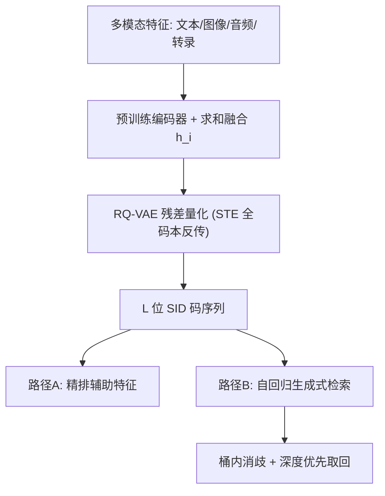

# Semantic IDs for Recommender Systems at Snapchat: Use Cases, Technical Challenges, and Design Choices (Snapchat 推荐系统中的语义 ID：应用场景、技术挑战与设计选择)

- **会议/期刊**: SIGIR 2026 (Industry Track)
- **作者与机构**: Clark Mingxuan Ju*, Tong Zhao*, Leonardo Neves, Neil Shah 等（Snap Inc.，*共同一作）
- **推荐链路定位**: 召回（生成式检索）+ 精排（辅助特征）
- **研究方向**: 生成式推荐与离散语义 ID / 冷启动与长尾推荐
- **论文原文**: [https://arxiv.org/abs/2604.03949v1](https://arxiv.org/abs/2604.03949v1)
- **开源代码**: [https://github.com/snap-research/GRID](https://github.com/snap-research/GRID)

## TL;DR (1分钟核心速览)

原子 ID 面临参数爆炸、无归纳能力（冷启动）与长尾欠训练三大痛点，SID（RQ-VAE 残差量化得到的离散码序列）以极小基数与语义前缀聚类缓解之。本文是 Snapchat 的工业落地报告：提出 **STE 全码本反传 + 多模态嵌入融合** 两大改造以对抗码本坍缩，并提出 **启发式桶内消歧 + 深度优先取回** 解决 SID-Item 碰撞。SID 作为精排辅助特征在广告/DPA/好友/搜索多场景离线 AUC 提升 0.028%–0.67%，作为生成式检索主目标在短视频场景线上分享 +4.39%、转发 +3.55%。

## Background & Motivation (背景与核心矛盾)

- **主流范式**: 推荐模型以 per-user/per-item 原子 ID 查表得稠密嵌入，压缩稀疏交互为连续隐向量；近期 TIGER 系工作改用 RQ-VAE/VQ-VAE 将多模态语义表征量化为有序离散码（SID），以语义哈希替代原子查表。
- **前人局限**: ① 原子 ID 参数量随用户/物品数爆炸，且无归纳偏置，新实体无嵌入（冷启动）；② 长尾分布下尾部 ID 梯度稀疏、表征欠训练；③ 现有 SID 文献多在学术数据集验证，**码本坍缩**（仅少数 centroid 被激活）与**生成式检索的 SID→Item 碰撞**两大工业级障碍缺乏系统方案。
- **核心洞察 (Key Insight)**: SID 的价值不在"更小的 ID"，而在其**共享前缀诱导的语义聚类**——它让 token 嵌入在全库范围内被频繁更新，从而同时改善泛化与参数利用率；但这一性质的前提是码本被充分利用，坍缩会直接摧毁哈希粒度。
- **本文切入点**: 从 tokenizer 训练（抗坍缩）与下游解码（抗碰撞）两端同时改造，并在广告、DPA、好友、搜索、短视频五类真实场景做离线 + 线上 A/B 全链路验证。

## Method (核心方法设计)

### 1. 整体框架 (Overall Architecture)

流程为：多模态原始特征（文本/图像/音频/转录）经各自预训练编码器映射为嵌入，**求和融合**为统一表征 $h_i$ 后送入 RQ-VAE 编码器；残差量化逐层取最近 centroid 得到 $L$ 位 SID 码；解码端以各层 centroid 之和重建。下游有两条使用路径：(a) SID 作为**类别型辅助特征**拼入精排/召回模型；(b) SID 替换行为序列中的原子 ID，训练自回归序列推荐器直接**生成**未来物品的 SID 序列，再经桶内消歧映射回具体 item。

### 2. 关键设计拆解 (Key Designs)

1. **STE 全码本反传（对抗码本坍缩）**：标准 RQ-VAE 的 $\arg\max$ 使梯度只流向被选中的 centroid 行，初始化不佳即产生大量"死码"，语义哈希粒度退化。本文将重建式改为
$$\hat{h}_i=\mathrm{Dec}\Big(\textstyle\sum_{l}\big(\mathbf{C}_l[\text{sid}_l]+\mathrm{sim}(h^l_i,\mathbf{C}_l)\cdot\mathbf{C}_l-\mathrm{sg}[\mathrm{sim}(h^l_i,\mathbf{C}_l)\cdot\mathbf{C}_l]\big)\Big),$$
即用余弦相似度对**整个码本**做直通估计，前向值不变、反向把全部 centroid 纳入更新图。直觉：把"硬指派"变成"软竞争"，死码也能获得逃离的梯度信号。

2. **多模态嵌入融合（提升输入方差）**：单一文本嵌入分布同质、拓扑简单，RQ-VAE 只需少量 centroid 即可低损重建，反而加剧坍缩。采用 $h_i=\sum_{m\in M}\mathrm{Enc}_m(x^m)$、$\hat{h}_{i,m}=\mathrm{Dec}_m(\sum_l \mathbf{C}_l[\mathrm{sid}_l])$ 的求和融合与多解码头，输入流形更复杂，迫使量化覆盖更广的码本区域。实测 STE 带来唯一率 +83.4%，多模态 +23.7%，音频 +11.2%，转录 +4.7%。

3. **SID-to-Item 消歧与深度优先取回**：SID 基数远小于原子 ID，语义相近物品必然共享同一码序列（碰撞）。方案一为**启发式桶内消歧**：对同一 SID 下的多个候选 item，用领域元数据（累计观看时长、内容新鲜度）做二级排序；方案二为**深度优先于广度**：固定取回预算下，从 Top-10 SID 各取 100 个 item 显著优于从 Top-100 SID 各取 10 个，说明模型对头部 SID 置信度高。训练侧沿用标准重建损失 + commitment 损失，生成式检索为逐 token 自回归交叉熵，无额外负采样。

## Experimental Setup & Evaluation Protocol (实验设置与评估协议)

- **数据集与预处理**: 主体为 Snapchat 内部多场景工业数据（广告、DPA、好友、搜索、短视频），学术基准采用 Amazon Beauty（沿用 TIGER 的 `5-core` 过滤与去重 token 追加以保证码本形状可比）。

| 数据集 | #Users | #Items | #Interactions | 稀疏度/密度 | 特征/场景说明 |
| :--- | :---: | :---: | :---: | :---: | :--- |
| Snap 广告/DPA | 未披露 | 未披露 | 未披露 | 未披露 | 文本元数据（标题/品牌/类目），Qwen-Embedding 编码 |
| Snap 好友/搜索 | 未披露 | >900M 用户 ID | 未披露 | 未披露 | GraphHash 图语义 SID |
| Snap 短视频 | 未披露 | 未披露 | 未披露 | 未披露 | 多模态（clip/音频/转录） |
| Amazon Beauty | 未披露 | 未披露 | 未披露 | 未披露 | 公开基准，GR 对比 |

- **数据划分与防穿越 (Splitting Strategy)**: 内部数据按工业标准时间切分（历史行为→未来交互），Amazon Beauty 沿用 TIGER 的 `Leave-One-Out` 设定。
- **排名评测协议 (Ranking Protocol)**: 生成式检索采用 `Full-Ranking` 式 Recall@5/10 与 NDCG@5/10（Beauty 上 Recall@10）；精排侧报告 AUC 相对提升，**0.01% AUC 增益即视为显著**。
- **对比基线与超参设置**: 精排对比"无 SID 辅助特征"的基线；GR 对比不同序列长度（120/240/480）与不同码本形状（$1024^3$ 至 $64^3$）；线上以 A/B 实验的业务指标为准。

## Key Experimental Results (实验关键数据)

### 1. 主实验对比 (Main Results)

**表 1 SID 作为精排辅助特征的离线 AUC 提升**

| 场景 | 指标 | 提升 |
| :--- | :--- | :---: |
| 广告排序 | Swipe up (goal-based bidding) | +0.028% |
| 广告排序 | Landing page view | +0.035% |
| DPA 排序 | Add to cart | **+0.67%** |
| DPA 排序 | 全头平均 | +0.24% |

**表 2 GraphHash SID 辅助特征的线上 A/B**

| 模型 | 指标 | 线上提升 |
| :--- | :--- | :---: |
| Find Friends | relevance | +1.77% / +4.90% |
| Friending | 负向行为 | **-5.13% / -3.17%** |
| Display Name Search | feature use | +1.55% / +12.43% |

**表 3 生成式检索离线指标（短视频，序列长度消融）**

| 变体 | R@5 | R@10 | N@5 | N@10 |
| :--- | :---: | :---: | :---: | :---: |
| Seq=120 (Baseline) | — | — | — | — |
| Seq=240 | +13.7% | +8.3% | +8.2% | +6.5% |
| Seq=480 | **+31.5%** | **+16.7%** | **+26.5%** | **+22.2%** |

**表 4 生成式检索线上 A/B（Seq=480）**

| 取回策略 | 指标 | 提升 |
| :--- | :--- | :---: |
| Top-100 SID × 10 item（随机映射） | 播放 | 中性 |
| Top-10 SID × 100 item（随机映射） | 播放 | +0.13% |
| Top-10 SID × 100 item（相关性引导） | 播放 | +0.57% |
| 同上 | 发送 | +2.54% |
| 同上 | 分享 | **+4.39%** |
| 同上 | 转发 | +3.55% |

### 2. 消融实验 (Ablation Study)

**表 5 抗坍缩处理对 SID 唯一率的影响（内部数据）**

| 处理 | 唯一率提升 |
| :--- | :---: |
| Clip embedding + RQ-VAE (Baseline) | — |
| + RQ-VAE with STE | **+83.4%** |
| + 多模态嵌入 | +23.7% |
| + 音频嵌入 | +11.2% |
| + 转录嵌入 | +4.7% |

**表 6 码本形状 vs 唯一率 vs GR 性能（Amazon Beauty）**

| 码本形状 | 唯一率 | Recall@10 |
| :--- | :---: | :---: |
| $1024^3$ | 92.95% | 6.1 |
| $512^3$ | 91.79% | **6.2** |
| $256^3$ | 81.65% | 6.1 |
| $128^3$ | 70.58% | 6.0 |
| $64^3$ | 65.40% | 5.8 |

### 3. 关键实验发现 (Key Findings)

1. **STE 是抗坍缩的第一杠杆**：单独启用 STE 即带来 +83.4% 唯一率提升，远超多模态融合的 +23.7%；说明坍缩主因是"稀疏梯度更新依赖初始化"而非输入多样性不足，二者是互补而非替代关系。
2. **唯一率并非越高越好，存在 ~70% 饱和点**：Beauty 上唯一率从 65.4% 升至 70.6% 时 Recall@10 由 5.8 升至 6.0，但继续升至 92.95% 后 Recall 反而回落至 6.1（$512^3$ 的 91.79% 取得最优 6.2）。唯一率应作为"防坍缩 sanity check"，而非质量金标准。
3. **解码策略的收益量级远超模型侧微调**：同为 Top-10 SID × 100 item，随机映射仅 +0.13% 播放，相关性引导映射跃升至 +0.57% 播放与 +4.39% 分享；而广度优先（Top-100 × 10）完全中性。碰撞消歧是 SID 检索落地的真正瓶颈。

## Highlights, Limitations & Rating (亮点、对比与审稿评价)

- **与代表作对比 (vs. Prior Work)**: 相较 TIGER/Rajput et al. 仅在学术数据上验证 RQ-VAE SID，本文首次给出跨五类场景的工业级证据；相较 RQ-Kmeans 系（如 Snap 前作 GRID）不可微，本文坚持 RQ-VAE 路线以支持多模态融合与 STE 改造；相较通用冷启动元学习方法，SID 以"语义前缀共享"零样本地为新物品生成可训练嵌入。
- **可迁移亮点**: ① STE 全码本反传可直接插入任何 VQ/RQ tokenizer 训练管线，几乎零额外成本；② "深度优先于广度"的取回预算分配原则可迁移至任何生成式检索/语义 ID 召回系统。
- **审稿级局限批判**: ① 内部数据规模、稀疏度与基线绝对数值全部未披露，离线 AUC 提升 0.028%–0.035% 的量级难以判断统计稳健性；② 桶内消歧依赖人工设计的领域启发式（观看时长、新鲜度），缺乏可学习消歧模块，跨场景迁移需重新调参；③ 唯一率与下游性能的饱和阈值（~70%）仅在 Beauty 单一数据集上观测，普适性存疑。
- **四维评分**: 创新性 ⭐⭐⭐⭐ | 实验扎实度 ⭐⭐⭐⭐ | 方法清晰度 ⭐⭐⭐⭐⭐ | 落地价值 ⭐⭐⭐⭐⭐

