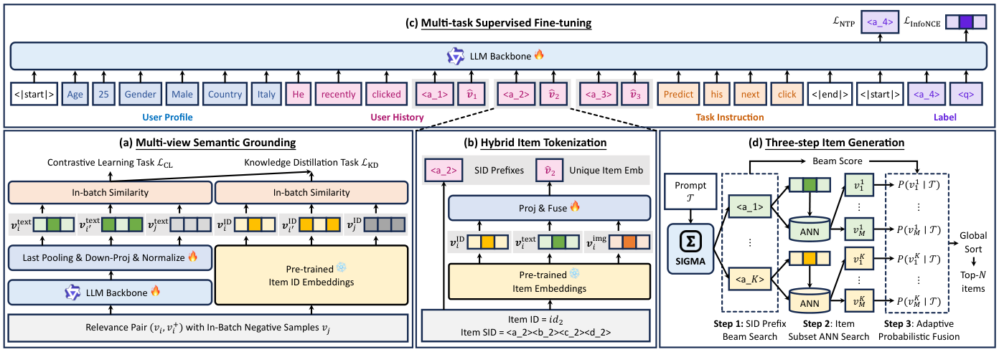
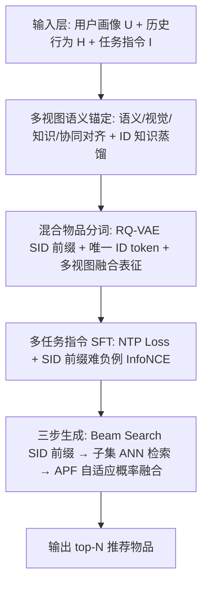
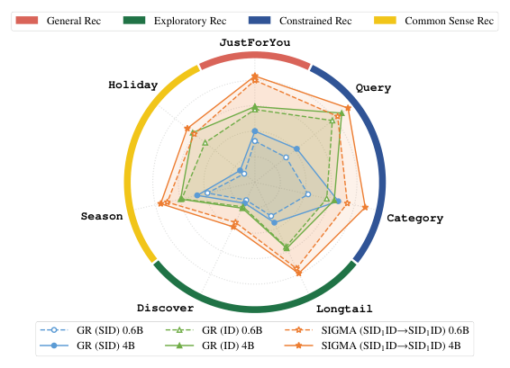
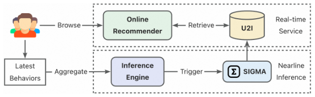

# SIGMA: A Semantic-Grounded Instruction-Driven Generative Multi-Task Recommender at AliExpress (语义锚定的指令驱动生成式多任务推荐系统)

- **会议/期刊**: SIGIR 2026 (Industry Track, 5 pages)
- **推荐链路定位**: 端到端生成式 (End-to-End Generative) — 以 LLM 直接生成物品 SID 前缀 + ANN 检索候选，替代传统多级级联
- **研究方向**: 生成式推荐与离散语义 ID / 大语言模型推荐 (LLM4Rec)
- **论文原文**: [https://arxiv.org/abs/2602.22913v2](https://arxiv.org/abs/2602.22913v2)
- **开源代码**: 暂未开源

## TL;DR (核心速览)

针对现有生成式推荐 (GR) 仅做 next-item 预测、无法响应节日/类目/长尾等多样化业务诉求，且通用 LLM 缺乏平台协同信号的问题，SIGMA 提出「多视图语义锚定 + 混合 SID/ID 分词 + 七任务指令 SFT + 三步生成与自适应概率融合 (APF)」的统一框架。离线以 SID 级 HR@K 评估，SID1ID→SID1ID 配置在 HR@10 达 33.76%（较 GR(ID) 的 28.98% 提升约 16.5%）；AliExpress 5% 流量两周 A/B 中 GMV +7.84%、转化率 +3.84%。

## Background & Motivation (背景与动机)

- **领域背景与主流范式**: 生成式推荐 (GR) 以 TIGER/RQ-VAE 式语义 ID (SID) 为物品标识，用自回归 LLM 端到端生成物品 ID，替代「召回→粗排→精排→重排」的多级级联，具备建模能力强、计算高效、可扩展的优势。
- **现有方法局限 (Limitations of Prior Work)**:
  1. **任务单一**：绝大多数 GR 只做 vanilla next-item prediction，无法支持「节日主题推荐」「指定类目/Query 约束推荐」「长尾扶持」等业务定制需求；
  2. **强依赖历史行为**：与传统推荐器一样依赖行为数据积累，对动态趋势（节日、季节、热点）响应存在固有延迟；
  3. **通用 LLM 域偏移**：通用 LLM 缺乏平台内协同信号，直接用于物品实体建模存在语义-协同鸿沟。
- **核心挑战 (Key Challenge)**: 简单的特征拼接或加深网络无法同时解决「语义与协同信号统一」「精确物品建模 vs. 高效生成」「多任务异构输出分布校准」三重矛盾——纯 SID 分词在量化中丢失细粒度物品特征，纯 ID 分词则丧失结构化语义先验。
- **核心洞察与切入点 (Key Insight)**: 作者利用 LLM 的强语义理解与参数化世界知识，将异构推荐需求统一为**指令跟随**问题；同时以「多视图对比对齐 + 协同知识蒸馏」把物品实体锚定进统一隐空间，再用「SID 前缀 + 唯一 ID token」的混合分词兼顾结构与细粒度，最后用 beam 分数标准差 $\sigma$ 自适应调节输出分布的锐化/平坦程度以匹配任务对精度/多样性的需求。

## Problem Formulation & Method (问题定义与方法架构)

### 1. 符号定义与输入表征 (Notations & Input Representations)

- 用户集 $\mathcal{U}$、物品集 $\mathcal{I}$；用户静态画像 $\mathbf{U}$（年龄、性别、国家等）、历史行为序列 $\mathbf{H}$、任务指令 $\mathbf{I}$。
- 物品 $v_i$ 的多视图表征：语义表征 $\boldsymbol{v}^{\text{text}}_i$（LLM 编码，维度 64）、ID 表征 $\boldsymbol{v}^{\text{ID}}_i$（线上排序模型物品 ID embedding）、视觉表征 $\boldsymbol{v}^{\text{img}}_i$；融合表征 $\tilde{\boldsymbol{v}}_i$ 维度 128。
- 物品分词：SID 前缀 $\{c_1,\dots,c_\ell\}$（$\ell\in[1,L]$，$L$ 为码本层数）+ 唯一 ID token $id_i$。
- 输出：目标物品的 SID 前缀 token 序列 + 特殊 query token $q$ 的隐状态 $\boldsymbol{h}$，经 ANN 检索得到 top-$N$ 物品。

### 2. 整体流水线 (Overall Architecture)

数据流：物品元数据 JSON 线性化 → LLM 编码得语义表征 → 多视图相关性对（语义/视觉/知识/协同）对比对齐 + 线上 ID embedding 知识蒸馏 → RQ-VAE 量化得 SID + 唯一 ID token 混合分词 → 七任务指令 SFT（NTP + InfoNCE 双损失）→ 三步生成（Beam Search SID 前缀 → 子集 ANN 检索 → APF 融合排序）。

<figure class="paper-figure" markdown="span">
  <figcaption>图 1：SIGMA 的整体框架。</figcaption>
</figure>

### 3. 核心模块设计与数学原理 (Key Designs & Formulations)

**(a) 多视图语义锚定 (Multi-view Semantic Grounding)**：构造四类相关性对——语义对齐（线上搜索日志 query→高点击物品）、视觉对齐（同风格视觉特征物品对）、知识对齐（LLM + 站内搜索关联节日/热点/季节与主题物品）、协同对齐（同一交互 session 内共现物品）。对相关性对 $\{(v_i,v^+_i)\}_{i=1}^B$ 用 LLM 提取语义表征 $\{\boldsymbol{v}^{\text{text}}_k\}_{k=1}^{2B}$，采用 in-batch 负例的 InfoNCE：

$$\mathcal{P}(\{\boldsymbol{v}^{\text{text}}_k\},i,j)=\frac{e^{\cos(\boldsymbol{v}^{\text{text}}_i,\boldsymbol{v}^{\text{text}}_j)/\tau}}{\sum_{k=1,k\neq i}^{2B}e^{\cos(\boldsymbol{v}^{\text{text}}_i,\boldsymbol{v}^{\text{text}}_k)/\tau}},\quad \mathcal{L}_{CL}=-\frac{1}{2B}\sum_{i=1}^{2B}\log\mathcal{P}(\cdot,i,i')$$

其中 $i'=(i+B)\bmod 2B$。进一步以知识蒸馏把线上排序模型 ID embedding 的 item-item 关系迁移到语义空间：

$$\mathcal{L}_{KD}=-\frac{1}{2B}\sum_{i,j=1}^{2B}\mathcal{P}(\{\boldsymbol{v}^{\text{ID}}_k\},i,j)\log\frac{\mathcal{P}(\{\boldsymbol{v}^{\text{ID}}_k\},i,j)}{\mathcal{P}(\{\boldsymbol{v}^{\text{text}}_k\},i,j)}$$

物理直觉：对比学习解决「通用 LLM 域偏移」，KL 蒸馏解决「缺协同信号」，二者共同把自然语言、世界知识与物品实体锚定进同一隐空间。

**(b) 混合物品分词 (Hybrid Item Tokenization)**：RQ-VAE 将 $\boldsymbol{v}^{\text{text}}_i$ 量化为层级 SID $\{c_1,\dots,c_L\}$（256×4 码本）；为缓解量化信息损失，额外引入唯一 ID token $id_i$，物品表示为 $\{c_1,\dots,c_\ell,id_i\}$。SID token 查 LLM 词表 $\mathbf{E}$，ID token 作为索引检索多视图预训练 embedding 并经可学习 MLP 融合，LLM 输入为：

$$[\mathbf{E}(c_1),\dots,\mathbf{E}(c_\ell),\text{UpProj}(\text{MLP}(\boldsymbol{v}^{\text{ID}}_i,\boldsymbol{v}^{\text{text}}_i,\boldsymbol{v}^{\text{img}}_i))]$$

**(c) 多任务 SFT 与三步生成 + APF**：七任务分四组——General Rec (JustForYou)、Constrained Rec (Query, Category)、Exploratory Rec (Longtail, Discover)、Common Sense Rec (Season, Holiday)。SFT 双损失：SID 前缀上的 NTP 损失 $\mathcal{L}_{NTP}=-\frac{1}{\ell}\sum_{t=1}^{\ell}\log P(c_t|\mathbf{U},\mathbf{H},\mathbf{I},c_{<t})$，以及目标 ID 上的 InfoNCE（难负例为共享同一 SID 前缀的随机物品）：

$$\mathcal{L}_{InfoNCE}=-\log\frac{e^{\cos(\boldsymbol{h},\tilde{\boldsymbol{v}}_i)/\tau}}{e^{\cos(\boldsymbol{h},\tilde{\boldsymbol{v}}_i)/\tau}+\sum_{v_j\in\mathcal{N}_{\{c_1,\dots,c_\ell\}}}e^{\cos(\boldsymbol{h},\tilde{\boldsymbol{v}}_j)/\tau}}$$

生成阶段：Beam Search 得 top-$K$ SID 前缀及 beam 分数 $\phi_k=\sum_{t=1}^{\ell}\log P(c^k_t|\mathcal{T},c^k_{<t})$；对每个前缀拼接 query token 取隐状态 $\boldsymbol{h}^k$，在共享该前缀的物品子集 $\mathcal{V}^k$ 内做 ANN 检索 top-$M$；最终生成概率分解为 $P(v_i|\mathcal{T})=P(c^k_1,\dots,c^k_\ell|\mathcal{T})\times P(id_i|\mathcal{T},c^k_1,\dots,c^k_\ell)$，其中第二项以 beam 分数标准差 $\sigma(\{\phi_1,\dots,\phi_K\})$ 调节温度：约束型任务 $\phi_1$ 与 $\phi_K$ 差距大 → $\sigma$ 大 → 分布锐化保精度；多样性任务 $\sigma$ 小 → 分布平坦促探索。

### 4. 训练目标、负采样与推理复杂度 (Optimization, Negative Sampling & Complexity)

- **损失函数**: 语义锚定阶段 $\mathcal{L}_{CL}+\mathcal{L}_{KD}$；SFT 阶段 $\mathcal{L}_{NTP}+\mathcal{L}_{InfoNCE}$，温度 $\tau=0.05$。
- **训练负采样策略**: 语义锚定用 in-batch 负例（batch 16,384）；SFT 阶段从共享同一 SID 前缀的物品中随机选 100K batch-shared 难负例（SID Prefix Hard Negative）。
- **时间与空间复杂度**: 离线需构建 150M 相关性对与 130M SFT 样本；在线采用「近线推理 + 实时检索」架构——用户最新行为按分钟级聚合，触发带 past KV cache 的异步增量推理，候选写入 U2I 索引供实时服务，规避 LLM 在线逐 token 解码的延迟瓶颈。原文未报告具体 ms/request 延迟与峰值显存数值。

## Experimental Setup & Evaluation Protocol (实验设置与评估协议)

- **数据集统计与预处理**: 基于 AliExpress 2026-01 匿名用户行为日志构建 150M 相关性对（语义锚定）与 130M SFT 样本，另取 2026-02 的 2M SFT 样本作评估。原文未披露用户数/物品数/交互数等统计量，亦未说明 5-core 类过滤规则。

| 数据集 (Dataset) | 用户数 (#Users) | 物品数 (#Items) | 交互数 (#Interactions) | 稀疏度/密度 (Sparsity) | 模态/辅助特征说明 |
| :--- | :---: | :---: | :---: | :---: | :--- |
| AliExpress 相关性对 | 原文未报告 | 原文未报告 | 150M 相关性对 | 原文未报告 | 搜索日志、视觉、知识、session 共现 |
| AliExpress SFT (训练) | 原文未报告 | 原文未报告 | 130M SFT 样本 | 原文未报告 | 七任务指令样本 |
| AliExpress SFT (评估) | 原文未报告 | 原文未报告 | 2M SFT 样本 (2026-02) | 原文未报告 | 同上 |

- **数据划分方式 (Splitting Strategy)**: 采用**时间切分**——训练用 2026-01 日志，评估用 2026-02 的 2M 样本，属全局时间戳切分，可降低未来信息泄露风险；但原文未说明是否对用户/物品做重叠性约束。
- **排名评测协议 (Ranking Protocol)**: 采用 **SID 级 Hit Rate (HR@K)**，$K\in\{1,5,10,20\}$；对直接生成物品 ID 的基线，将其预测物品映射为 SID 以保证公平。原文未明确是全库排序还是采样排序，亦未报告显著性检验。
- **评价指标与显著性检验**: HR@1/5/10/20；语义表征维度 64、融合表征维度 128；原文未报告多随机种子方差或配对显著性检验。

## Key Experimental Results (核心实验结果)

### 1. 主实验对比 (Main Results)

| 数据集 | 指标 | Online Model (Transformer 生成) | GR (SID) | GR (ID) | SIGMA (SID1ID→SID1ID) | 相对提升 (vs. 最强基线) |
| :--- | :--- | :---: | :---: | :---: | :---: | :---: |
| AliExpress 评估集 | HR@1 | 6.25% | 8.01% | 7.31% | **9.61%** | +20.0% (vs. GR(SID)) |
| AliExpress 评估集 | HR@5 | 15.16% | 16.17% | 20.15% | **24.73%** | +22.7% (vs. GR(ID)) |
| AliExpress 评估集 | HR@10 | 21.32% | 22.41% | 28.98% | **33.76%** | +16.5% (vs. GR(ID)) |
| AliExpress 评估集 | HR@20 | 30.06% | 26.41% | 37.37% | **43.05%** | +15.2% (vs. GR(ID)) |

分词配置对比：SID4ID→SID2ID 因两 token 生成准确率仅 29%（单 token 为 63%）而性能受限（HR@10 28.43%）；SID4ID→SID1ID 达 33.37%，但序列更长、开销更大且相对 SID1ID→SID1ID（33.76%）增益边际，故最终采用 SID1ID→SID1ID。

### 2. 消融实验与控制变量分析 (Ablation Study)

| 消融配置 | HR@1 | HR@5 | HR@10 | HR@20 |
| :--- | :---: | :---: | :---: | :---: |
| SIGMA 完整版 | **9.61%** | **24.73%** | **33.76%** | **43.05%** |
| - Semantic Grounding | 7.80% | 19.10% | 25.85% | 33.24% |
| - APF (仅取 Top-1 前缀) | 9.31% | 22.82% | 30.18% | 37.73% |
| - Pre-trained Item Emb | 8.13% | 21.82% | 30.24% | 39.11% |
| - SID Prefix Hard Negative | 9.03% | 23.79% | 32.40% | 41.34% |
| # Hard Negatives (10K) | 8.43% | 22.87% | 31.70% | 40.86% |

**贡献最大的是多视图语义锚定**（HR@10 下降 7.91 个百分点），印证通用 LLM 域偏移与协同信号缺失是核心瓶颈；APF 次之（-3.58），预训练物品 embedding 融合（-3.52）与 SID 前缀难负例（-1.36）亦有稳定贡献；难负例数量从 100K 降至 10K 时 HR@10 掉 2.06 个百分点。原文未说明消融是否严格对齐参数量或图拓扑度数。

### 3. 稀疏度/冷启动分桶与超参敏感度 (Sparsity Buckets & Hyperparameters)

- **长尾/探索任务表现**: 原文在 Exploratory Rec 组中单列 Longtail 与 Discover 任务，并在图 2 中展示各任务随模型规模的变化，但未给出按交互频次分桶的细粒度数值表。
- **模型规模敏感度**: 从 Qwen3-0.6B 扩至 Qwen3-4B，SIGMA 在所有任务上一致提升，且在知识密集型（Holiday）与语义驱动型（Query、Category）任务上增益尤为明显，验证更大 LLM 骨干的语义理解与世界知识优势。

<figure class="paper-figure" markdown="span">
  <figcaption>图 2：不同方法在各任务上随模型规模扩展的性能变化。</figcaption>
</figure>

- **关键超参数**: $\tau=0.05$；RQ-VAE 码本 256×4；语义锚定 batch 16,384、SFT batch 4,096；AdamW，学习率 2e-5，2,000 步线性 warmup。原文未给出 $\tau$、码本大小、beam 宽度 $K$ 与 ANN 候选数 $M$ 的敏感性曲线。
- **线上 A/B 测试结果**: AliExpress 5% 流量、为期 2 周，覆盖 JustForYou、Query、Season、Holiday 四任务；SIGMA-4B 带来 **订单量 +2.80%、转化率 +3.84%、GMV +7.84%、购买类目广度 +2.47%**。

<figure class="paper-figure" markdown="span">
  <figcaption>图 3：SIGMA 的在线服务架构。</figcaption>
</figure>

## Highlights, Limitations & Critiques (亮点、局限与审稿级批判)

- **核心亮点与可迁移性**:
  1. **混合分词范式**（SID 前缀 + 唯一 ID token + 多视图融合表征）在「结构化语义先验」与「细粒度物品区分」间取得平衡，可直接迁移到电商搜索、广告召回等需要精确物品定位的生成式场景；
  2. **APF 机制**用 beam 分数标准差 $\sigma$ 作为任务精度/多样性的自适应旋钮，是一个轻量、无需额外训练、可解释性强的输出分布校准算子，可移植到任意 beam-based 生成检索系统；
  3. **多视图锚定 + ID 知识蒸馏**为通用 LLM 注入平台协同信号提供了可复用的工业配方；
  4. **近线推理 + past KV cache + U2I 索引**的在线架构，为 LLM 生成式推荐的低延迟落地提供了工程参考。
- **局限性与审稿视角批判 (Critical Limitations)**:
  1. **评估协议薄弱**：仅报告 SID 级 HR@K，未说明全库排序还是采样排序、未报告 NDCG/MRR、未做显著性检验与多随机种子方差，工业论文的离线结论说服力有限；
  2. **数据统计缺失**：未披露用户/物品规模、过滤规则、时间切分下用户重叠情况，复现性受限；
  3. **基线覆盖不足**：仅对比 Online Model、GR(SID)、GR(ID) 三个基线，缺少 TIGER、LC-Rec、EAGER 等公开 GR 强基线及传统 SASRec/双塔召回对照；
  4. **APF 的理论依据偏经验**：以 $\sigma$ 调节温度缺乏形式化推导，且 $\sigma$ 的尺度随 $K$、任务分布漂移，跨场景迁移时需重新标定；
  5. **在线收益归因不清晰**：A/B 仅报告整体业务指标，未拆分各任务独立增益，也未报告延迟分位数（P99）与推理成本；
  6. **5 页短文**导致方法细节（如 RQ-VAE 训练细节、ANN 索引类型、beam 宽度）大量留白。

## Rating (四维评分)

- **方法创新性 (Novelty)**: ⭐⭐⭐⭐ （混合分词与 APF 融合机制有明确工业新意，但多视图对齐与指令 SFT 属已有范式的组合）
- **评估协议与实验扎实度 (Protocol & Experiments)**: ⭐⭐⭐ （线上 A/B 数据亮眼，但离线协议披露不足、基线偏少、缺显著性检验）
- **写作与数学规范度 (Clarity & Rigor)**: ⭐⭐⭐⭐ （公式与架构图清晰，5 页篇幅下细节压缩明显）
- **工业落地与复现价值 (Industrial & Practical Value)**: ⭐⭐⭐⭐⭐ （真实 AliExpress 全量部署 + 两周 A/B + GMV +7.84%，工程参考价值极高；但未开源）
