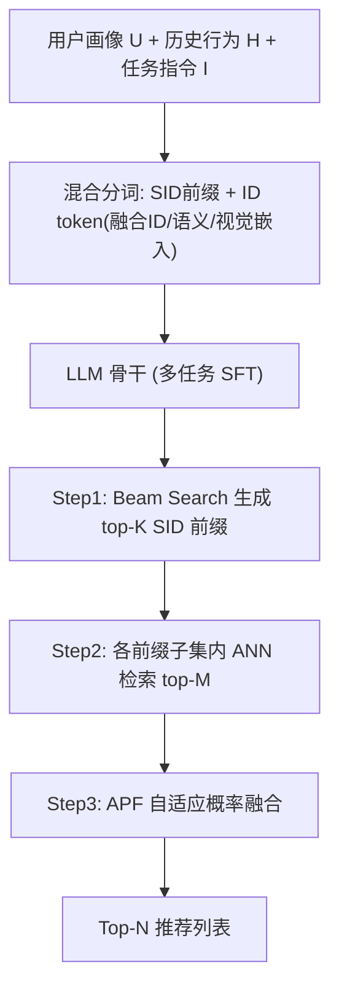

# SIGMA: A Semantic-Grounded Instruction-Driven Generative Multi-Task Recommender at AliExpress (语义锚定、指令驱动的 AliExpress 生成式多任务推荐器)

- **会议/期刊**: SIGIR 2026 (Industry Track)
- **作者与机构**: Yang Yu, Lei Kou, Huaikuan Yi, Bin Chen, Yayu Cao, Lei Shen, Chao Zhang, Bing Wang, Xiaoyi Zeng（阿里巴巴国际数字商业集团 AliExpress）
- **推荐链路定位**: 端到端生成式（召回级候选生成 + 排序融合）
- **研究方向**: 生成式推荐 / 大语言模型推荐
- **论文原文**: [https://arxiv.org/abs/2602.22913v2](https://arxiv.org/abs/2602.22913v2)
- **开源代码**: 暂未开源

## TL;DR (1分钟核心速览)

现有生成式推荐（GR）几乎都困在"交互驱动的 next-item 预测"单一范式里：既无法响应"节日主题推荐""指定类目推荐"这类业务指令，又因强依赖历史行为而对趋势变化存在天然滞后。SIGMA 用**多视图语义锚定**把通用 LLM 拉进电商物品空间（语义+视觉+知识+协同四类对齐对），用**混合分词（SID 前缀 + 唯一 ID token）**兼顾结构化生成与细粒度区分，用**13 亿级多任务指令 SFT** 统一 7 类推荐需求，最后以**三步生成 + 自适应概率融合（APF）**按任务精度/多样性需求校准输出分布。离线全任务平均 HR@10 达 33.76%（较 GR(ID) 的 28.98% 提升约 16.5%），线上 2 周 A/B 带来 GMV +7.84%、转化率 +3.84%。

## Background & Motivation (背景与核心矛盾)

- **主流范式**: 以 TIGER 为代表的 GR 将物品用 RQ-VAE 量化成层次化 Semantic ID，让 LLM 以自回归方式生成 SID 完成检索；工业界则仍以 Transformer 序列模型做 next-behavior 预测。
- **前人局限**: ① 任务单一——只做个性化 next-item，无法承载"节日/季节/类目/查询"等业务约束，而每新增一类需求就要重训一个模型；② 语义漂移与冷启滞后——纯行为驱动模型对新兴趋势（节日、热点）响应存在数据积累延迟，且通用 LLM 与电商物品空间存在严重 domain shift、缺乏协同信号。
- **核心洞察 (Key Insight)**: LLM 的参数化世界知识 + 指令跟随能力，恰好可以把"异构推荐需求"统一成同一个生成范式；但前提是必须先把物品实体锚定进 LLM 的语义空间，否则指令只是空中楼阁。
- **本文切入点**: 不改 LLM 架构，而是从**输入表征（语义锚定+混合分词）**与**输出分布（APF 校准）**两端同时改造，中间用多任务指令 SFT 打通。

## Method (核心方法设计)

### 1. 整体框架 (Overall Architecture)

SIGMA 以 Qwen3-0.6B/4B 为骨干，闭环为四段：先以四类 relevance pair 做对比学习 + 协同知识蒸馏，把物品文本表征对齐到线上排序模型的 ID 嵌入空间；再将每个物品 tokenize 为 `[SID 前缀 tokens] + [唯一 ID token]`，ID token 作为索引去取 ID/语义/视觉三路预训练嵌入并经 MLP 融合后上投影进 LLM 词表；随后在 1.3 亿条覆盖 7 任务的指令样本上做 SFT，同时优化 SID 前缀的 NTP 损失与目标物品的 InfoNCE 损失；推理时先 Beam Search 生成 top-K SID 前缀，再在每个前缀对应的物品子集内做 ANN 检索，最后由 APF 融合两段概率输出 top-N。

<figure class="paper-figure" markdown="span">
  <figcaption>图1：SIGMA的整体框架。</figcaption>
</figure>

### 2. 关键设计拆解 (Key Designs)

1. **多视图语义锚定（Multi-view Semantic Grounding）**：通用 LLM 与电商物品空间存在 domain shift，且纯文本语义缺失协同信号。本文构造语义（query→高点击物品）、视觉（同风格多模态配对）、知识（LLM+站内搜索关联节日/热点→主题物品）、协同（同会话共现）四类 relevance pair，先用 InfoNCE 做对比学习：

$$\mathcal{L}_{CL}=-\frac{1}{2B}\sum_{i=1}^{2B}\log\frac{e^{\cos(\boldsymbol{v}^{text}_i,\boldsymbol{v}^{text}_{i'})/\tau}}{\sum_{k\neq i}e^{\cos(\boldsymbol{v}^{text}_i,\boldsymbol{v}^{text}_k)/\tau}}$$

再用 KL 蒸馏把线上排序模型 ID 嵌入的批内相似度分布迁移给文本表征：$\mathcal{L}_{KD}=-\frac{1}{2B}\sum_{i,j}\mathcal{P}(\boldsymbol{v}^{ID})\log\frac{\mathcal{P}(\boldsymbol{v}^{ID})}{\mathcal{P}(\boldsymbol{v}^{text})}$。直觉：让"文本说得像"与"行为买得近"在同一空间重合，LLM 才既懂世界知识又懂平台偏好。

2. **混合物品分词（Hybrid Item Tokenization）**：纯 SID 量化存在信息损失，同前缀物品无法区分；纯 ID token 又丢失层次结构、生成空间过大。本文用 RQ-VAE 将 $\boldsymbol{v}^{text}_i$ 量化为 $\{c_1,\dots,c_L\}$，但只保留长度 $\ell$ 的前缀参与生成，并追加唯一 ID token $id_i$，物品表示为 $[E(c_1),\dots,E(c_\ell),\text{UpProj}(\text{MLP}(\boldsymbol{v}^{ID}_i,\boldsymbol{v}^{text}_i,\boldsymbol{v}^{img}_i))]$。直觉：SID 前缀负责"粗定位 + 可生成"，ID token 负责"精区分 + 多模态融合"，二者互补。

3. **训练目标、负采样与推理效率**：总损失为 $\mathcal{L}=\mathcal{L}_{NTP}+\mathcal{L}_{InfoNCE}$，其中 NTP 只在 SID 前缀上计算，目标物品 ID 用 InfoNCE 优化以规避超大词表 softmax；负采样采用**同 SID 前缀的批内共享 hard negative**（10 万条），迫使模型在同语义子空间内做细粒度判别。推理侧采用 nearline 异步增量推理 + KV cache 复用，候选写入 U2I 索引供实时服务，规避自回归在线延迟。

## Experimental Setup & Evaluation Protocol (实验设置与评估协议)

- **数据集与预处理**: 基于 AliExpress 2026-01 匿名行为日志构建 1.5 亿 relevance pair（语义锚定）与 1.3 亿 SFT 样本，另取 2026-02 的 200 万样本作评测。覆盖 7 个任务：JustForYou（通用）、Query/Category（约束）、Longtail/Discover（探索）、Season/Holiday（常识）。

| 数据集 | #Users | #Items | #Interactions | 稀疏度/密度 | 特征/场景说明 |
| :--- | :---: | :---: | :---: | :---: | :--- |
| AliExpress-Grounding | — | — | 150M pairs | — | 语义/视觉/知识/协同四类对齐对 |
| AliExpress-SFT | — | — | 130M | — | 7 任务指令微调样本 |
| AliExpress-Eval | — | — | 2M | — | 2026-02 留出评测集 |

- **数据划分与防穿越 (Splitting Strategy)**: 按**全局时间戳切分**——训练用 2026-01 日志，评测用 2026-02 样本，天然规避未来行为泄漏。
- **排名评测协议 (Ranking Protocol)**: 采用 **SID 级 Hit Rate（HR@1/5/10/20）**，对直接生成 item ID 的基线统一映射回 SID 以保证公平；未采用采样负例排序，属全候选生成式评测。
- **对比基线与超参设置**: 基线为 Online Model（Transformer 自回归）、GR(SID)（RQ-VAE 纯 SID）、GR(ID)（纯 ID 分词），后两者用同一 SFT 数据微调。语义表征维度 64、融合嵌入 128、$\tau=0.05$、码本 256×4、SFT batch 4096、学习率 2e-5 + 2000 步 warmup。

## Key Experimental Results (实验关键数据)

### 1. 主实验对比 (Main Results)

| Method | HR@1 | HR@5 | HR@10 | HR@20 |
| :--- | :---: | :---: | :---: | :---: |
| Online Model | 6.25% | 15.16% | 21.32% | 30.06% |
| GR (SID) | 8.01% | 16.17% | 22.41% | 26.41% |
| GR (ID) | 7.31% | 20.15% | 28.98% | 37.37% |
| SIGMA (SID4ID→SID2ID) | 8.91% | 21.33% | 28.43% | 36.02% |
| SIGMA (SID4ID→SID1ID) | 9.50% | **24.89%** | 33.37% | 42.77% |
| **SIGMA (SID1ID→SID1ID)** | **9.61%** | 24.73% | **33.76%** | **43.05%** |
| Improv. vs. best baseline | +20.0% | +23.5% | +16.5% | +15.2% |

### 2. 消融实验 (Ablation Study)

| 变体 | HR@1 | HR@5 | HR@10 | HR@20 |
| :--- | :---: | :---: | :---: | :---: |
| SIGMA 完整版 | **9.61%** | **24.73%** | **33.76%** | **43.05%** |
| w/o Semantic Grounding | 7.80% | 19.10% | 25.85% | 33.24% |
| w/o APF（仅取 Top-1 前缀） | 9.31% | 22.82% | 30.18% | 37.73% |
| w/o Pre-trained Item Emb | 8.13% | 21.82% | 30.24% | 39.11% |
| w/o SID Prefix Hard Negative | 9.03% | 23.79% | 32.40% | 41.34% |
| Hard Negatives 降至 10K | 8.43% | 22.87% | 31.70% | 40.86% |

### 3. 关键实验发现 (Key Findings)

1. **语义锚定是最大单点增益来源**：移除后 HR@10 从 33.76% 骤降至 25.85%（−7.91 pt，相对跌幅 23.4%），甚至低于纯 ID 分词的 GR(ID) 的 28.98%，说明通用 LLM 不经对齐直接吃电商物品会因 domain shift 严重劣化，对齐不是锦上添花而是入场券。
2. **生成粒度存在"精度天花板"而非越长越好**：SID4ID→SID2ID 因两 token 前缀生成准确率仅 29%（单 token 为 63%）导致 HR@10 反降至 28.43%；而 SID4ID→SID1ID 相对 SID1ID→SID1ID 仅带来边际增益却显著拉长序列，故最终选 SID1ID→SID1ID——**前缀长度应由生成准确率而非信息量决定**。
3. **APF 与 hard negative 分别贡献"分布形状"与"判别粒度"**：去掉 APF 后 HR@20 从 43.05% 掉到 37.73%（−5.32 pt），说明按任务自适应调节分布锐度对探索类任务至关重要；同前缀 hard negative 从 100K 降到 10K 即损失 2.19 pt HR@20，验证了"同语义子空间内难负例"是 ID token 精确判别的关键。

## Highlights, Limitations & Rating (亮点、对比与审稿评价)

- **与代表作对比 (vs. Prior Work)**: 相较 TIGER/GR(SID) 的纯层次 SID 生成，SIGMA 用 ID token 补足量化信息损失并支持多模态嵌入注入；相较 GR(ID) 的纯 ID 分词，它保留了 SID 前缀带来的可生成结构与 ANN 子集检索效率；相较传统多任务多塔模型，它用一条指令统一 7 类需求，无需为每个业务场景单独建模。
- **可迁移亮点**: ① "SID 前缀 + 唯一 ID token"的混合分词可直接迁移到任何需要"结构化生成 + 细粒度区分"的生成式召回场景；② 用 beam score 的标准差 $\sigma$ 作为分布锐度调节因子（约束任务 $\sigma$ 大→锐化保精度，探索任务 $\sigma$ 小→平坦促多样）是一个极轻量、无需额外训练的任务自适应技巧。
- **审稿级局限批判**: ① 评测仅报告 SID 级 HR，未给出 NDCG/MRR 等位置敏感指标，也未说明各任务 HR 是简单平均还是按样本量加权，任务间不均衡可能掩盖短板；② 线上架构依赖 nearline 异步推理 + KV cache，分钟级行为聚合意味着对秒级热点仍存在延迟，且论文未披露推理 QPS、显存占用与 4B 模型的实际服务成本；③ 7 任务的指令模板与数据配比未做敏感性分析，任务间负迁移风险未被讨论。
- **四维评分**: 创新性 ⭐⭐⭐⭐ | 实验扎实度 ⭐⭐⭐⭐ | 方法清晰度 ⭐⭐⭐⭐⭐ | 落地价值 ⭐⭐⭐⭐⭐

