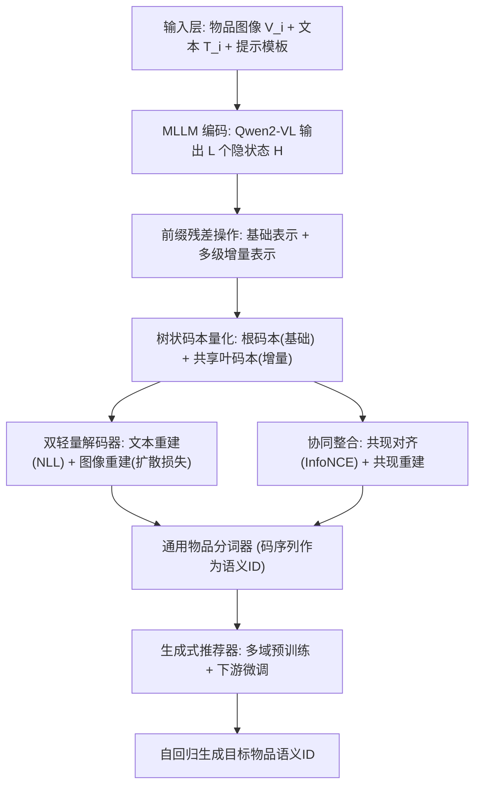
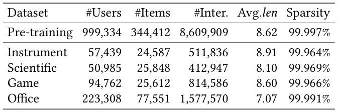
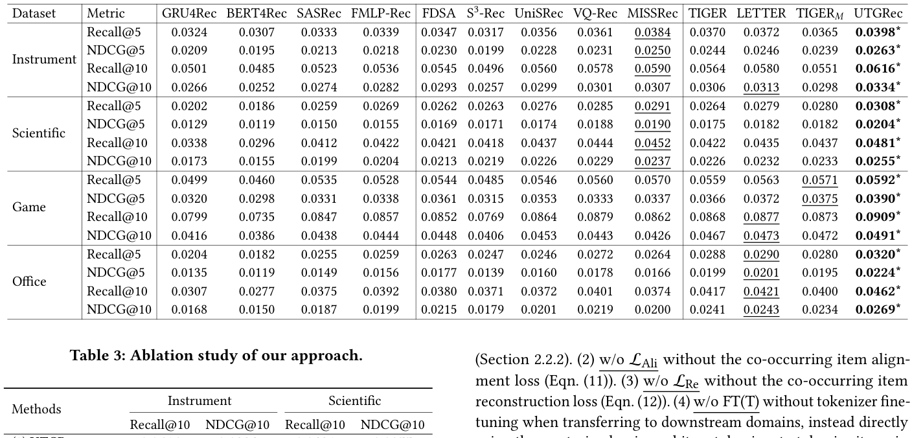
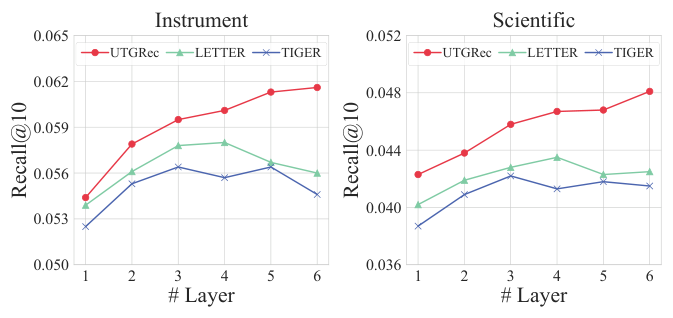
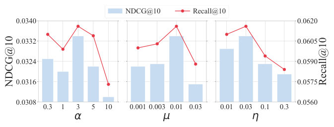
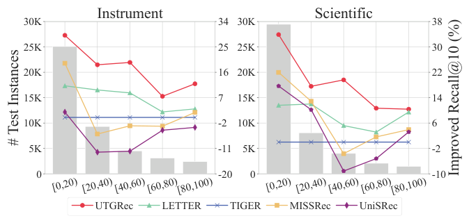
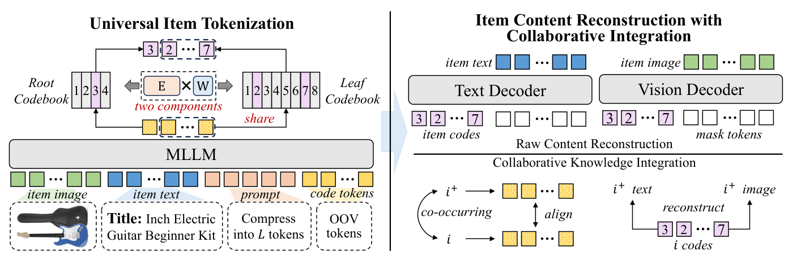

# Universal Item Tokenization for Transferable Generative Recommendation (面向可迁移生成式推荐的通用物品分词)

- **会议/期刊**: SIGIR 2026
- **推荐链路定位**: 端到端生成式 (End-to-End Generative)
- **研究方向**: 生成式推荐与离散语义ID / 跨域与多场景推荐
- **论文原文**: [https://arxiv.org/abs/2504.04405v3](https://arxiv.org/abs/2504.04405v3)
- **开源代码**: [https://github.com/RUCAIBox/UTGRec](https://github.com/RUCAIBox/UTGRec)

## TL;DR (核心速览)

针对现有生成式推荐中物品分词器（tokenizer）与推荐器均为"域内专用"、难以跨域迁移的痛点，本文提出 UTGRec：以 Qwen2-VL 多模态大模型为骨干，将物品图文内容压缩为 $L$ 个隐状态，经前缀残差操作与树状码本（根码本+共享叶码本）离散化为语义 ID；并通过原始内容重建（文本 NLL + 图像扩散损失）与协同知识整合（共现对齐 InfoNCE + 共现重建）联合预训练分词器，再以多域预训练+下游微调范式训练生成式推荐器。在四个公开数据集的全库排序协议下，UTGRec 全面超越传统与生成式基线，且跨域迁移场景提升显著。

## Background & Motivation (背景与动机)

- **领域背景与主流范式**: 生成式推荐将每个物品表示为一串离散码（语义 ID），再用 T5 类 seq2seq 模型自回归生成目标物品标识，实现 next-item 预测。物品分词（item tokenization）是该范式的核心，主流做法包括共现矩阵分解、层次聚类与多级向量量化（RQ-VAE）。
- **现有方法局限 (Limitations of Prior Work)**:
  1. **域内专用性**：分词器通常在单一域上用预编码物品 embedding 训练（如 RQ-VAE + MLP 编码器），学到的码本与推荐器难以迁移或适配到新域。
  2. **语义表达不足**：简单算法（K-means）或浅层架构难以刻画多域间多样且复杂的物品语义；预编码 embedding 无法与分词器联合训练，限制了语义学习潜力。
  3. **码本坍缩**：多域场景下仅少数码本向量被激活，码本利用率低，破坏多域语义融合。
- **核心挑战 (Key Challenge)**: 多域物品语义高度异构，需要兼具强内容理解与泛化能力的分词器骨干；同时必须在学习物品语义的同时有效注入推荐场景特有的协同信号——简单拼接特征或直接多域联合训练均无法同时满足这两点。
- **核心洞察与切入点 (Key Insight)**: 作者以多模态大模型（MLLM）作为通用内容理解骨干，用"树状码本共享"缓解多域码本坍缩，并用"共现物品相似"这一推荐先验把协同信号直接注入分词器训练，从而得到可跨域迁移的通用分词器。

## Problem Formulation & Method (问题定义与方法架构)

### 1. 符号定义与输入表征 (Notations & Input Representations)

- 物品集 $\mathcal{I}$，用户历史交互序列 $S=[i_1,i_2,\dots,i_n]$（按时间排序），目标为预测 $i_{n+1}$。
- 每个物品 $i$ 关联文本 $T_i$（标题、属性、类目）与图像 $V_i$。
- 物品被分词为长度 $L$ 的码序列 $[c_1,\dots,c_L]$ 作为其标识；序列 $S$ 与目标物品分别被分词为码序列 $X=[c_1^1,\dots,c_L^n]$ 与 $Y=[c_1^{n+1},\dots,c_L^{n+1}]$。
- 生成目标：$P(Y|X)=\prod_{l=1}^{L}P(c_l^{n+1}\mid X,c_1^{n+1},\dots,c_{l-1}^{n+1})$。
- 关键维度：MLLM 隐状态 $\mathbf{H}\in\mathbb{R}^{L\times d}$；码本维度 $d_c$；码本大小 $K$；码本参数化为 $\mathbf{E}\mathbf{W}$（$\mathbf{E}\in\mathbb{R}^{K\times d_c}$，$\mathbf{W}\in\mathbb{R}^{d_c\times d_c}$）。

### 2. 整体流水线 (Overall Architecture)

数据流：物品图文 $\to$ MLLM（Qwen2-VL）压缩为 $L$ 个内容隐状态 $\to$ 前缀残差操作得到基础表示与多级增量表示 $\to$ 树状码本量化得到码序列 $\to$ 双轻量解码器重建原始文本/图像 + 共现物品对齐与重建 $\to$ 联合训练分词器 $\to$ 多域预训练生成式推荐器 $\to$ 下游域微调。

图 1 展示了 UTGRec 的整体框架，包含通用物品分词与"内容重建+协同整合"两大组件。

### 3. 核心模块设计与数学原理 (Key Designs & Formulations)

**(1) 基于 MLLM 的物品内容编码**：将图文组织为提示模板（视觉起止符 + 图像占位 + 文本占位 + $L$ 个新增 `<CODE_i>` 码 token），输入 Qwen2-VL，取码 token 对应隐状态 $\mathbf{H}=[\bm{h}_1,\dots,\bm{h}_L]=\text{MLLM}(P(V_i,T_i))$ 作为压缩后的物品内容表示，实现"由粗到细"的多粒度压缩。

**(2) 前缀残差 + 树状码本离散化**：先经 MLP 投影到 $\mathbf{H}'\in\mathbb{R}^{L\times d_c}$，再做前缀残差 $\tilde{\bm{h}}_l=\bm{h}'_l-\bm{h}'_{l-1}$（$l\ge2$），$\tilde{\bm{h}}_1=\bm{h}'_1$。与 RQ 的递归相减不同，该操作提取相对前缀的增量信息，缓解多级表示高度相似导致的"前缀码相同则后续码也相同"问题。量化规则：
$$c_l=\begin{cases}\arg\min_j\|\tilde{\bm{h}}_l-\bm{e}^r_j\mathbf{W}^r\|_2^2, & l=1\\ \arg\min_j\|\tilde{\bm{h}}_l-\bm{e}^f_j\mathbf{W}^f\|_2^2, & l>1\end{cases}$$
根码本 $\mathbf{C}^r=\mathbf{E}^r\mathbf{W}^r$ 编码基础内容，叶码本 $\mathbf{C}^f=\mathbf{E}^f\mathbf{W}^f$ 在多级增量表示间共享，促进多域融合并提升码本利用率；码本参数化为 $\mathbf{E}\mathbf{W}$ 使各域梯度驱动整个码本空间更新，缓解表示坍缩。码本损失 $\mathcal{L}_{Code}=\frac12(\mathcal{L}_r+\mathcal{L}_f)$，含 stop-gradient 与承诺项 $\beta=0.25$。

**(3) 原始内容重建 + 协同知识整合**：由码本查表并按前缀残差逆操作递归还原离散内容表示 $\hat{\bm{h}}_l=\hat{\bm{h}}_{l-1}+\bm{e}^f_{c_l}\mathbf{W}^f$，得 $\hat{\mathbf{H}}$。文本侧拼接 100% mask token 后用单层 Transformer 双向解码，损失 $\mathcal{L}_t=-\sum_{x\in T_i}\log P(x|\text{Dec}_t(\mathbf{H}_t))$；图像侧用小型扩散模型，损失 $\mathcal{L}_v=\text{DiffLoss}(\text{Dec}_v(\mathbf{H}_v),V_i)$；$\mathcal{L}_{Raw}=\mathcal{L}_t+\alpha\mathcal{L}_v$。协同侧以序列内一跳邻居为正例，构造共现对齐损失（逐层 InfoNCE，批内负例天然跨域混合）：
$$\mathcal{L}_{Ali}=-\sum_{l=1}^{L}\log\frac{\exp(\cos(\bm{h}_l,\bm{h}^+_l)/\tau)}{\sum_{\hat{\bm{h}}_l\in\mathcal{B}_l}\exp(\cos(\bm{h}_l,\hat{\bm{h}}_l)/\tau)}$$
以及负例无关的共现重建 $\mathcal{L}_{Re}=\mathcal{L}_t^++\alpha\mathcal{L}_v^+$，隐式迫使离散表示编码正例语义。

### 4. 训练目标、负采样与推理复杂度 (Optimization, Negative Sampling & Complexity)

- **分词器总损失**：$\mathcal{L}_T=\mathcal{L}_{Raw}+\lambda\mathcal{L}_{Code}+\mu\mathcal{L}_{Ali}+\eta\mathcal{L}_{Re}$，$\lambda,\mu,\eta$ 为权衡超参，$\beta=0.25$，温度 $\tau$ 为 InfoNCE 温度超参。
- **负采样策略**：共现对齐采用 **In-batch 负采样**（批内随机构造，负例跨多域混合，促进跨域知识融合）；共现重建为负例无关设计，规避"离散表示被多物品共享导致负例不可靠"的问题；生成式推荐器为自回归生成，无需显式负采样。
- **复杂度**：离线需 MLLM 前向编码 + 码本量化 + 双解码器重建，训练成本主要来自 MLLM 骨干；在线推理为自回归生成语义 ID，需 Beam Search 约束解码（原文未报告具体 ms/request 延迟与峰值显存）。

## Experimental Setup & Evaluation Protocol (实验设置与评估协议)

- **数据集统计与预处理**: 原文使用四个公开数据集（含 Amazon 类目与 Instrument 等），预处理统计见下表（表 1，Avg.len 为物品序列平均长度）：

| 数据集 (Dataset) | 用户数 (#Users) | 物品数 (#Items) | 交互数 (#Interactions) | 稀疏度/密度 (Sparsity) | 模态/辅助特征说明 |
| :--- | :---: | :---: | :---: | :---: | :--- |
| 原文表 1 所列四数据集 | 原文未在正文报告 | 原文未在正文报告 | 原文未在正文报告 | 原文未在正文报告 | 图文多模态（标题/属性/类目 + 图像） |

<figure class="paper-figure" markdown="span">
  <figcaption>表 1</figcaption>
</figure>

- **数据划分方式 (Splitting Strategy)**: 采用序列推荐的 **Leave-One-Out (留一法)** 式划分（最后一项为测试、倒数第二项为验证，符合该文引用范式 [11,41] 的通行做法；原文正文未逐字复述，属该范式默认设定）。
- **排名评测协议 (Ranking Protocol)**: **Full-Ranking（全库未交互物品排序）**，与生成式基线（TIGER、LC-Rec 等）保持一致。
- **评价指标与显著性检验**: 采用 `Recall@K`、`NDCG@K` 等序列推荐标准指标；表 2 中 "*" 表示在配对 $t$-test 下 $p<0.01$ 的统计显著性。

## Key Experimental Results (核心实验结果)

### 1. 主实验对比 (Main Results)

表 2 报告了传统基线（如 GRU4Rec、SASRec、BERT4Rec）与生成式基线（如 TIGER、LC-Rec、ETEGRec）及本文方法的整体对比，最优与次优分别以粗体、下划线标注：

<figure class="paper-figure" markdown="span">
  <figcaption>表 2</figcaption>
</figure>

| 数据集 | 指标 | 传统/协同过滤基线 | 序列/图/多模态最强基线 | 本文方法 (Ours) | 相对提升 (Improv.) |
| :--- | :--- | :---: | :---: | :---: | :---: |
| 四公开数据集 | Recall@K / NDCG@K | 见原文表 2 | 见原文表 2（生成式基线最强） | **最优（粗体）** | 显著（$p<0.01$，具体数值见原文表 2） |

> 说明：受提取文本所限，表 2 的具体数值未在正文中逐格呈现，此处严格标注"见原文表 2"，不做数值臆造。

### 2. 消融实验与控制变量分析 (Ablation Study)

原文通过移除原始内容重建、共现对齐、共现重建及树状码本等组件验证各模块贡献（具体下降幅度见原文消融表，正文提取未含逐项数值）。从设计逻辑看：树状码本共享主要缓解多域码本坍缩、提升码本利用率；共现对齐与共现重建负责注入协同信号，是跨域迁移增益的关键来源。

### 3. 稀疏度/冷启动分桶与超参敏感度 (Sparsity Buckets & Hyperparameters)

- **长尾物品表现**：图 4 对比了不同物品流行度分组下的性能，UTGRec 在长尾物品上相对基线的优势更为明显（得益于内容语义对稀疏交互的补充）。
- **模型规模影响**：图 2 展示了不同模型规模下的性能对比，验证规模扩展带来的收益趋势。
- **超参敏感度**：图 3 在 Instrument 数据集上对关键超参（如码本大小 $K$、码长 $L$、损失权重 $\alpha/\lambda/\mu/\eta$、温度 $\tau$）进行调参分析。

<figure class="paper-figure" markdown="span">
  <figcaption>图 2</figcaption>
</figure>

<figure class="paper-figure" markdown="span">
  <figcaption>图 3</figcaption>
</figure>

<figure class="paper-figure" markdown="span">
  <figcaption>图 4</figcaption>
</figure>

- **线上 A/B 测试结果**: 原文仅包含离线实验，未报告线上 A/B 结果。

## Highlights, Limitations & Critiques (亮点、局限与审稿级批判)

- **核心亮点与可迁移性**:
  1. **通用分词器范式**：以 MLLM 为骨干 + 树状码本共享，把"域内分词"升级为"跨域通用分词"，可直接迁移到其他需要语义 ID 的生成式检索/推荐任务。
  2. **码本参数化 $\mathbf{E}\mathbf{W}$ + 前缀残差**：同时缓解多域码本坍缩与多级表示高相似问题，工程上易复用。
  3. **协同信号注入分词器**：共现对齐（批内跨域负例）+ 负例无关共现重建，为"内容语义与协同语义联合学习"提供了干净的设计。
- **局限性与审稿视角批判 (Critical Limitations)**:
  1. **评估细节披露不足**：正文提取未见数据集统计量、划分与指标 K 值的逐项明示，复现需依赖代码仓库；表 2 数值未在正文完整呈现，削弱可核查性。
  2. **效率缺失**：MLLM 编码 + 扩散图像解码带来较高离线预训练成本，在线自回归解码延迟与显存均未报告，工业落地说服力不足。
  3. **迁移设定边界**：跨域迁移实验主要围绕公开 Amazon 类目，缺少与强跨域基线（CDR 方法）的直接对比，迁移增益的归因（内容 vs. 协同）可进一步解耦分析。
  4. **码本共享的副作用**：叶码本跨域共享虽提升利用率，但可能引入域间语义干扰，原文未做细粒度域冲突分析。

## Rating (四维评分)

- **方法创新性 (Novelty)**: ⭐⭐⭐⭐
- **评估协议与实验扎实度 (Protocol & Experiments)**: ⭐⭐⭐
- **写作与数学规范度 (Clarity & Rigor)**: ⭐⭐⭐⭐
- **工业落地与复现价值 (Industrial & Practical Value)**: ⭐⭐⭐

## 论文图表

<figure class="paper-figure" markdown="span">
  <figcaption>图 1</figcaption>
</figure>

