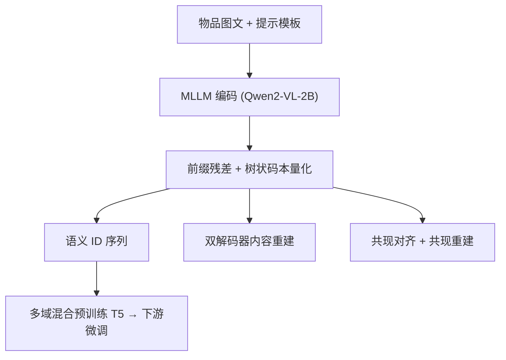

# Universal Item Tokenization for Transferable Generative Recommendation (面向可迁移生成式推荐的通用物品分词)

- **会议/期刊**: SIGIR 2026
- **作者与机构**: Bowen Zheng, Wayne Xin Zhao, Ji-Rong Wen (中国人民大学高瓴人工智能学院)；Hongyu Lu, Yu Chen (腾讯微信)
- **推荐链路定位**: 端到端生成式（物品分词器 + 生成式推荐器）
- **研究方向**: 生成式推荐与离散语义 ID / 跨域与多场景推荐
- **论文原文**: [https://arxiv.org/abs/2504.04405v3](https://arxiv.org/abs/2504.04405v3)
- **开源代码**: [https://github.com/RUCAIBox/UTGRec](https://github.com/RUCAIBox/UTGRec)

## TL;DR (1分钟核心速览)

现有生成式推荐的分词器（RQ-VAE/层次聚类）与推荐器均为**域内专属**，换域即失效。UTGRec 用 MLLM（Qwen2-VL-2B）把物品图文压缩为 $L$ 个内容表征，经**前缀残差 + 树状码本**离散化为语义 ID，并以**原始内容重建 + 共现物品对齐/重建**联合训练，得到跨域通用分词器；再在多域混合码序列上预训练 T5 推荐器并做"冻结码本矩阵、仅调投影"的轻量微调。在 4 个 Amazon 下游域、Leave-One-Out + Full-Ranking 协议下，Recall@10 相对最强基线提升 4.4%–9.7%，且模型加深时性能持续上涨而非过拟合。

## Background & Motivation (背景与核心矛盾)

- **主流范式**: 生成式推荐将物品映射为多级码序列（语义 ID），用 T5 自回归生成目标 ID；分词器多基于单域预编码 embedding 训练 RQ-VAE 或做层次聚类。
- **前人局限**: ①分词器与推荐器均域内专属，跨域无法迁移；直接把 K-means/RQ-VAE(MLP) 扩到多域，难以刻画多域异构语义，且预编码 embedding 无法与分词器联合优化。②多域下码本**表征坍缩**严重——每域仅少数码本向量被激活，破坏多域融合。
- **核心洞察**: 物品图文内容本身携带跨域通用语义，而共现关系携带推荐专属协同知识；二者应在**同一个可联合训练的分词器**内被同时编码，而非事后拼接。
- **本文切入点**: 以 MLLM 为编码骨干 + 树状共享码本 + 内容/协同双路重建，把"分词器"从域内组件升级为可预训练、可微调的通用基础设施。

## Method (核心方法设计)

### 1. 整体框架 (Overall Architecture)

物品图文经提示模板送入 Qwen2-VL-2B，输出 $L$个 code token 隐状态$\mathbf{H}\in\mathbb{R}^{L\times d}$作为压缩内容表征；经前缀残差拆为基本表征与多级增量表征，分别由根码本与共享叶码本量化得到语义 ID$[c_1,\dots,c_L]$。训练侧用双轻量解码器从离散表征重建原始文本与图像，并引入共现物品的对比对齐与跨物品重建注入协同信号。下游阶段：先用通用分词器把多域交互序列统一编码、混合预训练 T5 推荐器，再在新域上冻结码本矩阵、仅微调投影矩阵与推荐器。

<figure class="paper-figure" markdown="span">
  <figcaption>图1：UTGRec的整体框架。</figcaption>
</figure>

### 2. 关键设计拆解 (Key Designs)

1. **树状码本 + 前缀残差（解决码本坍缩与码间高相似）**：MLLM 压出的 $L$个表征同源、高度相似，导致同前缀物品后缀码也雷同；且多域下码本碎片化。本文先做前缀残差$\tilde{\boldsymbol{h}}_l=\boldsymbol{h}'_l-\boldsymbol{h}'_{l-1}\ (l\ge 2)$提取增量信息，再将码本参数化为$\mathbf{C}_r=\mathbf{E}_r\mathbf{W}_r$、$\mathbf{C}_f=\mathbf{E}_f\mathbf{W}_f$，根码本管基本表征、叶码本被所有增量层**共享**。量化式为$c_l=\arg\min_j\|\tilde{\boldsymbol{h}}_l-\boldsymbol{e}^{(r/f)}_j\mathbf{W}^{(r/f)}\|_2^2$。共享叶码本 + 投影矩阵联合更新使各域梯度共同驱动整个码本空间，抑制碎片化。
2. **原始内容重建 + 协同知识注入（解决"语义通用但不懂推荐"）**：以往用预编码 embedding 作重建目标，信息有损。本文把离散表征逆残差还原为 $\hat{\mathbf{H}}$，拼接 mask token 后由单层 Transformer 文本解码器做 100% 掩码的 MLM 式重建，图像侧用小型扩散模型以扩散损失重建：$\mathcal{L}_{Raw}=\mathcal{L}_t+\alpha\mathcal{L}_v$。协同侧基于"共现即相似"，对共现正样本做 InfoNCE 对齐$\mathcal{L}_{Ali}$（批内负样本天然跨域混合），并**用当前物品的离散表征去重建正样本内容**$\mathcal{L}_{Re}=\mathcal{L}_t^++\alpha\mathcal{L}_v^+$——该损失与负样本无关，规避了"共享码本导致正负样本表征重叠"使对比学习失真的问题。
3. **训练目标与迁移策略**：分词器总损失 $\mathcal{L}_T=\mathcal{L}_{Raw}+\lambda\mathcal{L}_{Code}+\mu\mathcal{L}_{Ali}+\eta\mathcal{L}_{Re}$（$\lambda=200$，$\alpha=3,\mu=0.01,\eta=0.03$）。推荐器用标准 NLL$\mathcal{L}_R=-\sum_l\log P(c_l^{n+1}\mid X,c_{<l}^{n+1})$，T5 骨干、beam=50。码冲突处理上，不用额外无语义码，而是把末级码重指派为次近邻码。下游微调**冻结$\mathbf{E}_r,\mathbf{E}_f$、只调$\mathbf{W}_r,\mathbf{W}_f$**，保住预训练码间关联。

## Experimental Setup & Evaluation Protocol (实验设置与评估协议)

- **数据集与预处理**: Amazon 2023 评论集，5 域预训练 + 4 域下游，全部 `5-core` 过滤，序列按时间排序、截断至 20：

| 数据集 | #Users | #Items | #Interactions | 稀疏度 | 角色 |
| :--- | :---: | :---: | :---: | :---: | :--- |
| Pre-training (5 域合并) | 999,334 | 344,412 | 8,609,909 | 99.997% | 预训练 |
| Instrument | 57,439 | 24,587 | 511,836 | 99.964% | 下游 |
| Scientific | 50,985 | 25,848 | 412,947 | 99.969% | 下游 |
| Game | 94,762 | 25,612 | 814,586 | 99.966% | 下游 |
| Office | 223,308 | 77,551 | 1,577,570 | 99.991% | 下游 |

- **数据划分与防穿越**: `Leave-One-Out`——每用户最后一项为测试、倒数第二项为验证、其余训练。
- **排名评测协议**: 无偏 `Full-Ranking`（全物品集排序），指标 Recall@{5,10}、NDCG@{5,10}；生成式模型统一 beam size = 50。
- **对比基线与超参**: 三类基线——传统序列（GRU4Rec/BERT4Rec/SASRec/FMLP-Rec）、内容迁移（FDSA/S3-Rec/UniSRec/VQ-Rec/MISSRec）、生成式（TIGER/LETTER/TIGER$_M$）。码本根 256 / 叶 512（总向量数与 TIGER 对齐），$L=3$，LoRA 微调 MLLM，显著性用配对 t 检验$p<0.01$。

## Key Experimental Results (实验关键数据)

### 1. 主实验对比 (Main Results)

| 数据集 | 指标 | MISSRec | TIGER | LETTER | TIGER$_M$ | **UTGRec** | Improv. |
| :--- | :--- | :---: | :---: | :---: | :---: | :---: | :---: |
| Instrument | R@10 | 0.0590 | 0.0564 | 0.0580 | 0.0551 | **0.0616** | +4.4% |
| Instrument | N@10 | 0.0307 | 0.0306 | 0.0313 | 0.0298 | **0.0334** | +6.7% |
| Scientific | R@10 | 0.0452 | 0.0422 | 0.0435 | 0.0437 | **0.0481** | +6.4% |
| Scientific | N@10 | 0.0237 | 0.0226 | 0.0232 | 0.0233 | **0.0255** | +7.6% |
| Game | R@10 | 0.0862 | 0.0868 | 0.0877 | 0.0873 | **0.0909** | +3.7% |
| Game | N@10 | 0.0426 | 0.0467 | 0.0473 | 0.0472 | **0.0491** | +3.8% |
| Office | R@10 | 0.0374 | 0.0417 | 0.0421 | 0.0400 | **0.0462** | +9.7% |
| Office | N@10 | 0.0200 | 0.0241 | 0.0243 | 0.0234 | **0.0269** | +10.7% |

（Improv. 相对最强非本文基线；全部提升在 $p<0.01$ 下显著。）

### 2. 消融实验 (Ablation Study)

| 变体 | Instrument R@10 | Instrument N@10 | Scientific R@10 | Scientific N@10 |
| :--- | :---: | :---: | :---: | :---: |
| (0) UTGRec | **0.0616** | **0.0334** | **0.0481** | **0.0255** |
| (1) w/o TreeCode | 0.0591 | 0.0319 | 0.0457 | 0.0239 |
| (2) w/o $\mathcal{L}_{Ali}$ | 0.0599 | 0.0321 | 0.0464 | 0.0243 |
| (3) w/o $\mathcal{L}_{Re}$ | 0.0607 | 0.0326 | 0.0468 | 0.0246 |
| (4) w/o FT(T) | 0.0551 | 0.0302 | 0.0415 | 0.0218 |
| (5) Full FT | 0.0559 | 0.0304 | 0.0423 | 0.0225 |
| (6) w/o PT(R) | 0.0583 | 0.0315 | 0.0451 | 0.0236 |
| (7) w/o PT | 0.0575 | 0.0310 | 0.0444 | 0.0232 |

### 3. 关键实验发现 (Key Findings)

1. **分词器微调是迁移的命门**：去掉分词器微调（变体 4）掉点最狠，Instrument R@10 从 0.0616 跌至 0.0551（−10.6%），甚至低于"完全不预训练"（变体 7，0.0575）——说明新域码字纠缠必须靠域内微调解开，否则预训练反而成负担；而全量微调码本（变体 5，0.0559）同样崩，证实"冻结 $\mathbf{E}$、只调$\mathbf{W}$"是保住码间关联的关键。
2. **协同信号与树状码本各自贡献可加**：去掉 $\mathcal{L}_{Ali}$/$\mathcal{L}_{Re}$ 分别掉 2.8%/1.5%（Instrument R@10），二者叠加的协同注入约贡献 4%；树状码本相对 RQ-VAE 式多级码本带来约 4% 增益，印证共享叶码本缓解了多域码本坍缩。
3. **可扩展性与长尾双赢**：TIGER/LETTER 加到 3 层以上即过拟合掉点，UTGRec 在 1→6 层持续上涨（图 2）；按物品流行度分桶后，UTGRec 在 [0,20) 冷门桶相对 TIGER 的 Recall@10 提升最大（图 4），而 UniSRec/MISSRec 仅在冷门桶占优、热门桶反被生成式模型反超——通用分词器把跨域内容先验真正转化成了长尾收益。

## Highlights & Limitations (亮点、对比与审稿批判)

- **与代表作对比 (vs. Prior Work)**: TIGER/LETTER 的 RQ-VAE 分词器绑定单域预编码 embedding，LETTER 虽加协同正则但仍域内闭环；UniSRec/VQ-Rec/MISSRec 虽做跨域通用表征，却仍停留在"序列表征 vs 候选表征算相似度"的传统范式。UTGRec 的本质差异是把通用性下沉到**分词器层**，使生成式检索范式首次具备跨域迁移能力。
- **可迁移亮点**: ①"冻结码本矩阵、只微调投影矩阵"的轻量域适应策略，可直接搬到任何 VQ/RQ 类语义 ID 体系的冷启动迁移；②用"当前物品离散表征重建正样本内容"替代对比学习，规避共享码本下正负样本表征重叠的失真，是一个通用的协同注入技巧。
- **审稿级局限批判**: ①分词器依赖 Qwen2-VL-2B + LoRA + 16 卡预训练 3 epoch，物品侧编码开销与工程成本远高于 RQ-VAE，论文未给出 tokenization 离线耗时与在线生成延迟的量化对比；②下游仅 4 个 Amazon 域、且预训练/下游同源同平台，跨平台（如 Amazon→淘宝）与严格零样本（不微调）场景未验证，"通用"边界仍待检验。

## Rating (四维评分)

- **方法创新性 (Novelty)**: ⭐⭐⭐⭐ （首次把物品分词器做成可预训练可迁移的通用组件，树状共享码本 + 负样本无关的共现重建设计有巧思）
- **评估协议与实验扎实度 (Protocol & Experiments)**: ⭐⭐⭐⭐ （Full-Ranking + Leave-One-Out + $p<0.01$ 显著性，12 个基线三类覆盖，消融 7 变体完整；扣分在仅 Amazon 单平台）
- **写作与数学规范度 (Clarity & Rigor)**: ⭐⭐⭐⭐ （公式链条清晰、码本损失与残差逆运算交代完整，但 MLLM 提示模板与码冲突重指派细节略简）
- **工业落地与复现价值 (Industrial & Practical Value)**: ⭐⭐⭐⭐ （代码已开源、微调策略轻量可落地；但 MLLM 分词器的离线编码成本是大规模上线的现实门槛）

