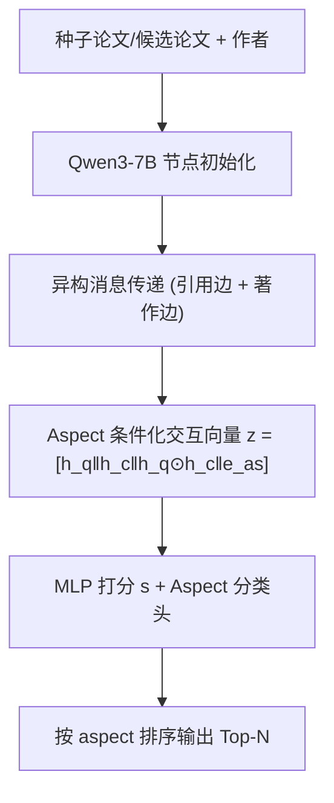
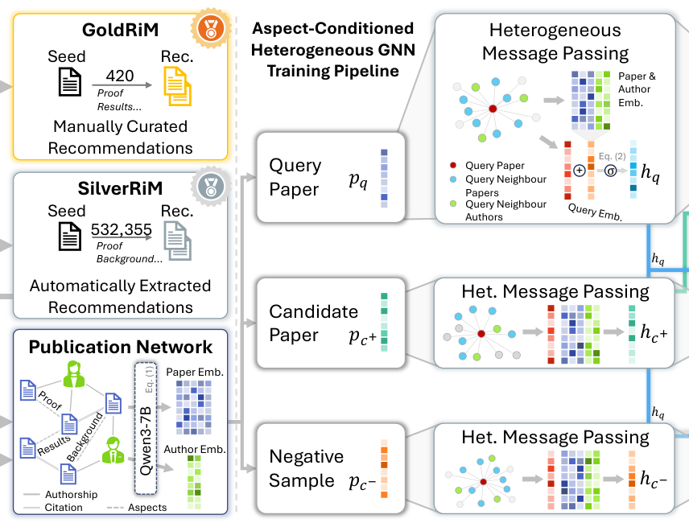

# Aspect-Aware Content-Based Recommendations for Mathematical Research Papers (面向数学研究论文的方面感知内容推荐)

- **会议/期刊**: SIGIR 2026
- **作者与机构**: Ankit Satpute 等（FIZ Karlsruhe / 哥廷根大学 / NII）
- **推荐链路定位**: 召回（内容式候选检索）
- **研究方向**: 图神经网络与知识图谱推荐 / 冷启动与长尾推荐
- **论文原文**: [https://arxiv.org/abs/2605.03861v1](https://arxiv.org/abs/2605.03861v1)
- **开源代码**: [https://github.com/gipplab/MathAspectRecSys](https://github.com/gipplab/MathAspectRecSys)

## TL;DR (1分钟核心速览)

数学论文的相关性由"概念关系"（推广、限制、证明复用）决定，而非文本或引用重叠，导致 LLM 嵌入式 CbRPR 失效。作者先做专家研究，提出 4 类数学专属 aspect（Specialization/Restriction、Modification/Generalization、Results、Prove/Cases），构建 GoldRiM（420 对专家标注）与 SilverRiM（53 万对自动抽取）数据集，并提出 AchGNN——在论文-作者异构图上传消息、在打分层做 aspect 条件化的 GNN。在 Full-Ranking 协议下，GoldRiM 上 General MRR 达 0.593，相对 GraphCL 提升 26%，相对 SciBERT-FT 提升 5 倍以上。

## Background & Motivation (背景与核心矛盾)

- **主流范式**: CbRPR 主流做法是 LLM 嵌入相似度检索（SPECTER/SciBERT-FT/Qwen3-7B）或异构图 GNN 联合建模引用与作者结构（GraphCL）。
- **前人局限**: ① 数学论文通过抽象、符号压缩与演绎推理相连，专家推荐对的 2-gram Jaccard 均值仅 0.031，Qwen3-7B 嵌入相似度甚至低于随机全局文档，文本/语义信号近乎无效；② 引用信号也稀疏——23% 的推荐对之间无引用路径，bibliographic coupling 与 co-citation 召回仅 34%/35%。
- **核心洞察 (Key Insight)**: 与专家共同标注 420 对推荐后发现，相关性本质是 **aspect 驱动**的（66 个细粒度标签可归并为 4 类高层 aspect），且这些关系在 zbMATH 评审摘要中被显式表述，可规模化抽取。
- **本文切入点**: 把电商领域的 aspect 条件化建模迁移到学术图，用"aspect 条件打分 + 作者谱系"补足纯语义与纯引用的双重失效。

## Method (核心方法设计)

### 1. 整体框架 (Overall Architecture)

两阶段：先"接地"——用 zbMATH Open 专家评审摘要构建 GoldRiM（80 种子、420 对、单专家 30 年经验标注）与 SilverRiM（Qwen2.5-14B 抽取 212K 种子、532K 对、7,326 个关系短语，再用 k-means 对齐到 4 类 aspect 本体）。再建模——构建论文节点 + 作者节点的异构图，边含 aspect 标注边、引用边、著作边；节点用 Qwen3-7B 嵌入初始化（摘要中显式引用已剔除防泄漏），经 GraphSAGE 式异构消息传递后，在打分层做 aspect 条件化相似度计算与辅助 aspect 分类，联合 BPR 排序损失训练。

<figure class="paper-figure" markdown="span">
  <figcaption>图 2：AchGNN 的架构与学习流程。</figcaption>
</figure>

### 2. 关键设计拆解 (Key Designs)

1. **Aspect 条件化打分（打分层而非消息传递层做条件化）**：若在消息传递中注入 aspect，会把多个 aspect 纠缠进同一节点嵌入。本文改为在最终嵌入上拼接 aspect 嵌入构造交互向量 $z^{(as_k)}_{q,c}=[h_q\|h_c\|h_q\odot h_c\|e_{as_k}]$，再由 MLP 输出标量分$s^{(as_k)}_{q,c}=f_{score}(z^{(as_k)}_{q,c})$。直觉：对称交互项$h_q\odot h_c$捕捉共性，$e_{as_k}$ 让同一对论文在不同 aspect 下获得不同排序，实现相关性维度解耦。

2. **辅助 Aspect 预测任务**：仅靠 BPR 无法保证嵌入区分 aspect。对正样本对构造 $z_{q,c}=[h_q\|h_c\|h_q\odot h_c]$，经 MLP 输出$\hat{y}_{q,c}\in\mathbb{R}^{|\mathcal{AS}|}$，用交叉熵$\mathcal{L}_{aspect}=\mathrm{CE}(\mathrm{softmax}(\hat{y}_{q,c}),as_k)$ 监督。负样本对不参与该任务（其 aspect 未定义），aspect 类间竞争提供隐式负监督。

3. **训练目标、负采样与推理效率**：总损失 $\mathcal{L}=\mathcal{L}_{rank}+\lambda\mathcal{L}_{aspect}$，其中$\mathcal{L}_{rank}=-\log\sigma(s^{(as_k)}_{q,c^+}-s^{(as_k)}_{q,c^-})$。负样本用 Qwen3-7B 嵌入检索 top 候选构造 **hard negative**（排除训练集文档）。超参：论文邻居 15、作者邻居 5、层数$L=2$、$\lambda=0.2$。推理时对全库 380 万篇文档算 aspect 条件分并排序，作者节点嵌入可预计算，开销主要在 GNN 前向。

## Experimental Setup & Evaluation Protocol (实验设置与评估协议)

- **数据集与预处理**:

| 数据集 | #Seeds | #Rec.Pairs | #Aspects | 平均推荐数/种子 | 说明 |
| :--- | :---: | :---: | :---: | :---: | :--- |
| GoldRiM | 80 | 420 | 4 | 5.25 | 单专家标注，仅测试 |
| SilverRiM | 212,382 | 532,355 | 4 | 2.50 | LLM 抽取 + 聚类对齐 |
| PwC | 157,606 | 1,227,058 | 3 | 7.78 | 机器学习论文，跨域验证 |

- **数据划分与防穿越**: GoldRiM 仅作测试集；SilverRiM 与 PwC 按 **75%/25% 比例划分**，5 折交叉验证。训练与评测前**移除摘要中所有对 zbMATH 文档的显式引用**，防止模型利用引用线索作弊。
- **排名评测协议**: 每个 aspect 独立构建检索任务，种子文档对 **380 万篇英文 zbMATH 全库**做 kNN 检索（cosine），即无偏 **Full-Ranking**；另设 General 设置将所有 aspect 测试文档混合检索。报告 P@10、R@10、MRR@10。
- **对比基线与超参**: 公式检索 Approach0、MathIR 稠密检索 DPR/Mabowdor、BERT 系 SPECTER/SciBERT/SciBERT-FT、LLM 嵌入 Qwen2-7B/Qwen3-7B/Qwen3-7B-FT/Memtron、图基线 GraphCL；所有模型参数量 <8B 以贴合数字图书馆部署约束。

## Key Experimental Results (实验关键数据)

### 1. 主实验对比 (Main Results)

GoldRiM（General 设置，k=10）：

| 方法 | P@10 | R@10 | MRR@10 |
| :--- | :---: | :---: | :---: |
| SciBERT-FT | 0.075 | 0.133 | 0.261 |
| Qwen3-7B | 0.106 | 0.213 | 0.413 |
| Qwen3-7B-FT | 0.122 | 0.245 | 0.475 |
| Memtron | 0.091 | 0.187 | 0.343 |
| GraphCL | 0.271 | 0.352 | 0.471 |
| **AchGNN** | **0.341** | **0.425** | **0.593** |
| AchGNN_noMath | 0.324 | 0.403 | 0.566 |

SilverRiM（General）：GraphCL MRR 0.396 → **AchGNN 0.410**；Qwen3-7B-FT 0.409。PwC 跨域：AchGNN 在 Task aspect 上 P 0.478 / MRR 0.524，Method 上 P 0.512 / MRR 0.469，与 SciBERT-FT（Task MRR 0.708）互有胜负，证明方法可迁移但非全面碾压。

### 2. 消融实验 (Ablation Study)

| 变体 | 相对 R@10 下降 (GoldRiM) | 结论 |
| :--- | :---: | :--- |
| 移除 Specialization/Restriction 监督 | 最大（约 20%+） | 该 aspect 样本最多、贡献最大 |
| 移除 Prove/Cases 监督 | 最小 | 训练样本最少、相关性高度局部化 |
| 随机化作者边 | 最差，超过任一单 aspect 移除 | 作者信号是语义谱系而非单纯连通性 |
| 移除全部作者信息 | 显著下降 | 作者边仅占约 12% 连接但作用关键 |
| AchGNN_noMath（去公式） | 轻微下降 | 公式仅提供增量信号 |

### 3. 关键实验发现 (Key Findings)

1. **结构信号 > 语义信号**：GraphCL 与 AchGNN 共享同一图结构，AchGNN 仅靠 aspect 条件化打分就把 General MRR 从 0.471 提到 0.593（+26%），说明瓶颈不在图结构而在"是否按 aspect 解耦相关性维度"。
2. **作者谱系是数学领域的强信号**：随机化作者边造成的性能下降超过移除任一单个 aspect，而作者边仅占图连接约 12%，证明 AchGNN 学到的是"同一学派/证明风格"的语义谱系，而非噪声连通。
3. **aspect 消融几乎不外溢**：移除某 aspect 监督主要损害该 aspect 自身指标，General 设置下降很小，说明 aspect 条件化打分成功避免了多相关性维度坍缩进单一嵌入。

## Highlights & Limitations (亮点、对比与审稿批判)

- **与代表作对比 (vs. Prior Work)**: 相比 SciBERT-FT（PwC 上的 SOTA aspect-CbRPR），本文首次把 aspect 条件化从电商迁移到学术图并引入作者谱系；相比 GraphCL，本文不改图结构、只改打分与损失，却拿到 26% 相对提升，增量干净可复现。
- **可迁移亮点**: ① "打分层条件化 + 辅助分类头"的解耦范式可直接搬到多意图召回、多场景推荐；② 用 LLM 从评审摘要抽取关系短语再聚类对齐到小 aspect 本体，是低成本构建领域 aspect 标注的通用套路。
- **审稿级局限批判**: ① GoldRiM 仅 80 种子、单标注者、单一子领域（代数几何），统计效力与偏差存疑；② SilverRiM 上精度下降、相对优势收窄，说明 LLM 抽取标签噪声稀释了排序质量，且全库 380 万文档的 aspect 条件打分推理成本未做量化分析。

## Rating (四维评分)

- **方法创新性 (Novelty)**: ⭐⭐⭐⭐ （aspect 条件化打分 + 作者谱系建模组合新颖，但各组件在电商/学术图均有先例，属扎实迁移而非范式突破）
- **评估协议与实验扎实度 (Protocol & Experiments)**: ⭐⭐⭐⭐ （Full-Ranking 全库检索 + 5 折交叉验证 + 防引用泄漏处理严谨，但 GoldRiM 规模小、单标注者削弱结论稳健性）
- **写作与数学规范度 (Clarity & Rigor)**: ⭐⭐⭐⭐ （公式编号完整、符号统一，aspect 本体构建流程交代清楚；部分消融仅给相对下降百分比未给绝对值）
- **工业落地与复现价值 (Industrial & Practical Value)**: ⭐⭐⭐⭐⭐ （已部署 MaRDI 平台、数据集与代码全开源、模型 <8B 参数贴合真实数字图书馆部署约束）

