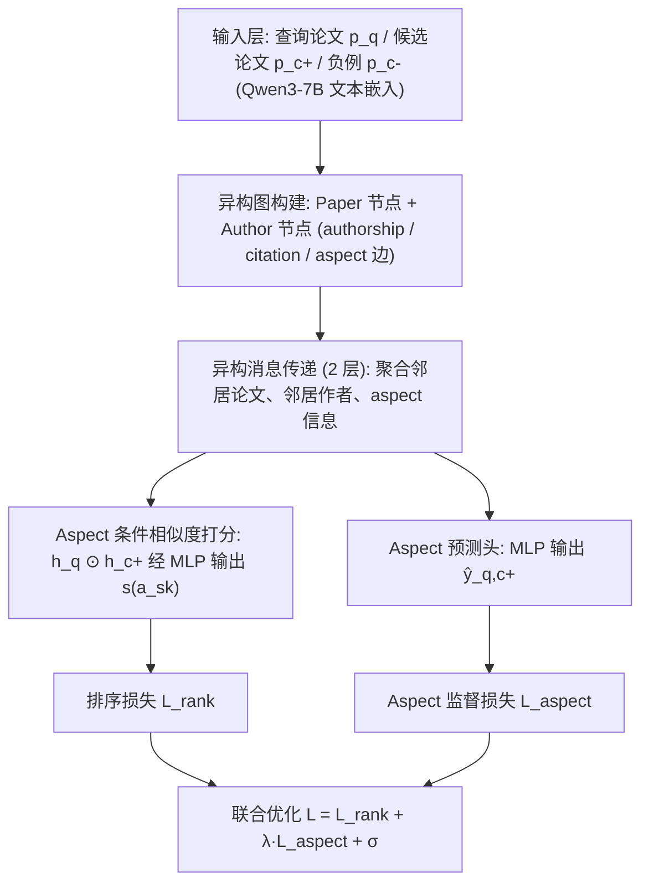
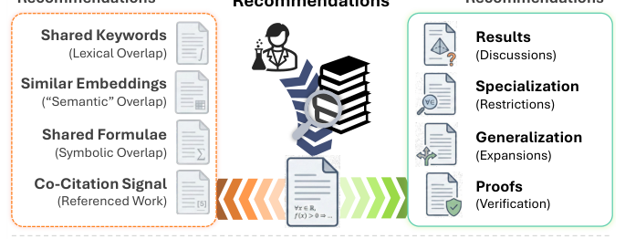
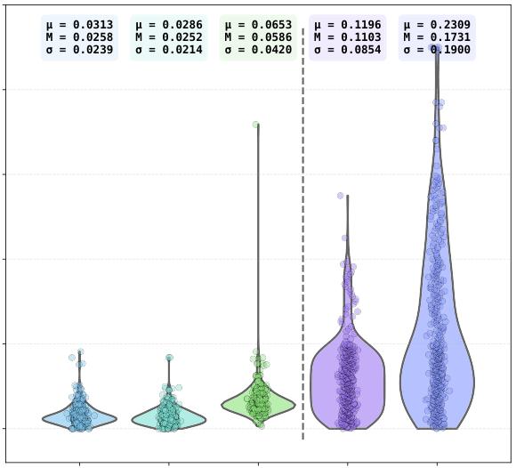
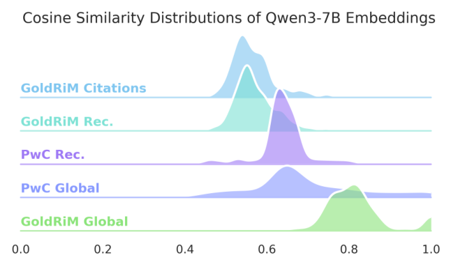
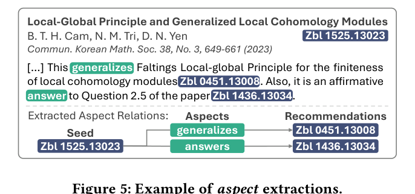
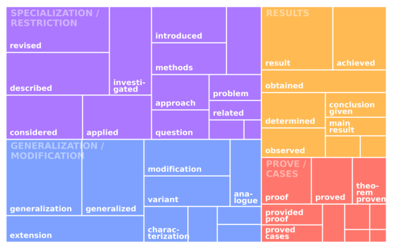

# Aspect-Aware Content-Based Recommendations for Mathematical Research Papers (面向数学研究论文的 Aspect 感知内容推荐)

- **会议/期刊**: SIGIR 2026 (49th International ACM SIGIR Conference)
- **推荐链路定位**: 召回 (Retrieval) — 候选论文内容召回
- **研究方向**: 图神经网络与知识图谱推荐 / 冷启动与长尾推荐（学术论文内容推荐）
- **论文原文**: [https://arxiv.org/abs/2605.03861v1](https://arxiv.org/abs/2605.03861v1)
- **开源代码**: [https://github.com/gipplab/MathAspectRecSys](https://github.com/gipplab/MathAspectRecSys) （注：预提取的 `huggingface.co/spaces/mteb` 为 MTEB 基准页面，非本文代码；正文明确给出 GitHub 仓库地址）

## TL;DR (核心速览)

针对数学论文"概念相关但文本/引用重叠极低"导致现有内容推荐失效的痛点，作者先做专家驱动研究，发现数学相关性本质是 **aspect 驱动**（Specialization/Modification/Results/Prove 四类），据此构建 GoldRiM（专家标注）与 SilverRiM（大规模自动抽取）两个数据集，并提出 **AchGNN**——aspect 条件异构图 GNN，联合建模文本语义、引用结构与作者谱系。在 GoldRiM/SilverRiM 上全面超越 LLM 嵌入与微调基线，并迁移至 Papers with Code 验证跨域泛化。

## Background & Motivation (背景与动机)

- **领域背景与主流范式**: 内容型论文推荐 (CbRPR) 在计算机科学与生物医学已较成熟，主流范式为 **LLM/领域微调嵌入 + 向量相似度检索**（SciBERT、SPECTER、Qwen3-7B 嵌入等），辅以异构图 GNN 联合建模 paper-author-venue 多实体关系。
- **现有方法局限 (Limitations of Prior Work)**:
  1. **文本相似度失效**：数学论文通过抽象、符号压缩与演绎推理关联，专家推荐对的 2-gram Jaccard 均值仅 **0.031**，远低于 PwC 数据集，TF-IDF/嵌入检索无法捕捉"对偶表述、证明策略复用"等深层联系。
  2. **引用结构覆盖不足**：GoldRiM 中 **23%** 的推荐对之间无引用路径；有路径者 43% 仅一跳、3% 两跳，区分度低；bibliographic coupling 召回仅 34%、co-citation 仅 35%。
  3. **现有 aspect 数据集缺失数学域**：已有 aspect-based CbRPR 数据集全部来自 CS/BM，遵循 IMRD 结构，无法迁移到高度符号化、缺乏显式结构标记的数学文本。
- **核心挑战 (Key Challenge)**: 简单拼接文本特征或加深网络无法解决——因为数学相关性由**领域特定角色**（泛化、限制、证明复用）决定，而非可观测的相似度信号；且 LLM 嵌入在数学文本上系统性欠佳（图 1 给出直观反例：Qwen3-7B 检索到表面相似论文，专家却推荐概念泛化论文）。
- **核心洞察与切入点 (Key Insight)**: 作者通过专家协作的 pilot study 发现相关性是 **aspect 驱动**的，且**作者谱系**（数学家倾向在狭窄子领域工作、复用证明风格、以作者名指代基础结果）可作为引用网络的自然延伸，弥补引用覆盖不足。由此提出 RQ1（数学相关性由什么构成）与 RQ2（文本+作者谱系联合建模的效果）。

## Problem Formulation & Method (问题定义与方法架构)

### 1. 符号定义与输入表征 (Notations & Input Representations)

- 论文集 $\mathcal{P}$、作者集 $\mathcal{A}$；查询论文 $p_q$ 及其表示 $h_q$，候选论文 $p_{c^+}$（正例）与 $p_{c^-}$（负例），表示分别为 $h_{c^+}$、$h_{c^-}$。
- Aspect 集合 $\mathcal{K}$ = {Specialization/Restriction, Modification/Generalization, Results, Prove/Cases}，共 4 类；aspect 嵌入记为 $e_{a_{s_k}}$。
- 文本编码器：**Qwen3-7B** 生成论文语义嵌入（作为节点初始特征）；图含 paper 节点与 author 节点，边类型包括 authorship、citation、aspect 关系。
- 输出：aspect 条件下的 query-candidate 相似度打分 $s_{q,c^+}(a_{s_k})$ 与 aspect 预测 $\hat{y}_{q,c^+}$。

### 2. 整体流水线 (Overall Architecture)

两阶段：(1) **Grounding 阶段**——基于 zbMATH Open 构建 GoldRiM（80 seed、420 专家推荐对）与 SilverRiM（大规模自动抽取，含 aspect 关系抽取，见图 5 示例）；(2) **AchGNN 建模阶段**——在 paper-author 异构图上传导消息，融合文本语义、引用与作者谱系，输出 aspect 条件相似度。

<figure class="paper-figure" markdown="span">
  <figcaption>图 2</figcaption>
</figure>

图 2 展示了 AchGNN 的整体架构与学习流程：左侧为 GoldRiM（人工标注）与 SilverRiM（自动抽取）两条数据构建路径，中间为 aspect 条件异构图 GNN 的消息传递，右侧为 aspect 条件相似度打分与 aspect 预测双头，最终以 $\mathcal{L} = \mathcal{L}_{rank} + \lambda \mathcal{L}_{aspect} + \sigma$ 联合训练。

### 3. 核心模块设计与数学原理 (Key Designs & Formulations)

1. **Aspect 条件异构图消息传递**：在 paper-author 异构图（2 层隐藏层）上，对查询论文 $p_q$ 聚合三类邻居——引用邻居论文、共作者邻居、aspect 关联论文，得到 $h_q$；候选论文同理得 $h_{c^+}$、$h_{c^-}$。物理直觉：作者谱系作为"概念血统"代理，弥补引用路径缺失（23% 无路径）与短路径低区分度问题。

2. **Aspect 条件相似度打分 (A-CS Scoring)**：对每个 aspect $a_{s_k}$，以逐元素交互 $h_q \odot h_{c^+}$ 作为输入，经 2 层 MLP（标量输出）得到 aspect 特定相似度：
$$s_{q,c^+}(a_{s_k}) = \text{MLP}_{k}\big(h_q \odot h_{c^+};\ e_{a_{s_k}}\big)$$
即同一对论文在不同 aspect 下获得不同打分，实现"为什么相关"的可解释条件化。

3. **Aspect 预测头**：另一 2 层 MLP（aspect 向量输出）预测 $\hat{y}_{q,c^+}$，对候选关系做 aspect 分类监督，迫使表示编码 aspect 语义。

### 4. 训练目标、负采样与推理复杂度 (Optimization, Negative Sampling & Complexity)

- **损失函数**:
$$\mathcal{L} = \mathcal{L}_{rank} + \lambda\,\mathcal{L}_{aspect} + \sigma$$
其中 $\mathcal{L}_{rank}$ 为成对排序损失（正例 $p_{c^+}$ 打分高于负例 $p_{c^-}$），$\mathcal{L}_{aspect}$ 为 aspect 预测的监督损失（交叉熵类），$\lambda$ 为 aspect 损失权重，$\sigma$ 为附加正则/偏置项（原文以符号形式给出，未展开具体数值）。
- **训练负采样策略**: 采用**负例采样**（每正例配负例 $p_{c^-}$ 构造成对训练），原文未报告具体负采样分布（Uniform / In-batch / Hard Negative）细节。
- **时间与空间复杂度**: 原文未报告训练单 epoch 耗时、推理延迟 (ms/request) 与峰值显存；推理阶段为图表示 + MLP 打分，无需 Beam Search；系统已部署于 MaRDI 平台（zbMATH Open 计划接入），但**原文未报告线上 A/B 指标**。

## Experimental Setup & Evaluation Protocol (实验设置与评估协议)

- **数据集统计与预处理**:

| 数据集 (Dataset) | 用户数 (#Users) | 物品数 (#Items) | 交互数 (#Interactions) | 稀疏度/密度 (Sparsity) | 模态/辅助特征说明 |
| :--- | :---: | :---: | :---: | :---: | :--- |
| GoldRiM | 80 seeds | 420 推荐对（每 seed 3–11 条） | 420 | — | 单一资深专家标注，全部取自 Algebraic Geometry；4 类 aspect 分布：Specialization 32.14%、Modification 40%、Results 17.86%、Prove 10% |
| SilverRiM | 原文未报告 | 原文未报告 | 大规模（自动抽取） | — | 由 zbMATH Open 摘要隐式推荐信号自动派生，含 aspect 关系抽取（图 5） |
| PwC (Papers with Code) | 原文未报告 | 原文未报告 | 原文未报告 | — | 机器学习出版物，用于跨域泛化评估；无引用数据 |

- **数据划分方式 (Splitting Strategy)**: 原文未明确报告训练/验证/测试的具体划分比例与策略（GoldRiM 为专家标注测试集性质，SilverRiM 用于大规模建模与定量评估）；**未报告**是否采用时间戳切分，存在潜在数据泄露风险需读者注意。
- **排名评测协议 (Ranking Protocol)**: 原文未明确标注 Full-Ranking 还是 Sampled Ranking；从方法描述看采用成对排序 + 负例采样训练，评测细节需参照原文补充材料。
- **评价指标与显著性检验**: 原文正文未列出具体指标名称（如 Recall@K / NDCG@K / MRR）与显著性检验结果；对比基线包括微调 LLM CbRPR、异构图 GNN、SOTA LLM 嵌入（Qwen3-7B 等）。**原文未报告**配对显著性检验。

## Key Experimental Results (核心实验结果)

### 1. 主实验对比 (Main Results)

原文声明 AchGNN 在 GoldRiM 与 SilverRiM 上**一致优于所有基线**（微调 LLM CbRPR、异构图 GNN、LLM 嵌入），且在**所有评估 aspect 上均取得显著提升**；在 PwC 上展现有竞争力的跨域表现。但**原文正文未给出具体数值表格**（指标数值、提升比例需查阅原文表格与补充材料），故此处不臆造数据。

| 数据集 | 指标 | 传统/协同过滤基线 | 序列/图/多模态最强基线 | 本文方法 (Ours) | 相对提升 (Improv.) |
| :--- | :--- | :---: | :---: | :---: | :---: |
| GoldRiM | 原文未报告具体指标 | — | 微调 LLM CbRPR / 异构图 GNN / LLM 嵌入 | **AchGNN** | 原文声明"substantial gains across all aspects"（未给数值） |
| SilverRiM | 原文未报告具体指标 | — | 同上 | **AchGNN** | 原文声明一致优于基线（未给数值） |
| PwC | 原文未报告具体指标 | — | 同上 | **AchGNN** | 有竞争力的跨域表现（未给数值） |

### 2. 消融实验与控制变量分析 (Ablation Study)

原文进行了消融实验，分析三类信号的贡献：(1) **单个 aspect 监督**的贡献；(2) **作者谱系 (authorship lineage)** 的贡献；(3) **图结构信号**的贡献。结论为三者对 AchGNN 性能均有贡献，但**原文正文未给出各模块移除后的具体性能下降数值**，也未明确说明消融是否严格控制参数量或图度数匹配。

### 3. 稀疏度/冷启动分桶与超参敏感度 (Sparsity Buckets & Hyperparameters)

- **长尾/冷启动分析**: 原文未报告按交互频次分桶的细粒度结果；但 GoldRiM 分析显示 23% 推荐对无引用路径、bibliographic coupling 召回仅 34%，间接说明纯结构信号在稀疏连接下的局限，作者谱系建模正是针对此冷启动式稀疏场景。
- **关键超参数敏感度**: 原文未报告 $\lambda$、层数 $L$、嵌入维度等超参的敏感度曲线。
- **线上 A/B 测试**: 系统已部署于 **MaRDI 平台**（示例文档见论文脚注），并计划接入 zbMATH Open；但**原文未报告线上 A/B 的 CTR/留存等业务指标**，仅包含离线实验与部署描述。

## Highlights, Limitations & Critiques (亮点、局限与审稿级批判)

- **核心亮点与可迁移性**:
  1. **Aspect 条件化建模范式**可迁移至任何"概念相关但表面信号弱"的领域（如法律判例、专利、人文社科），将"为什么相关"显式建模为条件变量。
  2. **作者谱系作为引用网络补充**的思路具有普适性——在引用稀疏的学术场景中，共作者/师承关系可作为概念血统代理。
  3. 数据集构建方法论（专家小样本 Gold + 自动大规模 Silver 双轨）值得借鉴。
- **局限性与审稿视角批判 (Critical Limitations)**:
  1. **评估协议披露不足**：正文未明确数据划分策略、排名协议（Full vs Sampled）、具体指标与显著性检验，削弱实验可复现性与说服力。
  2. **GoldRiM 规模与偏置**：仅 80 seed、420 对、单一标注者、单一子领域（代数几何），作者自认存在偏置，泛化性存疑。
  3. **主实验缺少数值表格**：仅声明"全面超越"而无具体数值与提升比例，审稿视角下难以判断提升幅度是否显著。
  4. **超参与效率缺失**：未报告训练/推理耗时、显存、超参敏感度，工业落地证据（MaRDI 部署）缺乏量化指标。
  5. **负采样与损失细节不完整**：$\sigma$ 项含义、负采样分布、$\lambda$ 取值均未展开。

## Rating (四维评分)

- **方法创新性 (Novelty)**: ⭐⭐⭐⭐ （aspect 条件异构图 GNN + 作者谱系建模，针对数学域的首创性较强）
- **评估协议与实验扎实度 (Protocol & Experiments)**: ⭐⭐⭐ （数据集构建扎实，但划分/指标/数值披露不足）
- **写作与数学规范度 (Clarity & Rigor)**: ⭐⭐⭐ （架构清晰，但公式与超参细节偏简略）
- **工业落地与复现价值 (Industrial & Practical Value)**: ⭐⭐⭐⭐ （已部署 MaRDI 并开源数据与代码，复现价值高）

## 论文图表

<figure class="paper-figure" markdown="span">
  <figcaption>图 1</figcaption>
</figure>

<figure class="paper-figure" markdown="span">
  <figcaption>图 3</figcaption>
</figure>

<figure class="paper-figure" markdown="span">
  <figcaption>图 4</figcaption>
</figure>

<figure class="paper-figure" markdown="span">
  <figcaption>图 5</figcaption>
</figure>

<figure class="paper-figure" markdown="span">
  <figcaption>图 6</figcaption>
</figure>

