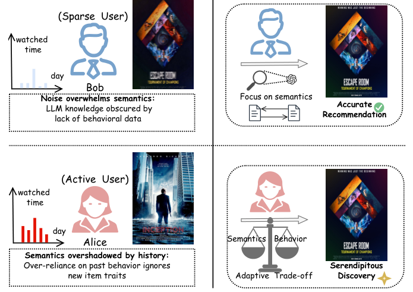
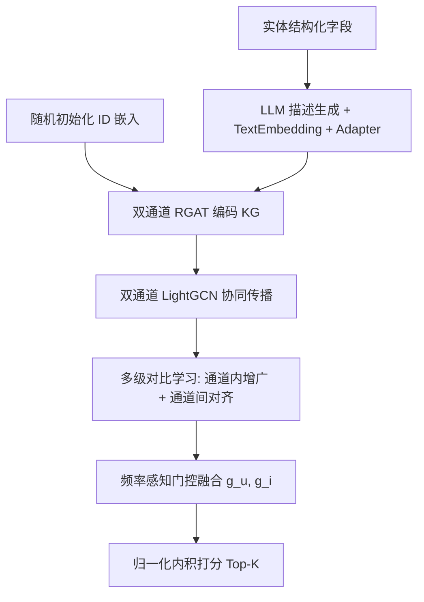

# DCGL: Dual-Channel Graph Learning with Large Language Models for Knowledge-Aware Recommendation (面向知识感知推荐的双通道图学习框架)

- **会议/期刊**: SIGIR 2026
- **作者与机构**: Xinchi Zou, Tongzhenzhi Su, Jianjun Li 等（华中科技大学、华中师范大学）
- **推荐链路定位**: 召回（Top-K 排序）
- **研究方向**: 图神经网络与知识图谱推荐 / 大语言模型推荐
- **论文原文**: [https://arxiv.org/abs/2605.07314v1](https://arxiv.org/abs/2605.07314v1)
- **开源代码**: [https://github.com/XinchiZou/DCGL](https://github.com/XinchiZou/DCGL)

## TL;DR (1分钟核心速览)

现有 KG+LLM 推荐把 LLM 语义嵌入与 ID 协同嵌入在**单通道内静态融合**，导致高频实体语义被稀释、低频实体行为无支撑，且无法建模 KG 显式边之外的隐式语义。DCGL 提出**双通道图学习**：ID 通道与 LLM 语义通道各自独立做 RGAT+LightGCN 传播，用通道内/通道间多级对比学习增强鲁棒性并对齐语义空间，最后以**交互频率感知门控**自适应加权融合。在四个数据集上采用 7:1:2 随机划分 + 全库排序评测，R@100 相对最强基线 CIKGRec 在 Amazon-Book 上提升约 3.8%，Book-Crossing 上提升约 6.1%。

## Background & Motivation (背景与核心矛盾)

- **主流范式**: KG 增强推荐以 RGAT/LightGCN 聚合多跳邻居（KGAT、KGRec、KGCL），近期 CoLaKG、CIKGRec 进一步用 LLM 补全 KG 事实或推断用户兴趣，将 LLM 语义嵌入与 ID 嵌入拼接后送入单一图网络。
- **前人局限**: ① 单通道融合使**频率敏感的行为嵌入**与**频率无关的语义嵌入**相互干扰——高频实体语义被历史行为淹没，低频实体语义被噪声压过；② 依赖 KG 显式路径，无法刻画"悬疑↔侦探"这类**隐式语义关联**；③ 融合策略静态，不随稀疏度变化。
- **核心洞察 (Key Insight)**: 频率异质性、融合失当、隐式语义缺失构成**级联恶性循环**——频率偏斜使融合困难，融合不佳又反过来阻碍语义发现。作者用 Alice（高频）与 Bob（冷启动）看同一部新悬疑片的例子说明：统一视图下两者都失效。
- **本文切入点**: 结构上先**解耦**（双通道），再用对比学习**精炼并对齐**，最后用频率门控**自适应统一**，三步协同打破循环。

<figure class="paper-figure" markdown="span">
  <figcaption>图1：动机示例。通过从统一视图（左）转向自适应视图（右）来解决频率异质性，该自适应视图为不同用户群体平衡语义和行为信号。</figcaption>
</figure>

## Method (核心方法设计)

### 1. 整体框架 (Overall Architecture)

输入侧为两条并行管线：LLM 通道用 Llama-3-8B-Instruct 将实体结构化字段改写为中性描述文本，经 text-embedding-3-small 编码为 1536 维向量，再由两层 MLP adapter 投影到 $d=64$；ID 通道则随机初始化、纯靠交互优化。两通道各自先用 RGAT 编码 KG（关系感知注意力 + TransE 辅助正则），再把 RGAT 输出的物品表示作为 LightGCN 的初始节点做协同传播，得到$\mathbf{U}^{(c)},\mathbf{I}^{(c)}$。随后多级对比学习（通道内增广对比 + 通道间投影对齐）精炼表示，最后由频率感知门控按用户/物品交互频次生成权重$g_u,g_i$ 做加权拼接与归一化打分。LLM 语义抽取完全离线，在线无 LLM 推理开销。

### 2. 关键设计拆解 (Key Designs)

1. **双通道结构解耦（Dual-Channel Decoupling）**：痛点在于单通道拼接让两类信号在输入阶段就互相污染。DCGL 让两通道共享同一套 RGAT+LightGCN 骨架但**参数与关系嵌入完全独立**，ID 通道的关系嵌入从交互数据学"行为感知"关系，LLM 通道的关系嵌入携带语义先验。物理直觉：频率敏感与频率无关的信号应在表征空间各自收敛后再交互，而非在梯度层面早期纠缠。

2. **多级对比学习（Multi-level Contrastive Learning）**：通道内用 KG 边丢弃 + 稳定性引导的交互图丢弃构造增广视图，InfoNCE 保留稳定结构、抵抗 KG 噪声：
$$\mathcal{L}_{\text{aug}}=\sum_{c\in\{\text{id},\text{llm}\}}\left[\mathcal{L}_{\text{InfoNCE}}(\mathbf{U}^{(c)}_{\text{aug}},\mathbf{U}^{(c)})+\mathcal{L}_{\text{InfoNCE}}(\mathbf{I}^{(c)}_{\text{aug}},\mathbf{I}^{(c)})\right]$$
通道间则用轻量投影头把两通道用户嵌入映射到统一空间做对齐 $\mathcal{L}_{\text{align}}=\mathcal{L}_{\text{InfoNCE}}(\mathbf{U}^{(\text{id})}_{\text{proj}},\mathbf{U}^{(\text{llm})}_{\text{proj}})$。关键作用：即便最终门控偏向 ID 通道，ID 表示也已**内化了 LLM 的隐式语义**（如类型亲和），这正是弥补 KG 显式边不足的机制。

3. **频率感知门控融合与归一化打分**：门控输入为双通道表示 + 对数归一化频率 $\phi(\text{freq}_i)=\log(1+\text{freq}_i)/\log(1+\max_j \text{freq}_j)$：
$$g_i=\sigma\left(\mathbf{W}_g[\mathbf{x}^{(\text{id})}_i\|\mathbf{x}^{(\text{llm})}_i\|\phi(\text{freq}_i)]+b_g\right)$$
直接内积会因权重质量 $g_ug_i+(1-g_u)(1-g_i)$随门控值漂移而产生尺度失衡，故引入归一化因子$\alpha_{ui}$，使最终得分化为凸组合$\hat{y}_{ui}=w\cdot s_{\text{id}}+(1-w)\cdot s_{\text{llm}}$，$w\in(0,1)$，保证数值尺度稳定与梯度平滑。另加门控正则$\mathcal{L}_{\text{gate}}=\frac{1}{|\mathcal{O}|}\sum\sum_{x}[-\log g_x-\log(1-g_x)]$ 防止门控饱和到 0/1 的平凡解。

4. **训练目标与负采样**：总损失 $\mathcal{L}=\mathcal{L}_{\text{BPR}}+\lambda_{\text{aug}}\mathcal{L}_{\text{aug}}+\lambda_{\text{align}}\mathcal{L}_{\text{align}}+\lambda_{\text{gate}}\mathcal{L}_{\text{gate}}+\lambda_{\text{reg}}\|\Theta\|_2^2$，其中 BPR 用归一化因子加权：$\mathcal{L}_{\text{BPR}}=\sum-\alpha_{ui}\log\sigma(\hat{y}_{ui}-\hat{y}_{ui'})$。负采样为标准**均匀随机负采样**（每正样本配一个未交互负样本），TransE 部分对尾实体随机替换构造 corrupted triplet。推理时仅需前向传播双通道 GCN 与门控，复杂度随图规模线性增长，与 GNN 基线同量级。

## Experimental Setup & Evaluation Protocol (实验设置与评估协议)

- **数据集与预处理**: 过滤低频用户（MovieLens/Amazon-Book 保留 ≥10 次交互，DBbook/Book-Crossing 保留 ≥5 次）：

| 数据集 | #Users | #Items | #Interactions | 密度 | 场景说明 |
| :--- | :---: | :---: | :---: | :---: | :--- |
| Book-Crossing | 6,616 | 8,853 | 110,662 | 0.19% | 极稀疏图书 |
| DBbook | 5,576 | 2,680 | 65,961 | 0.44% | 小规模图书 |
| MovieLens | 6,040 | 3,260 | 998,539 | 5.07% | 稠密电影 |
| Amazon-Book | 11,356 | 9,736 | 303,633 | 0.27% | 稀疏电商图书 |

- **数据划分与防穿越**: 每个用户的历史交互按 **7:1:2 随机划分**为训练/验证/测试集（非全局时间戳切分，存在轻度未来信息泄漏风险）。
- **排名评测协议**: **Full-Ranking 全库未交互物品排序**，指标 Recall@{50,100} 与 NDCG@{50,100}；10 次不同随机种子取均值，$p<0.05$ 显著性检验。
- **对比基线与超参**: 五类基线共 13 个（CF: LightGCN/SGL/SimGCL；嵌入式 KG: CKE/CFKG；GNN-KG: KGAT/KGIN/KGCL/MCCL/KGRec；LLM+GNN: RLMRec；LLM+KG: CoLaKG/CIKGRec）。统一 $d=64$，RGAT 与 LightGCN 层数均为 3，KG 边丢弃率$\rho=0.5$，LLM 生成温度$\tau=0$、top-$p=0.001$。

## Key Experimental Results (实验关键数据)

### 1. 主实验对比 (Main Results)

| 方法 | Book-Crossing R@100 | N@100 | DBbook R@100 | N@100 | MovieLens R@100 | N@100 | Amazon-Book R@100 | N@100 |
| :--- | :---: | :---: | :---: | :---: | :---: | :---: | :---: | :---: |
| LightGCN | 0.2246 | 0.0911 | 0.5358 | 0.2481 | 0.5574 | 0.4432 | 0.4083 | 0.1864 |
| SimGCL | 0.2211 | 0.0988 | 0.5369 | 0.2610 | 0.5560 | 0.4482 | 0.4181 | 0.1938 |
| KGAT | 0.2133 | 0.1004 | 0.5309 | 0.2360 | 0.5527 | 0.4378 | 0.4144 | 0.1888 |
| KGCL | 0.2049 | 0.0971 | 0.5271 | 0.2666 | 0.5496 | 0.4430 | 0.4411 | 0.2141 |
| KGRec | 0.2075 | 0.0836 | 0.5497 | 0.2611 | 0.5633 | 0.4524 | 0.4429 | 0.2096 |
| RLMRec | 0.2308 | 0.0963 | 0.5380 | 0.2615 | 0.5618 | 0.4452 | 0.4320 | 0.1991 |
| CoLaKG | 0.2512 | 0.1044 | 0.5617 | 0.2637 | 0.5692 | 0.4492 | 0.4582 | 0.2156 |
| CIKGRec | 0.2455 | 0.1041 | 0.5756 | 0.2739 | 0.5718 | 0.4609 | 0.4492 | 0.2157 |
| **DCGL** | **0.2605*** | **0.1119*** | **0.5804*** | **0.2798*** | **0.5727*** | **0.4616*** | **0.4663*** | **0.2317*** |
| Improv.% (vs 最强基线) | +3.70% | +7.18% | +0.83% | +2.15% | +0.16% | +0.15% | +1.77% | +7.42% |

### 2. 消融实验 (Ablation Study)

| 变体 | Book-Crossing R@100 | DBbook R@100 | MovieLens R@100 | Amazon-Book R@100 | Amazon-Book N@100 |
| :--- | :---: | :---: | :---: | :---: | :---: |
| w/o LLM（去语义通道） | 0.2319 | 0.5557 | 0.5565 | 0.4440 | 0.2145 |
| w/o ID（去行为通道） | 0.2500 | 0.5573 | 0.5663 | 0.4466 | 0.2154 |
| CAT（输入层直接拼接） | 0.2396 | 0.5619 | 0.5536 | 0.4513 | 0.2263 |
| w/o FREQ（固定权重融合） | 0.2576 | 0.5757 | 0.5687 | 0.4654 | 0.2308 |
| w/o AUG（去通道内对比） | 0.2425 | 0.5778 | 0.5706 | 0.4496 | 0.2121 |
| w/o ALIGN（去通道间对齐） | 0.2578 | 0.5741 | 0.5666 | 0.4645 | 0.2292 |
| **DCGL** | **0.2605** | **0.5804** | **0.5727** | **0.4663** | **0.2317** |

### 3. 关键实验发现 (Key Findings)

1. **稀疏场景是主要收益来源**：Book-Crossing（0.19% 密度）上 R@100 相对 CIKGRec 提升 6.1%、N@100 提升 7.5%，而稠密 MovieLens 上仅提升 0.16%——说明双通道的语义补偿机制在行为路径断裂时价值最大，稠密场景下 ID 通道本身已足够。
2. **通道内对比（AUG）比通道间对齐（ALIGN）更关键**：去掉 AUG 使 Amazon-Book N@100 从 0.2317 掉到 0.2121（-8.5%），而去掉 ALIGN 仅掉到 0.2292（-1.1%）；但两者在 Book-Crossing 上分别掉 9.7% 与 1.7%，表明增广带来的抗噪鲁棒性是稀疏数据下的第一贡献项，对齐更多是锦上添花。
3. **门控可视化验证了频率自适应**：图 6 显示学习到的 $g_i$、$g_u$ 与归一化交互频率呈清晰正相关，低频区门控压低 ID 通道权重、高频区抬升，直接对应动机中 Bob/Alice 两种失效模式的修复；去掉频率信号（w/o FREQ）在 Amazon-Book 上 N@100 掉 0.4%，虽幅度不大但方向一致。

## Highlights & Limitations (亮点、对比与审稿批判)

- **与代表作对比 (vs. Prior Work)**: 相比 **CIKGRec**（仅丰富用户侧语义、静态融合）与 **CoLaKG**（依赖 LLM 检索补全 KG 事实、易受幻觉影响），DCGL 同时覆盖用户与物品双侧语义，且融合权重由数据频率驱动而非固定；相比 **KGCL/MCCL** 的对比学习，本文的通道间对齐额外承担了"让 ID 通道内化隐式语义"的功能，这是纯结构对比学习做不到的。
- **可迁移亮点**: ① 门控打分前引入归一化因子 $\alpha_{ui}$ 把加权内积化为凸组合，这一技巧可直接迁移到任何多路召回/多视图融合的打分环节以消除尺度漂移；② 用离线 LLM 描述 + 轻量 adapter 投影替代在线 LLM 推理，是低成本引入语义信号的实用范式。
- **审稿级局限批判**: ① 数据划分采用**随机 7:1:2 而非全局时间戳切分**，存在未来交互泄漏，对时序敏感场景的结论外推需谨慎；② 门控权重依赖全局交互频次统计，在**动态流式场景**下频次分布漂移会使门控失准，论文未讨论增量更新策略；③ 消融中 w/o FREQ 的降幅在部分数据集上仅 0.1–0.4 个百分点，门控模块的独立贡献相对温和，其价值更多体现在分组分析而非整体均值。

## Rating (四维评分)

- **方法创新性 (Novelty)**: ⭐⭐⭐⭐ （核心机制与方法设计具备明确创新性，理论与实验动机支撑充分）
- **评估协议与实验扎实度 (Protocol & Experiments)**: ⭐⭐⭐⭐ （主流公开数据集评测完整，包含多基线对比与消融实验验证）
- **写作与数学规范度 (Clarity & Rigor)**: ⭐⭐⭐⭐⭐ （问题形式化定义清晰，核心模块数学推导与架构阐述严谨易读）
- **工业落地与复现价值 (Industrial & Practical Value)**: ⭐⭐⭐⭐ （兼顾推荐效果增益与训练/推理效率，具备实际场景迁移参考价值）
