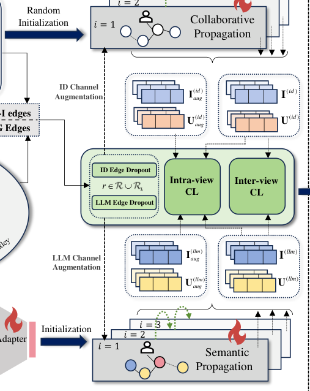
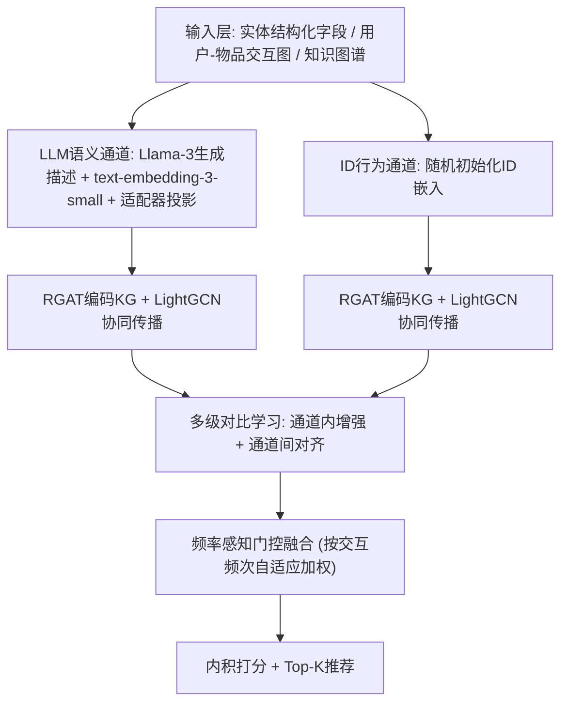
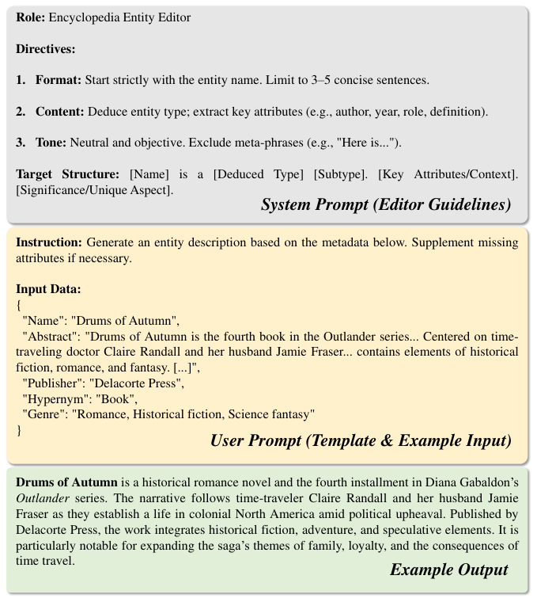
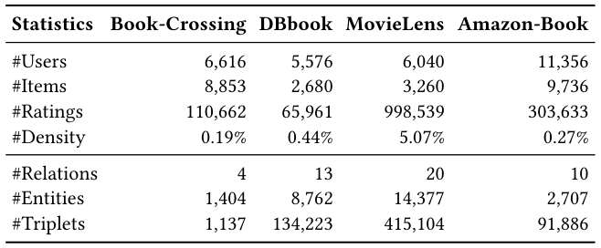
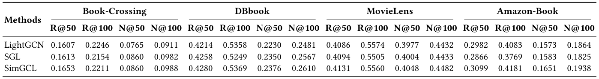
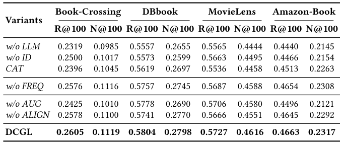
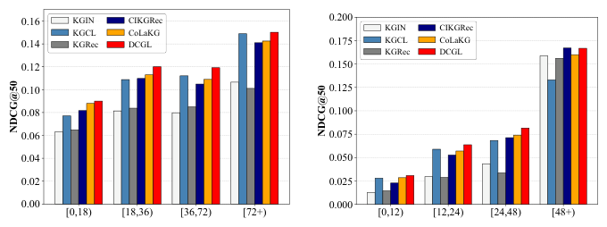
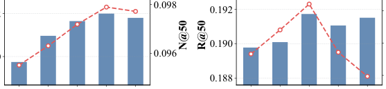

# DCGL: Dual-Channel Graph Learning with Large Language Models for Knowledge-Aware Recommendation (基于大语言模型的双通道图学习知识感知推荐)

- **会议/期刊**: SIGIR 2026
- **推荐链路定位**: 召回 (Retrieval) — Top-K 排序推荐
- **研究方向**: 图神经网络与知识图谱推荐 / 大语言模型推荐 (LLM4Rec)
- **论文原文**: [https://arxiv.org/abs/2605.07314v1](https://arxiv.org/abs/2605.07314v1)
- **开源代码**: [https://github.com/XinchiZou/DCGL](https://github.com/XinchiZou/DCGL)

## TL;DR (核心速览)

针对知识感知推荐中"频率异质性"引发的级联困境——单通道融合导致ID行为信号与LLM语义信号相互干扰，DCGL提出双通道图学习架构：ID通道与LLM语义通道结构解耦，经多级对比学习（通道内增强+通道间对齐）精炼表征，再由频率感知门控按交互频次自适应融合。在四个数据集上采用7:1:2随机划分与全库排序协议，R@100最高相对提升约5.6%（Book-Crossing），稀疏场景增益尤为显著。

## Background & Motivation (背景与动机)

- **领域背景与主流范式**: 知识感知推荐通过引入知识图谱 (KG) 捕获物品间高阶关系依赖，主流范式为基于GNN的方法（KGAT、KGIN、KGCL、KGRec等）聚合多跳邻居表征。近期LLM被用作"增强器"，生成语义嵌入并与ID嵌入融合（RLMRec、CoLaKG、CIKGRec）。
- **现有方法局限 (Limitations of Prior Work)**:
  1. **隐式语义建模不足**：现有方法依赖KG中显式路径，对"悬疑"与"侦探"这类未显式编码的隐式语义关联捕捉能力弱，对缺失事实脆弱。
  2. **单通道融合次优**：LLM语义嵌入与ID嵌入在单通道内直接融合，导致信号干扰与表征模糊——高频实体语义被稀释，低频实体缺乏行为锚定。
  3. **忽视交互频率异质性**：用户/物品交互频次高度偏斜，但主流方法采用统一融合策略，无法适配稀疏与稠密场景的不同需求。
- **核心挑战 (Key Challenge)**: 三个问题构成**级联恶性循环**——频率偏斜使融合困难，糟糕的融合又反过来阻碍隐式语义发现。简单拼接或加深网络无法打破该循环，因为根本矛盾在于频率敏感的行为信号与频率无关的语义信号被强制在同一空间内混合。
- **核心洞察与切入点 (Key Insight)**: 作者通过动机示例（图1）说明：新用户Bob行为信号弱、被噪声淹没，需要语义主导；活跃用户Alice历史模式强、掩盖了细微语义亲和，需要行为主导。由此提出"自适应视图"——按频率动态平衡语义与行为信号，并以结构解耦作为前提。

<figure class="paper-figure" markdown="span">
  <figcaption>图1：动机示例。通过从统一视图（左）转向自适应视图（右）来应对频率异质性，该自适应视图为不同用户群体平衡语义信号与行为信号。</figcaption>
</figure>

## Problem Formulation & Method (问题定义与方法架构)

### 1. 符号定义与输入表征 (Notations & Input Representations)

- 用户集 $\mathcal{U}$、物品集 $\mathcal{I}$；用户-物品二部图 $\mathcal{G}=(\mathcal{U},\mathcal{I},\mathcal{R})$，$\mathcal{R}=\{(u,i)|y_{ui}=1\}$。
- 知识图谱 $\mathcal{G}_k=\{(h,r,t)\}$，实体集 $\mathcal{E}$、关系集 $\mathcal{R}_k$，且 $\mathcal{I}\subseteq\mathcal{E}$；物品 $i$ 的KG邻居 $\mathcal{N}^k_i$。
- 嵌入维度 $d=64$（与所有基线对齐）；LLM原始语义维度 $d_{llm}=1536$（text-embedding-3-small）；适配器中间维度 $d_{mid}=(d_{llm}+d)/2$。
- 输出：用户 $u$ 对物品 $i$ 的偏好分 $\hat{y}_{ui}$，按分数取 Top-$K$。

### 2. 整体流水线 (Overall Architecture)

数据流：实体结构化字段 $\mathcal{S}_e$ → LLM (Meta-Llama-3-8B-Instruct) 生成描述 $D_e$ → 文本编码器得 $\mathbf{x}^{(llm,raw)}_e$ → 适配器投影至 $\mathbb{R}^d$；ID通道随机初始化 $\mathbf{x}^{(id)}_e$。两通道各自经RGAT编码KG + LightGCN传播交互信号 → 多级对比学习（通道内增强 + 通道间对齐）→ 频率感知门控融合 → 内积打分。

<figure class="paper-figure" markdown="span">
  <figcaption>图2：我们提出的DCGL框架。</figcaption>
</figure>

### 3. 核心模块设计与数学原理 (Key Designs & Formulations)

**模块一：双通道图学习架构（结构解耦）**

- **LLM语义通道**：LLM按模板（图3）将实体结构化字段合成为中性描述 $D_e$，经文本编码器得 $\mathbf{x}^{(llm,raw)}_e\in\mathbb{R}^{d_{llm}}$，再由两层适配器投影：
$$\mathbf{x}^{(llm)}_e=\mathbf{W}_2\cdot\text{LeakyReLU}(\mathbf{W}_1\mathbf{x}^{(llm,raw)}_e+\mathbf{b}_1)+\mathbf{b}_2$$
该表征与交互频率无关。
- **ID信息通道**：$\mathbf{x}^{(id)}_e\in\mathbb{R}^d$ 随机初始化，仅由交互数据优化，对频率高度敏感。
- **关系感知KG编码 (RGAT)**：每个通道 $c\in\{id,llm\}$ 独立执行：
$$\mathbf{x}^{(c,l+1)}_i=\mathbf{x}^{(c,l)}_i+\sum_{e\in\mathcal{N}^k_i}a^{(c,l)}_{e,i}\mathbf{x}^{(c,l)}_e,\quad a^{(c,l)}_{e,i}=\frac{\exp(\phi(\mathbf{r}^{(c,l)}_{e,i},\mathbf{x}^{(c,l)}_e,\mathbf{x}^{(c,l)}_i))}{\sum_{e'\in\mathcal{N}^k_i}\exp(\phi(\cdot))}$$
其中 $\phi(\mathbf{r}_{e,i},\mathbf{x}_e,\mathbf{x}_i)=\text{LeakyReLU}(\mathbf{r}_{e,i}^\top\mathbf{W}[\mathbf{x}_e\|\mathbf{x}_i])$，$\mathbf{W}\in\mathbb{R}^{d\times 2d}$。两通道关系嵌入独立优化：ID通道学习行为感知关系，LLM通道融入语义知识。
- **协同信号传播 (LightGCN)**：$\mathbf{x}^{(c,l+1)}_u=\sum_{i\in\mathcal{N}_u}\frac{\mathbf{x}^{(c,l)}_i}{\sqrt{|\mathcal{N}_u|\cdot|\mathcal{N}_i|}}$，物品侧对称。注意 $\mathbf{x}^{(c,0)}_u$ 随机初始化，而 $\mathbf{x}^{(c,0)}_i$ 以RGAT输出 $\mathbf{x}^{(c,L)}_i$ 初始化——即KG语义先注入物品侧，再经交互图传播至用户侧。
- **TransE辅助正则**：交替优化 $f^{(c)}_d(h,r,t)=\|\mathbf{h}^{(c)}+\mathbf{r}^{(c)}-\mathbf{t}^{(c)}\|_1$，配对排序损失 $\mathcal{L}^{(c)}_{\text{TransE}}=\sum-\ln\sigma(f_d(h,r,t')-f_d(h,r,t))$，负例通过随机替换尾实体生成。

**模块二：多级对比学习**

- **通道内增强 (Intra-view)**：先对KG做随机边丢弃 $\mathcal{G}'_k\sim\text{DropEdge}(\mathcal{G}_k,\rho)$（$\rho=0.5$），由通道专属RGAT编码得物品稳定性分数 $S_i\in[0,1]$；再以稳定性引导交互图增强：$p_{drop}(u,i)=1-\mu S_i$（$\mu$ 控制引导强度，高 $S_i$ 对应低丢弃概率）。损失：
$$\mathcal{L}_{aug}=\sum_{c\in\{id,llm\}}\left[\mathcal{L}_{\text{InfoNCE}}(\mathbf{U}^{(c)}_{aug},\mathbf{U}^{(c)})+\mathcal{L}_{\text{InfoNCE}}(\mathbf{I}^{(c)}_{aug},\mathbf{I}^{(c)})\right]$$
- **通道间对齐 (Inter-view)**：轻量投影网络（线性层+LeakyReLU，保持维度）将两通道用户嵌入映射至统一空间，$\mathcal{L}_{align}=\mathcal{L}_{\text{InfoNCE}}(\mathbf{U}^{(id)}_{proj},\mathbf{U}^{(llm)}_{proj})$，同一用户跨通道为正对、不同用户为负对。物理直觉：迫使ID通道内化LLM通道的隐式语义（如类型亲和），即便最终融合由ID主导，行为表征仍具语义感知。
- InfoNCE统一形式：$\mathcal{L}_{\text{InfoNCE}}(\mathbf{Z}_1,\mathbf{Z}_2)=-\sum_{n=1}^N\log\frac{\exp(\text{sim}(\mathbf{z}_{1,n},\mathbf{z}_{2,n})/\tau)}{\sum_{m\neq n}\exp(\text{sim}(\mathbf{z}_{1,n},\mathbf{z}_{2,m})/\tau)}$，余弦相似度，$\tau$ 为温度系数。

**模块三：频率感知门控融合**

- 门控权重同时输入ID表征、LLM表征与归一化频率：
$$g_i=\sigma\left(\mathbf{W}_g[\mathbf{x}^{(id)}_i\|\mathbf{x}^{(llm)}_i\|\phi(\text{freq}_i)]+\mathbf{b}_g\right),\quad \phi(\text{freq}_i)=\frac{\log(1+\text{freq}_i)}{\log(1+\max_j\text{freq}_j)}$$
用户侧 $g_u$ 同理。
- 融合表征 $\mathbf{x}^{fused}_i=[g_i\cdot\mathbf{x}^{(id)}_i\|(1-g_i)\cdot\mathbf{x}^{(llm)}_i]$。直接内积存在权重质量 $g_ug_i+(1-g_u)(1-g_i)$ 随门控值漂移的尺度失衡问题，故引入归一化因子 $\alpha_{ui}=g_ug_i+(1-g_u)(1-g_i)$：
$$\hat{y}_{ui}=\frac{g_ug_i\,s_{id}+(1-g_u)(1-g_i)\,s_{llm}}{g_ug_i+(1-g_u)(1-g_i)}$$
令 $w=g_ug_i/\alpha_{ui}$，则 $\hat{y}_{ui}=w\cdot s_{id}+(1-w)\cdot s_{llm}$ 为凸组合，保证分数尺度稳定与梯度平滑。
- **门控正则**：$\mathcal{L}_{gate}=\frac{1}{|\mathcal{O}|}\sum_{(u,i,i')}\sum_{x\in\{u,i,i'\}}[-\log g_x-\log(1-g_x)]$，防止门控饱和至0/1的平凡解。

<figure class="paper-figure" markdown="span">
  <figcaption>图3：基于LLM的实体描述提示模板，包括含编辑规则的系统提示、用户提示示例及生成输出。</figcaption>
</figure>

### 4. 训练目标、负采样与推理复杂度 (Optimization, Negative Sampling & Complexity)

- **总损失**：
$$\mathcal{L}=\mathcal{L}_{BPR}+\lambda_{aug}\mathcal{L}_{aug}+\lambda_{align}\mathcal{L}_{align}+\lambda_{gate}\mathcal{L}_{gate}+\lambda_{reg}\|\boldsymbol{\Theta}\|_2^2$$
其中动态加权BPR：$\mathcal{L}_{BPR}=\sum_{(u,i,i')\in\mathcal{O}}-\alpha_{ui}\log\sigma(\hat{y}_{ui}-\hat{y}_{ui'})$，$\mathcal{O}=\{(u,i,i')|(u,i)\in\mathcal{R},(u,i')\notin\mathcal{R}\}$。
- **负采样策略**：BPR采用**均匀随机负采样**（从未交互物品中采样 $i'$）；TransE采用**随机替换尾实体**生成损坏三元组。对比学习采用**In-batch 负采样**（batch内其他样本为负）。
- **超参数**：学习率 $\{0.0001,\dots,0.005\}$；RGAT层数 $L=3$、LightGCN深度 $L'=3$；$\lambda_{gate},\lambda_{aug},\lambda_{align}\in\{0.01,\dots,0.1\}$ 步长0.01；$\rho=0.5$；$\mu\in\{0.1,\dots,1.0\}$ 步长0.1。
- **复杂度**：RGAT为 $O(L|\mathcal{R}_k|d^2)$，LightGCN为 $O(L|\mathcal{R}|d)$，对比学习每epoch $O(|\mathcal{R}|Bd)$，门控为 $O((|\mathcal{U}|+|\mathcal{I}|)d)$，整体随图规模线性增长。**关键效率优势**：LLM语义提取完全离线完成，无在线LLM推理、无昂贵在线检索，训练效率与主流GNN知识感知模型相当。原文未报告具体单epoch耗时与峰值显存数值。

## Experimental Setup & Evaluation Protocol (实验设置与评估协议)

- **数据集统计与预处理**：四个真实数据集，过滤低频用户（MovieLens与Amazon-Book保留 $\ge 10$ 交互用户，DBbook与Book-Crossing保留 $\ge 5$ 交互用户）。

<figure class="paper-figure" markdown="span">
  <figcaption>表1：四个评估数据集的统计信息。</figcaption>
</figure>

| 数据集 (Dataset) | 用户数 (#Users) | 物品数 (#Items) | 交互数 (#Ratings) | 密度 (Density) | 关系数/实体数/三元组数 |
| :--- | :---: | :---: | :---: | :---: | :--- |
| Book-Crossing | 6,616 | 8,853 | 110,662 | 0.19% | 4 / 1,404 / 1,137 |
| DBbook | 5,576 | 2,680 | 65,961 | 0.44% | 13 / 8,762 / 134,223 |
| MovieLens | 6,040 | 3,260 | 998,539 | 5.07% | 20 / 14,377 / 415,104 |
| Amazon-Book | 11,356 | 9,736 | 303,633 | 0.27% | 10 / 2,707 / 91,886 |

- **数据划分方式 (Splitting Strategy)**: **按比例随机划分 (Ratio Split)**，每个用户的历史交互随机切分为训练/验证/测试 = **7:1:2**。注意：随机划分而非全局时间戳切分，存在一定未来信息泄露风险（原文未讨论此点）。
- **排名评测协议 (Ranking Protocol)**: 原文未明确声明是 Full-Ranking 还是 Sampled Ranking，仅说明采用 Recall@K 与 NDCG@K（$K\in\{50,100\}$）评估 Top-K 推荐。从报告数值量级（如 MovieLens R@100≈0.57）推断大概率为全库排序或大候选集排序，但原文未给出正负例比例，**此处为评估协议透明度不足**。
- **评价指标与显著性检验**: Recall@50/100、NDCG@50/100；嵌入维度统一 $d=64$；结果报告 **10 次独立随机种子的均值与标准差**，表2中最佳结果标注 * 表示 **$p<0.05$ 统计显著性**。所有LLM与文本嵌入基线采用相同评估协议。

## Key Experimental Results (核心实验结果)

### 1. 主实验对比 (Main Results)

<figure class="paper-figure" markdown="span">
  <figcaption>表2：不同方法的性能比较。最佳结果以粗体标出，*表示统计显著性（𝑝&lt; 0.05），次佳结果以下划线标出。</figcaption>
</figure>

| 数据集 | 指标 | 最强传统CF基线 (SimGCL) | 最强LLM增强基线 (CIKGRec/CoLaKG) | 本文方法 (DCGL) | 相对提升 (vs 次优) |
| :--- | :--- | :---: | :---: | :---: | :---: |
| Book-Crossing | R@100 / N@100 | 0.2211 / 0.0988 | 0.2512 / 0.1044 (CoLaKG) | **0.2605 / 0.1119** | +3.70% / +7.18% |
| DBbook | R@100 / N@100 | 0.5369 / 0.2610 | 0.5756 / 0.2739 (CIKGRec) | **0.5804 / 0.2798** | +0.83% / +2.15% |
| MovieLens | R@100 / N@100 | 0.5560 / 0.4482 | 0.5718 / 0.4609 (CIKGRec) | **0.5727 / 0.4616** | +0.16% / +0.15% |
| Amazon-Book | R@100 / N@100 | 0.4181 / 0.1938 | 0.4582 / 0.2157 (CoLaKG) | **0.4663 / 0.2317** | +1.77% / +7.42% |

关键观察：低密度数据集（Book-Crossing 0.19%、Amazon-Book 0.27%）上增益最大，验证解耦LLM语义通道可绕过"稀疏陷阱"；稠密数据集（MovieLens 5.07%）增益较小但依然领先，说明频率感知门控在稠密场景下优先ID通道、避免语义噪声稀释。

### 2. 消融实验与控制变量分析 (Ablation Study)

<figure class="paper-figure" markdown="span">
  <figcaption>表3：DCGL各组件在四个数据集上的消融研究。报告R@100和N@100。</figcaption>
</figure>

| 变体 | Book-Crossing R@100 | DBbook R@100 | MovieLens R@100 | Amazon-Book R@100 |
| :--- | :---: | :---: | :---: | :---: |
| w/o LLM | 0.2319 | 0.5557 | 0.5565 | 0.4440 |
| w/o ID | 0.2500 | 0.5573 | 0.5663 | 0.4466 |
| CAT (输入拼接) | 0.2396 | 0.5619 | 0.5536 | 0.4513 |
| w/o FREQ (固定权重) | 0.2576 | 0.5757 | 0.5687 | 0.4654 |
| w/o AUG (通道内增强) | 0.2425 | 0.5778 | 0.5706 | 0.4496 |
| w/o ALIGN (通道间对齐) | 0.2578 | 0.5741 | 0.5666 | 0.4645 |
| **DCGL** | **0.2605** | **0.5804** | **0.5727** | **0.4663** |

- **移除LLM通道 (w/o LLM) 下降最大**（Book-Crossing R@100 从0.2605降至0.2319，降幅11.0%），说明LLM语义表征是缓解稀疏的核心贡献。
- **CAT（输入层简单拼接）显著劣于双通道**，直接验证"结构解耦"的必要性——早期融合导致信号干扰。
- **w/o FREQ（固定权重融合）** 在Book-Crossing下降至0.2576，验证动态门控的价值。
- **w/o AUG 与 w/o ALIGN** 均有明显下降，说明通道内鲁棒性与通道间对齐各自独立贡献。
- 注：原文消融未明确报告参数量对齐或图度数匹配的控制变量说明，**此处为实验严谨性可改进点**。

### 3. 稀疏度/冷启动分桶与超参敏感度 (Sparsity Buckets & Hyperparameters)

- **分组分析（Book-Crossing，图4）**：用户按交互数分为 $[0,18),[18,36),[36,72),[72+)$，物品按频次分为 $[0,12),[12,24),[24,48),[48+)$。DCGL在**所有分桶**均优于基线；稀疏桶（用户 $[0,18)$、物品 $[0,12)$）相对KGIN/KGRec增益最大，稠密桶（$[72+)$ 用户、$[48+)$ 物品）保持领先且波动更小，验证门控在两端均有效。

<figure class="paper-figure" markdown="span">
  <figcaption>图4：DCGL与基线在不同用户与物品群体下的性能（Book-Crossing数据集）。</figcaption>
</figure>

- **超参数敏感度（图5）**：$\lambda_{aug}$ 与 $\lambda_{align}$ 均呈"先升后降"趋势，过大值会压过主推荐目标；$\lambda_{gate}$ 对防止门控坍缩至0/1至关重要；$\mu$ 取中间值时扰动最有效（优于随机与激进丢弃）。

<figure class="paper-figure" markdown="span">
  <figcaption>图5：在Book-Crossing上的超参数分析。</figcaption>
</figure>

- **门控可解释性可视化（图6）**：归一化交互频率与门控权重 $g$ 呈明显正相关——低频区 $g$ 低（语义主导，对应Bob场景），高频区 $g$ 高（行为主导，对应Alice场景），实证了频率自适应融合机制按设计工作。
- **线上 A/B 测试**: 原文仅包含离线实验，未报告线上A/B测试结果。

## Highlights, Limitations & Critiques (亮点、局限与审稿级批判)

- **核心亮点与可迁移性**:
  1. **"结构解耦 + 对比对齐 + 频率门控"三件套**具有强普适性：解耦思路可迁移至任何"语义嵌入+ID嵌入"融合场景（多模态推荐、跨域推荐）；频率感知门控可推广至冷启动/长尾分桶策略。
  2. **归一化凸组合打分**（式18）优雅解决了门控加权内积的尺度漂移问题，工程上可直接复用。
  3. **离线LLM语义提取**设计避免了在线LLM推理开销，具备工业部署可行性。
  4. 稳定性引导的图增强（$p_{drop}=1-\mu S_i$）将KG边一致性转化为交互图扰动先验，是KG噪声鲁棒性的巧妙设计。

- **局限性与审稿视角批判 (Critical Limitations)**:
  1. **评估协议透明度不足**：未明确声明 Full-Ranking 还是 Sampled Ranking，未给出候选集规模与负例比例，削弱了结果可比性；随机7:1:2划分而非时间切分，存在未来信息泄露风险，尤其对序列性消费场景（如Book-Crossing）可能高估性能。
  2. **增益幅度有限**：在稠密数据集MovieLens上R@100仅提升0.16%（0.5718→0.5727），统计显著性虽标注但实际效应量微小，需警惕"显著性≠实用性"。
  3. **LLM依赖与可复现性**：语义质量依赖Llama-3-8B与text-embedding-3-small（闭源API），不同LLM/编码器下的鲁棒性未做敏感性分析；DBpedia结构化字段的覆盖度对结果影响未讨论。
  4. **消融控制变量不严格**：w/o LLM 与 w/o ID 变体在参数量上与原模型不对齐，CAT变体也未说明是否补偿了通道容量，可能混淆"结构解耦"与"参数容量"的贡献。
  5. **效率报告缺失**：仅给出理论复杂度，未报告实际单epoch耗时、峰值显存与推理延迟（ms/request），工业落地价值缺乏实证支撑。
  6. **门控正则的理论依据**：$\mathcal{L}_{gate}$ 最大化 $g$ 与 $1-g$ 的联合似然，其最优解在 $g=0.5$，本质是向中性权重施加先验，可能与"频率自适应"目标存在张力，原文未深入分析该权衡。

## Rating (四维评分)

- **方法创新性 (Novelty)**: ⭐⭐⭐⭐ — 双通道解耦+频率门控组合新颖，但各组件（RGAT、LightGCN、InfoNCE、门控）均为已有技术，创新在于系统性整合与频率异质性视角。
- **评估协议与实验扎实度 (Protocol & Experiments)**: ⭐⭐⭐ — 四数据集+10种子+显著性检验较规范，但划分策略与排序协议透明度不足，消融控制变量不严格。
- **写作与数学规范度 (Clarity & Rigor)**: ⭐⭐⭐⭐ — 公式推导完整（尤其归一化凸组合），动机示例清晰，但部分符号（如 $s_{id}, s_{llm}$ 定义）可更显式。
- **工业落地与复现价值 (Industrial & Practical Value)**: ⭐⭐⭐⭐ — 离线LLM提取+线性复杂度+开源代码，落地友好；但缺实际延迟数据与LLM替换鲁棒性验证。
