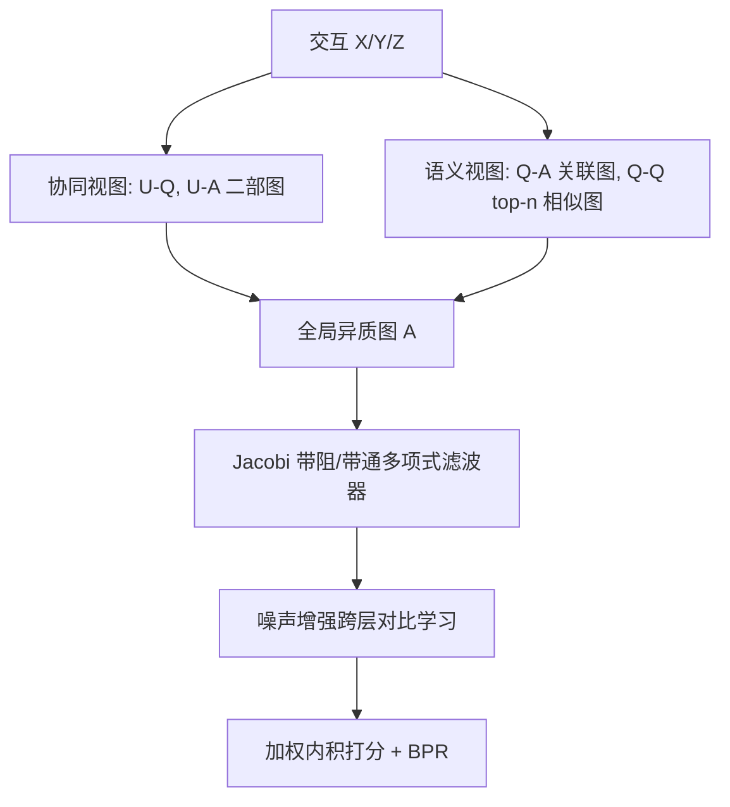
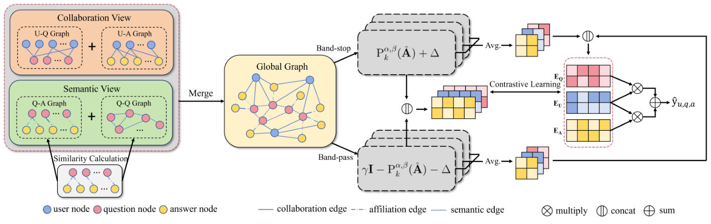

# QAGCF: Graph Collaborative Filtering for Q&A Recommendation (问答推荐图协同过滤)

- **会议/期刊**: SIGIR 2026
- **作者与机构**: Changshuo Zhang, Teng Shi, Xiao Zhang, Yanping Zheng, Jun Xu, Ji-Rong Wen (中国人民大学高瓴人工智能学院)；Ruobing Xie, Qi Liu (腾讯微信)
- **推荐链路定位**: 召回
- **研究方向**: 图神经网络与知识图谱推荐 / 自监督对比学习与交互去噪
- **论文原文**: [论文原文链接](https://arxiv.org/abs/2406.04828v1)
- **开源代码**: [ZhihuRec 数据集仓库](https://github.com/THUIR/ZhihuRec-Dataset)（模型代码暂未开源）

## TL;DR (1分钟核心速览)

问答平台推荐的是「问题-答案对」而非单一物品，用户点击可能由问题或答案单独驱动（协同信息纠缠），且问答对内部与问答对之间存在语义相似（语义信息纠缠）。QAGCF 将问答对解耦为 U-Q/U-A 双协同图与 Q-A/Q-Q 双语义图，合并为全局异质图后用 Jacobi 多项式图滤波器分离高/低频信号，并以噪声增强的跨层对比学习稳定训练。在 ZhihuRec 与 Commercial 上采用 Full-Ranking 协议，Recall@10 相对最强基线 XSimGCL 提升 5.34% / 5.16%，五项指标全面 SOTA。

## Background & Motivation (背景与核心矛盾)

- **主流范式**: 问答平台研究多聚焦于「找答主」「找高质量答案」或把答案当单一物品做传统推荐；图协同过滤（LightGCN、SGL、XSimGCL）则统一在 user-item 二部图上做高阶传播。
- **前人局限**: ① 把问答对整体当物品，无法区分点击究竟由问题还是答案驱动；② 只把答案当物品，则丢失问题侧的协同信号；③ 问答对内部（Q-A）与问答对之间（Q-Q）的语义关联被完全忽略。
- **核心洞察 (Key Insight)**: 作者在 ZhihuRec 上做了两组实证：过滤曝光>10 且答案>10 的问题后，被点击答案占比几乎覆盖 0–1 全区间（图 2a），证明点击既可能源于问题也可能源于答案；问答对内部平均余弦相似度 0.4161 显著高于问题与无关答案的 0.2833，用户已点击问题间相似度 0.4482 也高于点击/未点击的 0.4053（图 2b），证明语义纠缠真实存在。
- **本文切入点**: 用「协同视图 + 语义视图」双视图显式解耦两类信息，再合并为全局图统一建模，并用谱分析证明全局图强异质、需同时保留高低频。

## Method (核心方法设计)

### 1. 整体框架 (Overall Architecture)

输入为用户-问题交互 $\mathbf{X}$、用户-答案交互$\mathbf{Y}$与问答归属$\mathbf{Z}$。模型先分别构建协同视图（U-Q、U-A 二部图）与语义视图（Q-A 关联图、Q-Q 相似图），四者拼成全局邻接矩阵$\mathbf{A}$；随后用 Jacobi 多项式基作为带阻滤波器提取高/低频信号，并用$\gamma\mathbf{E}^{(0)}-\mathbf{E}^{(k)}_{\text{band-stop}}$反解出中频带通分量，二者拼接为$2d$ 维节点表示；训练时对带阻嵌入注入符号对齐噪声做跨层对比学习，最终以用户-答案与用户-问题内积加权和打分，BPR 优化。

<figure class="paper-figure" markdown="span">
  <figcaption>图3：QAGCF的整体框架由四个模块组成：(1) 协同视图与语义视图的构建，(2) 用于处理全局图不同频段信息的带阻与带通滤波器，(3) 基于噪声的嵌入增强的对比学习，(4) 基于所学嵌入的预测模块。</figcaption>
</figure>

### 2. 关键设计拆解 (Key Designs)

1. **双视图解耦构图（Disentangled Multi-View Construction）**：针对 C1，把问答对拆成 U-Q 与 U-A 两张二部图，让问题侧与答案侧的协同信号各自传播；针对 C2，Q-A 图不用 0/1 归属矩阵而用归一化余弦关联 $C_{i,j}=(\cos(\mathbf{e}_{q_i},\mathbf{e}_{a_j})+1)/2$（仅$Z_{i,j}=1$时非零），使低相关问答对间信息传递被削弱；Q-Q 图按行取 top-$n$（$n=\mu N$）稀疏化，避免全连接噪声。四图合并为$\mathbf{A}=\begin{pmatrix}\mathbf{0}&\mathbf{X}&\mathbf{Y}\\\mathbf{X}^\top&\mathbf{A}_{qq}&\mathbf{C}\\\mathbf{Y}^\top&\mathbf{C}^\top&\mathbf{0}\end{pmatrix}$并做对称归一化$\hat{\mathbf{A}}=\mathbf{D}^{-1/2}\mathbf{A}\mathbf{D}^{-1/2}$。直觉：把「为什么点」与「点了什么相似内容」拆到不同子图，避免信号互相污染。
2. **Jacobi 多项式带阻/带通滤波（Polynomial Graph Filter）**：全局图含用户/问题/答案三类节点，异质性极强，LightGCN 式低通传播会抹平判别信息。作者谱分析发现 $\hat{\mathbf{A}}_{\text{train}}$特征值与$\mathbf{U}^\top\mathbf{A}_{\text{test}}\mathbf{U}$对角元在低频（≈1.0）与高频（≈−1.0）处强线性相关、中频（≈0.0）处散乱（图 4），故用 Jacobi 基$\mathbf{E}^{(k)}_{\text{band-stop}}=P_k^{\alpha,\beta}(\hat{\mathbf{A}})\mathbf{E}^{(0)}$抑制中频、保留高低频，再以$\mathbf{E}^{(k)}_{\text{band-pass}}=\gamma\mathbf{E}^{(0)}-\mathbf{E}^{(k)}_{\text{band-stop}}$ 显式取回中频，拼接后逐层平均得最终表示。直觉：低频承载相似用户/物品的共性，高频刻画相似节点间的差异，二者都对测试图预测有用。
3. **噪声增强跨层对比学习与训练目标**：对第 $k$层带阻嵌入加符号对齐噪声$\boldsymbol{\Delta}=\boldsymbol{\omega}\odot\text{sign}(\mathbf{e}^{(k)}_{i,\text{band-stop}})$，$\boldsymbol{\omega}\sim U(0,1)^d$，保证扰动不越界；正样本为同节点第 1 层与最终层表示，负样本为 in-batch 随机节点，损失$\mathcal{L}_C=\mathcal{L}_C^u+\mathcal{L}_C^q+\mathcal{L}_C^a$。总目标$\mathcal{L}=\mathcal{L}_{BPR}+\lambda_2\mathcal{L}_C+\lambda_3\|\Theta\|_2^2$，打分$\hat{y}_{u,q,a}=\mathbf{e}_u'^\top\mathbf{e}_a'+\lambda_1\mathbf{e}_u'^\top\mathbf{e}_q'$。训练负采样为每正例均匀采 1 个负例；空间复杂度$O((M+N+O)d)$，主要开销在每 epoch 重建 Q-A/Q-Q 图（$O((N+O+\mu N\log N)Nds)$）。

## Experimental Setup & Evaluation Protocol (实验设置与评估协议)

- **数据集与预处理**:

| 数据集 | #Users | #Items(问题/答案) | #Interactions | 稀疏度/密度 | 特征/场景说明 |
| :--- | :---: | :---: | :---: | :---: | :--- |
| ZhihuRec | 7,975 | 12,612 / 31,025 | 265,971 | 极稀疏 | 知乎 1M 版，剔除无归属答案，仅保留正交互 |
| Commercial | 40,204 | 31,710 / 101,056 | 953,212 | 极稀疏 | 某公开问答平台真实行为日志 |

- **数据划分与防穿越 (Splitting Strategy)**: 按 8:1:1 比例随机划分 train/validation/test（非时间切分，存在轻度未来信息泄漏风险）。
- **排名评测协议 (Ranking Protocol)**: 无偏 `Full-Ranking`，对用户未交互的全部候选问答对排序，报告 Recall@10、MRR@10、NDCG@10、Hit@10、Precision@10。
- **对比基线与超参设置**: 四类基线——Non-GNN（BPRMF、NeuMF）、GNN（NGCF、LightGCN、LightGCL、HMLET）、GNN+多项式滤波（JGCF 及 Legendre/Chebyshev 变体）、GNN+对比学习（SGL、SimGCL、XSimGCL）。嵌入维度 $d=64$，batch size 2048，Xavier 初始化，Adam 优化，每 10 epoch 验证、patience=10 早停，以 MRR@10 为早停指标；最优超参$\mu=10^{-4}$、$\alpha=1.0$、$\beta=1.5$、$\gamma=0.1$、$\lambda_1=0.1$、$\lambda_2=0.1$、$\omega=0.2$、$\tau=0.2$；显著性$t$-test$p<0.05$。

## Key Experimental Results (实验关键数据)

### 1. 主实验对比 (Main Results)

| 类别 | 模型 | ZhihuRec Recall@10 | MRR@10 | NDCG@10 | Commercial Recall@10 | MRR@10 | NDCG@10 |
| :--- | :--- | :---: | :---: | :---: | :---: | :---: | :---: |
| Non-GNN | BPRMF | 0.0363 | 0.0324 | 0.0236 | 0.0496 | 0.0281 | 0.0289 |
| GNN | LightGCN | 0.0481 | 0.0441 | 0.0317 | 0.0604 | 0.0343 | 0.0353 |
| GNN | HMLET | 0.0511 | 0.0466 | 0.0335 | 0.0618 | 0.0350 | 0.0361 |
| GNN+PbGF | JGCF | 0.0510 | 0.0469 | 0.0339 | 0.0626 | 0.0361 | 0.0367 |
| GNN+CL | SGL | 0.0495 | 0.0465 | 0.0328 | 0.0639 | 0.0370 | 0.0377 |
| GNN+CL | SimGCL | 0.0532 | 0.0471 | 0.0342 | 0.0700 | 0.0405 | 0.0413 |
| GNN+CL | XSimGCL | 0.0562 | 0.0503 | 0.0366 | 0.0756 | 0.0447 | 0.0453 |
| OURS | **QAGCF** | **0.0592\*** | **0.0543\*** | **0.0391\*** | **0.0795\*** | **0.0461\*** | **0.0472\*** |
| | **Improv.%** | **+5.34%** | **+7.95%** | **+6.83%** | **+5.16%** | **+3.13%** | **+4.19%** |

（Hit@10 与 Precision@10 同样全面最优：ZhihuRec 0.1484 / 0.0160，Commercial 0.1144 / 0.0119，相对 XSimGCL 分别 +5.77%/+3.23% 与 +4.67%/+5.31%。）

### 2. 消融实验 (Ablation Study)

| 变体 | ZhihuRec Recall | MRR | NDCG | Commercial Recall | MRR | NDCG |
| :--- | :---: | :---: | :---: | :---: | :---: | :---: |
| QAGCF_UA（仅 U-A 图） | 0.0565 | 0.0524 | 0.0374 | 0.0776 | 0.0450 | 0.0461 |
| QAGCF_UA+UQ（加 U-Q） | 0.0579 | 0.0540 | 0.0387 | 0.0788 | 0.0461 | 0.0470 |
| QAGCF w/o PbGF | 0.0575 | 0.0510 | 0.0372 | 0.0786 | 0.0456 | 0.0466 |
| QAGCF w/o CL | 0.0527 | 0.0474 | 0.0349 | 0.0710 | 0.0408 | 0.0419 |
| QAGCF_U(A+Q)（问答整体当物品） | 0.0566 | 0.0535 | 0.0383 | 0.0778 | 0.0455 | 0.0465 |
| **QAGCF（完整）** | **0.0592** | **0.0543** | **0.0391** | **0.0795** | **0.0461** | **0.0472** |

### 3. 关键实验发现 (Key Findings)

1. **对比学习是最大增益源，滤波器次之**：去掉 CL 后 ZhihuRec Recall 从 0.0592 跌至 0.0527（−11.0%），Commercial 从 0.0795 跌至 0.0710（−10.7%），跌幅远超去掉 PbGF（−2.9% / −1.1%），说明在强异质全局图上噪声增强的跨层对比主要承担了抗过平滑与鲁棒化职责。
2. **解耦必须「拆到底」而非「拼回去」**：把问题嵌入直接加到答案上（QAGCF_U(A+Q)）虽优于仅用 U-A 图，但 Recall 仍比完整模型低 0.0026 / 0.0017；逐步加图（UA → UA+UQ → 完整）单调递增，证明协同视图与语义视图缺一不可，且 Q-Q 语义边贡献独立于 U-Q 协同边。
3. **Q-Q 图需极稀疏、中频需被压制**：$\mu=10^{-4}$（稀疏度 99.99%）最优，$\mu$增至$10^{-1}$时性能明显下滑；滤波器参数上$\beta=1.5$比$\alpha$更敏感（低频共性信息更关键），而$\gamma=0.1$ 的小中频权重说明中频信号对测试图预测贡献有限，与图 4 谱分析结论一致。

## Highlights & Limitations (亮点、对比与审稿批判)

- **与代表作对比 (vs. Prior Work)**: 相比 LightGCN/XSimGCL 只在 user-item 二部图上做低通传播与噪声对比，QAGCF 首次把「问答对」拆成四张子图并显式建模 Q-Q 语义边；相比 JGCF 仅用多项式滤波处理异质图，本文额外引入带通反解与对比学习，且针对问答场景定制了关联矩阵 $\mathbf{C}$ 替代 0/1 归属矩阵。
- **可迁移亮点**: ① 用「带阻滤波 + $\gamma\mathbf{E}^{(0)}-$反解」显式取回中频分量的技巧，可直接迁移到任何多类型节点异质图；② 每 epoch 用当前嵌入重建语义图（Q-A 关联、Q-Q top-$n$）的动态构图策略，适合语义随训练漂移的场景。
- **审稿级局限批判**: ① 8:1:1 随机划分而非全局时间戳切分，问答平台内容时效性强，Full-Ranking 指标可能被未来交互乐观高估；② 每 epoch 重建 Q-A/Q-Q 图带来 $O(\mu N^2)$级开销，Commercial 规模（3 万问题）尚可，但十万级问题库的在线/增量部署成本未讨论；③ 超参$\lambda_2,\tau$ 敏感度较高（图 8），且仅在两个数据集上验证，缺乏跨平台泛化证据。

## Rating (四维评分)

- **方法创新性 (Novelty)**: ⭐⭐⭐⭐ （问答对四图解耦 + 带阻/带通多项式滤波的组合在 Q&A 场景属首次，谱分析动机扎实，但各组件均为已有技术的场景化重组）
- **评估协议与实验扎实度 (Protocol & Experiments)**: ⭐⭐⭐⭐ （Full-Ranking + 五指标 + 四类 11 个基线 + $t$ 检验齐全，消融覆盖构图/滤波/对比三模块，但随机划分与仅两数据集略欠）
- **写作与数学规范度 (Clarity & Rigor)**: ⭐⭐⭐⭐ （四图构造与滤波公式定义清晰，复杂度分析完整，附录给出 Jacobi 递推；但 Eq.16 与 Eq.13 的符号一致性、$\mathbf{C}$ 每 epoch 重建的梯度处理细节略含糊）
- **工业落地与复现价值 (Industrial & Practical Value)**: ⭐⭐⭐⭐ （基于 RecBole-GNN 实现、ZhihuRec 公开可复现，四图结构贴合真实问答平台；但动态构图开销与模型代码未开源限制了直接落地）
