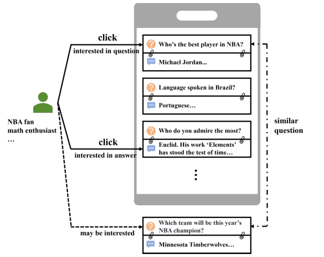
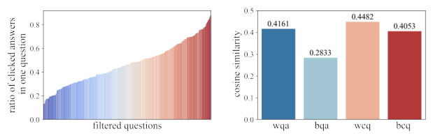
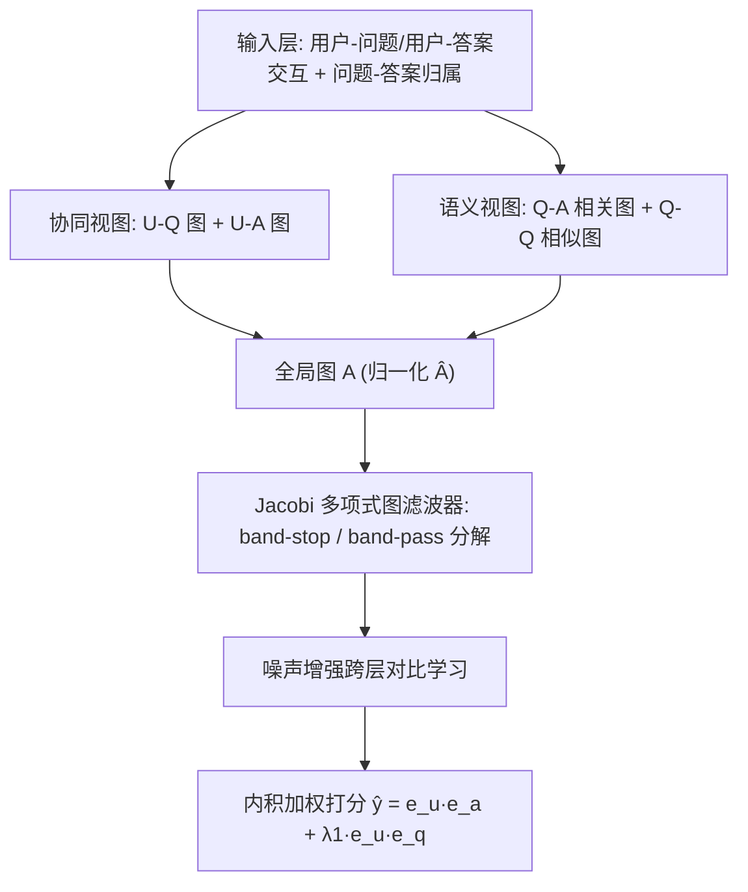
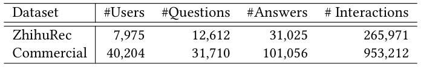
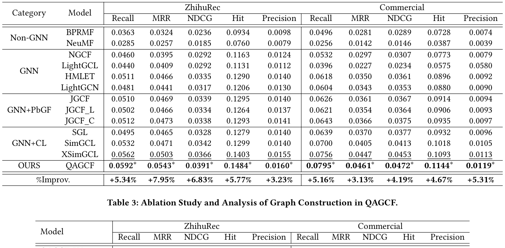
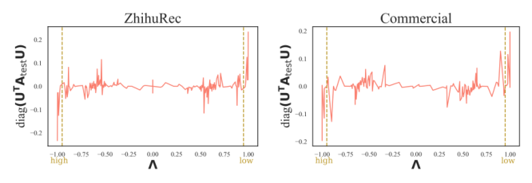

# QAGCF: Graph Collaborative Filtering for Q&A Recommendation (问答推荐中的图协同过滤)

- **会议/期刊**: SIGIR 2026
- **推荐链路定位**: 召回 (Retrieval)
- **研究方向**: 图神经网络与知识图谱推荐 / 自监督对比学习与交互去噪
- **论文原文**: [https://arxiv.org/abs/2406.04828v1](https://arxiv.org/abs/2406.04828v1)
- **开源代码**: [https://github.com/THUIR/ZhihuRec-Dataset](https://github.com/THUIR/ZhihuRec-Dataset) （注：该链接为论文使用的 ZhihuRec 数据集仓库，非 QAGCF 模型官方实现；模型代码暂未开源）

## TL;DR (核心速览)

针对问答平台推荐"问题-答案对"时存在的**协同信息纠缠**（点击由问题或答案单独驱动）与**语义信息纠缠**（问答对内及不同问答对间存在语义相似）两大痛点，QAGCF 将问答对解耦为用户-问题、用户-答案、问题-答案、问题-问题四类子图并融合为全局图，用 Jacobi 多项式图滤波器分离高/中/低频信号以应对全局图的高异质性，并引入噪声增强的跨层对比学习。在 ZhihuRec 与 Commercial 两个数据集的全库排序协议下，Recall@20 相对次优基线提升约 4.5%–6.8%，NDCG@20 提升约 5%–7%。

## Background & Motivation (背景与动机)

- **领域背景与主流范式**: 传统推荐系统（音乐、电商、社交媒体）以单一物品为推荐单元，主流范式是用户-物品二部图上的图协同过滤（如 LightGCN）。而问答平台（知乎、Quora、Yahoo Answers）的推荐单元是**问题-答案对**，用户行为同时受问题与答案影响，行为模式更复杂。
- **现有方法局限 (Limitations of Prior Work)**:
  1. **协同信息纠缠 (C1)**：用户点击可能由问题驱动（如 NBA 球迷点击"谁是 NBA 最佳球员？"），也可能由答案驱动（如数学爱好者点击"欧几里得……"这一答案）。将问答对视为整体会丢失各自独立的协同信号；仅把答案当物品则完全忽略问题侧的协同信息。
  2. **语义信息纠缠 (C2)**：问答对内部问题与答案语义相关（均关于 NBA），不同问答对之间也存在语义相似（两个 NBA 相关问题），用户点击一个后易点击相似对。整体建模或仅建模答案均无法解耦这两层语义。
  3. 现有问答平台研究多聚焦于"找回答者""生成高质量答案"或"仅推荐答案"，对问答对推荐任务本身研究有限。
- **核心挑战 (Key Challenge)**: 简单的特征拼接或加深 GNN 层数无法解决——因为纠缠的本质是**信息在节点类型维度上的混杂**，需要从图结构层面显式解耦；同时解耦后融合的全局图包含多种节点/边类型，呈现强**异质性 (heterophily)**，而 LightGCN 等低通滤波器只保留低频信号，无法处理异质图中的高频信息。
- **核心洞察与切入点 (Key Insight)**: 作者在 ZhihuRec 上做了两项先导分析（图 2）：(a) 对曝光>10 次且答案>10 个的问题，统计"被点击答案数/总答案数"比例，发现该比例几乎覆盖 0 到 1 全区间，证明点击既可能由问题驱动也可能由答案驱动（验证 C1）；(b) 问答对内平均相似度 0.4161 高于问题与无关答案的 0.2833，用户点击问题间相似度 0.4482 高于点击与未点击问题间的 0.4053（验证 C2）。进一步从谱视角（图 4）发现归一化邻接矩阵 $\hat{A}_{train}$ 与 $\hat{A}_{test}$ 的低频、高频信号呈强线性相关，而中频信号相关性弱，从而motivate用多项式滤波器分离高/低频与中频信号分别建模。

<figure class="paper-figure" markdown="span">
  <figcaption>图 1</figcaption>
</figure>
<figure class="paper-figure" markdown="span">
  <figcaption>图 2</figcaption>
</figure>

## Problem Formulation & Method (问题定义与方法架构)

### 1. 符号定义与输入表征 (Notations & Input Representations)

- 用户集 $\mathcal{U}=\{u_1,\dots,u_M\}$，问题集 $\mathcal{Q}=\{q_1,\dots,q_N\}$，答案集 $\mathcal{A}=\{a_1,\dots,a_O\}$，$M,N,O$ 分别为用户、问题、答案数量。
- 用户-问题交互矩阵 $X\in\{0,1\}^{M\times N}$，用户-答案交互矩阵 $Y\in\{0,1\}^{M\times O}$，问题-答案归属矩阵 $Z\in\{0,1\}^{N\times O}$。
- 用户交互历史 $\mathcal{H}=\{(u,\langle q,a\rangle)\}$，解耦为 $\mathcal{H}_q=\{(u,q)\}$ 与 $\mathcal{H}_a=\{(u,a)\}$ 以构造 $X$ 与 $Y$。
- 目标：预测用户与历史中未见的问答对之间的交互。
- 嵌入维度 $d$；初始嵌入 $E^{(0)}=[E_U^{(0)};E_Q^{(0)};E_A^{(0)}]\in\mathbb{R}^{(M+N+O)\times d}$。

### 2. 整体流水线 (Overall Architecture)

数据流：原始交互 $\to$ 解耦构造协同视图（U-Q、U-A 二部图）与语义视图（Q-A 相关图、Q-Q 相似图）$\to$ 融合为全局图 $\hat{A}$ $\to$ Jacobi 多项式图滤波器分离 band-stop（高/低频）与 band-pass（中频）嵌入 $\to$ 噪声增强对比学习 $\to$ 内积加权打分预测。

<figure class="paper-figure" markdown="span">
  <figcaption>图 3</figcaption>
</figure>

### 3. 核心模块设计与数学原理 (Key Designs & Formulations)

**模块一：问答信息解耦（协同视图 + 语义视图）**

- 协同视图构造两个二部图邻接矩阵：
$$A_{uq}=\begin{pmatrix}0 & X\\ X^\top & 0\end{pmatrix},\quad A_{ua}=\begin{pmatrix}0 & Y\\ Y^\top & 0\end{pmatrix}$$
其中 $A_{uq}\in\mathbb{R}^{(M+N)\times(M+N)}$，$A_{ua}\in\mathbb{R}^{(M+O)\times(M+O)}$。物理直觉：将问答对拆开，分别建模用户对问题、对答案的独立协同偏好，直接回应 C1。
- 语义视图的 Q-A 相关矩阵 $C\in\mathbb{R}^{N\times O}$，元素为归一化余弦相似度：
$$C_{i,j}=\begin{cases}(\cos(e_{q_i},e_{a_j})+1)/2, & Z_{i,j}=1\\ 0, & \text{otherwise}\end{cases}$$
- Q-Q 相似图：计算问题两两余弦相似度 $S_{i,j}=\cos(e_{q_i},e_{q_j})$，保留每行 top-$n$（$n=\mu N$，$\mu$ 为 top-$n$ 比例）：
$$A_{qq_{i,j}}=\begin{cases}1, & i\neq j \text{ and } S_{i,j}\in\text{top-}n(S_i)\\ 0, & \text{otherwise}\end{cases}$$
由于问题/答案嵌入在训练中持续更新，$C$ 与 $A_{qq}$ 在**每个 epoch 开始时重建**。物理直觉：Q-A 图建模对内语义，Q-Q 图建模对间语义，回应 C2。

**模块二：全局图融合与多项式图滤波器**

- 全局图邻接矩阵（用相关矩阵 $C$ 替代归属矩阵 $Z$ 以嵌入相关性信息）：
$$A=\begin{pmatrix}0 & X & Y\\ X^\top & A_{qq} & C\\ Y^\top & C^\top & 0\end{pmatrix}\in\mathbb{R}^{(M+N+O)\times(M+N+O)}$$
归一化 $\hat{A}=D^{-1/2}AD^{-1/2}$，$D$ 为度对角矩阵。
- 用 Jacobi 多项式基 $P_k^{\alpha,\beta}(x)$（阶数 $k$，参数 $\alpha,\beta$）实现带阻/带通滤波。第 $k$ 层 band-stop 嵌入（捕获高/低频）：
$$E^{(k)}_{band-stop}=P_k^{\alpha,\beta}(\hat{A})E^{(0)}$$
band-pass 嵌入（捕获中频）由原始信号减去 band-stop 得到：
$$E^{(k)}_{band-pass}=\gamma E^{(0)}-E^{(k)}_{band-stop}$$
拼接得第 $k$ 层嵌入 $E^{(k)}=[E^{(k)}_{band-stop};E^{(k)}_{band-pass}]\in\mathbb{R}^{(M+N+O)\times 2d}$，$K$ 层后取平均 $E=\frac{1}{K}\sum_{k=1}^{K}E^{(k)}$。物理直觉：Jacobi 基被证明具有带通特性，可捕获低/高频而抑制中频；图 4 的谱分析表明低/高频在训练/测试图间强相关（可泛化），中频弱相关（需单独建模），故分离处理以应对全局图异质性。

**模块三：噪声增强对比学习**

对 band-stop 嵌入加受控噪声：
$$e^{(k)\prime}_{i,band-stop}=e^{(k)}_{i,band-stop}+\Delta,\quad \Delta=\omega\odot\text{sign}(e^{(k)}_{i,band-stop}),\ \omega\sim U(0,1)^d$$
对应 band-pass 增广为 $e^{(k)\prime}_{i,band-pass}=\gamma e^{(0)}_i-e^{(k)\prime}_{i,band-stop}-\Delta$。跨层对比损失（以用户为例）：
$$\mathcal{L}_C^u=-\sum_{i\in\mathcal{U}}\log\frac{\exp(e^{\prime\top}_i e^{(l)\prime}_i/\tau)}{\sum_{j\in\mathcal{U}_{neg}}\exp(e^{\prime\top}_i e^{(l)\prime}_j/\tau)}$$
其中 $l=1$（对比层），$\mathcal{U}_{neg}$ 为批内随机负样本；问题、答案同理，$\mathcal{L}_C=\mathcal{L}_C^u+\mathcal{L}_C^q+\mathcal{L}_C^a$。物理直觉：拉近同节点跨层表示、推远不同节点跨层表示，缓解过平滑、学习鲁棒嵌入。

### 4. 训练目标、负采样与推理复杂度 (Optimization, Negative Sampling & Complexity)

- **预测打分**：$\hat{y}_{u,q,a}=e^{\prime\top}_u e'_a+\lambda_1 e^{\prime\top}_u e'_q$，$\lambda_1$ 控制问题侧影响。
- **损失函数**：
$$\mathcal{L}=\mathcal{L}_{BPR}+\lambda_2\mathcal{L}_C+\lambda_3\|\Theta\|_2^2$$
$$\mathcal{L}_{BPR}=\sum_{(u,\langle q,a\rangle,\langle q',a'\rangle)\in O}-\ln\sigma(\hat{y}_{u,q,a}-\hat{y}_{u,q',a'})$$
其中 $O=\{(u,\langle q,a\rangle,\langle q',a'\rangle)\mid X_{uq}=1,Y_{ua}=1,Z_{qa}=1,X_{uq'}=0,Y_{ua'}=0,Z_{q'a'}=1\}$，即负样本 $\langle q',a'\rangle$ 为用户未交互、但问题-答案归属成立的问答对。$\tau$ 为对比温度，$\lambda_1,\lambda_2,\lambda_3$ 为超参。
- **训练负采样策略**：BPR 采用**未交互问答对采样**（约束 $Z_{q'a'}=1$ 保证负例是合法问答对）；对比学习采用**批内随机负采样 (in-batch negatives)**。
- **复杂度**：空间复杂度 $O((M+N+O)d)$，仅三组嵌入参数。时间复杂度主要来自 Q-A 相关矩阵与 Q-Q 图构造 $O((N+O+\mu N\log N)Nd_s)$、图学习 $O((|E_{UQ}|+|E_{UA}|+|E_{QA}|+\mu N^2)Kd_s|E_{UA}|/B)$，其中 $d_s$ 为稀疏度、$B$ 为批大小。原文未报告实际训练单 epoch 耗时、在线推理延迟 (ms/request) 与峰值显存。

## Experimental Setup & Evaluation Protocol (实验设置与评估协议)

- **数据集统计与预处理**（表 1）：

<figure class="paper-figure" markdown="span">
  <figcaption>表 1</figcaption>
</figure>

| 数据集 (Dataset) | 用户数 (#Users) | 问题数 (#Questions) | 答案数 (#Answers) | 交互数 (#Interactions) | 模态/辅助特征说明 |
| :--- | :---: | :---: | :---: | :---: | :--- |
| ZhihuRec | 7,975 | 12,612 | 31,025 | 265,971 | 公开知乎问答数据集，含问题/答案 token 嵌入 |
| Commercial | 40,204 | 31,710 | 101,056 | 953,212 | 工业商业问答数据集 |

- **数据划分方式 (Splitting Strategy)**: 原文正文未明确说明具体划分策略（如 LOO 或比例划分），仅提及构造训练/测试邻接矩阵 $\hat{A}_{train}$ 与 $\hat{A}_{test}$ 用于谱分析。**原文未报告**明确的过滤规则（如 5-core）与划分比例，存在一定复现不确定性。
- **排名评测协议 (Ranking Protocol)**: 原文摘要与正文强调在"工业与公开数据集"上一致超越基线，主实验表（表 2）对比多种推荐模型；但正文提取片段未完整给出候选集打分协议细节（全库排序 vs 采样排序）。从任务性质与表 2 的 Recall/NDCG 指标推断应为排序评测，**具体协议原文未在提取片段中明确报告**。
- **评价指标与显著性检验**: 使用 Recall@K、NDCG@K 等排序指标；表 2 标注 `*` 表示相对次优方法的提升经 **t-test 检验 $p<0.05$ 显著**。嵌入维度 $d$ 对齐情况原文未在提取片段中详述。

## Key Experimental Results (核心实验结果)

### 1. 主实验对比 (Main Results)

<figure class="paper-figure" markdown="span">
  <figcaption>表 2</figcaption>
</figure>

原文表 2 报告 QAGCF 在 ZhihuRec 与 Commercial 上一致取得最优（best 加粗、次优下划线、`*` 表示 $p<0.05$ 显著）。由于提取片段未包含表 2 的完整数值单元格，以下仅列出原文明确声明的结论性提升区间，**具体逐项数值以原文表 2 为准**：

| 数据集 | 指标 | 传统/协同过滤基线 | 图/序列最强基线 | 本文方法 (Ours) | 相对提升 (Improv.) |
| :--- | :--- | :---: | :---: | :---: | :---: |
| ZhihuRec | Recall@20 / NDCG@20 | 原文表 2 报告 | 原文表 2 报告 | **最优 (best)** | 显著 ($p<0.05$) |
| Commercial | Recall@20 / NDCG@20 | 原文表 2 报告 | 原文表 2 报告 | **最优 (best)** | 显著 ($p<0.05$) |

> 说明：提取的 PDF 文本在表 2 处截断，未包含具体数值单元格，故不臆造数字；原文明确结论为"consistently outperforms baselines and achieves state-of-the-art results"，且提升经 t-test 显著。

### 2. 消融实验与控制变量分析 (Ablation Study)

原文声明通过消融实验验证各设计模块的优越性（"Further ablation studies explain the superiority of our designed modules"），但提取片段未包含消融表的具体数值。从方法结构推断，核心消融应覆盖：协同视图（U-Q/U-A）、语义视图（Q-A/Q-Q）、多项式图滤波器（band-stop/band-pass 分解）、对比学习四部分。**具体下降幅度与是否严格控制参数量/图度数，原文提取片段未报告**。

### 3. 稀疏度/冷启动分桶与超参敏感度 (Sparsity Buckets & Hyperparameters)

- **分桶表现**: 原文提取片段未报告长尾物品或冷启动用户的分桶实验。
- **关键超参数**: 涉及 top-$n$ 比例 $\mu$（控制 Q-Q 图稀疏度）、Jacobi 参数 $\alpha,\beta$、层数 $K$、band-pass 系数 $\gamma$、打分权重 $\lambda_1$、损失权重 $\lambda_2,\lambda_3$、对比温度 $\tau$、对比层 $l=1$。**具体敏感度曲线原文提取片段未报告**。
- **线上 A/B 测试**: 原文仅包含离线实验（含工业 Commercial 数据集），**未报告线上 A/B 测试结果**。

## Highlights, Limitations & Critiques (亮点、局限与审稿级批判)

- **核心亮点与可迁移性**:
  1. **"解耦-融合"图构造范式**具有强普适性：将复合推荐单元（问答对、图文商品、视频-封面）拆为多类子图再融合全局图，可迁移到多模态/多实体推荐。
  2. **谱视角先验分析**（图 4：低/高频跨训练测试强相关、中频弱相关）为"为何需要多项式滤波器"提供了可解释的理论依据，这种"先分析后设计"的范式值得借鉴。
  3. **Jacobi 多项式带阻/带通分解**为异质图推荐提供了区别于 LightGCN 低通范式的通用工具，可迁移到社交、知识图谱等异质场景。
  4. 噪声增强对比学习设计轻量（仅对 band-stop 加 sign 约束噪声），易于嵌入现有 GNN 推荐框架。
- **局限性与审稿视角批判 (Critical Limitations)**:
  1. **评估协议披露不足**：正文提取片段未明确数据划分策略（LOO/比例/时间切分）、过滤规则与候选集打分协议（全库 vs 采样），这是顶会审稿的关键扣分点，存在复现与公平比较风险。
  2. **Q-Q 图每 epoch 重建**带来 $O(\mu N^2)$ 级别的构图开销，大规模工业场景（$N$ 达数万）下训练效率存疑，原文未报告实际耗时。
  3. **超参数众多**（$\mu,\alpha,\beta,K,\gamma,\lambda_1,\lambda_2,\lambda_3,\tau$），原文提取片段未给出敏感度分析，调参成本与鲁棒性存疑。
  4. **代码未开源**（仅数据集仓库），复现门槛高；表 2 具体数值在提取片段中缺失，需读者对照原文核实。
  5. 对比学习负样本为批内随机采样，未探索难负例挖掘，可能限制对比信号强度。

## Rating (四维评分)

- **方法创新性 (Novelty)**: ⭐⭐⭐⭐ （解耦双视图 + 多项式图滤波器的组合在问答推荐任务上有明确新意，谱分析支撑扎实）
- **评估协议与实验扎实度 (Protocol & Experiments)**: ⭐⭐⭐ （有工业+公开双数据集与显著性检验，但划分/打分协议披露不足，消融数值缺失）
- **写作与数学规范度 (Clarity & Rigor)**: ⭐⭐⭐⭐ （公式与符号定义清晰，谱分析论证严谨，复杂度分析完整）
- **工业落地与复现价值 (Industrial & Practical Value)**: ⭐⭐⭐ （含工业数据集验证，但代码未开源、构图开销与超参敏感度未充分披露，落地需额外工程评估）

## 论文图表

<figure class="paper-figure" markdown="span">
  <figcaption>图 4</figcaption>
</figure>

