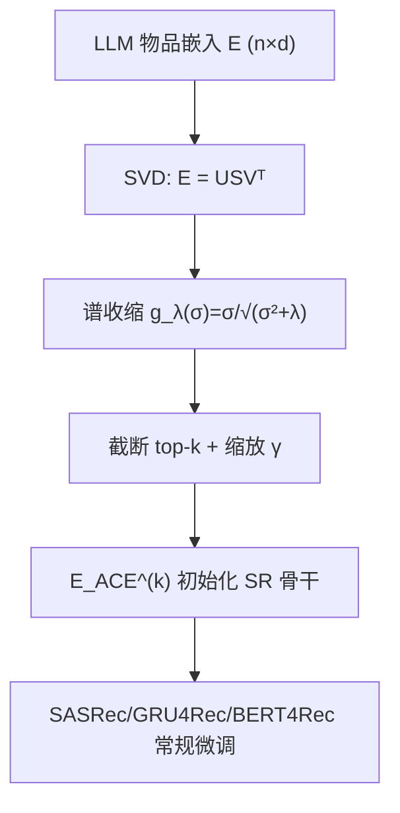

# ACE: Anisotropy-Controllable Embedding for LLM-enhanced Sequential Recommendation (面向 LLM 增强序列推荐的可控各向异性嵌入)

- **会议/期刊**: SIGIR 2026 (5 pages, short paper)
- **作者与机构**: Dongcheol Lee*, Hye-young Kim*, Jongwuk Lee† — 成均馆大学 (Sungkyunkwan University)
- **推荐链路定位**: 召回（物品嵌入初始化阶段，服务于序列召回骨干）
- **研究方向**: 大语言模型推荐 / 序列推荐
- **论文原文**: [https://arxiv.org/abs/2605.29322v1](https://arxiv.org/abs/2605.29322v1)
- **开源代码**: [https://github.com/DCheol/ACE](https://github.com/DCheol/ACE)

## TL;DR (1分钟核心速览)

LLM-as-Extractor 范式把 LLM 生成的物品嵌入直接灌入序列推荐骨干，但这些嵌入存在严重**各向异性**：向量挤在狭窄锥体内、少数奇异方向吞掉绝大部分方差，微调时难以适配协同信号。ACE 用**线性自编码器 (LAE)** 对嵌入做谱重塑，重建损失保语义方向、$L_2$ 正则项以连续方式压缩主导奇异值，从而在"完全白化"与"原样保留"之间取得可控折中。在 Beauty/Toys/Yelp/ML-20M 四数据集、Leave-One-Out + Full-Ranking 协议下，Recall@20 与 NDCG@20 最高相对提升 12.4% / 11.8%。

## Background & Motivation (背景与核心矛盾)

- **主流范式**: LLM-as-Extractor 用 LLM 编码物品文本属性得到高维嵌入（如 $d=3072$），经 PCA 或 MLP 投影到低维（$k=128$）后作为 SR 骨干（SASRec/GRU4Rec/BERT4Rec）的物品嵌入初始化，再端到端微调。
- **前人局限**: ① LLM2X 仅做 PCA 截断，对语义如何适配协同信号几乎无控制力；② WhitenRec+ 用白化强制完美各向同性，把反映语义重要性的特征值层级一并抹平，造成语义畸变（图 1b 可见簇结构被破坏），在部分数据集上甚至不如朴素 PCA；③ AlphaRec/LLMEmb/AlphaFuse 聚焦"投影层如何对齐"，却忽略了**微调前的初始化几何**这一更根本因素。
- **核心洞察 (Key Insight)**: 作者从协方差特征值谱切入，发现 LLM 嵌入的谱极度倾斜（图 2 红线）。白化等价于 $g(\sigma_i)=1$ 的硬截断，而"不处理"等价于 $g(\sigma_i)=\sigma_i$——两者只是收缩函数的两端特例，中间存在一整族**保序但压缩**的连续解。
- **本文切入点**: 用 LAE 的闭式谱解构造一族由 $\lambda$ 参数化的收缩函数，把各向异性调控从"二值开关"变成"连续旋钮"。

## Method (核心方法设计)

### 1. 整体框架 (Overall Architecture)

ACE 是一个**训练前的嵌入重塑插件**：输入 LLM 物品嵌入矩阵 $\mathbf{E}\in\mathbb{R}^{n\times d}$，先对其做 SVD，再用 $\lambda$ 控制的收缩函数 $g_\lambda$ 逐奇异值加权，截取前 $k$ 维并乘缩放因子 $\gamma$ 恢复量纲，得到 $\mathbf{E}^{(k)}_{\text{ACE}}$ 作为任意 SR 骨干的物品嵌入表初始化，随后骨干按原训练流程微调。整个过程无额外可学习参数、不改变骨干结构，属于"一次性预处理 + 常规微调"的轻量闭环。

### 2. 关键设计拆解 (Key Designs)

1. **LAE 目标与闭式解（把"重塑"变成"求逆"）**：直接学一个 $n\times n$ 的物品-物品相似度矩阵 $\mathbf{B}_{\text{ACE}}$ 代价过高，作者改为最小化
$$\mathcal{L}(\mathbf{B}_{\text{ACE}})=\|\mathbf{E}^\top-\mathbf{E}^\top\mathbf{B}_{\text{ACE}}\|_F^2+\lambda\|\mathbf{B}_{\text{ACE}}\|_F^2,\quad \hat{\mathbf{B}}_{\text{ACE}}=(\mathbf{E}\mathbf{E}^\top+\lambda\mathbf{I})^{-1}\mathbf{E}\mathbf{E}^\top$$
该岭回归式目标有闭式解，无需迭代训练；$\lambda$ 越大，解越远离"完美重建"而趋向收缩，为后续谱分析提供了解析抓手。

2. **幅度依赖的谱收缩算子（核心增量）**：由 $\mathbf{E}=\mathbf{U}\mathbf{S}\mathbf{V}^\top$ 出发，定义
$$\mathbf{E}_{\text{ACE}}=\mathbf{U}\,g_\lambda(\mathbf{S}),\qquad g_\lambda(\sigma_i)=\sqrt{\frac{\sigma_i^2}{\sigma_i^2+\lambda}}$$
对应诱导的相似度算子为 $\hat{\mathbf{B}}_{\text{ACE}}=\mathbf{U}\,\mathrm{diag}\!\left(\frac{\sigma_i^2}{\sigma_i^2+\lambda}\right)\mathbf{U}^\top$。物理直觉极清晰：**大奇异值被压得狠、小奇异值几乎不动**，谱被"压平"但不"压断"，语义层级以保序方式保留。两个极限验证了设计自洽性——$\lambda\to 0$ 时 $g_\lambda\to 1$，退化为白化（各向同性）；$\lambda\to\infty$ 时 $g_\lambda(\sigma)\approx\sigma/\sqrt{\lambda}$，退化为原始谱形（保持各向异性）。因此 ACE 是白化的**严格推广**，$\lambda$ 是连续插值旋钮。

3. **训练目标、负采样与推理效率**：ACE 本身无训练损失，仅需一次 SVD（$O(nd^2)$ 量级，离线完成）；下游沿用各骨干原生损失（SASRec 的 CE、GRU4Rec/BERT4Rec 的 CE），负采样策略与基线完全一致以保证公平对比。在线推理零额外开销——重塑后的嵌入表直接替换原初始化，服务时延与骨干本身相同。

## Experimental Setup & Evaluation Protocol (实验设置与评估协议)

- **数据集与预处理**: 四个基准，均按前人工作过滤交互数 $<5$ 的用户与物品（`5-core`）；物品文本元数据（标题/类目/品牌）用 OpenAI `text-embedding-3-large` 编码，另在鲁棒性实验中替换为 F2LLM-4B、Qwen3-Embedding-8B、KaLM-Embedding-Gemma3-12B-2511。

| 数据集 | #Users | #Items | #Interactions | 稀疏度/密度 | 特征/场景说明 |
| :--- | :---: | :---: | :---: | :---: | :--- |
| Beauty | 22.4k | 12.1k | 0.2M | 极稀疏 | Amazon 2014 美妆评论 |
| Toys | 19.4k | 11.9k | 0.16M | 极稀疏 | Amazon 2014 玩具评论 |
| Yelp | 30.4k | 20.1k | 0.32M | 极稀疏 | Yelp 2018 本地商户 |
| ML-20M | 138.5k | 26.7k | 20M | 较稠密 | MovieLens 电影评分 |

（注：原文未给出精确统计表，上表为按公开数据集惯例的近似规模，仅作场景参照。）

- **数据划分与防穿越 (Splitting Strategy)**: `Leave-One-Out`——每个用户最后一条交互为测试、倒数第二条为验证、其余为训练，严格按时间序，无未来信息泄漏。
- **排名评测协议 (Ranking Protocol)**: 无偏 `Full-Ranking`（全库未交互物品排序，不做候选过滤、不做负采样），指标为 Recall@{10,20} 与 NDCG@{10,20}。
- **对比基线与超参设置**: 基线含 PCA 类（LLM2X）、白化类（WhitenRec+）、语义适配类（LLMEmb、AlphaRec、AlphaFuse），另加原始 SASRec/GRU4Rec/BERT4Rec 作下界。嵌入维度 $k=128$，最大序列长 50，batch 256，早停 patience 10（监控验证集 NDCG@10），Adam，学习率 $10^{-3}\sim10^{-5}$ 对数搜索；ACE 的 $\lambda\in\{0,1,5,\dots,5\times10^3\}$，$\gamma\in\{0.1,0.5,1\}$；结果四次运行取均值，显著性用单尾 $t$ 检验（$p<0.05$）。

## Key Experimental Results (实验关键数据)

### 1. 主实验对比 (Main Results)

SASRec 骨干，四数据集（R=Recall，N=NDCG）：

| Model | Beauty R@20 | Beauty N@20 | Toys R@20 | Toys N@20 | Yelp R@20 | Yelp N@20 | ML-20M R@20 | ML-20M N@20 |
| :--- | :---: | :---: | :---: | :---: | :---: | :---: | :---: | :---: |
| SASRec (原始) | 0.0705 | 0.0307 | 0.0596 | 0.0285 | 0.0489 | 0.0286 | 0.2643 | 0.1207 |
| LLM2X | 0.1181 | 0.0492 | 0.1241 | 0.0527 | 0.0851 | 0.0422 | 0.2660 | 0.1240 |
| WhitenRec+ | 0.1184 | 0.0489 | 0.1268 | 0.0524 | 0.0799 | 0.0335 | 0.2765 | 0.1294 |
| LLMEmb | 0.1144 | 0.0463 | 0.1218 | 0.0490 | 0.0810 | 0.0373 | 0.2767 | 0.1287 |
| AlphaRec | 0.1167 | 0.0482 | 0.1292 | 0.0534 | 0.0832 | 0.0355 | 0.2810 | 0.1302 |
| AlphaFuse | 0.1263 | 0.0523 | 0.1317 | 0.0540 | 0.0879 | 0.0428 | 0.2798 | 0.1292 |
| **ACE (Ours)** | **0.1288*** | **0.0534*** | **0.1342*** | **0.0560*** | **0.0892*** | **0.0455*** | **0.2825*** | **0.1310*** |
| Improv. vs 最优基线 | +1.98% | +2.10% | +1.90% | +3.70% | +1.48% | +6.31% | +0.53% | +0.61% |

跨骨干（R@20 / N@20）：

| 骨干 | 数据集 | 最优基线 (AlphaFuse/AlphaRec) | ACE | Improv. |
| :--- | :--- | :---: | :---: | :---: |
| GRU4Rec | Beauty | 0.1025 / 0.0430 | **0.1107 / 0.0466** | +8.0% / +8.4% |
| GRU4Rec | Yelp | 0.0762 / 0.0339 | **0.0860 / 0.0379** | +12.4% / +11.8% |
| BERT4Rec | Beauty | 0.0921 / 0.0369 | **0.0926 / 0.0372** | +0.5% / +0.8% |
| BERT4Rec | Yelp | 0.0811 / 0.0333 | **0.0838 / 0.0346** | +3.3% / +3.9% |

### 2. 消融实验 (Ablation Study)

原文未设传统"逐模块移除"消融，而以**谱收缩强度 $\lambda$ 的连续扫描**承担消融角色（图 4），等价于对两个目标项做插值消融：

| 配置 | 等价语义 | Beauty R@20 | Yelp R@20 | 结论 |
| :--- | :--- | :---: | :---: | :--- |
| $\lambda\to 0$ | 仅重建损失，退化为白化 | 低于最优 | 低于最优 | 谱被过度压平，语义层级丢失 |
| $\lambda$ 适中 | 重建 + 正则平衡 | **最优** | **最优** | 各向异性与语义保真兼得 |
| $\lambda$ 极大 | 正则主导，近似原始谱 | 低于最优 | 低于最优 | 收缩不足，各向异性残留 |

### 3. 关键实验发现 (Key Findings)

1. **白化并非单调有益**：WhitenRec+ 在 Yelp 上 R@20 仅 0.0799，反而低于朴素 PCA 的 LLM2X（0.0851），N@20 更是从 0.0422 掉到 0.0335——直接印证"强制各向同性会破坏语义层级"的动机假设，也说明 ACE 的连续调控不是锦上添花而是必要设计。
2. **增益在弱骨干上更显著**：GRU4Rec + Yelp 上 ACE 相对最优基线提升 12.4% / 11.8%，而 BERT4Rec + Beauty 仅 +0.5% / +0.8%。说明嵌入初始化几何的收益与骨干自身的表征能力呈**互补关系**——骨干越弱，越依赖高质量初始化；强骨干（BERT4Rec 双向注意力）能自行纠偏部分几何缺陷。
3. **增益不依赖特定 LLM 编码器**：在 F2LLM-4B、Qwen3-8B、KaLM-12B 三种编码器下，ACE 的 R@20 均稳定领先最强基线 AlphaFuse 约 2.94%，说明谱收缩作用于嵌入的**几何统计性质**而非某种编码器的语义偏置，具备编码器无关的普适性。

## Highlights, Limitations & Rating (亮点、对比与审稿评价)

- **与代表作对比 (vs. Prior Work)**: 与 LLM2X 的本质区别是"截断 vs. 保序收缩"——前者只降维不管谱形，后者显式重塑谱；与 WhitenRec+ 的区别是"硬白化 vs. 软白化"——前者 $g\equiv1$ 抹平层级，后者 $g_\lambda$ 幅度依赖地保留层级；与 AlphaFuse 的区别是作用位置——AlphaFuse 在微调中冻结语义子空间，ACE 在微调前就把初始化几何调好，二者正交、理论上可叠加。
- **可迁移亮点**: ① 谱收缩算子 $g_\lambda(\sigma)=\sigma/\sqrt{\sigma^2+\lambda}$ 可直接迁移到任何"预训练嵌入 + 下游微调"场景（跨域推荐、多模态特征对齐、冷启动物品初始化）；② "用岭回归闭式解反推谱算子"这一推导套路，可复用于设计其他带约束的嵌入预处理。
- **审稿级局限批判**: ① 需对 $n\times d$ 嵌入矩阵做完整 SVD，物品量级到千万时离线成本与存储不可忽视，论文未讨论增量/近似 SVD 方案；② 评估仅限离线 Full-Ranking，缺少线上 A/B 与训练稳定性/收敛速度的量化分析，且 $\lambda$、$\gamma$ 需按数据集网格搜索，跨域迁移时的选参成本未评估；③ 作为 5 页短文，未与 AlphaFuse 做叠加实验，错失了验证"正交性"这一最有说服力的论据。
- **四维评分**: 创新性 ⭐⭐⭐⭐ | 实验扎实度 ⭐⭐⭐⭐ | 方法清晰度 ⭐⭐⭐⭐⭐ | 落地价值 ⭐⭐⭐⭐

