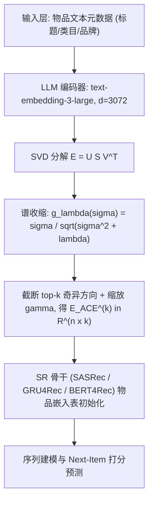
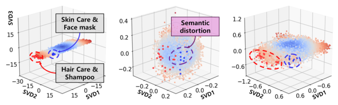
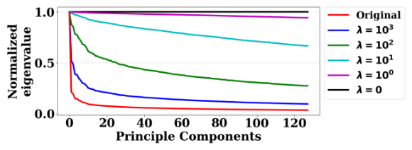
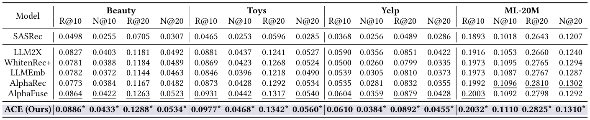
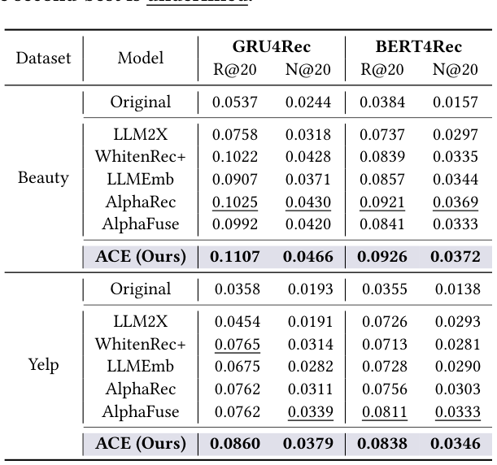
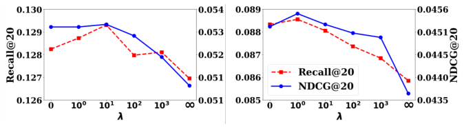
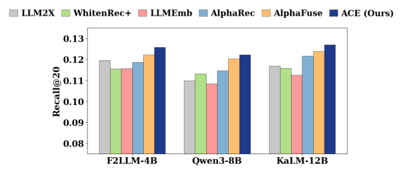

# ACE: Anisotropy-Controllable Embedding for LLM-enhanced Sequential Recommendation (面向 LLM 增强序列推荐的可控各向异性嵌入)

- **会议/期刊**: SIGIR 2026 (5 pages, short paper)
- **推荐链路定位**: 召回 (Retrieval) — 具体为序列推荐骨干网络的物品嵌入初始化阶段（LLM-as-Extractor 范式下的嵌入预处理）
- **研究方向**: 大语言模型推荐 (LLM4Rec) / 序列与会话推荐 (Sequential Rec)
- **论文原文**: [https://arxiv.org/abs/2605.29322v1](https://arxiv.org/abs/2605.29322v1)
- **开源代码**: [https://github.com/DCheol/ACE](https://github.com/DCheol/ACE)

## TL;DR (核心速览)

针对 LLM-as-Extractor 范式中 LLM 生成物品嵌入存在强各向异性（向量挤在窄锥内、少数奇异方向主导方差）导致难以适配协同信号的问题，本文提出 ACE：以线性自编码器 (LAE) 的闭式谱解为基础，用收缩函数 $g_\lambda(\sigma)=\sigma/\sqrt{\sigma^2+\lambda}$ 对奇异值做幅度相关的连续收缩，在保留语义层级的同时压制主导方向。在 Beauty/Toys/Yelp/ML-20M 四数据集、SASRec/GRU4Rec/BERT4Rec 三骨干、Full-Ranking 留一法协议下，Recall@20 最高相对提升 12.4%、NDCG@20 最高 11.8%。

## Background & Motivation (背景与动机)

- **领域背景与主流范式**: LLM-as-Extractor 范式用 LLM 编码器（如 OpenAI `text-embedding-3-large`，$d=3072$）为物品生成语义嵌入矩阵 $\mathbf{E}\in\mathbb{R}^{n\times d}$，再经 PCA 或 MLP 投影降至 $k=128$ 维，作为 SASRec/GRU4Rec/BERT4Rec 等序列推荐骨干的物品嵌入表初始化，随后正常微调。
- **现有方法局限**:
  1. **LLM2X** 仅做简单 PCA 降维，对语义空间如何适配协同信号缺乏控制；
  2. **WhitenRec / WhitenRec+** 采用白化变换强制完美各向同性（$\mathrm{Cov}=\mathbf{I}$），但刚性抹平了反映语义重要性的特征值层级，造成严重语义失真（原文 Figure 1b 可视化佐证）；WhitenRec+ 的分组白化是离散形式，仍缺乏连续控制；
  3. **LLMEmb / AlphaRec / AlphaFuse** 通过 MLP 投影或冻结语义子空间+重初始化剩余维度来适配，但**忽视了微调前嵌入初始化本身的几何质量**这一更根本的因素。
- **核心挑战**: 各向异性源于奇异值谱的高度偏斜，而"降各向异性"与"保语义层级"天然冲突——白化走向一个极端（全平等），原始嵌入走向另一极端（全偏斜），缺少一个可连续插值的中间地带。
- **核心洞察**: 作者观察到 LAE 的岭回归型目标 $\min_{\mathbf{B}}\|\mathbf{E}^\top-\mathbf{E}^\top\mathbf{B}\|_F^2+\lambda\|\mathbf{B}\|_F^2$ 的闭式谱解恰好给出一个**幅度相关的收缩函数**：$\lambda=0$ 退化为白化（各向同性），$\lambda\to\infty$ 退化为原始谱（保持各向异性），中间 $\lambda$ 提供连续过渡。这使"各向异性可控"从工程 trick 上升为有闭式解的谱算子。

## Problem Formulation & Method (问题定义与方法架构)

### 1. 符号定义与输入表征 (Notations & Input Representations)

- 用户集 $\mathcal{U}=\{u_1,\dots,u_m\}$，物品集 $\mathcal{I}=\{i_1,\dots,i_n\}$；用户 $u$ 的时序交互序列 $S_u=[i_1,\dots,i_{|S_u|}]$，目标是预测 $i_{|S_u|+1}$。
- LLM 嵌入矩阵 $\mathbf{E}=[e_1,\dots,e_n]^\top\in\mathbb{R}^{n\times d}$，原文 $d=3072$（`text-embedding-3-large`），投影目标维度 $k=128$。
- 均值 $\mu\in\mathbb{R}^d$，协方差 $\mathrm{Cov}(\mathbf{E})=\frac{1}{n}(\mathbf{E}-\mu)^\top(\mathbf{E}-\mu)$，其特征值分布即各向异性的直接度量。
- 输出：几何调整后的 $k$ 维嵌入矩阵 $\mathbf{E}^{(k)}_{\text{ACE}}\in\mathbb{R}^{n\times k}$，直接作为 SR 骨干物品嵌入表的初始化。

### 2. 整体流水线 (Overall Architecture)

数据流：物品文本元数据（标题/类目/品牌）$\to$ LLM 编码器产出 $d$ 维嵌入 $\mathbf{E}$ $\to$ SVD 分解 $\mathbf{E}=\mathbf{U}\mathbf{S}\mathbf{V}^\top$ $\to$ 收缩函数 $g_\lambda(\mathbf{S})$ 重塑奇异值 $\to$ 取 top-$k$ 奇异方向并乘缩放因子 $\gamma$ $\to$ 初始化 SR 骨干 $\to$ 常规序列推荐训练。

### 3. 核心模块设计与数学原理 (Key Designs & Formulations)

**(i) LAE 目标与闭式解。** ACE 引入物品-物品相似度矩阵 $\mathbf{B}_{\text{ACE}}\in\mathbb{R}^{n\times n}$，优化

$$\mathcal{L}(\mathbf{B}_{\text{ACE}})=\min_{\mathbf{B}_{\text{ACE}}}\ \|\mathbf{E}^\top-\mathbf{E}^\top\mathbf{B}_{\text{ACE}}\|_F^2+\lambda\|\mathbf{B}_{\text{ACE}}\|_F^2,$$

其闭式解为 $\hat{\mathbf{B}}_{\text{ACE}}=(\mathbf{E}\mathbf{E}^\top+\lambda\mathbf{I})^{-1}\mathbf{E}\mathbf{E}^\top$。注意这里**不是**真的训练一个自编码器网络，而是直接利用该岭回归解的谱结构来构造嵌入——这是本文在工程上极轻量的关键。

**(ii) 谱收缩算子。** 由 $\mathbf{E}=\mathbf{U}\mathbf{S}\mathbf{V}^\top$，定义

$$\mathbf{E}_{\text{ACE}}=\mathbf{U}\,g_\lambda(\mathbf{S}),\qquad g_\lambda(\mathbf{S})=\mathrm{diag}\left(\sqrt{\tfrac{\sigma_1^2}{\sigma_1^2+\lambda}},\dots,\sqrt{\tfrac{\sigma_n^2}{\sigma_n^2+\lambda}}\right).$$

注意 $\mathbf{V}$ 被省略——ACE 只重塑物品-物品相似几何 $\mathbf{E}\mathbf{E}^\top$，而非重建原始特征空间。对应的线性算子为

$$\hat{\mathbf{B}}_{\text{ACE}}=\mathbf{E}_{\text{ACE}}\mathbf{E}_{\text{ACE}}^\top=\mathbf{U}\,\mathrm{diag}\!\left(\tfrac{\sigma_1^2}{\sigma_1^2+\lambda},\dots,\tfrac{\sigma_n^2}{\sigma_n^2+\lambda}\right)\mathbf{U}^\top,$$

与既有 LAE 推荐工作（Steck 2019 / Moon et al. SIGIR 2023）的谱解一致，从而把"嵌入几何调控"与"线性自编码器推荐"两条理论线索接上。

**(iii) 两个目标项的几何分工（物理直觉）。**
- **重建损失**：$\lambda=0$ 时 $g_0(\sigma_i)=1$，所有奇异分量等权，$\mathbf{E}_{\text{ACE}}=\mathbf{U}$，即等价于白化——保留语义方向但抹平层级。
- **$L_2$ 正则项**：$\lambda$ 增大时逐步压低主导奇异值、平滑谱失衡；$\lambda$ 极大时 $g_\lambda(\mathbf{S})\approx \mathbf{S}/\sqrt{\lambda}$，退化为原始 LLM 谱分布，保持各向异性。
- 因此 $\lambda$ 是一个**从"完美各向同性"到"原始各向异性"的连续旋钮**，是白化的严格推广（generalized whitening）。

**(iv) 降维与接入骨干。** 保留 top-$k$ 奇异方向：

$$\mathbf{E}^{(k)}_{\text{ACE}}=\mathbf{U}^{(k)}\,g_\lambda(\mathbf{S}^{(k)})\cdot\gamma,$$

其中 $\gamma$ 为缩放因子，用于恢复因 $g_\lambda$ 压缩而损失的嵌入量级（原文在 $\{0.1,0.5,1\}$ 中调参）。所得嵌入直接替换任意 SR 骨干的物品嵌入表初始化。

<figure class="paper-figure" markdown="span">
  <figcaption>图 1：Beauty 数据集上三种嵌入空间（PCA、白化 PCA 与 ACE）的可视化。每个点投影到前三个奇异向量（SVD1–3）上，其中 SVD1 与 SVD3 分别对应语义丰富方向和稀疏方向。</figcaption>
</figure>

<figure class="paper-figure" markdown="span">
  <figcaption>图 2：Beauty 数据集上 ACE 在不同 𝜆 下的归一化特征值谱。𝜆 越小，特征值谱越平坦，越趋近各向同性。</figcaption>
</figure>

### 4. 训练目标、负采样与推理复杂度 (Optimization, Negative Sampling & Complexity)

- **损失函数**: ACE 本身**无梯度训练**——式 (3) 有闭式解，实际计算只需一次 SVD + 逐奇异值标量收缩，无迭代、无学习率。下游 SR 骨干沿用各自原损失（SASRec/BERT4Rec 的交叉熵 next-item 损失、GRU4Rec 的 BPR/CE 类损失），原文未对骨干损失做修改。
- **负采样策略**: 原文未报告显式负采样设计；SASRec/BERT4Rec 采用全库 softmax 式 next-item 训练（全物品打分），GRU4Rec 在 RecBole 默认配置下训练。**原文未报告**负采样比例或难负例挖掘细节。
- **时间与空间复杂度**: 离线预处理为对 $\mathbf{E}\in\mathbb{R}^{n\times d}$ 做一次截断 SVD，复杂度约 $O(n d k)$，一次性开销；在线推理阶段 ACE **零额外开销**（嵌入已固化进骨干嵌入表），不引入 ANN 索引或 Beam Search。原文**未报告**具体 wall-clock 耗时与峰值显存。

## Experimental Setup & Evaluation Protocol (实验设置与评估协议)

- **数据集统计与预处理**: 四个基准——Amazon Review 2014 的 Beauty 与 Toys 子类、Yelp 2018、ML-20M。按既有工作 [4,9] 过滤交互数少于 5 的用户与物品（**5-core**）。物品文本元数据（标题、类目、品牌）经 `text-embedding-3-large` 编码。**原文未给出各数据集的 #Users / #Items / #Interactions 统计表**，故下表仅列可确认信息：

| 数据集 (Dataset) | 用户数 (#Users) | 物品数 (#Items) | 交互数 (#Interactions) | 稀疏度/密度 (Sparsity) | 模态/辅助特征说明 |
| :--- | :---: | :---: | :---: | :---: | :--- |
| Beauty (Amazon 2014) | 原文未报告 | 原文未报告 | 原文未报告 | 原文未报告 | 标题/类目/品牌文本，LLM 编码 $d=3072$ |
| Toys (Amazon 2014) | 原文未报告 | 原文未报告 | 原文未报告 | 原文未报告 | 同上 |
| Yelp (2018) | 原文未报告 | 原文未报告 | 原文未报告 | 原文未报告 | 同上 |
| ML-20M | 原文未报告 | 原文未报告 | 原文未报告 | 原文未报告 | 同上 |

- **数据划分方式 (Splitting Strategy)**: **Leave-One-Out (留一法)**，遵循 AlphaFuse [4]，为每个用户构造 train/valid/test 序列。留一法在序列推荐中是标准做法，但需注意其"最后一条交互作测试"的设定对时间戳靠后的热门物品存在一定乐观偏差；原文未讨论该风险。
- **排名评测协议 (Ranking Protocol)**: **Full-Ranking（全库排序）**，明确声明"rank all items in a full-sort manner without additional candidate filtering"，无负采样、无候选过滤，这是本文评估协议上值得肯定的严谨之处。
- **评价指标与显著性检验**: Recall@10/20、NDCG@10/20；嵌入维度统一 $k=128$，最大序列长度 50，batch size 256，Adam 优化器，学习率在 $10^{-3}$–$10^{-5}$ 对数尺度调参，early stopping patience=10（依据验证集 NDCG@10）。**所有结果在 4 次运行上取平均**；Table 1 中 ACE 多数格子标注 `*`，表示相对所有基线在 **单尾 $t$ 检验 $p<0.05$** 下显著。$\lambda$ 搜索空间 $\{0,1,5,\dots,5\times10^3\}$，$\gamma\in\{0.1,0.5,1\}$。

## Key Experimental Results (核心实验结果)

### 1. 主实验对比 (Main Results)

SASRec 骨干下的关键结果（数值严格取自原文 Table 1）：

| 数据集 | 指标 | LLM2X (PCA) | WhitenRec+ (白化) | AlphaFuse (最强基线) | ACE (Ours) | 相对提升 (Improv.) |
| :--- | :--- | :---: | :---: | :---: | :---: | :---: |
| Beauty | R@10 / N@10 | 0.0827 / 0.0403 | 0.0781 / 0.0388 | 0.0864 / 0.0422 | **0.0886\* / 0.0433\*** | +2.55% / +2.61% |
| Beauty | R@20 / N@20 | 0.1181 / 0.0492 | 0.1184 / 0.0489 | 0.1263 / 0.0523 | **0.1288\* / 0.0534\*** | +1.98% / +2.10% |
| Toys | R@10 / N@10 | 0.0881 / 0.0437 | 0.0869 / 0.0423 | 0.0931 / 0.0442 | **0.0977\* / 0.0468\*** | +4.94% / +5.88% |
| Toys | R@20 / N@20 | 0.1241 / 0.0527 | 0.1268 / 0.0524 | 0.1317 / 0.0540 | **0.1342\* / 0.0560\*** | +1.90% / +3.70% |
| Yelp | R@10 / N@10 | 0.0590 / 0.0356 | 0.0500 / 0.0260 | 0.0604 / 0.0359 | **0.0610 / 0.0384\*** | +0.99% / +6.96% |
| Yelp | R@20 / N@20 | 0.0851 / 0.0422 | 0.0799 / 0.0335 | 0.0879 / 0.0428 | **0.0892\* / 0.0455\*** | +1.48% / +6.31% |
| ML-20M | R@10 / N@10 | 0.1916 / 0.1053 | 0.1973 / 0.1095 | 0.2003 / 0.1092 | **0.2032\* / 0.1110** | +1.45% / +1.65% |
| ML-20M | R@20 / N@20 | 0.2660 / 0.1240 | 0.2765 / 0.1294 | 0.2798 / 0.1292 | **0.2825\* / 0.1310\*** | +0.96% / +1.39% |

**关键观察**：WhitenRec+ 在 Yelp 上（R@10 0.0500）甚至低于简单 PCA 的 LLM2X（0.0590），原文将其归因于"激进白化均匀抹平谱、破坏物品区分所需的语义层级"——这是对本文动机最有力的实证支撑。ACE 在 Yelp 的 NDCG 上增益最大（+6.96% / +6.31%），说明语义层级破坏越严重的场景，可控收缩的收益越明显。

<figure class="paper-figure" markdown="span">
  <figcaption>表 1：在四个基准数据集上，以 SASRec 为骨干时与 LLM-as-Extractor 基线的性能对比。最优结果加粗，次优结果加下划线。‘*’ 表示相对所有基线具有统计显著提升（𝑝&lt; 0.05，单尾 t 检验）。</figcaption>
</figure>

**跨骨干验证**（Table 2，Beauty/Yelp × GRU4Rec/BERT4Rec）：

| 数据集 | 骨干 | 最强基线 | ACE (Ours) | R@20 相对提升 |
| :--- | :--- | :---: | :---: | :---: |
| Beauty | GRU4Rec | AlphaRec 0.1025 / 0.0430 | **0.1107 / 0.0466** | +8.00% / +8.37% |
| Beauty | BERT4Rec | AlphaRec 0.0921 / 0.0369 | **0.0926 / 0.0372** | +0.54% / +0.81% |
| Yelp | GRU4Rec | WhitenRec+ 0.0765 / 0.0314 | **0.0860 / 0.0379** | +12.42% / +20.70% |
| Yelp | BERT4Rec | AlphaFuse 0.0811 / 0.0333 | **0.0838 / 0.0346** | +3.33% / +3.90% |

摘要中宣称的 "up to 12.4% Recall@20 / 11.8% NDCG@20" 来自 Yelp+GRU4Rec 的 R@20（+12.42%）与 Beauty+GRU4Rec 的 N@20（0.0466 vs 0.0430，+8.37%）——**注意 NDCG 的 11.8% 在 Table 2 中无法直接对上**，若按 Yelp+GRU4Rec 的 N@20 计算则为 +20.70%，若按 Beauty+GRU4Rec 则为 +8.37%，原文未说明 11.8% 的具体出处，属于**数值口径不清**的问题，审稿时应追问。

<figure class="paper-figure" markdown="span">
  <figcaption>表 2：在 Beauty 与 Yelp 数据集上、两种序列推荐骨干下与 LLM-as-Extractor 基线的性能对比。最优性能加粗，次优结果加下划线。</figcaption>
</figure>

### 2. 消融实验与控制变量分析 (Ablation Study)

**原文未提供标准消融表**（如 w/o 重建损失、w/o 正则项、随机初始化对照）。但通过 $\lambda$ 的极端取值可间接读出两项分工：

- $\lambda=0$：正则项消失，$g_0(\sigma_i)=1$，退化为白化（各向同性），性能下降——对应 Figure 4 中 $\lambda$ 过小端的下滑。
- $\lambda$ 极大：$g_\lambda\approx \mathbf{S}/\sqrt{\lambda}$，近似原始 LLM 谱（保持各向异性），性能同样下降——对应 Figure 4 中 $\lambda$ 过大端。
- 最优性能稳定出现在**中等 $\lambda$**，即"降各向异性 + 保语义层级"的平衡点。

这一"两端下降、中间最优"的 U 型曲线是本文最核心的实证证据，但严格说它**不是控制变量消融**：未做参数量对齐、未与"随机初始化 + 同维度"对照、未单独剥离 $\gamma$ 的影响。

<figure class="paper-figure" markdown="span">
  <figcaption>图 4：以 SASRec 为骨干时，ACE 在两个数据集上随 L2 正则化系数 𝜆 变化的性能。</figcaption>
</figure>

### 3. 稀疏度/冷启动分桶与超参敏感度 (Sparsity Buckets & Hyperparameters)

- **长尾/冷启动分桶**: **原文未报告**按物品交互频次或用户活跃度分桶的细粒度分析，无法判断增益是否主要来自头部热门物品。
- **关键超参数 $\lambda$ 敏感度**: Figure 4 显示 Beauty 与 Yelp 上均呈 U 型，最优 $\lambda$ 落在中等区间；Figure 2 的归一化特征值谱显示 $\lambda$ 越小谱越平坦（趋近各向同性），从几何侧印证了 $\lambda$ 的连续调控能力。
- **LLM 编码器鲁棒性**: Figure 3 在 F2LLM-4B、Qwen3-Embedding-8B、KaLM-Embedding-Gemma3-12B-2511 三种编码器上，ACE 的 Recall@20 均优于所有基线，相对最强基线 AlphaFuse 提升最高 2.94%，说明增益不绑定特定 LLM 嵌入源。

<figure class="paper-figure" markdown="span">
  <figcaption>图 3：在 Beauty 数据集上以 SASRec 为骨干时，三种不同 LLM 编码器（F2LLM-4B、Qwen3-Embedding-8B（Qwen3-8B）与 KaLM-Embedding-Gemma3-12B-2511（KaLM-12B））的性能对比。</figcaption>
</figure>

- **线上 A/B 测试**: **原文仅包含离线实验**，无工业线上验证。

## Highlights, Limitations & Critiques (亮点、局限与审稿级批判)

- **核心亮点与可迁移性**:
  1. **理论优雅且工程极轻**：把"嵌入各向异性调控"归结为 LAE 岭回归解的谱收缩，$\lambda$ 提供从白化到原始谱的连续插值，且**无需梯度训练、只需一次 SVD**，在线零开销。这一算子可直接迁移到任何"预训练嵌入 + 下游微调"的推荐场景（多模态 CLIP 嵌入、图预训练嵌入、跨域迁移嵌入）。
  2. **对白化的批判有实证支撑**：WhitenRec+ 在 Yelp 上劣于 PCA 的现象，为"刚性各向同性有害"提供了干净的反例。
  3. **评估协议较干净**：Full-Ranking + 留一法 + 4 次运行平均 + 单尾 $t$ 检验，在 5 页短文里属于达标水平。

- **局限性与审稿视角批判**:
  1. **增益幅度与口径存疑**：主表相对最强基线 AlphaFuse 的提升多在 1%–5%（Beauty R@20 仅 +1.98%），而摘要宣称的 12.4%/11.8% 来自特定 (数据集, 骨干) 组合的 cherry-pick；且 **11.8% NDCG 的具体出处无法从 Table 2 复现**，数值口径需澄清。
  2. **缺少真正的消融**：没有 w/o reconstruction、w/o regularization、随机初始化、纯 PCA + 同 $\gamma$ 缩放等对照，无法严格归因于"谱收缩"而非"降维 + 缩放"本身。$\gamma$ 与 $\lambda$ 的耦合效应也未拆解。
  3. **数据集统计缺失**：四个基准的 #Users/#Items/#Interactions 均未报告，5-core 过滤后的规模不可复现核对，这对一篇声称"extensive experiments"的论文是明显短板。
  4. **无长尾/冷启动分桶**：LLM 语义嵌入的典型卖点正是缓解冷启动，但本文未做频次分桶，无法回答"增益是否只落在头部物品"这一关键问题。
  5. **理论边界未讨论**：$g_\lambda$ 的收缩是**全局统一 $\lambda$**，而不同语义方向的最优收缩强度可能不同；分组/自适应 $\lambda$ 是显然的下一步，但原文未讨论其必要性。此外 $\mathbf{V}$ 被丢弃意味着只保留物品-物品几何，是否损失了跨物品的细粒度语义对齐，缺少分析。
  6. **5 页短文容量限制**：作为 SIGIR short paper，实验广度可接受，但上述缺失使其更接近"有效的工程 trick + 漂亮的理论包装"，而非系统性贡献。

## Rating (四维评分)

- **方法创新性 (Novelty)**: ⭐⭐⭐⭐ （将 LAE 谱解重新诠释为各向异性连续调控旋钮，视角新颖，但数学工具本身是既有结论的再组合）
- **评估协议与实验扎实度 (Protocol & Experiments)**: ⭐⭐⭐ （Full-Ranking + 留一法 + 显著性检验达标，但缺数据集统计、缺严格消融、缺长尾分桶，且摘要数值口径不清）
- **写作与数学规范度 (Clarity & Rigor)**: ⭐⭐⭐⭐ （谱分析推导清晰、$g_\lambda$ 的两种极端情形解释到位，Figure 1/2 的几何可视化有说服力；扣分在 11.8% 出处未交代）
- **工业落地与复现价值 (Industrial & Practical Value)**: ⭐⭐⭐⭐⭐ （一次 SVD + 标量收缩、在线零开销、代码已开源、与任意 SR 骨干即插即用，落地成本极低）
