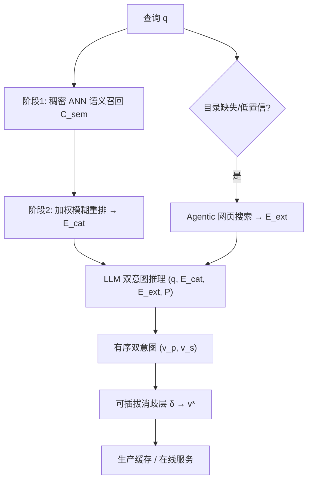
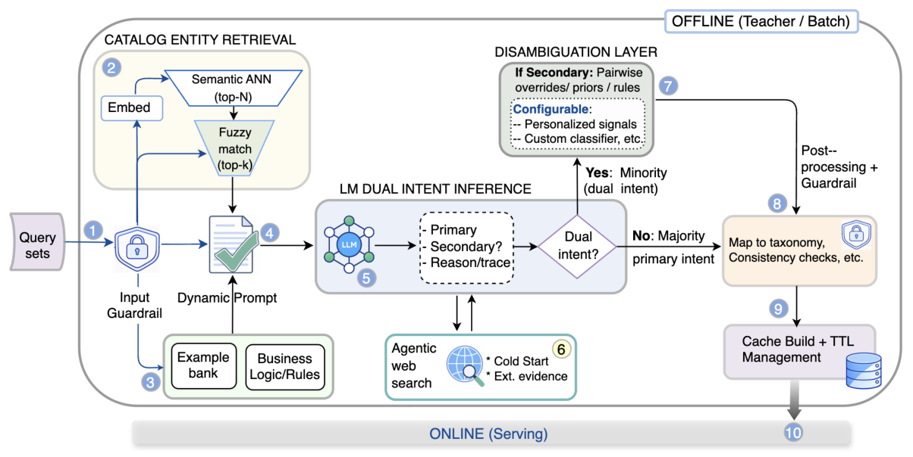
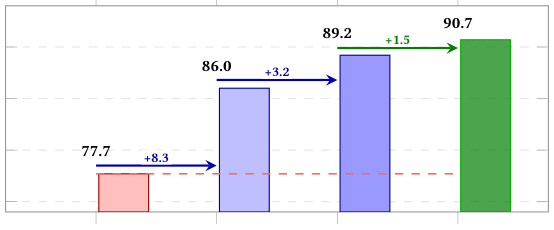

# Agentic Multi-Source Grounding for Enhanced Query Intent Understanding: A DoorDash Case Study (面向查询意图理解的多源 Agentic Grounding：DoorDash 案例研究)

- **会议/期刊**: ACM SIGIR 2026 (5 pages, industry/case study)
- **作者与机构**: Emmanuel Aboah Boateng, Kyle Macdonald, Akshad Viswanathan, Sudeep Das — DoorDash, Inc.
- **推荐链路定位**: 召回前置的查询意图路由（Query Intent Understanding, QIU），决定后续走 Restaurant / Grocery / Retail / Alcohol 哪条检索链路
- **研究方向**: 大语言模型推荐 / 对话推荐与智能体仿真
- **论文原文**: [https://arxiv.org/abs/2603.01486v2](https://arxiv.org/abs/2603.01486v2)
- **开源代码**: 暂未开源

## TL;DR (1分钟核心速览)

多品类市场里 "Wildflower" 这类上下文稀疏查询天然多义（餐厅连锁 / 零售花品 / 花卉），传统 softmax 分类器强制 winner-takes-all 会压掉并存的合法意图，而通用 LLM 无平台库存 grounding 会幻觉出不存在的品类。本文把意图预测重构为**集合覆盖问题**：先用「稠密 ANN 召回 + 模糊重排」两阶段从平台目录捞高精度实体，冷启动查询再由 LLM **自主调用网页搜索工具**补充实时世界知识，最后让 LLM 输出有序双意图 $(v_p,v_s)$，交由可插拔规则层裁决。在 DoorDash 四个基准（$N\approx 30{,}000$）上，全局 SOT 达 94.0%（较 Gemini 无 grounding 基线 +10.9pp、较线上 Legacy 系统 +4.6pp），长尾 Tail 段累计 +13.0pp 至 90.7%，已覆盖 95.9% 日搜索曝光。

## Background & Motivation (背景与核心矛盾)

- **主流范式**: 查询意图理解被当作单标签多分类任务，用 BERT 类编码器或 LLM 直接做 $v^*=\arg\max_{v\in V}P(v\mid q)$，输出一个品类去路由下游检索。
- **前人局限一（分类器）**: softmax 训练目标让各意图争夺概率质量，提升 "Restaurant" 置信度必然压制 "Retail"，即使 top-$k$ 输出也已丢失校准；对跨品类查询结构性不适配。
- **前人局限二（LLM）**: 通用 LLM 缺乏平台库存上下文，会把 "450 North"（精酿啤酒厂）误判为餐厅、把 "Wildflower" 误判为花卉商品，产生不可用库存的幻觉。
- **核心洞察 (Key Insight)**: 意图歧义的本质不是"分类不确定"，而是"多个意图同时为真"；因此应预测**意图集合**而非单点，并把"预测"与"裁决"解耦——预测交给带证据的 LLM，裁决交给可配置业务策略。
- **本文切入点**: 用平台目录实体 + Agentic 网页搜索双源证据把 LLM 锚定在真实库存上，再以双意图元组 + 规则消歧层同时消灭两类失败模式。

## Method (核心方法设计)

### 1. 整体框架 (Overall Architecture)

查询 $q$进入后先走两阶段目录实体检索（稠密 ANN 语义召回 → 加权模糊重排过滤），得到高精度实体集$E_{cat}$；若查询在目录中缺失或模型置信度低，LLM 作为 agent 自主触发网页搜索工具取回实时知识$E_{ext}$。两源证据连同策略上下文$\mathcal{P}$（业务覆盖规则 + 动态 few-shot 示例库）拼入 prompt，由 LLM 推理引擎输出有序双意图元组$(v_p,v_s)$；当$v_s\neq\varnothing$时进入可插拔消歧层，按历史胜率白名单裁决出最终单意图$v^*$，结果写入生产缓存供在线服务。

<figure class="paper-figure" markdown="span">
  <figcaption>图 2：系统架构概览。该流水线展示了多源证据检索过程（步骤 2–4、6）、双意图推理引擎（步骤 5），以及填充生产缓存的可插拔消歧层（步骤 7）。</figcaption>
</figure>

### 2. 关键设计拆解 (Key Designs)

1. **集合覆盖式意图建模（替代 argmax 单标签）**：把目标从"选一个最可能的品类"改为"选一个最小的意图集合，使真实意图被包含的概率最大"：
$$S=\arg\max_{S\subseteq V,\,|S|\leq k}P(v^*\in S\mid q,E),\quad E=E_{cat}\cup E_{ext}$$
取 $k=2$ 是工程折中——既保留一个显著备选意图，又让下游消歧保持可解。直觉上这把"概率质量竞争"变成了"覆盖率最大化"，从损失函数层面消除了意图互斥假设。

2. **两阶段目录实体检索（保召回再保精度）**：阶段一用共享编码器 $\phi$做 ANN 召回$C_{sem}=\mathrm{top\text{-}}N_{e\in\mathcal{E}}\cos(\phi(q),\phi(e))$，解决 "better chew" → Better Chew 植物基品牌这类严重词面漂移；阶段二用加权模糊分重排并阈值截断：
$$S_{fuzzy}(q,e)=\alpha\cdot\mathrm{TokenSet}(q,e)+(1-\alpha)\cdot\mathrm{PartialRatio}(q,e),\quad E_{cat}=\{e\in C_{sem}:S_{fuzzy}\geq\tau_{fuzzy}\}$$
$\alpha$ 在"词序无关的 token 集合重叠"与"子串部分匹配（抗拼写错误）"之间权衡。语义召回保证不漏，模糊重排保证注入 prompt 的实体是高精度的——这一步是幻觉抑制的主力。

3. **双意图输出 + 可插拔消歧与训练/推理开销**：LLM 输出 $(v_p,v_s)=\mathrm{LLM}(q,E_{cat},E_{ext},\mathcal{P})$，消歧层用历史胜率白名单$\mathcal{W}$ 做成对覆盖：
$$v^*=\delta(v_p,v_s)=\begin{cases}v_s & (v_p,v_s)\in\mathcal{W}\\ v_p & \text{otherwise}\end{cases}$$
该层是纯确定性规则、零额外推理成本，且可替换为学习式 re-ranker 或注入位置/订单历史等个性化信号而不动上游架构。系统无监督训练损失（依赖 LLM 推理 + 规则），工程上采用**离线批量计算 + 缓存**架构：缓存命中覆盖 95.9% 日流量，未命中回退到在线 BERT 分类器保底；离线 teacher 同时产出 silver 数据用于未来蒸馏低延迟 student。

## Experimental Setup & Evaluation Protocol (实验设置与评估协议)

- **数据集与流量切片**: 四个基准共 $N\approx 30{,}000$，均为 DoorDash 多品类搜索真实流量采样：

| 基准 | #Queries | 流量性质 | 说明 |
| :--- | :---: | :---: | :--- |
| Branded* | 7,809 | 头部品牌词 | 零售品牌名查询 |
| Retail | 7,988 | 常规零售 | 非食品类零售查询 |
| Tail (Synthetic) | 2,335 | 长尾合成 | 稀有长尾查询构造集 |
| SOT | 12,651 | 全局代表样本 | 覆盖 Head/Torso/Tail 三段 |
| SOT Tail (消融) | 4,993 | 长尾子集 | 歧义最密集，用于增量消融 |

- **数据划分与防穿越**: 论文未披露显式训练/测试切分比例；系统为 LLM 推理 + 规则式架构，无传统监督训练集，评测基于人工标注的意图 ground truth 切片，属**离线标注评测**而非时间戳切分。
- **排名评测协议**: 采用 **Accuracy（单标签命中率）**，且明确以消歧层裁决后的最终单意图 $v^*$与 ground truth 比对——即双意图元组必须先经$\delta$ 收敛为单标签再计分，避免"多输出即多命中"的虚高。
- **对比基线与超参**: 四类基线——(1) Legacy 线上混合 BERT+LLM 集成；(2) Gemini-2.5-flash 单意图无 grounding prompt（同 backbone 控制组，用于隔离架构贡献）；(3) GPT-4o；(4) GPT-4o-mini。检索超参含 ANN top-$N$、模糊阈值$\tau_{fuzzy}$、权重$\alpha$、意图集合上界$k=2$；论文未报告显著性检验。

## Key Experimental Results (实验关键数据)

### 1. 主实验对比 (Main Results)

| Benchmark | GPT-4o-mini | GPT-4o | Gemini Base | Legacy | **DI (Ours)** | Improv. (vs Gemini) |
| :--- | :---: | :---: | :---: | :---: | :---: | :---: |
| Branded* | 77.9% | 87.5% | 88.4% | 82.3% | **94.5%** | +6.1pp |
| Retail | 86.5% | 93.6% | 90.5% | 91.2% | **96.3%** | +5.8pp |
| Tail (Synthetic) | 82.6% | 87.1% | 86.4% | 83.4% | **92.4%** | +6.0pp |
| SOT (Overall) | 79.8% | 83.2% | 83.1% | 89.4% | **94.0%** | +10.9pp |

分段结果（SOT，图 3）：Head 段 Ours 99.5% / Legacy 98.4% / Gemini 92.3%；Torso 段 Ours 94.7% / Legacy 92.2% / Gemini 83.9%；Tail 段 Ours 90.7% / Legacy 82.2% / Gemini 77.7%。

### 2. 消融实验 (Ablation Study)

SOT Tail 子集（$N=4{,}993$）增量消融：

| 配置 | Accuracy | 增量 | 累计 |
| :--- | :---: | :---: | :---: |
| Baseline（无 grounding） | 77.7% | — | — |
| + Catalog Grounding | 86.0% | +8.3pp | +8.3pp |
| + Agentic Search | 89.2% | +3.2pp | +11.5pp |
| + Dual-Intent Disambiguation (Full) | **90.7%** | +1.5pp | **+13.0pp** |

<figure class="paper-figure" markdown="span">
  <figcaption>图 4：SOT 尾部上的组件消融（𝑁=4,993）。相较无 grounding 基线累计提升 +13.0pp。</figcaption>
</figure>

### 3. 关键实验发现 (Key Findings)

1. **目录 grounding 是绝对主力，贡献 64% 的增益**：单加 Catalog Grounding 即 +8.3pp（77.7%→86.0%），远超 Agentic Search 的 +3.2pp 与双意图消歧的 +1.5pp，说明幻觉的根因是"缺平台库存上下文"而非"缺世界知识"——通用 LLM 的常识推理并不弱，弱的是与私有库存的对齐。
2. **增益集中在长尾而非头部，且不牺牲头部安全**：Tail 段相对 Gemini 提升 +13.0pp（77.7%→90.7%），而 Head 段仍维持 99.5%（Legacy 98.4%），证明多意图框架是"长尾扩召回"而非"全局换范式"，导航型高频查询的可靠性未被稀释。
3. **同 backbone 对照揭示架构而非模型规模才是瓶颈**：Gemini Base（83.1%）与 GPT-4o（83.2%）在 SOT 上几乎持平，而同一 Gemini backbone 加 grounding 后跃至 94.0%（+10.9pp），说明在意图路由任务上"换更大模型"收益趋零，"换证据来源"才是有效杠杆；线上 changed/disagreement 段 CTR 31.74%→34.36%、QPR 6.66%→6.90% 亦与离线趋势一致。

## Highlights & Limitations (亮点、对比与审稿批判)

- **与代表作对比 (vs. Prior Work)**: 相较传统多分类 QIU（如 BERT 意图分类器），本文用集合覆盖目标替代 argmax，从损失层面解除意图互斥；相较通用 RAG / tool-augmented LLM 工作，本文首次把"agentic 多源 grounding + 双意图 + 可插拔消歧"三者组合进生产级 QIU，且消歧层与预测层解耦，业务策略更新无需重训模型。
- **可迁移亮点**: (1) "预测集合 + 规则裁决"的解耦范式可直接迁移到多业务场景路由（如电商品牌店 vs 商品列表、内容平台多频道分发）；(2) 两阶段"ANN 召回 + 加权模糊重排"作为 LLM prompt 的证据注入器，是低成本、高精度的幻觉抑制模板，可复用到任何需要注入私有实体的 LLM 应用。
- **审稿级局限批判**: (1) **评估协议薄弱**——仅报告 Accuracy，未给显著性检验、未披露标注一致性与切分细节，且 Tail (Synthetic) 为合成集，外部效度存疑；(2) **延迟与成本未量化**——Agentic 网页搜索为在线外部调用，论文只以"离线批量 + 缓存 95.9%"回避了 4.1% 未命中流量的在线开销与回退 BERT 的精度损失，缺少端到端 P99 延迟与成本对比；(3) 消歧层依赖历史胜率白名单 $\mathcal{W}$，对冷启动品类或分布漂移敏感，论文未做该超参/白名单规模的敏感性分析。

## Rating (四维评分)

- **方法创新性 (Novelty)**: ⭐⭐⭐⭐ （集合覆盖式意图建模 + 预测/裁决解耦的思路清晰且实用，但各组件（ANN 检索、模糊匹配、tool-use）均为成熟技术的组合创新，理论深度有限）
- **评估协议与实验扎实度 (Protocol & Experiments)**: ⭐⭐⭐ （四基准 + 分段 + 增量消融结构完整，且有线上 CTR/QPR 佐证，但缺显著性检验、切分细节与合成集外部效度验证）
- **写作与数学规范度 (Clarity & Rigor)**: ⭐⭐⭐⭐ （5 页短文公式精简、符号自洽，$k=2$ 等设计取舍有明确工程论证；但缺复杂度与延迟分析）
- **工业落地与复现价值 (Industrial & Practical Value)**: ⭐⭐⭐⭐⭐ （已覆盖 95.9% 日搜索曝光、有线上指标，架构解耦使其可跨市场复用；扣分项为未开源且依赖内部目录与 LLM 服务）
