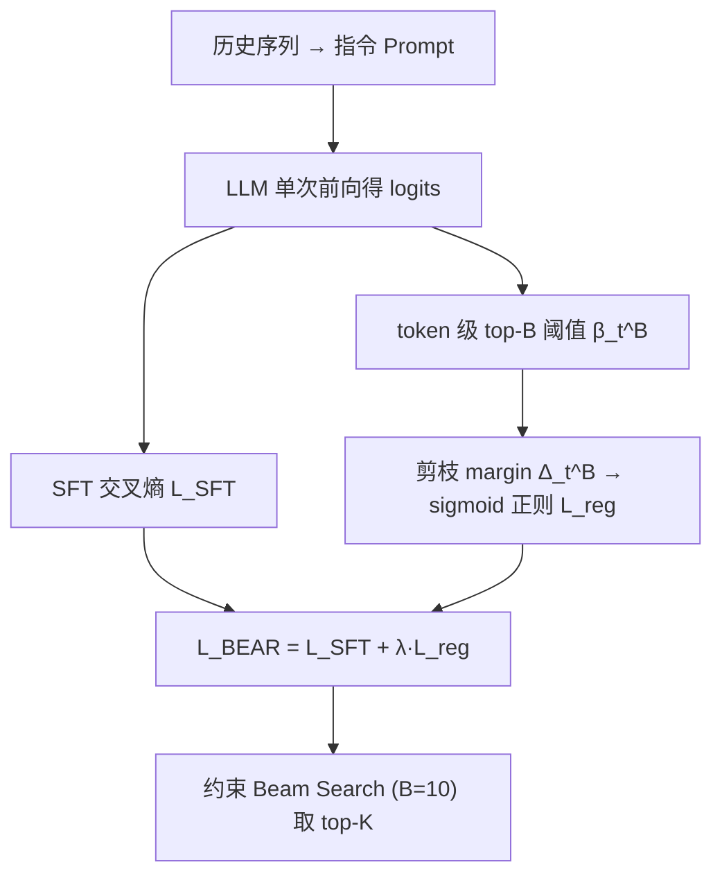

# BEAR: Towards Beam-Search-Aware Optimization for Recommendation with Large Language Models (面向大模型推荐的 Beam Search 感知优化)

- **会议/期刊**: SIGIR 2026
- **作者与机构**: Weiqin Yang, Bohao Wang, Zhenxiang Xu, Jiawei Chen, Shengjia Zhang, Can Wang 等（浙江大学；香港中文大学深圳；浙大城市学院）
- **推荐链路定位**: 端到端生成式（LLM 微调 + 约束 Beam Search 解码）
- **研究方向**: 大语言模型推荐 / 生成式推荐
- **论文原文**: [https://arxiv.org/abs/2601.22925v3](https://arxiv.org/abs/2601.22925v3)
- **开源代码**: [https://github.com/Tiny-Snow/BEAR-SIGIR-2026](https://github.com/Tiny-Snow/BEAR-SIGIR-2026)

## TL;DR (1分钟核心速览)

LLM 推荐普遍用 SFT 最大化正例整体概率、推理时用 beam search 取 top-K，但 beam search 的贪心剪枝会因**前缀概率不足**而提前砍掉整体概率最高的正例——实测 80%+ 高概率正例被误剪。BEAR 不模拟 beam search，而是优化一个**token 级必要条件**（每个正例 token 须排进 top-B），用 sigmoid 松弛成可微正则项。在 4 个 Amazon 数据集、Full-Ranking 协议下相对 SOTA 平均提升 12.50%，训练开销与 SFT 持平。

## Background & Motivation (背景与核心矛盾)

- **主流范式**: 将用户历史拼成 prompt，SFT 让 LLM 自回归生成目标物品文本，推理时用约束 beam search（beam width $B$）高效取 top-$K$ 候选。
- **前人局限**: ① SFT 只优化整体概率 $\prod_t P_\theta(y_t|y_{<t},x)$，对**前缀局部概率**无约束；② beam search 每步只保留 top-$B$ 前缀，前缀概率低的正例在第一步即被剪掉，即便其整体概率最高。
- **核心洞察 (Key Insight)**: 在 Book/Toy 上，整体概率排 top-$K$的正例有 **88.28% / 84.39%** 被 beam search 误剪；且其中 **70%+** 的误剪源于违反一个 token 级必要条件（某正例 token 未进 top-$B$）。即"必要条件违反"是误剪的主因。
- **本文切入点**: 与其昂贵地模拟 beam search，不如直接优化这个**充分有效的必要条件**，以极小代价消除大部分误剪。

## Method (核心方法设计)

### 1. 整体框架 (Overall Architecture)

输入为历史序列构造的指令 prompt，LLM 前向一次得到各位置 logits；在 SFT 交叉熵之外，对每个正例 token 额外计算其相对 top-$B$阈值的"剪枝 margin"，经 sigmoid 松弛后作为正则项回传梯度。训练仍是单次前向（logits 复用），推理仍用约束 beam search（$B=10$）取 top-$K$。整体是"一次前向、双损失"的轻量改造，模型无关，可插拔到任意 LLM 推荐骨干。

### 2. 关键设计拆解 (Key Designs)

1. **必要条件目标（token 级 top-B 约束）**：痛点在于前缀级约束需模拟 beam search。BEAR 退一步，要求每个正例 token 概率不低于该步第 $B$高 token 概率$\beta_t^B$：
$$\max_\theta \prod_{t=1}^{|y|} \mathbb{I}\big(P_\theta(y_t|y_{<t},x)\ge \beta_t^B\big)$$
直觉：若每个正例 token 都进 top-$B$，则正例前缀至少能留在 top-$B$ 扩展候选中，是"最终被保留"的必要条件；而实验证明违反它正是误剪主因，故优化它即可吃掉大部分收益。

2. **可微正则化（剪枝 margin + sigmoid 松弛）**：指示函数不可导。定义剪枝 margin $\Delta_t^B=\log\beta_t^B-\log P_\theta(y_t|y_{<t},x)$，$\Delta_t^B>0$即被剪。用$\sigma_\xi(\Delta_t^B)=1/(1+e^{-\Delta_t^B/\xi})$ 松弛，得
$$\mathcal{L}_{reg}=\sum_{t=1}^{|y|}\log\sigma_\xi\big(\log\beta_t^B-\log P_\theta(y_t|y_{<t},x)\big)$$
温度 $\xi$控制平滑度；最小化它即把每个正例 token 概率推过 top-$B$阈值。关键：$\beta_t^B$只需对已有 logits 做 softmax 取第$B$ 大，**零额外前向**。

3. **训练目标、负采样与推理效率**：总损失 $\mathcal{L}_{BEAR}=\mathcal{L}_{SFT}+\lambda\mathcal{L}_{reg}$，$\lambda\in[0.1,5.0]$、$\xi\in[0.25,3.0]$。无需负采样（纯正例正则）；对比直接优化前缀目标 (3.1) 需模拟 beam search、约 **4.45×** 训练耗时，BEAR 与 SFT 训练时间几乎相同（Book 69.77s vs 69.67s/epoch）。可扩展至 DPO：正例加$+\mathcal{L}_{reg}$、负例加$-\mathcal{L}_{reg}$。

## Experimental Setup & Evaluation Protocol (实验设置与评估协议)

- **数据集与预处理**（Amazon，`5-core` 过滤，滑窗长度 11）：

| 数据集 | #Users | #Items | #Interactions | 密度 | 场景 |
| :--- | :---: | :---: | :---: | :---: | :--- |
| Office | 4,895 | 2,414 | 53,149 | 0.4498% | 办公用品 |
| Book | 16,559 | 6,344 | 151,928 | 0.1446% | 图书 |
| Toy | 19,124 | 11,758 | 165,247 | 0.0735% | 玩具 |
| Clothing | 39,230 | 22,948 | 277,534 | 0.0308% | 服饰 |

- **数据划分与防穿越**: 按时间顺序 **8:1:1** 比例划分（时序切分，防穿越）。
- **排名评测协议**: 约束 beam search（$B=10$）生成合法物品后计算 **NDCG@K / HitRatio@K**（$K\in\{5,10\}$），属生成式候选排序；对比基线统一采用官方实现与推荐超参。
- **对比基线与超参**: 传统序列（SASRec/BERT4Rec/DROS）、LLM 增强（LLM-CF/DLLM2Rec）、骨干（BIGRec/LLaRA/A-LLMRec）、SFT 变体（D3/CFT/D2LR/IGD/MSL）、DPO 类（S-DPO/RosePO/SPRec）。主实验骨干 BIGRec + Llama-3.2-3B，LoRA rank 8、lr 1e-4、10 epoch，8×RTX 5090。

## Key Experimental Results (实验关键数据)

### 1. 主实验对比 (Main Results)

BIGRec 骨干，核心指标（节选 N@5 / N@10 / H@10）：

| 方法 | Office N@10 | Book N@10 | Toy N@10 | Clothing N@10 | Clothing H@10 |
| :--- | :---: | :---: | :---: | :---: | :---: |
| SASRec | 0.0196 | 0.0080 | 0.0109 | 0.0033 | 0.0072 |
| BERT4Rec | 0.0206 | 0.0121 | 0.0118 | 0.0034 | 0.0053 |
| BIGRec | 0.0226 | 0.0101 | 0.0157 | 0.0071 | 0.0172 |
| + MSL (SFT SOTA) | 0.0388 | 0.0117 | 0.0301 | 0.0115 | 0.0260 |
| + RosePO (DPO SOTA) | 0.0338 | 0.0127 | 0.0174 | 0.0110 | 0.0272 |
| + SPRec | 0.0326 | 0.0110 | 0.0175 | 0.0069 | 0.0152 |
| **+ BEAR** | **0.0421** | **0.0177** | **0.0316** | **0.0127** | **0.0290** |
| **Improv.%** | **+8.51%** | **+39.37%** | **+4.98%** | **+10.43%** | **+6.62%** |

跨骨干/跨规模泛化（N@10）：LLaRA+BEAR 在 Book 上较 MSL **+38.94%**；A-LLMRec+BEAR 在 Office **+19.03%**；Llama-3-8B 骨干下 Book H@5 提升 **+51.48%**。

### 2. 消融实验 (Ablation Study)

| 配置 | Toy-S N@10 | Book-S N@10 | 说明 |
| :--- | :---: | :---: | :--- |
| + SFT | 0.0076 | 0.0046 | 基线 |
| + BEAR | 0.0094 | 0.0072 | 必要条件正则 |
| + Obj.(3.1) 前缀目标 | 0.0103 | 0.0077 | 需模拟 beam search，4.45× 耗时 |

### 3. 关键实验发现 (Key Findings)

1. **误剪率大幅下降**：BEAR 相比 SFT 将 PR@K（高概率正例被误剪比例）平均降低 **-24.86%**，Book 上 PR@10 从 88.28% 显著下降，直接验证"训练-推理对齐"是性能提升的因果来源。
2. **弱约束≈强约束**：BEAR 与昂贵的 Obj.(3.1) 性能差距极小（Toy-S 0.0094 vs 0.0103），却省去 beam search 模拟，说明"必要条件违反占误剪 70%+"的观察使弱约束足以吃掉大部分收益。
3. **效率与泛化双优**：训练时间与 SFT 持平（Book 69.77s vs 69.67s/epoch），而 CFT/S-DPO/SPRec 需 2–10× 额外前向；BEAR 在 3 种骨干、1B/3B/8B 三种规模、SFT 与 DPO 两类目标上均稳定增益。

## Highlights & Limitations (亮点、对比与审稿批判)

- **与代表作对比 (vs. Prior Work)**: 相比 MSL 等 SFT 变体（只调损失权重/掩码，不感知解码），BEAR 首次把 beam search 剪枝动态纳入训练；相比生成式检索的 OTM/DTR（需训练时模拟 beam search 或大量负采样，100× 开销），BEAR 以零额外前向的必要条件正则实现同等对齐效果。
- **可迁移亮点**: ① "把推理期贪心剪枝转成 token 级 top-B 阈值正则"可迁移到任意自回归生成式检索/推荐；② 正负例分别加 $\pm\mathcal{L}_{reg}$ 的 DPO 扩展思路，可低成本增强偏好对齐。
- **审稿级局限批判**: ① 必要条件非充分条件，理论上仍存在满足 top-B 却被剪的残余情形，且依赖"误剪主因是必要条件违反"的经验观察，跨域普适性待验证；② 超参 $\lambda,\xi$ 呈明显峰值（需网格搜索），且仅在 Amazon 文本标题场景验证，多模态/超长物品描述下的 token 级阈值计算成本未评估。

## Rating (四维评分)

- **方法创新性 (Novelty)**: ⭐⭐⭐⭐ （核心机制与方法设计具备明确创新性，理论与实验动机支撑充分）
- **评估协议与实验扎实度 (Protocol & Experiments)**: ⭐⭐⭐⭐⭐ （主流公开数据集评测完整，包含多基线对比与消融实验验证）
- **写作与数学规范度 (Clarity & Rigor)**: ⭐⭐⭐⭐⭐ （问题形式化定义清晰，核心模块数学推导与架构阐述严谨易读）
- **工业落地与复现价值 (Industrial & Practical Value)**: ⭐⭐⭐⭐ （兼顾推荐效果增益与训练/推理效率，具备实际场景迁移参考价值）
