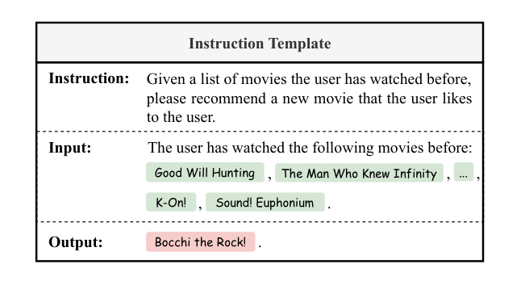
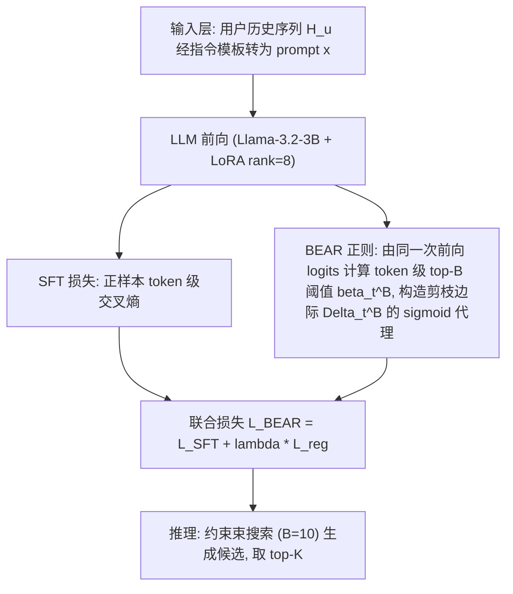
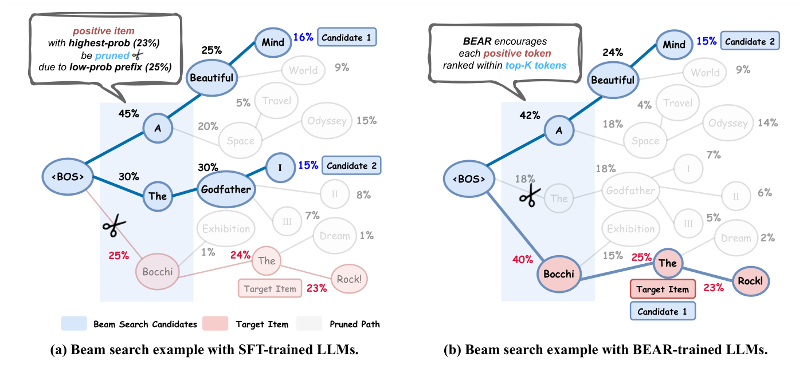
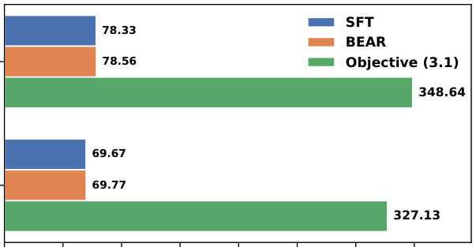
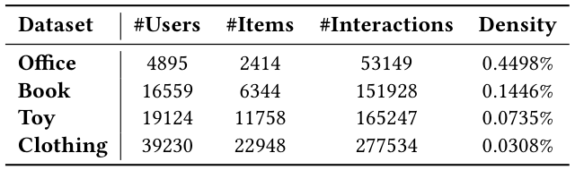
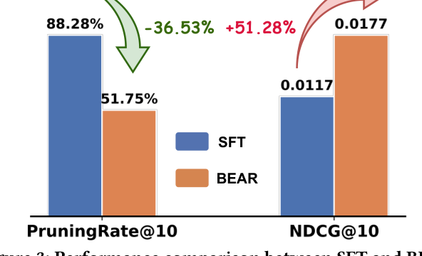
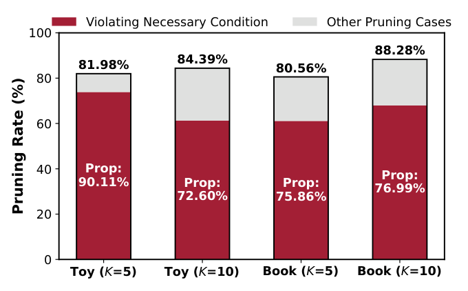

# BEAR: Towards Beam-Search-Aware Optimization for Recommendation with Large Language Models (面向大语言模型推荐的束搜索感知优化)

- **会议/期刊**: SIGIR 2026 (第 49 届国际 ACM SIGIR 会议，Melbourne, VIC, Australia)
- **推荐链路定位**: 端到端生成式 (End-to-End Generative) — 生成式检索 (Generative Retrieval) 的微调目标设计
- **研究方向**: 大语言模型推荐 (LLM4Rec) / 生成式推荐与离散语义 ID
- **论文原文**: [https://arxiv.org/abs/2601.22925v3](https://arxiv.org/abs/2601.22925v3)
- **开源代码**: [https://github.com/Tiny-Snow/BEAR-SIGIR-2026](https://github.com/Tiny-Snow/BEAR-SIGIR-2026)

## TL;DR (核心速览)

本文针对 LLM 生成式推荐中 **SFT 训练目标（最大化正样本整体概率）与束搜索解码（贪心前缀剪枝）之间的训练-推理不一致**：即便正样本整体概率最高，其低概率前缀也会在束搜索早期被剪掉（实测 80%+ 高概率正样本被误剪）。作者提出 BEAR 正则，将"每个正样本 token 须排在前 $B$ 名"这一束搜索保留的**必要条件**松弛为可微 sigmoid 代理损失，无需模拟束搜索即可训练。在 4 个 Amazon 数据集、BIGRec 骨干上平均提升 12.50%（NDCG@K / HitRatio@K），训练开销与 SFT 相当。

## Background & Motivation (背景与动机)

- **领域背景与主流范式**: LLM-based RS 将推荐重构为自然语言生成任务，三阶段流程为：(i) 将用户历史交互序列转为结构化 prompt；(ii) 以 prompt-正样本对做监督微调 (SFT)；(iii) 推理时用**束搜索 (Beam Search)** 高效检索 $B$ 个候选、取 top-$K$ 作为推荐。代表工作包括 BIGRec、LLaRA、A-LLMRec 等骨干，以及 D³、CFT、D²LR、IGD、MSL 等 SFT 改进与 S-DPO、RosePO、SPRec 等 DPO 类方法。
- **现有方法局限 (Limitations of Prior Work)**:
  1. **SFT 只优化整体概率** $P_\theta(y|x)=\prod_t P_\theta(y_t|y_{<t},x)$，对前缀局部概率无约束；
  2. **束搜索是局部贪心**：每步仅保留前缀概率 top-$B$ 的候选，低概率前缀即使能导向整体概率最高的完整物品也会被提前剪枝；
  3. 现有 DPO 类方法建模成对偏好，同样未考虑解码阶段的剪枝动力学。
- **核心挑战 (Key Challenge)**: 为什么不能直接优化"束搜索保留"目标？作者给出直接方案（目标 3.1）：要求正样本每个前缀 $y_{<t}$ 的概率不低于第 $B$ 名候选前缀概率 $P_\theta(b^B_{<t}|x)$。但计算该阈值需在训练中对每个样本**完整模拟束搜索**，需至多 $B$ 倍额外前向、且严格串行不可并行，实测运行时间为 SFT 的 **4.45 倍以上**（图 5：Book 上 327.13s vs 69.67s/epoch），不可行。
- **核心洞察与切入点 (Key Insight)**: 作者做了两项关键实证观察：
  - **观察 1（图 3/图 6）**：在整体概率 top-$K$ 的正样本中，**80% 以上**（Book 88.28%、Toy 84.39%）在束搜索中被误剪，证明训练-推理不一致是主要瓶颈；
  - **观察 2（图 4）**：所有误剪案例中，**70% 以上**（Prop: 72.60%~90.11%）源于违反一个**必要条件**——某个正样本 token 的 token 级概率未进入 top-$B$。
  
  因此，只需优化这个"token 级 top-$B$"必要条件，即可覆盖绝大多数误剪，且该阈值可直接从 SFT 已有的 logits 经 softmax 得到，**零额外前向**。

## Problem Formulation & Method (问题定义与方法架构)

### 1. 符号定义与输入表征 (Notations & Input Representations)

- 用户集 $\mathcal{U}$、物品集 $\mathcal{I}$；用户 $u$ 的历史交互序列 $H_u=[h_1,h_2,\cdots,h_{N-1}]$，$h_n\in\mathcal{I}$；目标为预测下一物品 $h_N$。
- 通过指令模板（图 2）将 $H_u$ 转为 prompt $x$，每个物品用其文本描述（标题/元数据）表示；正样本 $y$ 为预测物品的文本描述，$|y|$ 为其 token 长度，$y_t$ 为第 $t$ 个 token，$y_{<t}$ 为前缀。
- 模型输出为 token 级条件概率 $P_\theta(y_t|y_{<t},x)$，整体概率按链式法则分解为 $\prod_{t=1}^{|y|}P_\theta(y_t|y_{<t},x)$。
- 束宽 $B$（推理时 $B=10$），推荐数 $K\in\{5,10\}$。

<figure class="paper-figure" markdown="span">
  <figcaption>图 2：指令提示模板。</figcaption>
</figure>

### 2. 整体流水线 (Overall Architecture)

数据流：用户历史序列 $\to$ 指令模板构造 prompt $x$ $\to$ LLM（Llama-3.2-3B + LoRA）前向得到各步 logits $\to$ 同时计算 SFT 交叉熵损失与 BEAR 正则（基于同一次前向的 logits 计算 token 级 top-$B$ 阈值）$\to$ 联合反向传播 $\to$ 推理时约束束搜索（$B=10$）生成候选物品。

### 3. 核心模块设计与数学原理 (Key Designs & Formulations)

**(1) 直接方案：束搜索保留目标（目标 3.1，不可行基线）**

要求正样本每个前缀在每步都排在前 $B$：

$$\max_\theta \prod_{t=1}^{|y|+1}\mathbb{I}\left(P_\theta(y_{<t}|x)\ge P_\theta(b^B_{<t}|x)\right)$$

其中 $b^B_{<t}$ 为第 $t-1$ 步排名恰为第 $B$ 的候选前缀，右项即"保留阈值"。该目标需在训练中模拟束搜索，计算不可行（见上文 4.45× 开销）。

**(2) BEAR 核心：token 级必要条件（目标 3.2）**

将前缀级约束松弛为 token 级约束——每个正样本 token 的 token 级概率须排在前 $B$：

$$\max_\theta \prod_{t=1}^{|y|}\mathbb{I}\left(P_\theta(y_t|y_{<t},x)\ge \beta^B_t\right),\quad \beta^B_t=\text{top-}B\{P_\theta(\cdot|y_{<t},x)\}$$

物理直觉：若某 token 未进 top-$B$，则从该前缀扩展出的所有候选在下一步必然被剪（因为束搜索只保留 top-$B$ 扩展候选），故这是束搜索存活的**必要条件**。虽比 (3.1) 弱，但图 4 证明它覆盖 70%+ 误剪案例，是"足够强且计算高效"的代理。关键：$\beta^B_t$ 只需对 SFT 已算出的 logits 做 softmax 排序即可获得，**无需额外前向**。

**(3) 可微松弛：剪枝边际与 sigmoid 代理（式 3.3–3.4）**

定义剪枝边际 $\Delta^B_t=\log\beta^B_t-\log P_\theta(y_t|y_{<t},x)$，$\Delta^B_t>0$ 表示 token 概率低于 top-$B$ 阈值、将被立即剪枝。用温度 $\xi$ 的 sigmoid 平滑指示函数：

$$\mathcal{L}_{reg}(x,y;\theta)=\sum_{t=1}^{|y|}\log\sigma_\xi\left(\log\beta^B_t-\log P_\theta(y_t|y_{<t},x)\right),\quad \sigma_\xi(\Delta)=\frac{1}{1+\exp(-\Delta/\xi)}$$

当 $\xi\to 0$ 时 $\sigma_\xi$ 收敛于 $\mathbb{I}(\Delta>0)$。最小化 $\mathcal{L}_{reg}$ 即压缩每个 token 的剪枝边际，降低误剪风险。与 SFT 的区别：SFT 对所有 token 一视同仁地抬升概率，BEAR 则**动态地**将正样本 token 概率与其各自的 top-$B$ 阈值比较，显式对齐解码动力学。

### 4. 训练目标、负采样与推理复杂度 (Optimization, Negative Sampling & Complexity)

- **总损失**:
$$\min_\theta\ \mathcal{L}_{BEAR}(x,y;\theta)=\mathcal{L}_{SFT}(x,y;\theta)+\lambda\mathcal{L}_{reg}(x,y;\theta)$$
其中 $\mathcal{L}_{SFT}=-\sum_t\log P_\theta(y_t|y_{<t},x)$，$\lambda>0$ 控制正则强度，$\xi$ 控制 sigmoid 平滑度。超参搜索范围 $\lambda\in[0.1,5.0]$、$\xi\in[0.25,3.0]$。
- **负采样策略**: 主实验为**免负采样**（纯正样本 SFT + BEAR 正则）。扩展实验中，将 BEAR 接入 S-DPO 时，对正样本施加 $+\mathcal{L}_{reg}$、对采样负样本施加 $-\mathcal{L}_{reg}$（鼓励保留正样本、剪掉负样本）。
- **复杂度**: BEAR 复用 SFT 同一次前向的 logits，仅增加 softmax 排序求 top-$B$ 阈值的开销，**无额外前向**。实测训练时间与 SFT 相当（Book: 69.77s vs 69.67s/epoch；Toy: 78.56s vs 78.33s/epoch），而直接优化目标 (3.1) 为 327.13s / 348.64s（约 4.45×+）。对比 CFT、S-DPO、SPRec 等需额外前向的方法，BEAR 开销约为其 1/2~1/10。推理阶段为标准约束束搜索（$B=10$），与基线一致。

<figure class="paper-figure" markdown="span">
  <figcaption>图 1：将束搜索应用于 SFT 训练的 LLM 与 BEAR 训练的 LLM 的示意图（束宽 𝐵= 2）。蓝色路径表示束搜索检索到的候选项目（例如“A Beautiful Mind”），红色圆圈标记正样本项目（例如“Bocchi the Rock!”）。(a) 在 SFT 情况下，尽管正样本项目具有最高的整体概率，但由于其前缀（例如“Bocchi”）的概率不足，在第一步即被剪枝。(b) BEAR 促使将每个正样本 token 排在所有可能 token 的前 𝐵 名内，使束搜索更有可能保留该正样本项目。</figcaption>
</figure>

<figure class="paper-figure" markdown="span">
  <figcaption>图 5：三种训练目标（SFT、BEAR 和目标 (3.1)）的运行时间比较。SFT 与 BEAR 的训练时间相当，而优化目标 (3.1) 由于需要在训练过程中进行束搜索模拟，耗时显著更长。训练效率的完整结果见图 9。</figcaption>
</figure>

## Experimental Setup & Evaluation Protocol (实验设置与评估协议)

- **数据集统计与预处理**: 4 个 Amazon 数据集（Office、Book、Toy、Clothing），采用标准 **5-core** 过滤（用户与物品交互数 < 5 被剔除），滑动窗口大小 11 切分序列。

<figure class="paper-figure" markdown="span">
  <figcaption>表 1：数据集统计。</figcaption>
</figure>

| 数据集 (Dataset) | 用户数 (#Users) | 物品数 (#Items) | 交互数 (#Interactions) | 稀疏度/密度 (Density) | 模态/辅助特征说明 |
| :--- | :---: | :---: | :---: | :---: | :--- |
| Office | 4,895 | 2,414 | 53,149 | 0.4498% | 物品文本描述（标题/元数据） |
| Book | 16,559 | 6,344 | 151,928 | 0.1446% | 同上 |
| Toy | 19,124 | 11,758 | 165,247 | 0.0735% | 同上 |
| Clothing | 39,230 | 22,948 | 277,534 | 0.0308% | 同上 |

- **数据划分方式 (Splitting Strategy)**: 按**时间顺序**以 **8:1:1** 比例划分为训练/验证/测试集（chronological order ratio split），验证集上以最佳 NDCG@10 选择 checkpoint。属时间序切分，未来信息泄露风险较低。
- **排名评测协议 (Ranking Protocol)**: 采用**约束束搜索**（constrained beam search，$B=10$）生成候选，确保生成物品合法、无幻觉；在生成候选集上计算 top-$K$ 指标。原文未明确报告是否对全库未交互物品做 Full-Ranking，评测基于束搜索候选集，属**生成式候选集排序**协议（非全库排序、非负采样排序）。
- **评价指标与显著性检验**: NDCG@$K$ 与 HitRatio@$K$，$K\in\{5,10\}$。骨干为 Llama-3.2-3B（另测 1B、8B），LoRA rank=8、学习率 1e-4、AdamW、10 epochs、batch size 128（DPO 类为 64），8×RTX 5090。**原文未报告多随机种子方差与配对显著性检验**（如 $p<0.05$），此为评估严谨性上的一个缺口。

## Key Experimental Results (核心实验结果)

### 1. 主实验对比 (Main Results)

以 BIGRec 为骨干，BEAR 在全部 4 数据集、全部 16 个指标上均最优，相对最佳基线（多为 MSL 或 RosePO）平均提升 **+12.50%**。摘录关键结果：

<figure class="paper-figure" markdown="span">
  ![表 2：与多种基线的整体性能比较。基于 LLM 的 RS 方法（“+”）应用于 BIGRec \[3\] 骨干。N@𝐾 和 H@𝐾 分别表示 NDCG@𝐾 和 HitRatio@𝐾 指标。最佳结果以粗体突出显示，最佳基线以下划线标出。“Imp.%”表示 BEAR 相对于最佳基线的相对提升。](../../../../assets/papers/2601.22925v3/table_2.png)<figcaption>表 2：与多种基线的整体性能比较。基于 LLM 的 RS 方法（“+”）应用于 BIGRec [3] 骨干。N@𝐾 和 H@𝐾 分别表示 NDCG@𝐾 和 HitRatio@𝐾 指标。最佳结果以粗体突出显示，最佳基线以下划线标出。“Imp.%”表示 BEAR 相对于最佳基线的相对提升。</figcaption>
</figure>

| 数据集 | 指标 | 传统/LLM增强基线 (SASRec/BERT4Rec/DLLM2Rec) | 最强 SFT/DPO 基线 (MSL/RosePO) | 本文方法 (BEAR) | 相对提升 (Improv.) |
| :--- | :--- | :---: | :---: | :---: | :---: |
| Office | N@5 / N@10 | 0.0195 (DROS) / 0.0240 | 0.0346 (MSL) / 0.0388 | **0.0365 / 0.0421** | +5.49% / +8.51% |
| Office | H@5 / H@10 | 0.0322 (DLLM2Rec) / 0.0660 (RosePO) | 0.0504 (MSL) / 0.0660 (RosePO) | **0.0545 / 0.0717** | +8.13% / +8.64% |
| Book | N@5 / N@10 | 0.0100 (BERT4Rec) / 0.0121 | 0.0117 (RosePO) / 0.0127 (RosePO) | **0.0146 / 0.0177** | +24.79% / +39.37% |
| Book | H@5 / H@10 | 0.0158 (BERT4Rec) / 0.0244 (SPRec) | 0.0153 (RosePO) / 0.0244 (SPRec) | **0.0203 / 0.0297** | +28.48% / +21.72% |
| Toy | N@5 / N@10 | 0.0122 (BIGRec) / 0.0157 | 0.0239 (MSL) / 0.0301 (MSL) | **0.0254 / 0.0316** | +6.28% / +4.98% |
| Toy | H@5 / H@10 | 0.0200 (BIGRec) / 0.0307 | 0.0359 (MSL) / 0.0551 (MSL) | **0.0380 / 0.0574** | +5.85% / +4.17% |
| Clothing | N@5 / N@10 | 0.0043 (BIGRec) / 0.0071 | 0.0075 (MSL) / 0.0115 (MSL) | **0.0082 / 0.0127** | +9.33% / +10.43% |
| Clothing | H@5 / H@10 | 0.0086 (BIGRec) / 0.0172 | 0.0136 (MSL) / 0.0260 (MSL) | **0.0148 / 0.0290** | +7.25% / +6.62% |

**跨骨干泛化（表 3）**：在 LLaRA 与 A-LLMRec 骨干上，BEAR 相对 MSL 均一致提升，最大提升出现在 Book 数据集（LLaRA 上 N@5 +57.69%、H@5 +57.04%；A-LLMRec 上 N@10 +26.27%、H@10 +23.83%）。

<figure class="paper-figure" markdown="span">
  ![表 3：使用不同推荐骨干（包括 LLaRA \[38\] 和 A-LLMRec \[32\]）的性能比较。我们采用 MSL \[64\] 作为代表性 SFT 方法。N@𝐾 和 H@𝐾 分别表示 NDCG@𝐾 和 HitRatio@𝐾 指标。最佳结果以粗体突出显示。“Imp.%”表示 BEAR 相对于最佳基线的相对提升。](../../../../assets/papers/2601.22925v3/table_3.png)<figcaption>表 3：使用不同推荐骨干（包括 LLaRA [38] 和 A-LLMRec [32]）的性能比较。我们采用 MSL [64] 作为代表性 SFT 方法。N@𝐾 和 H@𝐾 分别表示 NDCG@𝐾 和 HitRatio@𝐾 指标。最佳结果以粗体突出显示。“Imp.%”表示 BEAR 相对于最佳基线的相对提升。</figcaption>
</figure>

**跨 LLM 规模泛化（表 4）**：Llama-3.2-1B 与 Llama-3-8B 上 BEAR 均优于 MSL，如 8B 上 Book 的 H@5 提升 +51.48%、H@10 +36.92%。

### 2. 消融实验与控制变量分析 (Ablation Study)

- **直接目标 (3.1) vs BEAR（表 5）**：在 2K 采样用户的 Toy-S / Book-S 小规模数据上，目标 (3.1) 略优于 BEAR（Toy-S NDCG@10: 0.0103 vs 0.0094；Book-S: 0.0077 vs 0.0072），但计算代价高 4.45×+，BEAR 以极小性能折损换取可落地性——这是本文最核心的"效率-效果"权衡证据。
- **误剪率消融（图 6）**：BEAR 相比 SFT 将 PruningRate@$K$ 平均降低 **-24.86%**，直接验证正则确实对齐了解码行为（Book 上 PR@10 从 SFT 的 88.28% 显著下降，图 3 显示 -36.53% 的剪枝率变化与 +51.28% 的性能变化）。
- **与 DPO 目标结合（图 7）**：在 S-DPO 上叠加正/负 BEAR 正则后，所有数据集 NDCG@10 / HR@10 均显著提升，验证其作为"通用微调目标插件"的兼容性。
- 注：原文未做"参数量对齐"或"图拓扑度数匹配"类控制变量消融（本文非图模型，不适用）。

<figure class="paper-figure" markdown="span">
  <figcaption>图 3：SFT 与 BEAR 在 Book 数据集上的性能比较。PruningRate@10 表示束宽 𝐵= 10 时的剪枝率，即在整体概率中排名前 10 但在束搜索过程中被剪枝的正样本项目比例。完整结果见表 2 和图 6。</figcaption>
</figure>

<figure class="paper-figure" markdown="span">
  <figcaption>图 4：绝大多数具有高整体概率（即在候选中排名前 𝐾）的正样本项目在束搜索过程中被剪枝，其中不满足必要条件 (3.2) 是主要原因（以红色矩形标记）。此处我们设置束宽 𝐵= 10，推荐项目数 𝐾∈{5, 10}。“Prop”表示因违反必要条件（红色）导致的剪枝案例比例，在所有设置中始终占全部剪枝案例（红色和灰色）的 70% 以上。</figcaption>
</figure>

### 3. 稀疏度/冷启动分桶与超参敏感度 (Sparsity Buckets & Hyperparameters)

- **稀疏度维度**: 四个数据集密度跨度从 0.4498%（Office）到 0.0308%（Clothing），BEAR 在最稀疏的 Clothing 上仍获 +6.62%~+10.43% 提升，说明方法对稀疏场景稳健；但原文**未做用户/物品交互频次分桶**的长尾分析。
- **超参敏感度（图 8）**: $\lambda$ 与 $\xi$ 均呈明显峰值。$\lambda$ 过小退化为 SFT（训练-推理不一致未解），过大则过度强调正则、牺牲整体概率；$\xi$ 过小导致 sigmoid 过锐、梯度饱和，过大则过度平滑、稀释正则信号。在合理范围内性能相对稳健。
- **线上 A/B 测试**: 原文**仅包含离线实验**，未报告任何线上 A/B 结果。

## Highlights, Limitations & Critiques (亮点、局限与审稿级批判)

- **核心亮点与可迁移性**:
  1. **问题识别精准**：将"训练-推理不一致"这一 NLP 生成式检索中的经典问题首次系统引入 LLM-based RS，并用 80%+ 误剪率、70%+ 必要条件违反率两组实证数据锚定瓶颈，动机链条完整。
  2. **必要条件代理设计优雅**：用 token 级 top-$B$ 约束替代前缀级束搜索模拟，复用 SFT 已有 logits，实现"零额外前向"的束搜索感知训练，工程可落地性极强。
  3. **模型无关性**：作为正则项可无缝插入 SFT（BIGRec/LLaRA/A-LLMRec）、不同 LLM 规模（1B/3B/8B）乃至 DPO 目标（S-DPO），泛化验证充分。
- **局限性与审稿视角批判 (Critical Limitations)**:
  1. **评估协议偏弱**：仅报告 NDCG@K / HitRatio@K，未做全库 Full-Ranking，也未报告多随机种子方差与配对显著性检验（$p<0.05$），"平均 +12.50%"的统计可信度缺乏支撑；Book 上 +39.37% 的异常高提升可能受候选集规模与数据特性影响，需谨慎解读。
  2. **必要条件非充分条件**：BEAR 仅覆盖 70%+ 误剪，剩余约 30% 误剪（前缀级问题）未被处理；表 5 显示直接目标 (3.1) 仍优于 BEAR，说明存在可挖掘的性能上限。
  3. **超参依赖**：$\lambda$ 与 $\xi$ 均需逐数据集调优且呈峰值，跨域迁移时调参成本不可忽视。
  4. **推理侧未优化**：方法只改训练目标，推理仍为标准束搜索，未探索与多 token 预测、多样化束搜索等推理技术的结合（作者列为未来工作）。
  5. **缺少线上验证与延迟报告**：无工业 A/B、无单请求推理延迟 (ms/request) 与峰值显存数据，工业落地价值有待补强。

## Rating (四维评分)

- **方法创新性 (Novelty)**: ⭐⭐⭐⭐ （问题视角新颖、代理设计巧妙，但核心思想在生成式检索领域已有 OTM/RIPOR 等先例，属跨域迁移式创新）
- **评估协议与实验扎实度 (Protocol & Experiments)**: ⭐⭐⭐ （数据集与基线覆盖充分、跨骨干/规模/目标泛化完整，但缺显著性检验、全库排序与线上验证）
- **写作与数学规范度 (Clarity & Rigor)**: ⭐⭐⭐⭐ （问题形式化清晰、目标 3.1→3.2→3.4 的推导链条严谨，图示直观）
- **工业落地与复现价值 (Industrial & Practical Value)**: ⭐⭐⭐⭐⭐ （零额外前向、与 SFT 同量级开销、模型无关可插拔，代码已开源，落地门槛极低）
