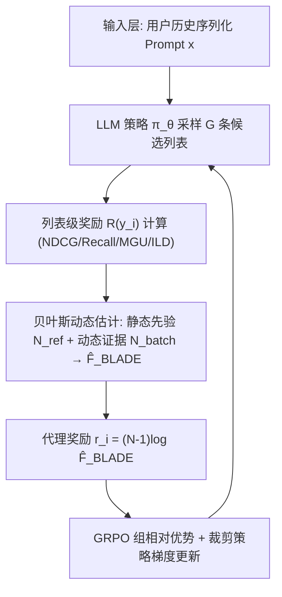
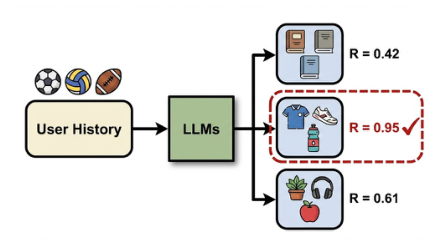
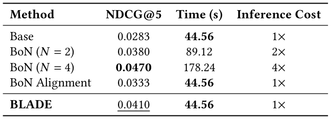
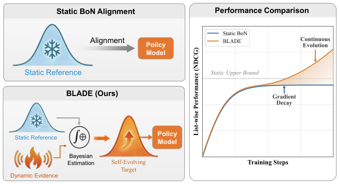
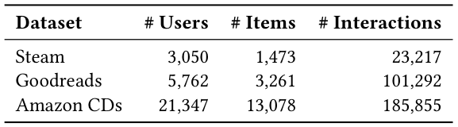
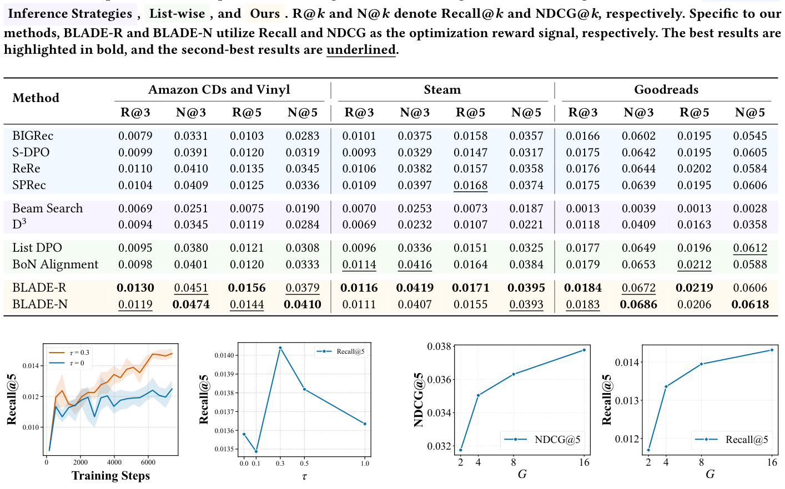
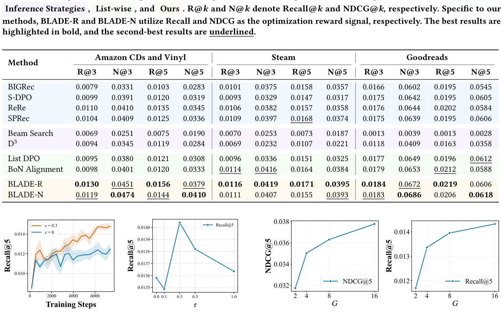
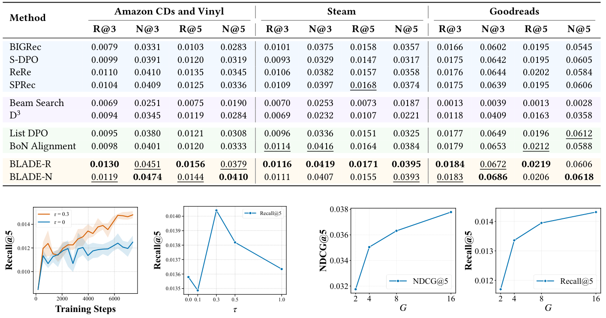

# Beyond Static Best-of-N: Bayesian List-wise Alignment for LLM-based Recommendation (超越静态 Best-of-N：面向 LLM 推荐的贝叶斯列表级对齐)

- **会议/期刊**: SIGIR 2026
- **推荐链路定位**: 端到端生成式 (End-to-End Generative) — 生成式列表推荐 + 列表级对齐
- **研究方向**: 大语言模型推荐 (LLM4Rec) / 生成式推荐与离散语义 ID
- **论文原文**: [https://arxiv.org/abs/2605.04559v1](https://arxiv.org/abs/2605.04559v1)
- **开源代码**: [https://github.com/RegionCh/BLADE](https://github.com/RegionCh/BLADE)

## TL;DR (核心速览)

针对 LLM4Rec 中 token 级目标无法优化 NDCG/公平性等列表级不可微指标、而推理期 Best-of-N (BoN) 延迟随 $N$ 线性增长的问题，本文提出 BLADE：将 BoN 对齐目标重构为贝叶斯动态估计，融合静态参考先验与当前策略 rollout 的动态证据，构建"自演化目标"以解决静态对齐的**无差别监督**与**梯度衰减**两大瓶颈。在 Amazon CDs、Steam、Goodreads 三个真实数据集上，BLADE 在 NDCG@5 上相对最强列表级基线 BoN Alignment 提升 23.1%，且推理开销与静态对齐持平（1×）。

## Background & Motivation (背景与动机)

- **领域背景与主流范式**: LLM4Rec 将推荐建模为条件序列生成，主流做法是 SFT + 对齐（DPO / List-DPO / S-DPO），以 token 级似然或成对偏好为优化目标。
- **现有方法局限 (Limitations of Prior Work)**:
  1. **目标错位**：token 级/成对目标与真实用户满意度所依赖的**列表级指标**（NDCG、公平性、多样性）存在根本性错位，而这些指标本质离散、不可微。
  2. **推理期 BoN 的代价**：BoN 通过采样 $N$ 个候选并选列表级奖励最优者绕过不可微问题，但推理延迟随 $N$ **线性增长**（图 1(b)、表 1：$N=4$ 时耗时 178.24s，为基线的 4×），无法实时部署。
  3. **BoN 对齐的静态参考缺陷**：将搜索能力蒸馏进模型权重的 BoN Alignment 依赖**固定参考分布**，导致两个瓶颈（见下）。
- **核心挑战 (Key Challenge)**: 静态参考的 CDF $F_{\text{ref}}(\cdot)$ 由固定样本集 $\mathcal{D}_{\text{ref}}$ 经验估计，上界被 $R_{\max}=\max_{y'\in\mathcal{D}_{\text{ref}}}R(y')$ 锁死。当策略探索出超越该上界的候选时：
  - **无差别监督 (Indiscriminate Supervision)**：对任意 $R(y_1)>R(y_2)>R_{\max}$，有 $(F_{\text{ref}}(R(y_1)))^{N-1}=(F_{\text{ref}}(R(y_2)))^{N-1}=1$，高质量候选被赋予相同目标概率，排序区分度丧失。
  - **梯度衰减 (Gradient Decay)**：$\lim_{F_{\text{ref}}\to 1}\log F_{\text{ref}}(R(y))=0$，策略越强，有效监督信号越弱，训练过早停滞。
- **核心洞察与切入点 (Key Insight)**: 静态参考本质是奖励景观的**先验信念**，其稳定但僵化。作者将目标构建重构为**实时贝叶斯推断**：把当前策略 rollout 视为动态证据，与静态先验融合得到后验目标，使目标分布随模型能力自适应缩放（图 2）。

## Problem Formulation & Method (问题定义与方法架构)

### 1. 符号定义与输入表征 (Notations & Input Representations)

- 用户集 $\mathcal{U}$、物品集 $\mathcal{I}$；对用户 $u\in\mathcal{U}$ 由其交互历史构造自然语言 prompt $x$。
- LLM 作为随机策略 $\pi_\theta$，自回归生成响应 $y=(y_1,\dots,y_T)$，表示有序的 $K$ 个推荐物品列表：
$$\pi_\theta(y|x)=\prod_{t=1}^{T}\pi_\theta(y_t|x,y_{<t})$$
- 优化目标为不可微列表级奖励 $R(y;u)$（NDCG、Recall、MGU、ILD 等）。
- 关键超参：组大小 $G=16$、参考集大小 $M=128$、动态系数 $\tau\in\{0.1,0.3,0.5,1.0\}$、BoN 采样数 $N$。

### 2. 整体流水线 (Overall Architecture)

数据流：用户历史序列化 prompt $x$ → LLM 策略 $\pi_\theta$ 采样 $G$ 条候选列表 $\{y_i\}_{i=1}^{G}$ → 计算列表级奖励 $R(y_i)$ → **贝叶斯动态估计**融合静态先验统计 $N^{<r}_{\text{ref}}$ 与批内动态证据 $N^{<r}_{\text{batch}}$ 得到 $\hat{F}_{\text{BLADE}}(r)$ → 转换为代理奖励 $r_i=(N-1)\log\hat{F}_{\text{BLADE}}(R(y_i))$ → 代入 GRPO 计算组相对优势并更新策略。**共享采样**机制使同一批 rollout 同时服务于目标估计与梯度计算，实现零额外开销。

### 3. 核心模块设计与数学原理 (Key Designs & Formulations)

**(1) 静态 BoN 对齐的变分下界（问题起点）**

由次序统计量展开，BoN 选择分布为 $\pi_{\text{BoN}}(y)=\sum_{k=1}^{N}\binom{N}{k}(F_{\text{ref}}(R(y)))^{N-k}\pi_{\text{ref}}(y)^k$。直接优化需对求和取对数，故采用 vBoN 的可处理下界代理：
$$\mathcal{J}_{\text{BoN}}(\theta)=\mathbb{E}_{y\sim\pi_\theta}\Big[(N-1)\log F_{\text{ref}}(R(y))-\log\frac{\pi_\theta(y)}{\pi_{\text{ref}}(y)}\Big]$$
即"分位数奖励 + KL 正则"。静态实现中 $F_{\text{ref}}$ 由固定 $\mathcal{D}_{\text{ref}}$ 经验估计，正是两大瓶颈的根源。

**(2) 贝叶斯动态估计（核心创新）**

对每个奖励阈值 $r$，将分位数 $\theta_r=F(r)\in[0,1]$ 建模为阈值专属 Beta 分布 $\theta_r\sim\text{Beta}(\alpha_r,\beta_r)$——Beta 支撑集与 CDF 值域匹配，且与"计数低于阈值样本数"的二项似然共轭，可闭式更新。

- **先验初始化**：$\alpha_r^0=N^{<r}_{\text{ref}}$，$\beta_r^0=M-N^{<r}_{\text{ref}}$（静态参考统计）。
- **幂缩放似然**：以动态系数 $\tau\ge 0$ 调节批证据的有效样本量，后验为
$$P(\theta_r|\mathcal{D}_{\text{batch}})\propto\underbrace{\theta_r^{\alpha_r^0-1}(1-\theta_r)^{\beta_r^0-1}}_{\text{静态先验}}\cdot\Big[\underbrace{\theta_r^{N^{<r}_{\text{batch}}}(1-\theta_r)^{(G-N^{<r}_{\text{batch}})}}_{\text{动态证据}}\Big]^{\tau}$$
- **后验参数**：$\alpha_r^{\text{new}}=\alpha_r^0+\tau N^{<r}_{\text{batch}}$，$\beta_r^{\text{new}}=\beta_r^0+\tau(G-N^{<r}_{\text{batch}})$。
- **点估计（BLADE 动态估计器）**：取后验期望
$$\hat{F}_{\text{BLADE}}(r)=\mathbb{E}[\theta_r|\mathcal{D}_{\text{batch}}]=\frac{N^{<r}_{\text{ref}}+\tau\cdot N^{<r}_{\text{batch}}}{M+\tau\cdot G}$$

**物理直觉**：$\tau=0$ 退化为静态估计器；$\tau=1$ 为标准 beta-二项更新；$0<\tau<1$ 保守压制批证据方差。由于分母随 rollout 奖励分布动态重标定，高奖励区不再饱和于 1，恢复排序区分度并防止梯度衰减。

**(3) 动态奖励集成与共享采样**

代理奖励 $r_i=(N-1)\log\hat{F}_{\text{BLADE}}(R(y_i))$ 直接代入 GRPO 计算组相对优势 $A_i=(R(y_i)-\mu_G)/\sigma_G$。**共享采样**：同一批 $\mathcal{D}_{\text{batch}}$ 既作动态证据更新后验，又用于策略梯度，故目标估计零额外开销。

### 4. 训练目标、负采样与推理复杂度 (Optimization, Negative Sampling & Complexity)

- **损失函数**：GRPO 裁剪代理目标
$$\mathcal{J}(\theta)=\mathbb{E}_{\pi_{\theta_{\text{old}}}}\Big[\frac{1}{G}\sum_{i=1}^{G}\frac{1}{T_i}\sum_{t=1}^{T_i}\big(\min(\rho_{i,t}A_i,\text{clip}(\rho_{i,t},1-\epsilon,1+\epsilon)A_i)-\beta\,\text{D}_{\text{KL}}(\pi_\theta\|\pi_{\text{ref}})\big)\Big]$$
其中 $\rho_{i,t}=\pi_\theta(y_{i,t}|x,y_{i,<t})/\pi_{\theta_{\text{old}}}(y_{i,t}|x,y_{i,<t})$，$A_i$ 由动态代理奖励 $r_i$ 计算。DPO 类基线 KL 惩罚 $\beta=0.1$。
- **负采样策略**：**免显式负采样**——采用组内相对比较（GRPO 组采样 $G=16$），以组内候选的相对奖励归一化替代外部负例；训练采样温度 0.8、重复惩罚 1.05 以鼓励探索。
- **复杂度**：BLADE 与静态 BoN Alignment 训练/推理开销相同（表 1：44.56s，1× 推理成本），远低于推理期 BoN（$N=2$ 为 2×、$N=4$ 为 4×）。在线推理为单次贪心解码，无需 Beam Search 或多次采样。原文未报告峰值显存数值。

## Experimental Setup & Evaluation Protocol (实验设置与评估协议)

- **数据集统计与预处理**（表 2）：过滤交互数 <10 的用户；Steam 与 Goodreads 保留 top 15% 最热门物品以保证交互稠密；滑动窗口取过去 10 个物品为历史、后续 10 个为目标列表。

| 数据集 (Dataset) | 用户数 (#Users) | 物品数 (#Items) | 交互数 (#Interactions) | 稀疏度/密度 (Sparsity) | 模态/辅助特征说明 |
| :--- | :---: | :---: | :---: | :---: | :--- |
| Steam | 3,050 | 1,473 | 23,217 | 密度约 0.52% | 物品标题文本 |
| Goodreads | 5,762 | 3,261 | 101,292 | 密度约 0.54% | 书籍标题/类型 |
| Amazon CDs and Vinyl | 21,347 | 13,078 | 185,855 | 密度约 0.067% | 商品标题文本 |

- **数据划分方式 (Splitting Strategy)**: 采用**两阶段范式**——基座模型在全量数据上 SFT 3 epoch 获取领域知识；对齐阶段在**采样子集**（4,096 训练 / 512 验证实例）上进行以平衡算力；**所有结果在完整测试集上报告**以保证无偏评估。原文未明确说明测试集的具体切分比例（如 LOO 或 8:1:1），存在一定协议描述模糊性。
- **排名评测协议 (Ranking Protocol)**: 生成式列表推荐，评测在完整测试集上进行（非采样负例排序）；所有训练类方法统一采用**贪心解码**评估，解码类基线（Beam Search、D3）遵循其标准协议。
- **评价指标与显著性检验**: 准确率指标 `Recall@k`、`NDCG@k`（$k\in\{3,5\}$）；列表级指标 **MGU**（Mean Group Unfairness，越低越好）与 **ILD**（Intra-List Diversity，越高越好）。骨干为 Llama-3.2-1B-Instruct，4×A100。**原文未报告多随机种子方差或配对显著性检验**（如 $p<0.05$），此为评估严谨性短板。

## Key Experimental Results (核心实验结果)

### 1. 主实验对比 (Main Results)

表 3 整体性能对比（节选关键指标）：

| 数据集 | 指标 | 最强 LLM 基线 (SPRec/ReRe) | 最强列表级基线 (BoN Alignment) | 本文方法 (BLADE-N) | 相对提升 (Improv.) |
| :--- | :--- | :---: | :---: | :---: | :---: |
| Amazon CDs | NDCG@5 | 0.0345 (ReRe) | 0.0333 | **0.0410** | +23.1% (vs BoN Align.) |
| Amazon CDs | NDCG@3 | 0.0410 (ReRe) | 0.0401 | **0.0474** | +18.2% (vs BoN Align.) |
| Amazon CDs | Recall@5 | 0.0135 (ReRe) | 0.0120 | **0.0156** (BLADE-R) | +15.6% (vs BoN Align.) |
| Steam | NDCG@5 | 0.0374 (SPRec) | 0.0384 | **0.0395** (BLADE-R) | +2.9% (vs BoN Align.) |
| Steam | NDCG@3 | 0.0397 (SPRec) | 0.0416 | **0.0419** (BLADE-R) | +0.7% (vs BoN Align.) |
| Goodreads | NDCG@3 | 0.0649 (List DPO) | 0.0653 | **0.0686** (BLADE-N) | +5.1% (vs BoN Align.) |
| Goodreads | Recall@5 | 0.0202 (ReRe) | 0.0212 | **0.0219** (BLADE-R) | +3.3% (vs BoN Align.) |

关键观察：BLADE 在三个数据集多数指标上取得最优；BLADE-R（以 Recall 为奖励）在 Recall 指标占优，BLADE-N（以 NDCG 为奖励）在 NDCG 指标占优，体现**目标可控性**。推理期策略（Beam Search、D3）表现显著落后，归因于独立采样假设导致的语义重复与同质化。

### 2. 消融实验与控制变量分析 (Ablation Study)

- **动态系数 $\tau$ 消融**（图 4(a)）：$\tau=0$（静态基线）初期提升后迅速平台化，实证验证梯度衰减假设；$\tau=0.3$ 的 BLADE 持续稳定提升，突破静态上界。
- **先验消融**（图 6）：对比 "No Prior ($M=0$)" 与 BLADE ($M=128$)，BLADE 始终更优；组大小 $G$ 越小相对提升越大（$G=2$ 时 +5.3%，$G=16$ 时 +1.7%），说明静态先验在采样稀疏时起关键稳定作用。
- **组大小 $G$ 影响**（图 5）：$G$ 从 2 增至 16，NDCG@5 与 Recall@5 持续提升，表明方法可随算力扩展获益。
- 原文未做严格参数量对齐或图拓扑度数匹配类消融（生成式范式下不适用）。

### 3. 稀疏度/冷启动分桶与超参敏感度 (Sparsity Buckets & Hyperparameters)

- **超参敏感度**（图 4(b)）：$\tau$ 增大时性能先升后降——过小过度锚定次优静态先验限制探索，过大因批样本有限引入高方差；中等 $\tau$ 取得最优平衡。
- **列表级目标泛化**（图 8）：采用复合奖励 $R_{\text{fair}}=R_{\text{NDCG}}-\lambda\cdot\text{MGU}$、$R_{\text{div}}=R_{\text{NDCG}}+\lambda\cdot\text{ILD}$。公平性上 BLADE 实现**严格帕累托占优**（所有 $\lambda$ 点位于 SFT 基线右上方），$\lambda\approx0.5$ 为甜点；多样性上 $\lambda=0.1$ 即触发显著 ILD 提升，且峰值多样性点（$\lambda=0.5$）NDCG 仍高于 SFT 基线。图 7 显示单独优化公平性目标会使 Recall@5 快速衰减至零，故必须引入相关性接地信号。
- **线上 A/B 测试**: 原文仅包含离线实验，未报告线上 A/B 结果。

## Highlights, Limitations & Critiques (亮点、局限与审稿级批判)

- **核心亮点与可迁移性**:
  1. **贝叶斯视角重构 BoN 对齐**：将静态参考视为先验、rollout 视为证据，用共轭 Beta-Binomial 闭式更新构建自演化目标，数学优雅且计算零开销，可迁移至任意"静态参考蒸馏"场景（如 RLHF、DPO 变体）。
  2. **共享采样机制**：同一批 rollout 双用于目标估计与梯度计算，是效率与性能兼得的关键工程洞察。
  3. **指标无关性**：统一框架可优化 NDCG、公平性、多样性等异构不可微目标，展现帕累托前沿导航能力。
- **局限性与审稿视角批判 (Critical Limitations)**:
  1. **评估协议描述不足**：未明确测试集切分方式（LOO / 比例 / 时间切分），存在潜在数据穿越风险；未报告多随机种子方差与显著性检验，单次结果的说服力受限。
  2. **骨干规模偏小**：仅用 Llama-3.2-1B-Instruct，未验证在 7B/更大模型上的可扩展性；对齐阶段仅用 4,096 样本子集，泛化性存疑。
  3. **绝对指标偏低**：Recall@5 普遍在 0.01–0.02 量级，生成式列表推荐的实用性仍受限于物品标题生成的精确匹配问题。
  4. **$\tau$ 需逐数据集调参**：动态系数在 $\{0.1,0.3,0.5,1.0\}$ 中搜索，缺乏自适应确定机制，增加部署成本。
  5. **无线上验证**：缺少真实业务延迟与留存/CTR 收益证据，工业落地价值待验证。

## Rating (四维评分)

- **方法创新性 (Novelty)**: ⭐⭐⭐⭐（贝叶斯动态估计重构 BoN 对齐，理论分析扎实，但本质是 GRPO + 动态奖励重标定的组合创新）
- **评估协议与实验扎实度 (Protocol & Experiments)**: ⭐⭐⭐（三数据集 + 多指标 + 机制分析充分，但缺显著性检验、切分描述模糊、骨干单一）
- **写作与数学规范度 (Clarity & Rigor)**: ⭐⭐⭐⭐（两大瓶颈的形式化推导清晰，Beta-Binomial 共轭更新严谨，图表逻辑连贯）
- **工业落地与复现价值 (Industrial & Practical Value)**: ⭐⭐⭐⭐（零额外推理开销、代码开源、指标可控，但缺线上验证与大规模骨干实验）

## 论文图表

<figure class="paper-figure" markdown="span">
  <figcaption>图 1：LLM4Rec 中 Best-of-N 的效率瓶颈。(a) BoN 从 𝑁 个样本中选择最优候选，以最大化列表级奖励。(b) 然而，线性增加 𝑁 会加剧推理延迟，使实时部署变得不切实际。</figcaption>
</figure>

<figure class="paper-figure" markdown="span">
  <figcaption>表 1：BLADE、BoN Alignment 与 Inference-time BoN 在推荐性能（NDCG@5）和推理效率上的比较。</figcaption>
</figure>

<figure class="paper-figure" markdown="span">
  <figcaption>图 2：静态 BoN Alignment 与 BLADE 的对比。（左）与锚定于冻结参考的静态方法不同，BLADE 通过融合静态先验与动态证据构建自演化目标，从而解决高奖励区域中的无差别监督问题。（右）该机制缓解梯度衰减，使模型能够突破静态上界以实现持续演化。</figcaption>
</figure>

<figure class="paper-figure" markdown="span">
  <figcaption>图 3：BLADE 的整体训练框架。（左）该流程展示了 BLADE 如何融合静态先验与动态证据以构建自演化目标分布。（右）详细训练算法。对于每个批次，BLADE 通过式 (14) 计算贝叶斯动态目标 ˆ𝐹𝑖，并将其转换为用于列表级策略优化的代理奖励。</figcaption>
</figure>

<figure class="paper-figure" markdown="span">
  <figcaption>表 2：数据集统计摘要。</figcaption>
</figure>

<figure class="paper-figure" markdown="span">
  <figcaption>表 3：整体性能比较。背景颜色区分不同类别的方法：基于 LLM 的、</figcaption>
</figure>

<figure class="paper-figure" markdown="span">
  <figcaption>图 4：在 CDs 和 Vinyl 数据集上的研究。(a) 在 𝜏= 0 和 𝜏= 0.3 时训练过程中 Recall 演化的比较。(b) 测试 Recall 对变化 𝜏 的性能敏感性。</figcaption>
</figure>

<figure class="paper-figure" markdown="span">
  <figcaption>图 5：BLADE 中生成物品数量（G）的影响</figcaption>
</figure>

