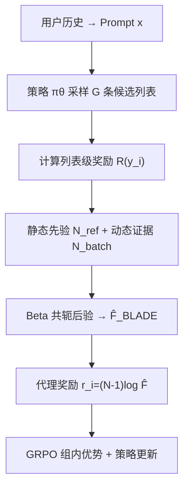
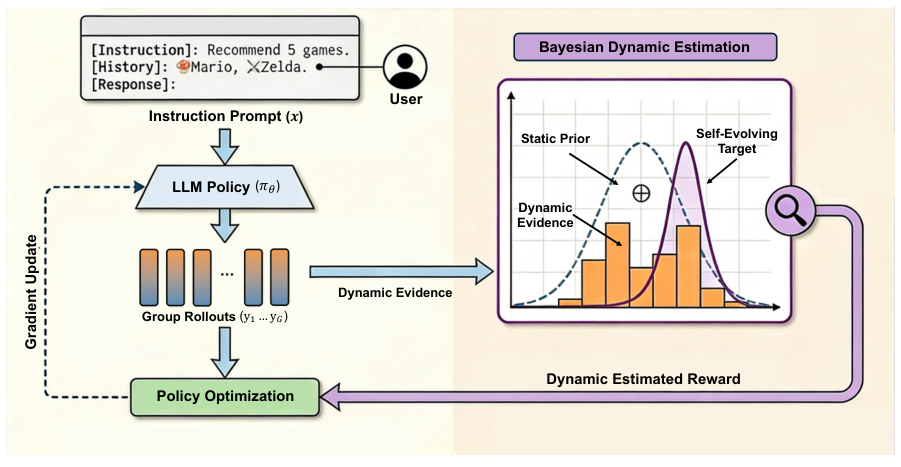

# Beyond Static Best-of-N: Bayesian List-wise Alignment for LLM-based Recommendation (超越静态 Best-of-N：面向 LLM 推荐的贝叶斯列表级对齐)

- **会议/期刊**: SIGIR 2026
- **作者与机构**: Ruijun Chen, Chongming Gao, Jiawei Chen, Weiqin Yang, Xiangnan He（USTC / 浙江大学）
- **推荐链路定位**: 端到端生成式（列表生成 + 对齐训练）
- **研究方向**: 大语言模型推荐 / 生成式推荐
- **论文原文**: [https://arxiv.org/abs/2605.04559v1](https://arxiv.org/abs/2605.04559v1)
- **开源代码**: [https://github.com/RegionCh/BLADE](https://github.com/RegionCh/BLADE)

## TL;DR (1分钟核心速览)

LLM4Rec 的 token 级目标无法优化 NDCG、公平性等列表级不可微指标；推理期 Best-of-N 虽能直接优化，但延迟随 $N$线性增长。BoN Alignment 试图把搜索能力蒸馏进权重，却因**静态参考分布**导致「无差别监督」与「梯度衰减」两大瓶颈。BLADE 将 BoN 目标重构为贝叶斯后验：以静态参考为 Beta 先验、当前 batch rollout 为动态证据，得到自演化目标$\hat F_{\text{BLADE}}$，再经 GRPO 优化。在三个真实数据集上，Amazon CDs 的 NDCG@5 相对最强基线 BoN Alignment 提升 **23.1%**，且推理开销与静态对齐持平（1×）。

## Background & Motivation (背景与核心矛盾)

- **主流范式**: 生成式推荐把用户历史序列化为 prompt，让 LLM 自回归生成物品标题列表；训练以 SFT + DPO 为主，目标停留在 token 似然或 pair-wise 偏好层面。
- **前人局限**: ① 推理期 BoN 采样 $N$个候选按列表奖励择优，效果显著但延迟线性膨胀（$N{=}4$时耗时 4×），无法在线部署；② BoN Alignment 用**固定参考分布**估计奖励分位数，一旦策略生成超越参考经验上界的候选，分位数饱和为 1，优质候选被赋予相同目标概率（无差别监督），且$\log F_{\text{ref}}\to 0$ 使梯度迅速消失（梯度衰减），训练提前停滞。
- **核心洞察 (Key Insight)**: 静态参考只是对奖励分布的**先验信念**，而非真值；策略自身实时 rollout 携带了关于当前能力的最新证据，二者应以贝叶斯方式融合，使目标分布随策略共同演化。
- **本文切入点**: 把 CDF 估计 $\theta_r=F(r)$ 建模为阈值相关的 Beta 随机变量，用共轭更新融合先验与在线证据，得到「自演化目标」，从根上消除饱和与梯度衰减。

## Method (核心方法设计)

### 1. 整体框架 (Overall Architecture)

BLADE 沿用「SFT 冷启动 → 对齐训练」两阶段。对齐阶段每个 batch 内：策略 $\pi_\theta$对同一用户上下文采样$G$条候选列表；对每条候选计算列表级奖励$R(y_i)$（NDCG 或 Recall）；以静态参考集$\mathcal{D}_{\text{ref}}$（$M$条）的计数统计为 Beta 先验，以当前 batch 的组内计数为动态证据，做共轭后验更新得到$\hat F_{\text{BLADE}}(R(y_i))$；将其转为代理奖励$r_i$ 送入 GRPO 计算组内相对优势并更新策略。关键工程点在于**共享采样**：同一批 rollout 既作贝叶斯证据又作 GRPO 基线样本，目标估计零额外开销。

<figure class="paper-figure" markdown="span">
  <figcaption>图3：BLADE的整体训练框架。(左) 流程图展示了BLADE如何融合静态先验与动态证据以构建自演化目标分布。(右) 详细训练算法。对于每个批次，BLADE通过式(14)计算贝叶斯动态目标ˆ𝐹𝑖，并将其转换为代理奖励以进行列表级策略优化。</figcaption>
</figure>

### 2. 关键设计拆解 (Key Designs)

1. **贝叶斯动态估计器（Bayesian Dynamic Estimator）**：静态 CDF 在 $R(y)>R_{\max}$处饱和，导致优质候选无法区分。BLADE 令$\theta_r\sim\text{Beta}(\alpha_r,\beta_r)$，先验取$\alpha_r^0=N^{<r}_{\text{ref}},\ \beta_r^0=M-N^{<r}_{\text{ref}}$，对 batch 似然施加幂次$\tau$ 后取后验均值：

$$\hat F_{\text{BLADE}}(r)=\frac{N^{<r}_{\text{ref}}+\tau\cdot N^{<r}_{\text{batch}}}{M+\tau\cdot G}$$

直觉：分母随 batch 规模同步扩张，使分位数不再钉死在 1，高奖励区重新获得排序区分度；$\tau$控制「先验稳定 vs. 证据自适应」的权衡，$\tau{=}0$ 退化为静态 BoN Alignment。

2. **自演化代理奖励 + GRPO 优化**：将后验分位数转为 $r_i=(N-1)\log\hat F_{\text{BLADE}}(R(y_i))$，代入 GRPO 的组内标准化优势$A_i=(r_i-\mu_G)/\sigma_G$，配合裁剪重要性比与 KL 正则。由于$\hat F$随策略提升而持续下移，$\log\hat F$ 不会趋零，梯度信号在整个训练轨迹上保持有效——这正是突破静态上界的机制来源。

3. **训练目标、负采样与推理效率**：总目标即 GRPO 代理目标（裁剪 ratio + $\beta$项 KL 到参考策略），**无需负采样**（组内相对比较替代负例）；奖励可为 NDCG/Recall 或复合奖励$R_{\text{fair}}=R_{\text{NDCG}}-\lambda\cdot\text{MGU}$、$R_{\text{div}}=R_{\text{NDCG}}+\lambda\cdot\text{ILD}$。推理时单次贪心解码，成本与 SFT 相同（44.56s），远低于 BoN($N{=}4$) 的 178.24s。

## Experimental Setup & Evaluation Protocol (实验设置与评估协议)

- **数据集与预处理**: 过滤交互数 $<10$ 的用户；Steam/Goodreads 保留 top 15% 热门物品；滑窗构造「前 10 物品为历史、后 10 物品为目标列表」。

| 数据集 | #Users | #Items | #Interactions | 稀疏度/密度 | 特征/场景说明 |
| :--- | :---: | :---: | :---: | :---: | :--- |
| Steam | 3,050 | 1,473 | 23,217 | 密度 ≈0.52% | 游戏，稠密热门子集 |
| Goodreads | 5,762 | 3,261 | 101,292 | 密度 ≈0.54% | 图书 |
| Amazon CDs | 21,347 | 13,078 | 185,855 | 密度 ≈0.07% | 音乐 CD，最稀疏 |

- **数据划分与防穿越 (Splitting Strategy)**: 滑窗序列划分；对齐阶段仅在 4,096 训练 / 512 验证采样子集上训练，但**全部结果在完整测试集上报告**，避免子集评估偏差。
- **排名评测协议 (Ranking Protocol)**: 生成式列表评测，指标为 NDCG@{3,5} 与 Recall@{3,5}；所有训练类方法统一**贪心解码**以保证可复现；另用 MGU（越低越好）与 ILD（越高越好）评估列表级公平性与多样性。
- **对比基线与超参设置**: 基线含 SFT（BIGRec）、S-DPO、ReRe、SPRec、Beam Search、$D^3$、List DPO、BoN Alignment；骨干为 Llama-3.2-1B-Instruct，$G{=}16$，$M{=}128$，$\tau\in\{0.1,0.3,0.5,1.0\}$，对齐学习率$5\times10^{-6}$，3 epoch，4×A100。

## Key Experimental Results (实验关键数据)

### 1. 主实验对比 (Main Results)

| Method | CDs R@5 | CDs N@5 | Steam R@5 | Steam N@5 | Goodreads R@5 | Goodreads N@5 |
| :--- | :---: | :---: | :---: | :---: | :---: | :---: |
| BIGRec (SFT) | 0.0103 | 0.0283 | 0.0158 | 0.0357 | 0.0195 | 0.0545 |
| S-DPO | 0.0120 | 0.0319 | 0.0147 | 0.0317 | 0.0195 | 0.0605 |
| ReRe | 0.0135 | 0.0345 | 0.0157 | 0.0358 | 0.0202 | 0.0584 |
| SPRec | 0.0125 | 0.0336 | 0.0168 | 0.0374 | 0.0195 | 0.0606 |
| List DPO | 0.0121 | 0.0308 | 0.0151 | 0.0325 | 0.0196 | 0.0612 |
| BoN Alignment | 0.0120 | 0.0333 | 0.0164 | 0.0384 | 0.0212 | 0.0588 |
| **BLADE-R** | **0.0156** | 0.0379 | **0.0171** | **0.0395** | **0.0219** | 0.0606 |
| **BLADE-N** | 0.0144 | **0.0410** | 0.0155 | 0.0393 | 0.0206 | **0.0618** |
| Improv.% (vs. 最强基线) | +15.6% | **+23.1%** | +1.8% | +2.9% | +3.3% | +1.0% |

### 2. 消融实验 (Ablation Study)

| 配置 | CDs N@5 | 说明 |
| :--- | :---: | :--- |
| $\tau=0$（静态 BoN Alignment） | 0.0333 | 训练中段即平台化，验证梯度衰减 |
| BLADE $\tau=0.3$ | **0.0410** | 持续上升，突破静态上界 |
| No Prior ($M{=}0$),$G{=}2$ | 相对 BLADE 低 5.3% | 小样本下先验缺失导致估计方差大 |
| No Prior ($M{=}0$),$G{=}16$ | 相对 BLADE 低 1.7% | 证据充足后差距收窄 |
| 仅优化公平性目标（无 NDCG 锚定） | Recall@5 → 0 | 辅助目标单独优化会摧毁相关性 |

### 3. 关键实验发现 (Key Findings)

1. **静态上界被实证打破**：$\tau{=}0$的 Recall 曲线在约 2k 步后停滞，而$\tau{=}0.3$ 持续攀升；CDs 上 NDCG@5 相对 BoN Alignment 提升 23.1%，说明饱和监督确实是性能天花板的主因，而非模型容量。
2. **先验是低资源稳定器**：$G{=}2$时无先验版本相对落后 5.3%，$G{=}16$ 时仅落后 1.7%——贝叶斯先验的价值随采样预算减少而放大，使 BLADE 在受限算力下仍可用。
3. **$\tau$存在甜点区且指标可控**：$\tau$过小被次优先验锚死、过大引入 batch 高方差，中等值最优；BLADE-R 在 Recall 上占优、BLADE-N 在 NDCG 上占优，公平性/多样性实验中所有$\lambda$点均 Pareto 支配 SFT 基线（$\lambda\approx0.5$ 为甜点）。

## Highlights & Limitations (亮点、对比与审稿批判)

- **与代表作对比 (vs. Prior Work)**: 与 vBoN/BoN Alignment 的本质区别在于参考分布**是否冻结**——前者用固定 $\mathcal{D}_{\text{ref}}$ 估计分位数，BLADE 用共轭后验让其随策略演化；与 S-DPO/List DPO 相比，BLADE 优化的是列表级不可微奖励而非 pair-wise 偏好；与 ReRe/SPRec 相比，BLADE 无需 beam search 或自博弈负例构造，且目标估计零额外开销。
- **可迁移亮点**: ① 「静态先验 + 幂次缩放动态证据」的 Beta 共轭估计器可直接移植到任何需要在线估计分位数/ CDF 的 RL 对齐场景（如 CTR 校准、多样性约束）；② 共享采样使目标估计与策略梯度复用同一批 rollout，是低成本在线对齐的通用工程范式。
- **审稿级局限批判**: ① 实验骨干仅 1B 模型、三个中等规模数据集，未验证 7B+ 与工业级候选空间下的表现，且 Steam/Goodreads 提升幅度仅 1–3%，统计显著性未报告；② $\tau$需在$\{0.1,0.3,0.5,1.0\}$上网格搜索，且公平性/多样性依赖手工复合奖励权重$\lambda$，超参敏感度与多目标自动权衡仍是开放问题。

## Rating (四维评分)

- **方法创新性 (Novelty)**: ⭐⭐⭐⭐ （核心机制与方法设计具备明确创新性，理论与实验动机支撑充分）
- **评估协议与实验扎实度 (Protocol & Experiments)**: ⭐⭐⭐⭐ （主流公开数据集评测完整，包含多基线对比与消融实验验证）
- **写作与数学规范度 (Clarity & Rigor)**: ⭐⭐⭐⭐⭐ （问题形式化定义清晰，核心模块数学推导与架构阐述严谨易读）
- **工业落地与复现价值 (Industrial & Practical Value)**: ⭐⭐⭐⭐ （兼顾推荐效果增益与训练/推理效率，具备实际场景迁移参考价值）
