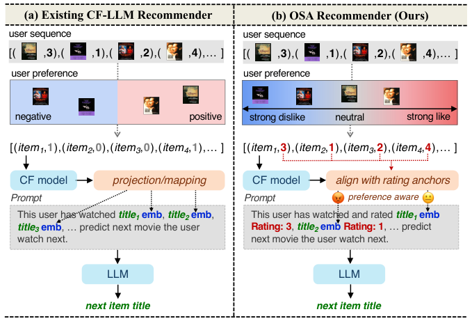
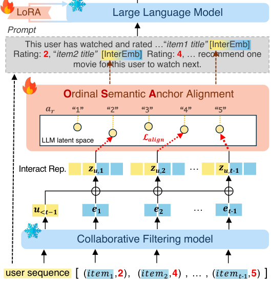
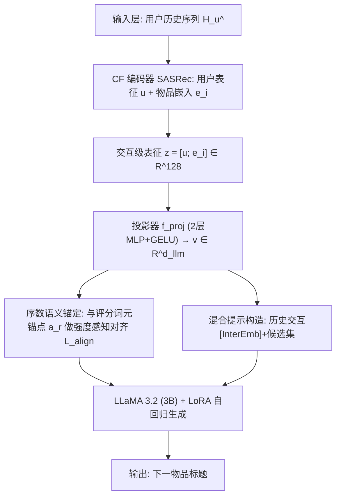
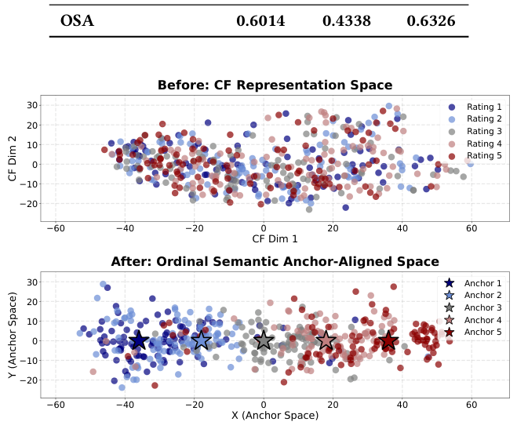
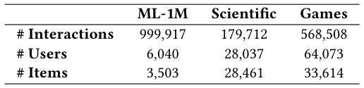
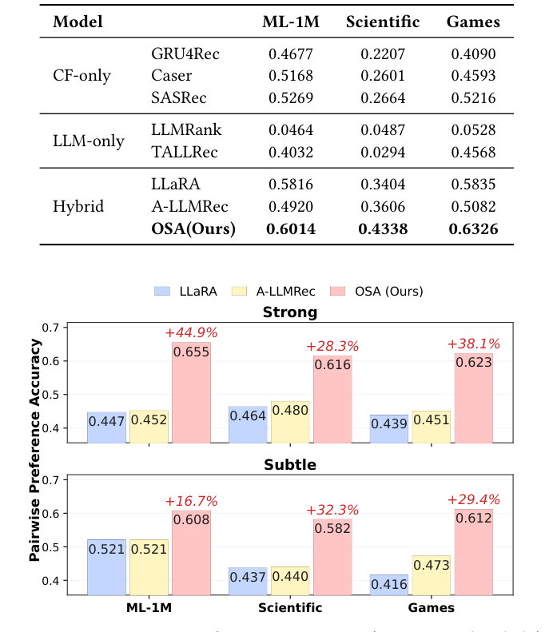
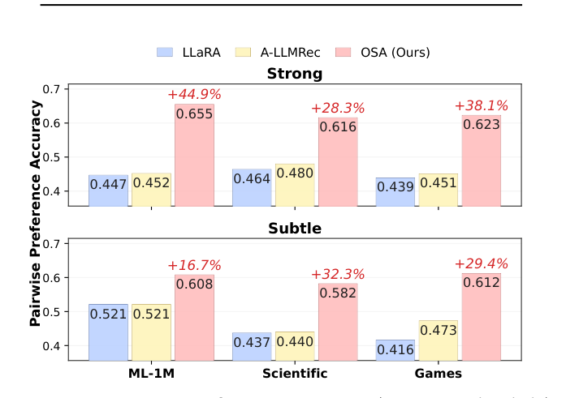
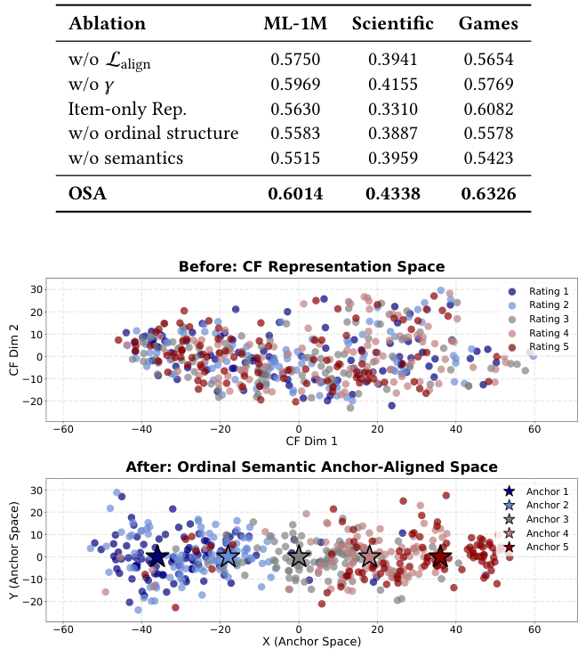
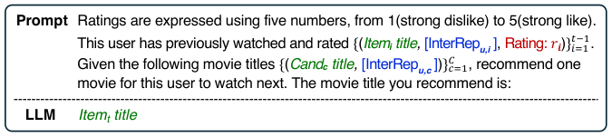

# Every Preference Has Its Strength: Injecting Ordinal Semantics into LLM-Based Recommenders (每种偏好都有其强度：向基于LLM的推荐器注入序数语义)

- **会议/期刊**: SIGIR 2026 (第49届国际ACM SIGIR会议，Melbourne, VIC, Australia)
- **推荐链路定位**: 精排 / 序列下一项预测 (Next-Item Prediction，候选集单选择)
- **研究方向**: 大语言模型推荐 (LLM4Rec) / 序列与会话推荐
- **论文原文**: [https://arxiv.org/abs/2605.10323v1](https://arxiv.org/abs/2605.10323v1)
- **开源代码**: [https://github.com/zzzzzioni/OSA](https://github.com/zzzzzioni/OSA)

## TL;DR (核心速览)

针对现有 CF–LLM 混合推荐框架将显式评分二值化/隐式化、丢弃偏好强度序数结构的问题，本文提出序数语义锚定 (OSA)：把评分等级 "1"–"5" 的 LLM 词元嵌入作为固定语义锚点，将交互级 CF 表征投影到 LLM 隐空间并按偏好强度加权对齐。在 ML-1M / Scientific / Games 三数据集、留一法 + 1 正 19 负采样协议下，Hit@1 达 0.6014/0.4338/0.6326，成对偏好准确率相对最佳基线最高提升 44.9%。

## Background & Motivation (背景与动机)

- **领域背景与主流范式**: 当前 LLM4Rec 的主流路线之一是 **hybrid prompting**（混合提示），即把协同过滤 (CF) 模型的用户/物品表征通过投影器映射进 LLM 隐空间，作为额外 token 或软提示注入，使 LLM 同时利用文本语义与协同信号。代表工作包括 LLaRA（投影 CF 表征为软 token）、A-LLMRec（对齐模态与 CF 表征）、CoLLM（协同嵌入注入）、以及蒸馏/二值化路线。
- **现有方法局限 (Limitations of Prior Work)**:
  1. **评分信息坍缩**：绝大多数 CF–LLM 框架用评分阈值把显式评分二值化，或直接退化为 positive-only 隐式反馈，丢弃了评分所承载的"喜欢/不喜欢 + 强度"双重信息。
  2. **粗粒度偏好不足以区分近邻候选**：二值化信号足以识别"总体喜欢的物品"，但难以在高度相关的候选之间做细微区分（如 4 星 vs 5 星）。
  3. **LLM 被当作通用预测器而非语义模型**：LLM 本身擅长建模分级语义与细粒度比较，但现有监督信号未提供这种机会。
- **核心挑战 (Key Challenge)**: 为什么简单拼接评分特征不行？因为评分若仅作为数值特征拼接，缺乏与 LLM 语义空间的对应关系；而若继续二值化，则序数结构（1<2<3<4<5 的相对顺序与强度）在表征空间中完全丢失。关键是要在**注入协同信号的同时保留序数语义**。
- **核心洞察与切入点 (Key Insight)**: 作者观察到 LLM 对有序数字词元（"1"…"5"）本身具有先验的序数语义理解。因此可将这些数字词元的**词元嵌入**直接作为固定语义锚点，把交互级 CF 表征"锚定"到对应评分等级的锚点上，并以强度感知权重（极端评分对齐更紧）施加约束，从而在 LLM 隐空间中诱导出序数结构。图1 对比了现有 CF–LLM 推荐器（仅正/负二值偏好）与 OSA（强厌恶—中性—强喜欢的分级偏好）的差异。

<figure class="paper-figure" markdown="span">
  <figcaption>图1：现有CF–LLM推荐模型与所提出的OSA框架的对比。</figcaption>
</figure>

## Problem Formulation & Method (问题定义与方法架构)

### 1. 符号定义与输入表征 (Notations & Input Representations)

- 用户集 $\mathcal{U}$、物品集 $\mathcal{I}$；用户 $u$ 在时刻 $t$ 之前的历史交互 $\mathcal{H}^{<t}_u=(i_1,\dots,i_{t-1})$，$i_k\in\mathcal{I}$。
- CF 编码器（SASRec）输出用户表征 $\mathbf{u}^{<t}=f_{\text{CF}}(\mathcal{H}^{<t}_u)\in\mathbb{R}^{d_{\text{rec}}}$，物品嵌入表给出 $\mathbf{e}_i\in\mathbb{R}^{d_{\text{rec}}}$，本文设 $d_{\text{rec}}=64$。
- 交互级表征 $\mathbf{z}_{u,i}=[\mathbf{u}^{<t-1};\mathbf{e}_i]\in\mathbb{R}^{2d_{\text{rec}}}$，对应显式评分 $r_{u,i}\in\{1,\dots,5\}$。
- 投影器 $f_{\text{proj}}:\mathbb{R}^{2d_{\text{rec}}}\to\mathbb{R}^{d_{\text{llm}}}$（两层 MLP + GELU），得 $\mathbf{v}_{u,i}=f_{\text{proj}}(\mathbf{z}_{u,i})$。
- 锚点：评分等级 $r$ 的数字文本词元在预训练 LLM 中的词元嵌入 $\mathbf{a}_r\in\mathbb{R}^{d_{\text{llm}}}$，$r\in\{1,\dots,5\}$，**固定不训练**。
- 输出：从候选集 $\mathcal{C}=\{c_1,\dots,c_C\}\subseteq\mathcal{I}$ 中生成下一物品标题。

### 2. 整体流水线 (Overall Architecture)

数据流：用户历史序列 → SASRec 编码得用户表征与物品嵌入 → 拼接为交互级表征 $\mathbf{z}_{u,i}$ → 两层 MLP 投影到 LLM 维度得 $\mathbf{v}_{u,i}$ → 与评分数字词元锚点 $\mathbf{a}_{r_{u,i}}$ 做强度感知对齐 → 混合提示（历史交互 + 候选集 + [InterEmb] 占位）送入 LoRA 微调的 LLaMA 3.2 (3B-Instruct) → 自回归生成下一物品标题。图2 给出 OSA 总览。

<figure class="paper-figure" markdown="span">
  <figcaption>图2：序数语义锚定（OSA）概览。</figcaption>
</figure>

### 3. 核心模块设计与数学原理 (Key Designs & Formulations)

**(1) 交互级表征 (Interaction Representation)**：不同于以往在用户级或物品级做对齐，OSA 在**交互级**构造 $\mathbf{z}_{u,i}=[\mathbf{u}^{<t-1};\mathbf{e}_i]$，使每个表征与单次交互所表达的偏好强度一一对应。这是后续强度感知对齐的前提——只有交互级粒度才能承载"这次交互是几星"的信息。

**(2) 序数语义锚点 (Ordinal Semantic Anchors)**：将评分等级 $r$ 表示为数字文本词元（"1"…"5"），从冻结 LLM 的词嵌入表中取出 $\mathbf{a}_r$ 作为固定锚点。物理直觉：LLM 预训练语料中数字词元天然携带有序尺度语义，锚点因此提供**共享、可解释、且与 LLM 语义空间同源**的参考系，无需额外学习。

**(3) 强度感知对齐 (Strength-Aware Alignment)**：对齐损失为
$$\mathcal{L}_{\text{align}}=\mathbb{E}_{(u,i)}\Big[\big(1-\cos(\mathbf{v}_{u,i},\mathbf{a}_{r_{u,i}})\big)\cdot w(r_{u,i})\Big],$$
其中强度权重
$$w(r)=1+\gamma\,|r-3|,\quad \gamma>0\ (\text{本文}\ \gamma=0.5).$$
该设计使极端评分（1 星、5 星）的交互被更强地拉向其锚点，中性评分（3 星）约束较弱。直觉是极端评分表达更确定、更强烈的人类偏好信号，应更紧地对齐；同时不同等级锚点之间保持分离，从而在隐空间中诱导出序数结构而非坍缩为粗相似群。图5 的 t-SNE 可视化显示：对齐前交互表征相对评分无清晰组织，对齐后按锚点序数结构排布，相邻评分更近、远距评分少重叠。

<figure class="paper-figure" markdown="span">
  <figcaption>图5：应用序数语义锚定前后交互表示的可视化（ML-1M）。</figcaption>
</figure>

### 4. 训练目标、负采样与推理复杂度 (Optimization, Negative Sampling & Complexity)

- **损失函数**: 总目标为自回归生成损失 + 对齐损失：
$$\max_{\theta}\ \sum_{u\in\mathcal{U}}\sum_{k=1}^{|y_{u,i_t}|}\log P_{\theta,\Theta}\big(y^{(k)}_{u,i_t}\mid \mathbf{p}_u, y^{(<k)}_{u,i_t}\big)\ -\ \lambda_{\text{align}}\,\mathcal{L}_{\text{align}},$$
其中 $\theta$ 为可学习参数（投影器 + LoRA），$\Theta$ 为冻结 LLM；$\lambda_{\text{align}}=0.5$，$\gamma=0.5$。原文未报告对齐损失中的温度系数（该损失为余弦对齐，非 InfoNCE，无 $\tau$）。
- **训练负采样策略**: 训练阶段为生成式下一项预测（teacher forcing），**无显式负采样**；评估阶段采用 1 个真值 + 19 个随机采样负例的候选集。
- **时间与空间复杂度**: 原文未报告具体训练耗时、单次推理延迟 (ms/request) 与峰值显存。定性上，OSA 相比 LLaRA/A-LLMRec 仅增加一个余弦对齐项（对固定锚点，无额外可训练参数），推理阶段与标准 hybrid prompting 一致（候选集内生成标题，非全库 ANN 检索）。

## Experimental Setup & Evaluation Protocol (实验设置与评估协议)

- **数据集统计与预处理**: 三个真实数据集，均提供 1–5 星显式评分。原文表1 统计如下（原文未说明 5-core 等过滤规则细节）：

<figure class="paper-figure" markdown="span">
  <figcaption>表1：数据集统计。</figcaption>
</figure>

| 数据集 (Dataset) | 用户数 (#Users) | 物品数 (#Items) | 交互数 (#Interactions) | 稀疏度/密度 (Sparsity) | 模态/辅助特征说明 |
| :--- | :---: | :---: | :---: | :---: | :--- |
| ML-1M | 6,040 | 3,503 | 999,917 | 原文未报告 | 电影标题文本 + 1–5 星评分 |
| Scientific (Amazon) | 28,037 | 28,461 | 179,712 | 原文未报告 | 商品标题文本 + 1–5 星评分 |
| Games (Amazon) | 64,073 | 33,614 | 568,508 | 原文未报告 | 商品标题文本 + 1–5 星评分 |

- **数据划分方式 (Splitting Strategy)**: **Leave-One-Out (留一法)**——最近一次交互作测试、次近一次作验证、其余作训练。由于按用户时间顺序切分，未来信息泄露风险较低；但需注意候选负例为随机采样，未做时间戳约束。
- **排名评测协议 (Ranking Protocol)**: **Sampled Ranking（采样负例排序）**——1 个真值物品 + 19 个随机采样负例，模型观察最多 20 条历史交互，从候选集中单选下一物品。**非 Full-Ranking**，因此 Hit@1 数值不可与全库排序结果直接比较。
- **评价指标与显著性检验**: 主指标 **Hit@1**（单选择任务）；辅以**成对偏好准确率**（采样 $\min(1000, 0.05|\mathcal{U}|)$ 个未见用户，构造一级评分差对：Strong = {1 vs 2, 4 vs 5}，Subtle = {2 vs 3, 3 vs 4}）。Embedding 维度 $d_{\text{rec}}=64$ 对所有混合基线统一（SASRec 共享 CF 编码器），LLM 统一为 LLaMA 3.2 (3B-Instruct)。**原文未报告多随机种子方差与配对显著性检验**。

## Key Experimental Results (核心实验结果)

### 1. 主实验对比 (Main Results)

表2 报告下一项预测 Hit@1。混合 CF–LLM 模型整体优于 CF-only 与 LLM-only 基线；OSA 在三数据集均取得最佳。

<figure class="paper-figure" markdown="span">
  <figcaption>表2：下一项预测下的Hit@1性能。每个数据集的最佳结果以粗体标出。</figcaption>
</figure>

| 数据集 | 指标 | 传统/协同过滤基线 (SASRec 最强) | 混合 CF–LLM 最强基线 | 本文方法 (Ours) | 相对提升 (Improv.) |
| :--- | :--- | :---: | :---: | :---: | :---: |
| ML-1M | Hit@1 | 0.5269 (SASRec) | 0.5816 (LLaRA) | **0.6014** | +3.40% |
| Scientific | Hit@1 | 0.2664 (SASRec) | 0.3606 (A-LLMRec) | **0.4338** | +20.30% |
| Games | Hit@1 | 0.5216 (SASRec) | 0.5835 (LLaRA) | **0.6326** | +8.41% |

注：LLM-only 基线表现分化明显——LLMRank 在三数据集仅 0.0464/0.0487/0.0528（接近随机），TALLRec 在 Scientific 仅 0.0294，说明纯文本 LLM 推荐在无协同信号时严重不足。

**成对偏好评估**（图4）：OSA 在所有数据集、Strong 与 Subtle 两种设置下均大幅领先 LLaRA 与 A-LLMRec。Strong 设置下相对最佳基线提升最高 **+44.9%**（ML-1M），Scientific +28.3%、Games +38.1%；Subtle 设置下提升 +16.7%/+32.3%/+29.4%。原文指出二值化基线在 Subtle 设置下常收敛至 0.5（等同随机猜测），印证保留序数强度对区分细微偏好差异的关键性。

<figure class="paper-figure" markdown="span">
  <figcaption>图4：成对偏好准确率（Strong与Subtle），并给出相对最佳基线的相对提升（+%）。</figcaption>
</figure>

### 2. 消融实验与控制变量分析 (Ablation Study)

表3 消融（Hit@1）：

<figure class="paper-figure" markdown="span">
  <figcaption>表3：OSA各组件的消融研究。</figcaption>
</figure>

| 变体 | ML-1M | Scientific | Games |
| :--- | :---: | :---: | :---: |
| w/o $\mathcal{L}_{\text{align}}$ | 0.5750 | 0.3941 | 0.5654 |
| w/o $\gamma$ | 0.5969 | 0.4155 | 0.5769 |
| Item-only Rep. | 0.5630 | 0.3310 | 0.6082 |
| w/o ordinal structure | 0.5583 | 0.3887 | 0.5578 |
| w/o semantics | 0.5515 | 0.3959 | 0.5423 |
| **OSA** | **0.6014** | **0.4338** | **0.6326** |

- **贡献最大**：移除对齐目标（w/o $\mathcal{L}_{\text{align}}$）使性能回落至混合基线水平，说明锚定对齐是核心；**破坏序数结构**（置换锚点顺序）与**移除语义**（随机初始化锚点替代）均导致显著下降，证明"序数性"与"LLM 语义先验"两者缺一不可。
- **交互级表征**：Item-only Rep.（用 $\mathbf{e}_i$ 替代 $\mathbf{z}_{u,i}$）在 ML-1M 与 Scientific 上明显下降（0.5630/0.3310），验证交互级粒度的重要性；Games 上该变体（0.6082）仍低于完整 OSA。
- **强度权重**：w/o $\gamma$ 下降幅度较小但一致，说明强调极端偏好有增益。
- **控制变量说明**：原文未明确报告参数量对齐或图拓扑度数匹配等控制变量消融。

### 3. 稀疏度/冷启动分桶与超参敏感度 (Sparsity Buckets & Hyperparameters)

- **用户/物品交互频次分桶表现**: 原文未报告长尾/冷启动分桶实验。
- **关键超参数敏感度**: 原文仅给出设定值（$d_{\text{rec}}=64$、$\lambda_{\text{align}}=0.5$、$\gamma=0.5$），**未报告超参数敏感度曲线**。
- **线上 A/B 测试结果**: 原文仅包含离线实验，**无线上 A/B 测试**。

## Highlights, Limitations & Critiques (亮点、局限与审稿级批判)

- **核心亮点与可迁移性**:
  1. **"零参数"语义锚点**：直接复用 LLM 数字词元嵌入作为固定锚点，无需学习额外锚点表，思路简洁且可迁移到任何需要注入序数/分级语义的场景（如评分预测、多级相关性排序、分级情感信号）。
  2. **交互级对齐粒度**：将对齐从用户/物品级下沉到交互级，使每个表征与单次偏好强度一一对应，这一设计对序列推荐、会话推荐中的细粒度偏好建模具有普适参考价值。
  3. **强度感知权重 $w(r)=1+\gamma|r-3|$**：以极简形式编码"极端评分更确定"的先验，可作为通用加权策略迁移。
  4. **成对偏好评估协议**：Strong/Subtle 两级评分差对的构造方式，为评估细粒度偏好建模提供了可复用的诊断性协议。
- **局限性与审稿视角批判 (Critical Limitations)**:
  1. **评估协议偏弱**：仅用 1 正 19 负的 Sampled Ranking 且只报 Hit@1，未做 Full-Ranking 与 NDCG@K/Recall@K，结论的稳健性与可比性受限；Hit@1 对候选集规模敏感。
  2. **统计严谨性不足**：未报告多随机种子方差、置信区间或配对显著性检验（$t$-test/Wilcoxon），表2 中 ML-1M 上 OSA 相对 LLaRA 的 +3.40% 提升是否显著存疑。
  3. **锚点语义的脆弱性**：依赖 LLM 对数字词元的先验序数理解，但不同分词器/语言/模型规模下数字词元的语义质量可能差异巨大；原文仅用 LLaMA 3.2 (3B) 单一骨干，未做跨骨干泛化验证。
  4. **超参与效率信息缺失**：$\gamma$、$\lambda_{\text{align}}$ 无敏感度分析；训练/推理耗时、显存均未报告，3B LLM + LoRA 的工业落地成本未评估。
  5. **数据规模与场景局限**：三数据集均为评分显式场景，未验证隐式反馈（无评分）场景下的适用性——尽管作者在结论中将"隐式反馈的文本语义锚点"列为未来工作，但这恰是工业推荐的主流场景。
  6. **论文篇幅**：正文仅 5 页（短文），实验深度受限于篇幅，部分关键细节（数据过滤、训练配置）需依赖代码仓库补充。

## Rating (四维评分)

- **方法创新性 (Novelty)**: ⭐⭐⭐⭐ （序数语义锚点 + 强度感知对齐的切入点新颖且优雅，但整体仍属 hybrid prompting 框架内的增量改进）
- **评估协议与实验扎实度 (Protocol & Experiments)**: ⭐⭐⭐ （成对偏好评估设计有洞察，但 Sampled Ranking + 仅 Hit@1 + 无显著性检验，实验深度偏薄）
- **写作与数学规范度 (Clarity & Rigor)**: ⭐⭐⭐⭐ （公式与动机链条清晰，符号规范；但关键超参与效率细节缺失）
- **工业落地与复现价值 (Industrial & Practical Value)**: ⭐⭐⭐ （代码已开源、锚点设计零额外参数易复现，但 3B LLM 推理成本与隐式反馈场景适配性限制工业落地）

## 论文图表

<figure class="paper-figure" markdown="span">
  <figcaption>图3：OSA的提示模板。</figcaption>
</figure>

