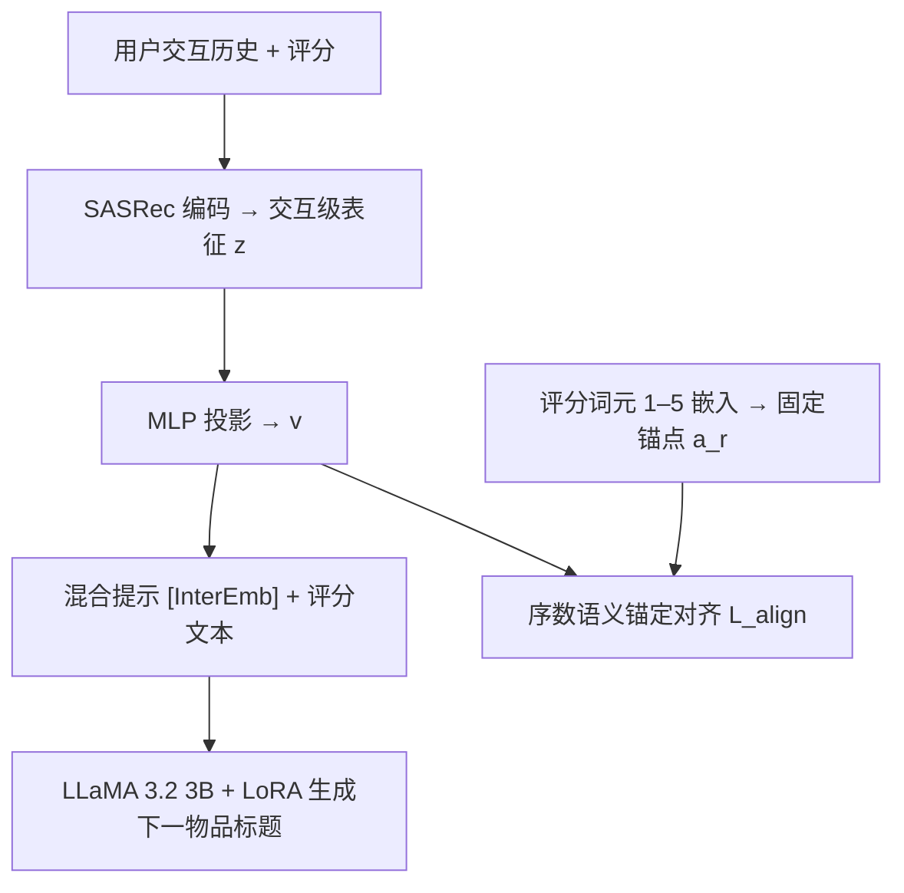

# Every Preference Has Its Strength: Injecting Ordinal Semantics into LLM-Based Recommenders (每份偏好皆有其强度：向LLM推荐器注入序数语义)

- **会议/期刊**: SIGIR 2026
- **作者与机构**: Jiwon Jeong, Donghee Han, Sungrae Hong, Woosung Kang, Mun Yong Yi (KAIST)
- **推荐链路定位**: 召回（生成式下一项预测）
- **研究方向**: LLM推荐 / 序列推荐
- **论文原文**: [https://arxiv.org/abs/2605.10323v1](https://arxiv.org/abs/2605.10323v1)
- **开源代码**: [https://github.com/zzzzzioni/OSA](https://github.com/zzzzzioni/OSA)

## TL;DR (1分钟核心速览)

现有 CF–LLM 混合推荐器普遍把显式评分二值化或压缩为正反馈，丢弃了刻画偏好强度的序数结构，导致模型只能分辨"喜欢/不喜欢"而无法分辨"多喜欢"。本文提出序数语义锚定（OSA）：把评分等级 "1"–"5" 的 LLM 词元嵌入作为固定语义锚点，在 LLM 隐空间中对交互级表征做强度感知的余弦对齐。在 ML-1M / Scientific / Games 三数据集、Leave-One-Out + 1 正 19 负采样协议下，Hit@1 分别达 0.6014 / 0.4338 / 0.6326，成对偏好准确率相对最佳基线最高提升 44.9%。

## Background & Motivation (背景与核心矛盾)

- **主流范式**: 混合提示（hybrid prompting）路线将 CF 模型的用户/物品表征经投影器注入 LLM 输入或隐空间（LLaRA 注入 token、A-LLMRec 做对齐），让 LLM 同时利用文本语义与协同信号。
- **前人局限**: 其一，这些框架把评分按阈值二值化或只保留正反馈，偏好强度信息在进入 LLM 前即被抹平；其二，对齐目标通常是"表征映射"而非"语义映射"，CF 向量被拉进 LLM 空间却未携带任何可解释的偏好梯度。
- **核心洞察 (Key Insight)**: 评分不是普通数值标签，而是序数语义信号——5 星比 4 星"更强地喜欢"，1 星比 2 星"更强地不喜欢"。而 LLM 预训练语料中本就蕴含对 "1"–"5" 有序数轴的语义理解，其词元嵌入天然构成一条可复用的序数参考轴。
- **本文切入点**: 不再让 LLM 被动接收 CF 向量，而是把 CF 交互表征主动"锚定"到评分词元嵌入上，用锚点的序数几何约束交互表征的排布。

## Method (核心方法设计)

### 1. 整体框架 (Overall Architecture)

OSA 以 SASRec 为 CF 编码器，对用户历史 $H_u^{<t}$ 输出用户表征 $\mathbf{u}^{<t}$，与目标物品嵌入 $\mathbf{e}_i$ 拼接成**交互级**表征 $\mathbf{z}_{u,i}=[\mathbf{u}^{<t-1};\mathbf{e}_i]\in\mathbb{R}^{2d_{rec}}$——注意粒度是"某用户对某物品的一次交互"，而非用户级或物品级向量。该表征经两层 GELU MLP 投影为 $\mathbf{v}_{u,i}\in\mathbb{R}^{d_{llm}}$，作为 `[InterEmb]` 占位符嵌入混合提示（历史中每条交互附带其评分文本），LLM 在候选集内生成下一物品标题。训练时同时优化自回归生成损失与锚定对齐损失，LLM 主干冻结、仅训练投影器与 LoRA。

<figure class="paper-figure" markdown="span">
  <figcaption>图2：序数语义锚定（OSA）概览。</figcaption>
</figure>

### 2. 关键设计拆解 (Key Designs)

1. **序数语义锚点（Ordinal Semantic Anchors）**：痛点是此前没有任何"偏好强度"的参照系。OSA 直接取预训练 LLM 对数字词元 "1"…"5" 的输入嵌入 $\mathbf{a}_r\in\mathbb{R}^{d_{llm}}$ 并**冻结**，作为五个语义锚点。妙处在于零额外参数、零额外训练：锚点间的相对几何关系继承自 LLM 对有序数轴的先验理解，天然携带"1<2<3<4<5"的序数结构，且与 LLM 自身语义空间同源，无需跨空间翻译。

2. **强度感知对齐（Strength-Aware Alignment）**：痛点是若对所有评分等权对齐，中性交互会稀释极端偏好的信号。OSA 用余弦对齐损失并按偏离中性的程度加权：

$$\mathcal{L}_{align}=\mathbb{E}_{(u,i)}\Big[\big(1-\cos(\mathbf{v}_{u,i},\mathbf{a}_{r_{u,i}})\big)\cdot w(r_{u,i})\Big],\quad w(r)=1+\gamma|r-3|$$

其中 $\gamma=0.5$。物理直觉：1 星与 5 星是"确定性最强"的偏好陈述，应被更紧地钉在其锚点附近；3 星本身模糊，允许漂移。这等价于给 LLM 隐空间注入一个序数归纳偏置——交互表征不仅要知道"正/负"，还要按强度分层排布。

3. **训练目标与推理开销**：总损失为自回归生成损失加对齐项，$\mathcal{L}=\mathcal{L}_{gen}+\lambda_{align}\mathcal{L}_{align}$，$\lambda_{align}=0.5$、$d_{rec}=64$。负采样方面，训练沿用混合提示的生成式目标（无显式负采样），评测阶段采用 1 正 19 负的候选打分。推理时锚点与对齐分支完全离线，在线仅需一次投影 + 一次 LLM 前向，开销与 LLaRA 等同量级。

## Experimental Setup & Evaluation Protocol (实验设置与评估协议)

- **数据集与预处理**: 三个含 1–5 星显式评分的数据集，规模跨度大：

| 数据集 | #Users | #Items | #Interactions | 特征/场景说明 |
| :--- | :---: | :---: | :---: | :--- |
| ML-1M | 6,040 | 3,503 | 999,917 | 电影，稠密 |
| Scientific | 28,037 | 28,461 | 179,712 | Amazon 工业与科学品，极稀疏 |
| Games | 64,073 | 33,614 | 568,508 | Amazon 电子游戏 |

- **数据划分与防穿越 (Splitting Strategy)**: `Leave-One-Out`——最近一次交互作测试、次近作验证、其余训练；输入历史截断至 20 条。
- **排名评测协议 (Ranking Protocol)**: `Sampled Ranking`，1 个真值 + 19 个随机负样本，主指标 Hit@1（单选择任务）。另设**成对偏好评测**：采样 $\min(1000, 0.05|U|)$ 个未见用户，构造相邻评分对，分 strong（1v2、4v5）与 subtle（2v3、3v4）两档，要求模型选出"会更喜欢并给更高分"的一项。
- **对比基线与超参设置**: CF-only（GRU4Rec、Caser、SASRec）、LLM-only（TALLRec、LLMRank）、Hybrid（LLaRA、A-LLMRec）。所有 LLM 方法统一用 LLaMA 3.2 (3B-Instruct) 主干、共享 SASRec 编码器，$d_{rec}=64$、$\lambda_{align}=0.5$、$\gamma=0.5$。

## Key Experimental Results (实验关键数据)

### 1. 主实验对比 (Main Results)

| 类别 | 模型 | ML-1M Hit@1 | Scientific Hit@1 | Games Hit@1 |
| :--- | :--- | :---: | :---: | :---: |
| CF-only | GRU4Rec | 0.4677 | 0.2207 | 0.4090 |
| CF-only | Caser | 0.5168 | 0.2601 | 0.4593 |
| CF-only | SASRec | 0.5269 | 0.2664 | 0.5216 |
| LLM-only | TALLRec | 0.4032 | 0.0294 | 0.4568 |
| LLM-only | LLMRank | 0.0464 | 0.0487 | 0.0528 |
| Hybrid | LLaRA | 0.5816 | 0.3404 | 0.5835 |
| Hybrid | A-LLMRec | 0.4920 | 0.3606 | 0.5082 |
| **Ours** | **OSA** | **0.6014** | **0.4338** | **0.6326** |
| | *Improv. vs 最佳基线* | *+3.4%* | *+20.3%* | *+8.4%* |

成对偏好准确率（图 4）：strong 档 OSA 为 0.655 / 0.616 / 0.623，相对最佳基线 +44.9% / +28.3% / +38.1%；subtle 档为 0.608 / 0.582 / 0.612，相对 +16.7% / +32.3% / +29.4%。

### 2. 消融实验 (Ablation Study)

| 变体 | ML-1M | Scientific | Games |
| :--- | :---: | :---: | :---: |
| w/o $\mathcal{L}_{align}$ | 0.5750 | 0.3941 | 0.5654 |
| w/o $\gamma$（等权对齐） | 0.5969 | 0.4155 | 0.5769 |
| Item-only Rep.（$\mathbf{z}\to\mathbf{e}_i$） | 0.5630 | 0.3310 | 0.6082 |
| w/o ordinal structure（打乱锚点顺序） | 0.5583 | 0.3887 | 0.5578 |
| w/o semantics（随机初始化锚点） | 0.5515 | 0.3959 | 0.5423 |
| **OSA** | **0.6014** | **0.4338** | **0.6326** |

### 3. 关键实验发现 (Key Findings)

1. **序数结构本身比"有锚点"更重要**：打乱锚点顺序（w/o ordinal structure）在 ML-1M 上掉至 0.5583，比随机初始化锚点（0.5515）几乎同样差，说明收益并非来自"多了一个对齐目标"，而是来自锚点间正确的序数几何；两者均低于完整模型 4–8 个点。
2. **交互级粒度是刚需**：把 $\mathbf{z}_{u,i}$ 换成纯物品嵌入（Item-only Rep.）在 Scientific 上暴跌至 0.3310（−23.7%），因为物品级向量无法承载"同一物品被不同用户以不同强度评价"的差异，而这正是序数语义的载体。
3. **强度加权与对齐损失互补且不可替代**：去掉 $\gamma$ 仅损失 0.5–1.8 个点，但去掉整个 $\mathcal{L}_{align}$ 在 Games 上掉 6.7 个点，说明"对齐"是主干、"加权"是精修；同时成对评测中基线常收敛到 0.5 随机水平，证明二值化确实摧毁了 subtle 区分能力。

## Highlights, Limitations & Rating (亮点、对比与审稿评价)

- **与代表作对比 (vs. Prior Work)**: LLaRA 把 CF 嵌入作为额外 token 注入提示，本质是"拼接"；A-LLMRec 做表征对齐但目标仍是隐式反馈；本文的区别在于对齐的**目标物**是 LLM 自带语义的评分词元，而非另一个可学习向量，因此对齐结果对 LLM 天然可解释。相较纯 CF 的 SASRec，OSA 在 Scientific 上提升 62.8%，说明稀疏场景下序数先验的补益最大。
- **可迁移亮点**: ①"用 LLM 词元嵌入当免费语义锚点"这一技巧可推广到任何有序离散属性（价格档位、停留时长分桶、年龄分段）；②强度感知加权 $w(r)=1+\gamma|r-3|$ 可直接移植到对比学习中的样本重加权。
- **审稿级局限批判**: 其一，评测采用 1 正 19 负的采样排序而非全库 Full-Ranking，且仅报告 Hit@1，缺少 NDCG@K 等排序质量指标，绝对数值可能被候选集规模放大；其二，锚点依赖 LLM 对数字词元的先验，对评分语义非数值化（如 "like/dislike" 文本标签）或评分分布严重偏斜的场景，锚点间距是否仍有意义缺乏验证；此外 3B 模型 + LoRA 的推理成本未与 CF-only 基线做延迟对比。
- **四维评分**: 创新性 ⭐⭐⭐⭐ | 实验扎实度 ⭐⭐⭐ | 方法清晰度 ⭐⭐⭐⭐⭐ | 落地价值 ⭐⭐⭐⭐

