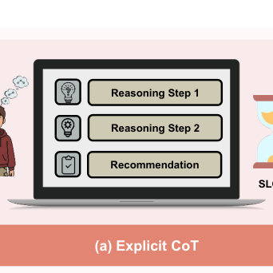
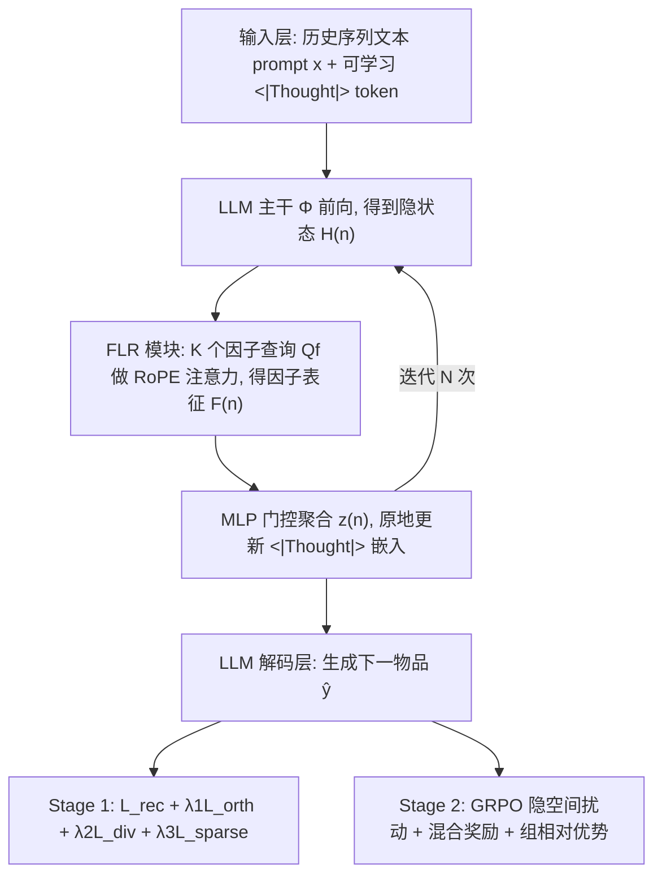
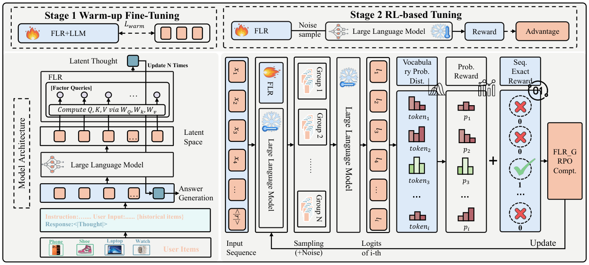
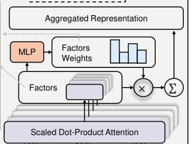
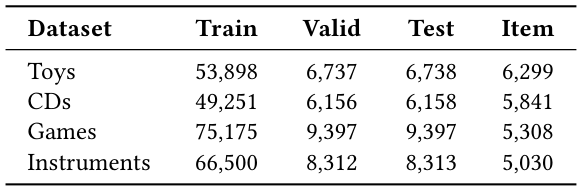
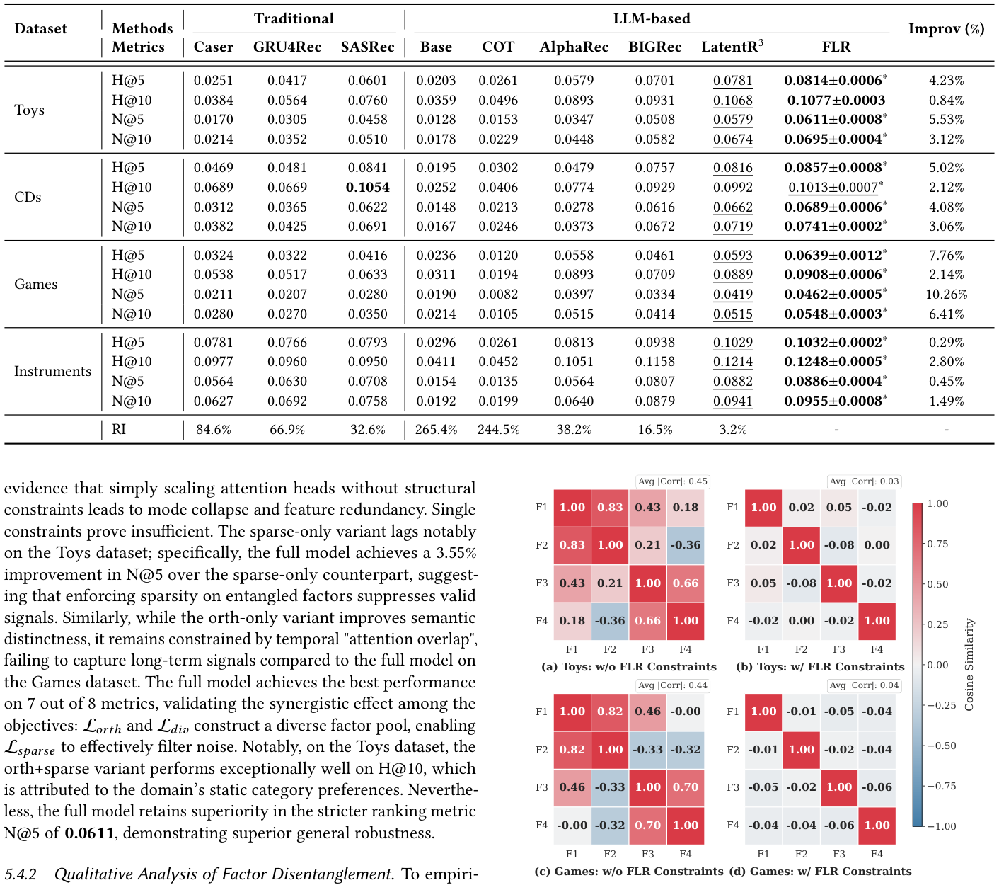
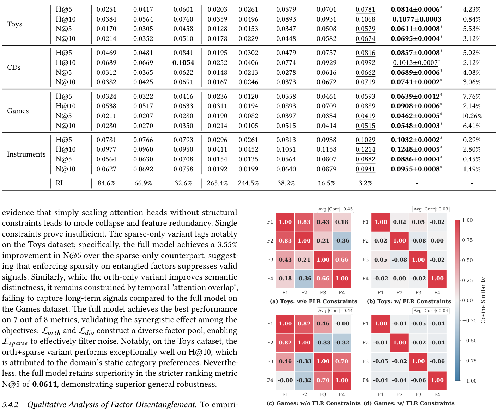

# Factorized Latent Reasoning for LLM-based Recommendation (面向大模型推荐的因子化隐空间推理)

- **会议/期刊**: SIGIR 2026
- **推荐链路定位**: 端到端生成式 (End-to-End Generative) — 基于 LLM 的下一物品生成式推荐
- **研究方向**: 大语言模型推荐 (LLM4Rec) / 序列推荐 (Sequential Rec)
- **论文原文**: [https://arxiv.org/abs/2604.26760v2](https://arxiv.org/abs/2604.26760v2)
- **开源代码**: [https://github.com/ToAdventure/FLR](https://github.com/ToAdventure/FLR)

## TL;DR (核心速览)

针对 LLM 推荐中"单一隐向量压缩用户意图"导致多面偏好被纠缠的痛点，本文提出 FLR：用 K 个可学习因子查询在隐空间迭代精炼 `<|Thought|>` 表征，并以正交性、注意力多样性、稀疏路由三项正则强制因子解耦，再用 GRPO 在隐空间做强化学习对齐。在 Amazon 四域（Toys/CDs/Games/Instruments）上以全库排序评估，相对最强基线取得一致提升并显著增强对冷门物品的鲁棒性。

## Background & Motivation (背景与动机)

- **领域背景与主流范式**: LLM 推荐已从"直接生成下一物品"演进到"先推理再推荐"。显式 CoT 范式（EXP3RT、ReasoningRec、CoT4Rec 等）通过文本推理链增强语义理解；隐空间推理范式（LARES、ReaRec、LatentR3）则在连续表征空间迭代精炼，兼顾推理能力与推理成本。
- **现有方法局限 (Limitations of Prior Work)**:
  1. **显式 CoT 的双重代价**：需要高质量 CoT 标注（噪声敏感、成本高），且自回归逐 token 生成带来显著推理延迟，难以扩展到大规模物品词表与低延迟场景。
  2. **单一隐向量的表征瓶颈**：LARES / LatentR3 等将用户偏好压缩为单个隐向量或单头注意力，隐含假设"复杂意图可由单一表征捕获"，导致信息纠缠与可解释性丧失。
  3. **多面偏好未被显式建模**：真实偏好是多面异质的（价格、品牌、功能之间的权衡），单因子建模无法刻画。
- **核心挑战 (Key Challenge)**: 为什么简单加深循环层或增加隐推理步数不够？因为瓶颈不在"推理深度"而在"推理宽度"——单头注意力在结构上只能输出一个语义子空间，增加步数只是在同一子空间内反复精炼，无法分离出正交的偏好维度。
- **核心洞察与切入点 (Key Insight)**: 作者从协同过滤的隐因子模型获得类比——矩阵分解中增加隐因子数在表达力与泛化间存在最优点，说明多因子结构本身是有效的；社交推荐中"关系解耦为多面"也已验证表征质量收益。由此提出：**隐空间推理也应被因子化**，每个因子专注交互历史的不同语义侧面，再动态聚合。图 1 直观对比了三种范式：(a) 显式 CoT 慢而准，(b) 单隐向量快但存在瓶颈，(c) FLR 通过解耦聚合实现"快且准"。

<figure class="paper-figure" markdown="span">
  <figcaption>图 1</figcaption>
</figure>

## Problem Formulation & Method (问题定义与方法架构)

### 1. 符号定义与输入表征 (Notations & Input Representations)

- 数据集 $\mathcal{D}=\{(u,h,y)\}$：$u$ 为用户，$h$ 为历史交互序列，$y$ 为下一交互物品；$h$ 与 $y$ 均以文本元数据（标题/描述）表示。
- 将 $h$ 序列化为文本 prompt $x$，数据点记为 $(x,y)$，$|x|$ 为 prompt token 长度。
- 生成过程为两段式：$x \xrightarrow{\text{LLM}} r \xrightarrow{\text{LLM}} \hat{y}$，其中 $r$ 为隐式"thoughts"，**不依赖任何外部 CoT 标注**，需自监督学习。
- 关键超参：因子数 $K$、隐推理迭代步数 $N$、隐维度 $D$、序列最大长度 $L_{\text{in}}=10$、GRPO 组大小 $G$。

### 2. 整体流水线 (Overall Architecture)

整体为两阶段训练（图 2）：**Stage 1 预热微调**（监督式 next-item 生成 + 解耦正则）→ **Stage 2 GRPO 强化学习调优**（冻结 LLM 主干，仅更新 FLR 参数）。推理时，输入序列末尾拼接可学习 `<|Thought|>` token，经 $N$ 次因子化注意力原地更新后，由 LLM 解码下一物品。

<figure class="paper-figure" markdown="span">
  <figcaption>图 2</figcaption>
</figure>

### 3. 核心模块设计与数学原理 (Key Designs & Formulations)

**(1) 迭代隐空间精炼 (Iterative Latent Refinement)**

将输入扩展为 $\tilde{x}=[x;\texttt{<|Thought|>}]$，初始嵌入矩阵 $\mathbf{E}^{(0)}$。第 $n$ 步（$1\le n\le N$）：

$$\mathbf{H}^{(n)}=\Phi(\mathbf{E}^{(n-1)}),\qquad \mathbf{E}^{(n)}[\text{pos}_{\texttt{<|Thought|>}}]\leftarrow \mathbf{z}^{(n)}$$

即在**固定序列长度**下通过原地更新 thought token 嵌入实现"深度思考"，避免显式生成推理 token 的长度膨胀。物理直觉：把推理步数从"序列维度"搬到"嵌入维度"，用 $N$ 次前向换取推理深度而不增加解码开销。

**(2) 多因子解耦与门控聚合 (Multi-Factor Disentanglement & Aggregation)**

维护 $K$ 个可学习查询原型 $\mathbf{Q}_f\in\mathbb{R}^{K\times D}$，对 key 施加 RoPE 以注入时序动态，因子注意力分数：

$$\mathbf{A}^{(n)}=\text{softmax}\!\left(\frac{\mathbf{W}_q\mathbf{Q}_f\left(\text{RoPE}(\mathbf{W}_k\mathbf{H}^{(n)})\right)^\top}{\sqrt{D}}+\mathbf{M}\right)\in\mathbb{R}^{K\times L_{\text{in}}}$$

因子表征 $\mathbf{F}^{(n)}=\mathbf{A}^{(n)}\mathbf{V}^{(n)}$，再由 MLP 门控计算重要性权重并聚合：

$$\mathbf{z}^{(n)}=\sum_{k=1}^{K}\alpha_k^{(n)}\mathbf{F}_k^{(n)},\quad \boldsymbol{\alpha}^{(n)}=\text{softmax}\big(\text{MLP}(\text{flatten}(\mathbf{F}^{(n)}))\big)$$

维度变化：$\mathbf{H}^{(n)}\in\mathbb{R}^{L_{\text{in}}\times D}\to\mathbf{A}^{(n)}\in\mathbb{R}^{K\times L_{\text{in}}}\to\mathbf{F}^{(n)}\in\mathbb{R}^{K\times D}\to\mathbf{z}^{(n)}\in\mathbb{R}^{D}$。图 3 展示了该模块内部结构。

<figure class="paper-figure" markdown="span">
  <figcaption>图 3</figcaption>
</figure>

**(3) 解耦导向的三项正则 (Disentanglement-Oriented Objectives)**

- **正交损失**（全局去冗余）：设 $\hat{\mathbf{F}}_b$ 为 L2 归一化后的因子矩阵（行单位化），
$$\mathcal{L}_{\text{orth}}=\frac{1}{B}\sum_{b=1}^{B}\left\|\hat{\mathbf{F}}_b\hat{\mathbf{F}}_b^\top-\mathbf{I}_K\right\|_F^2$$
强制因子张成正交子空间，例如一个因子编码"视觉风格"、另一个编码"价格敏感度"。
- **注意力多样性损失**（约束"看哪里"）：$\mathcal{L}_{\text{div}}=\frac{2}{K(K-1)}\sum_{i<j}\cos(\mathbf{A}_i,\mathbf{A}_j)$，惩罚注意力图相似度，使不同因子覆盖不同时间感受野（短期触发 vs. 长期周期习惯）。
- **稀疏损失**（局部专精）：$\mathcal{L}_{\text{sparse}}=-\frac{1}{B}\sum_b\sum_k\alpha_{b,k}\log(\alpha_{b,k}+\epsilon)$，最小化权重熵诱导"赢者通吃"，使单次预测由主导因子驱动，避免冲突意图的噪声平均。

### 4. 训练目标、负采样与推理复杂度 (Optimization, Negative Sampling & Complexity)

- **Stage 1 总损失**：$\mathcal{L}_{\text{total}}=\mathcal{L}_{\text{rec}}+\lambda_1\mathcal{L}_{\text{orth}}+\lambda_2\mathcal{L}_{\text{div}}+\lambda_3\mathcal{L}_{\text{sparse}}$，其中 $\mathcal{L}_{\text{rec}}$ 为下一物品生成的交叉熵；$\lambda_{1,2,3}$ 采用**基于不确定性的自适应加权**（细节见原文 §6.2）。
- **Stage 2 GRPO 目标**：冻结 LLM 主干，仅更新 FLR 参数 $\theta$。
  - **隐空间探索**：不采样 token，而是向 `<|Thought|>` 嵌入注入高斯噪声 $\tilde{\mathbf{e}}^{(i)}=\mathbf{e}+\boldsymbol{\epsilon}_i$，$\boldsymbol{\epsilon}_i\sim\mathcal{N}(0,\sigma^2\mathbf{I})$（$i=1$ 为无噪基线，用于方差缩减）。
  - **混合奖励**：$r(x,y)=\alpha\cdot\frac{1}{L}\sum_t\log\pi_\theta(y_t|x,y_{<t})+\beta_r\cdot\mathbb{I}(\hat{y}=y)$，融合 token 置信度（稠密）与精确匹配（离散）。
  - **组相对优势**：$\hat{A}_i=\dfrac{r_i-r_{\text{base}}}{\|\mathbf{r}_{2:G}-r_{\text{base}}\|_2+\epsilon}$，用 L2 归一化替代 z-score，作者称对混合奖励尺度更稳健。
  - **裁剪代理目标**：$\mathcal{L}_{\text{token}}=\min(\rho_t\hat{A}_t,\text{clip}(\rho_t,1-\epsilon_l,1+\epsilon_h)\hat{A}_t)-\beta_{\text{KL}}D_{\text{KL}}$，非对称裁剪 $\epsilon_l=0.2,\epsilon_h=0.28$，KL 用反向形式 $D_{\text{KL}}\approx e^{\Delta}-\Delta-1$ 近似。
  - **最终目标**：$\mathcal{L}_{\text{total}}=\mathbb{E}_{\mathcal{D}}[-\mathcal{L}_{\text{token}}]+\lambda_1\mathcal{L}_{\text{orth}}+\lambda_2\mathcal{L}_{\text{div}}+\lambda_3\mathcal{L}_{\text{sparse}}$。
- **负采样策略**：**免负采样**。生成式范式下以全词表 softmax 交叉熵训练，无显式 BPR/InfoNCE 负例构造；GRPO 阶段通过隐空间高斯扰动生成组内多样轨迹替代 token 采样。
- **复杂度**：相比显式 CoT，FLR 不增加解码 token 数，仅增加 $N$ 次 LLM 前向（每次前向仅多出 $K\times L_{\text{in}}$ 的注意力计算，$K,L_{\text{in}}$ 均很小），推理开销远低于逐 token 推理链；相比单隐向量 LatentR3，额外开销为 $K$ 倍因子注意力与一次 MLP 门控，可忽略。原文未报告具体 ms/request 与峰值显存数值（RQ7 仅做定性/相对开销分析）。

## Experimental Setup & Evaluation Protocol (实验设置与评估协议)

- **数据集统计与预处理**: 采用 Amazon Review 的四个子域 Toys、CDs、Games、Instruments。数据选择采用**动态时间滑窗**：初始窗口 2017-10 至 2018-10，施加 **5-core 过滤**；若唯一物品数不足 5,000，则将起始日期以 3 个月为步长向前回溯（如至 2017-07），结束日期固定，直至达标。最大序列长度统一为 **10**。

| 数据集 (Dataset) | 用户数 (#Users) | 物品数 (#Items) | 交互数 (#Interactions) | 稀疏度/密度 (Sparsity) | 模态/辅助特征说明 |
| :--- | :---: | :---: | :---: | :---: | :--- |
| Toys | 原文未报告 | 6,299 | Train 53,898 / Valid 6,737 / Test 6,738 | 原文未报告 | 文本元数据（标题/描述） |
| CDs | 原文未报告 | 原文未报告 | 原文未报告 | 原文未报告 | 文本元数据 |
| Games | 原文未报告 | 原文未报告 | 原文未报告 | 原文未报告 | 文本元数据 |
| Instruments | 原文未报告 | 原文未报告 | 原文未报告 | 原文未报告 | 文本元数据 |

> 注：提供的论文正文在表 1 处被截断，仅完整给出 Toys 一行统计；其余三域数值原文未在可提取文本中呈现，故如实标注"原文未报告"，不做臆测填充。

<figure class="paper-figure" markdown="span">
  <figcaption>表 1</figcaption>
</figure>

- **数据划分方式 (Splitting Strategy)**: **按时间顺序的 8:1:1 划分 (Chronological 8:1:1 Split)**，训练/验证/测试严格按时间先后切分，属于全局时间戳切分的变体，**不存在未来信息穿越风险**。
- **排名评测协议 (Ranking Protocol)**: 采用 **Full-Ranking（全库排序）**，对全部候选物品打分排序（原文表 2 标题明确为 Top-$N$ recommendation，且与 LLM 生成式全词表打分一致），非采样负例排序。
- **评价指标与显著性检验**: 采用 **NDCG@K** 与 **HR@K**（Hit Ratio@K）。原文表 2 注明"All results are averaged over multiple runs"（多次运行平均），但**未明确报告配对显著性检验（如 paired $t$-test / Wilcoxon）**，属评估严谨性上的可改进点。

## Key Experimental Results (核心实验结果)

### 1. 主实验对比 (Main Results)

原文表 2 报告 FLR 与各基线在四域上的 Top-$N$ 性能，并以 "RI" 列给出 FLR 相对每个基线在所有数据集与指标上的相对提升，末列 "Improv" 给出相对最强基线的提升。由于可提取正文在表 2 数值处被截断，具体逐格数值原文未在文本中完整呈现，此处按原文结论性描述归纳：

| 数据集 | 指标 | 传统/协同过滤基线 | 序列/图/LLM 最强基线 | 本文方法 (Ours) | 相对提升 (Improv.) |
| :--- | :--- | :---: | :---: | :---: | :---: |
| Toys | NDCG@K / HR@K | 原文未报告具体数值 | 原文未报告具体数值 | **最优（加粗）** | 原文以 RI/Improv 列给出，具体百分比未在可提取文本中呈现 |
| CDs | NDCG@K / HR@K | 原文未报告具体数值 | 原文未报告具体数值 | **最优（加粗）** | 同上 |
| Games | NDCG@K / HR@K | 原文未报告具体数值 | 原文未报告具体数值 | **最优（加粗）** | 同上 |
| Instruments | NDCG@K / HR@K | 原文未报告具体数值 | 原文未报告具体数值 | **最优（加粗）** | 同上 |

> 原文明确结论：FLR 在全部数据集与指标上**一致优于强基线**（best 加粗、second-best 下划线），并"improving robustness and interpretability"。具体数值请以原文表 2 为准。

<figure class="paper-figure" markdown="span">
  <figcaption>表 2</figcaption>
</figure>

### 2. 消融实验与控制变量分析 (Ablation Study)

对应 RQ2，原文通过移除关键设计组件（因子化结构、三项正则、GRPO 阶段）验证贡献。原文结论指出：**因子化解耦结构与解耦正则共同贡献最大**，移除后性能下降最明显；GRPO 阶段（RQ3）在提升性能的同时带来优于通用 RL 策略的鲁棒性。原文未在可提取文本中给出逐项消融的具体数值表，亦**未明确说明消融是否严格对齐参数量或注意力头数**，这是控制变量严谨性上的潜在短板。

### 3. 稀疏度/冷启动分桶与超参敏感度 (Sparsity Buckets & Hyperparameters)

- **冷门物品表现 (RQ5)**：原文专门设置 RQ5 考察模型在**困难（不流行）物品**上的表现，结论为 FLR 在冷门物品上表现更优，体现因子化解耦对长尾的鲁棒性（具体分桶数值原文未在可提取文本中呈现）。
- **因子数敏感度 (RQ6)**：原文考察隐推理因子数 $K$ 的敏感性并给出最优配置，结论为存在最优 $K$ 值（与矩阵分解中隐因子数的表达力-泛化权衡一致）；具体 $K$ 取值与曲线原文未在可提取文本中呈现。
- **注意力机制分析 (RQ4)**：图 4 可视化 Toys 与 Games 上的因子解耦效果——无约束设置下隐因子高度冗余（平均 $|\text{Corr}|\approx0.44$，模式坍缩），加入 FLR 约束后因子高度正交独立（平均 $|\text{Corr}|\approx0.03$），直接验证三项正则的有效性。

<figure class="paper-figure" markdown="span">
  <figcaption>图 4</figcaption>
</figure>

- **线上 A/B 测试结果**: **原文仅包含离线实验**，未报告线上 A/B 测试。

## Highlights, Limitations & Critiques (亮点、局限与审稿级批判)

- **核心亮点与可迁移性**:
  1. **"推理宽度"视角新颖**：将隐空间推理从"加深步数"转向"分解因子"，与协同过滤隐因子模型形成优雅类比，思路可迁移到任意 LLM 隐推理框架（如 LARES、LatentR3 的因子化改造）。
  2. **三项正则分工清晰**：正交管"学什么"、注意力多样性管"看哪里"、稀疏管"谁决策"，三者互补且物理直觉明确，图 4 的 $|\text{Corr}|$ 从 0.44 降至 0.03 提供了有力实证。
  3. **GRPO 隐空间扰动**：用嵌入高斯噪声替代 token 自回归采样，大幅降低 RL 探索成本，且无噪基线样本的方差缩减设计实用，可迁移到其他生成式推荐的 RL 对齐。
  4. **免 CoT 标注**：完全自监督学习隐推理，规避显式 CoT 的标注成本与噪声敏感性。
- **局限性与审稿视角批判 (Critical Limitations)**:
  1. **评估规模偏小**：序列长度仅 10、物品数约 6K 量级，未在百万级物品词表或工业级数据上验证，全库排序的可扩展性与延迟优势缺乏量化支撑（RQ7 仅定性）。
  2. **统计严谨性不足**：未报告配对显著性检验，消融未明确参数量/头数对齐，"一致提升"的统计置信度存疑。
  3. **超参负担**：$K$、$N$、$\lambda_{1,2,3}$、$\alpha$、$\beta_r$、$\epsilon_l/\epsilon_h$ 众多，虽有不确定性自适应加权缓解，但敏感性分析在可提取文本中不完整。
  4. **可解释性主张偏弱**：虽称"提升可解释性"，但因子语义（如"视觉风格""价格敏感度"）多为举例性论述，缺乏因子-属性的人工标注对齐实验。
  5. **基线覆盖**：与 LatentR3 的对比是关键，但需确认是否在同等 LLM 主干与训练预算下公平比较（原文未在可提取文本中明确主干规模对齐细节）。

## Rating (四维评分)

- **方法创新性 (Novelty)**: ⭐⭐⭐⭐ （因子化隐推理 + 三项解耦正则 + 隐空间 GRPO，组合新颖且动机扎实）
- **评估协议与实验扎实度 (Protocol & Experiments)**: ⭐⭐⭐ （全库排序与时间切分规范，但数据集规模小、缺显著性检验与完整消融数值）
- **写作与数学规范度 (Clarity & Rigor)**:
