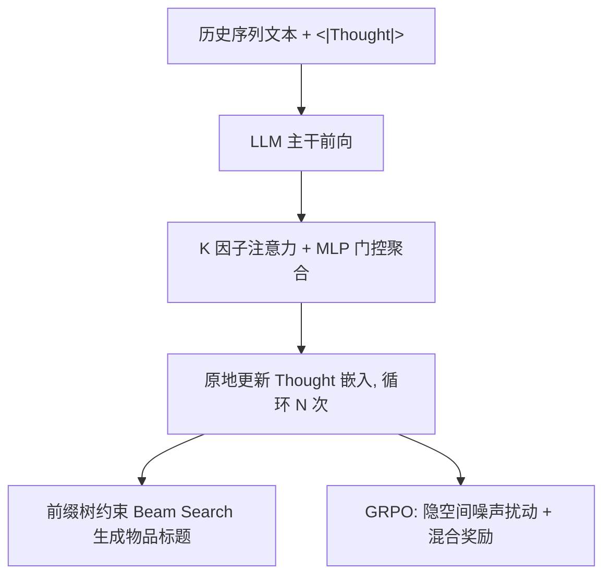

# Factorized Latent Reasoning for LLM-based Recommendation (面向 LLM 推荐的因子化隐式推理)

- **会议/期刊**: SIGIR 2026
- **作者与机构**: Tianqi Gao, Chengkai Huang, Zihan Wang, Cao Liu, Ke Zeng, Lina Yao（独立研究者 / Macquarie University / UNSW / 美团 LongCat 交互团队）
- **推荐链路定位**: 端到端生成式（LLM 序列推荐）
- **研究方向**: 大语言模型推荐 / 生成式推荐
- **论文原文**: [https://arxiv.org/abs/2604.26760v2](https://arxiv.org/abs/2604.26760v2)
- **开源代码**: [https://github.com/ToAdventure/FLR](https://github.com/ToAdventure/FLR)

## TL;DR (1分钟核心速览)

现有 LLM 隐式推理推荐（如 LatentR3）把用户意图压成**单个**隐向量，无法刻画价格/品牌/功能等多面偏好，且易发生表征纠缠。本文提出 FLR：在 `<|Thought|>` 令牌上做 K 个解耦因子的多轮注意力精炼，用正交、注意力多样性、稀疏路由三项正则强制因子专业化，再以因子化 GRPO 在隐空间对齐。在 Amazon 四域、全库前缀树约束解码协议下，N@5 相对最强基线最高提升 10.26%（Games），且推理耗时几乎与非推理 LLM 持平。

## Background & Motivation (背景与核心矛盾)

- **主流范式**: 将推荐改写为语言生成，用显式 CoT 或隐式推理令牌（LatentR3 的深度循环隐推理）替代直接 next-item 预测。
- **前人局限**: ① 显式 CoT 需高质量标注且自回归逐 token 生成，延迟不可控；② 隐式推理虽快，但每步只维护**单一**隐向量/单头注意力，多面偏好被强行压缩，出现信息纠缠与解释力丧失。
- **核心洞察 (Key Insight)**: 矩阵分解的经验表明隐因子数增加可提升表达力直至最优平衡；作者可视化发现无约束多头注意力的因子间平均 $|\text{Corr}|\approx0.44$，即"模式坍缩"——容量被冗余特征浪费。
- **本文切入点**: 把隐推理显式因子化为 K 个正交子空间上的"专家"，让稀疏门控在每次预测时只激活最相关因子。

## Method (核心方法设计)

### 1. 整体框架 (Overall Architecture)

输入为历史物品文本拼接的 prompt，末尾追加可学习 `<|Thought|>` 令牌。每一轮推理中，LLM 主干输出隐状态，FLR 模块用 K 个可学习查询原型做因子注意力，经 MLP 门控加权聚合为 $z^{(n)}$，**原地写回** thought 令牌嵌入，循环 N 次（默认 N=2）后在固定序列长度内完成"思考"。随后进入两阶段训练：先 SFT 预热，再冻结主干、仅更新 FLR 参数的 GRPO 阶段，用高斯噪声扰动 thought 嵌入构造组内样本、以混合奖励估计组相对优势。

<figure class="paper-figure" markdown="span">
  <figcaption>图2：FLR架构及其两阶段训练范式示意图。</figcaption>
</figure>

### 2. 关键设计拆解 (Key Designs)

1. **多因子注意力与动态聚合**：痛点是把多面意图塞进单头注意力。做法是维护 $K$个查询原型$Q_f$，键侧施加 RoPE 保留时序，得到因子注意力$A^{(n)}=\mathrm{softmax}\!\left(\frac{W_qQ_f(\mathrm{RoPE}(W_kH^{(n)}))^\top}{\sqrt{D}}+M\right)$，再以$\alpha^{(n)}=\mathrm{softmax}(\mathrm{MLP}(\mathrm{flatten}(F^{(n)})))$门控聚合$z^{(n)}=\sum_k\alpha_k^{(n)}F_k^{(n)}$。直觉：不同原型天然对应不同语义子空间，门控让上下文决定"听谁的"。

2. **三项解耦正则（全局—时序—局部三层约束）**：$\mathcal{L}_{orth}=\frac{1}{B}\sum_b\|\hat{F}_b\hat{F}_b^\top-I_K\|_F^2$约束**学什么**（因子张成正交子空间，如"视觉风格"vs"价格敏感"）；$\mathcal{L}_{div}=\frac{2}{K(K-1)}\sum_{i<j}\cos(A_i,A_j)$约束**看哪里**（差异化时间感受野，短期触发 vs 长期周期习惯）；$\mathcal{L}_{sparse}=-\frac{1}{B}\sum_b\sum_k\alpha_{b,k}\log(\alpha_{b,k}+\epsilon)$ 压低门控熵形成 winner-take-all，保证单次预测由单一主导因子驱动，避免冲突意图被平均成噪声。

3. **因子化 GRPO 与训练目标**：不做 token 级采样，而是对 thought 嵌入注入高斯噪声 $\tilde{e}^{(i)}=e+\epsilon_i$（首样本$\epsilon_1=0$作无噪基线降方差）；奖励为 token 置信度与精确匹配的混合$r=\alpha\cdot\frac{1}{L}\sum_t\log\pi_\theta(y_t|\cdot)+\beta_r\mathbb{I}(\hat{y}=y)$；优势用组内 L2 归一化偏差$\hat{A}_i=\frac{r_i-r_{base}}{\|r_{2:G}-r_{base}\|_2+\epsilon}$，配合非对称裁剪$(\epsilon_l{=}0.2,\epsilon_h{=}0.28)$与反向 KL 惩罚。总目标$\mathcal{L}_{total}=\mathcal{L}_{rec}+\lambda_1\mathcal{L}_{orth}+\lambda_2\mathcal{L}_{div}+\lambda_3\mathcal{L}_{sparse}$（RL 阶段替换为$-\mathcal{L}_{token}$），$\lambda$ 用不确定性加权自适应学习。负采样：生成式全库约束解码，**免负采样**。

## Experimental Setup & Evaluation Protocol (实验设置与评估协议)

- **数据集与预处理**: Amazon 四域，动态时间滑窗（2017.10–2018.10 起，物品不足 5000 则起点前推 3 个月）+ `5-core` 过滤，最大序列长度 10。

| 数据集 | #Train | #Valid | #Test | #Items | 场景说明 |
| :--- | :---: | :---: | :---: | :---: | :--- |
| Toys | 53,898 | 6,737 | 6,738 | 6,299 | 兴趣驱动、偏好多面 |
| CDs | 49,251 | 6,156 | 6,158 | 5,841 | 兴趣驱动 |
| Games | 75,175 | 9,397 | 9,397 | 5,308 | 软硬件混合需求 |
| Instruments | 66,500 | 8,312 | 8,313 | 5,030 | 专业性强、意图低维 |

- **数据划分与防穿越 (Splitting Strategy)**: 按时间戳 `8:1:1` 比例划分（chronological split），严格防穿越。
- **排名评测协议 (Ranking Protocol)**: 传统基线按其原打分协议；LLM 生成式基线用**全库前缀树约束 Beam Search**（beam=10），解码空间覆盖全候选集，属无偏 `Full-Ranking` 语义，避免自由生成的事后匹配。
- **对比基线与超参设置**: 传统 Caser/GRU4Rec/SASRec；LLM 侧 Base/CoT/AlphaRec/BIGRec/LatentR3。主干 Qwen2.5-1.5B，$K\in\{2,3,4\}$网格搜索（CDs 取 3，其余取 4），N=2，5 次随机种子均值，配对 t 检验$p<0.05$。

## Key Experimental Results (实验关键数据)

### 1. 主实验对比 (Main Results)

| 数据集 | 指标 | SASRec | AlphaRec | BIGRec | LatentR3 | **FLR** | Improv. |
| :--- | :---: | :---: | :---: | :---: | :---: | :---: | :---: |
| Toys | H@5 | 0.0601 | 0.0579 | 0.0701 | 0.0781 | **0.0814** | 4.23% |
| Toys | N@5 | 0.0458 | 0.0347 | 0.0508 | 0.0579 | **0.0611** | 5.53% |
| CDs | H@5 | 0.0841 | 0.0479 | 0.0757 | 0.0816 | **0.0857** | 5.02% |
| CDs | N@5 | 0.0622 | 0.0278 | 0.0616 | 0.0662 | **0.0689** | 4.08% |
| Games | H@5 | 0.0416 | 0.0558 | 0.0461 | 0.0593 | **0.0639** | 7.76% |
| Games | N@5 | 0.0280 | 0.0397 | 0.0334 | 0.0419 | **0.0462** | 10.26% |
| Instruments | H@10 | 0.0950 | 0.1051 | 0.1158 | 0.1214 | **0.1248** | 2.80% |
| Instruments | N@5 | 0.0708 | 0.0564 | 0.0807 | 0.0882 | **0.0886** | 0.45% |

相对传统模型最高提升 84.6%，相对未调优 LLM 超 265.4%，相对 LatentR3 平均约 3.2%。

### 2. 消融实验 (Ablation Study)

| 配置 | Games H@5 | Games N@5 | Toys H@5 | Toys N@5 |
| :--- | :---: | :---: | :---: | :---: |
| None（无正则） | 0.0596 | 0.0435 | 0.0779 | 0.0585 |
| 仅 sparse | 0.0631 | 0.0458 | 0.0782 | 0.0590 |
| 仅 orth | 0.0625 | 0.0460 | 0.0793 | 0.0594 |
| orth+sparse | 0.0607 | 0.0443 | 0.0794 | 0.0586 |
| **三项全开** | **0.0639** | **0.0462** | 0.0814 | **0.0611** |

### 3. 关键实验发现 (Key Findings)

1. **正则必须协同**：无约束基线在 Games H@5 落后完整模型 7.2%，因子间平均 $|\text{Corr}|$ 从 0.44 降至 0.03；仅加稀疏正则在 Toys N@5 落后 3.55%，说明在纠缠因子上强行稀疏会压制有效信号——正交与多样性先"造出专家池"，稀疏才能有效筛选。
2. **GRPO 依赖解耦结构**：通用 LR-GRPO 在 Games 上反而负迁移（H@5 −2.82%、N@5 −1.73%），而 FLR-GRPO 在全部 16 个指标-数据集组合上均为正增益，Toys H@10 提升 4.46%，证明粗粒度奖励需与因子头对齐才不沦为噪声。
3. **长尾收益显著更大**：相对 LatentR3，Games 非流行物品 N@10 提升 12.85%（流行组仅 6.46%），Instruments 非流行组 9.50% vs 流行组 0.83%，说明隐因子推理从语义线索补足了协同信号稀疏；同时 Instruments 增益最小，反映专业域意图空间低维、单头推理已够用。

## Highlights & Limitations (亮点、对比与审稿批判)

- **与代表作对比 (vs. Prior Work)**: 相比 LatentR3 的单头隐推理，FLR 把"一个向量"换成"K 个正交专家 + 稀疏路由"，是结构层面的增量而非仅训练技巧；相比 CoT/BIGRec 的显式中间 token，FLR 只增 1 个 thought 令牌，推理耗时几乎与非推理 LLM 持平（图 9），而 CoT 因 token 数不可控显著更慢；相比 AlphaRec 的纯文本协同表征，FLR 额外引入了可解释的因子分工（Head 3 专攻 Amiibo 收藏品、Head 4 专攻配件）。
- **可迁移亮点**: ① "正交 + 注意力多样性 + 稀疏熵"三层正则组合可直接移植到多兴趣召回或多头序列模型；② 用无噪基线样本 + L2 归一化组偏差估计优势，比 z-score 更稳，适合奖励尺度混合的 RL 微调场景。
- **审稿级局限批判**: ① 仅在 1.5B 小模型与四个 Amazon 子集上验证，$K$ 需按域网格搜索（CDs 取 3、其余取 4），缺少自动确定因子数的机制；② 全库前缀树约束解码在真实千万级物品库上的构建与 beam 搜索开销未评估，且未报告线上 A/B 或延迟分位数。

## Rating (四维评分)

- **方法创新性 (Novelty)**: ⭐⭐⭐⭐ （把矩阵分解的多因子思想迁移进 LLM 隐推理空间，三层正则各司其职，但整体仍是 LatentR3 的结构化扩展）
- **评估协议与实验扎实度 (Protocol & Experiments)**: ⭐⭐⭐⭐ （四域 + 全库约束解码 + 5 种子 + t 检验，消融与长尾分桶完整，缺线上验证）
- **写作与数学规范度 (Clarity & Rigor)**: ⭐⭐⭐⭐ （公式与三项正则动机交代清晰，因子可视化有说服力，但部分超参细节推给附录）
- **工业落地与复现价值 (Industrial & Practical Value)**: ⭐⭐⭐⭐ （代码开源、仅增 1 个 thought 令牌、冻结主干只训 FLR 参数，工程成本低；大规模前缀树解码待验证）

