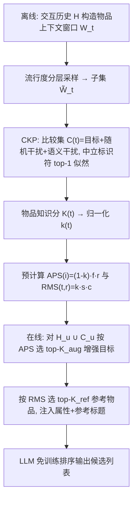
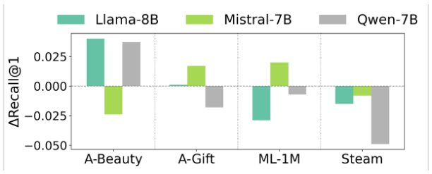
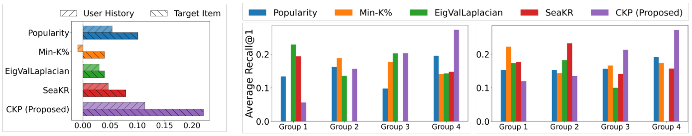
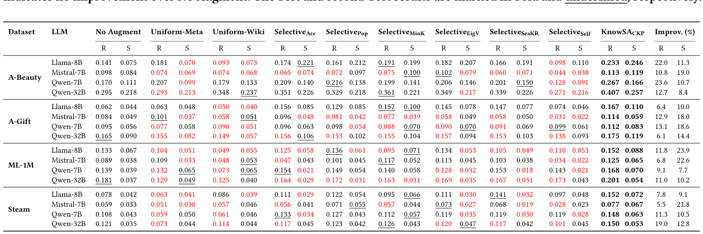
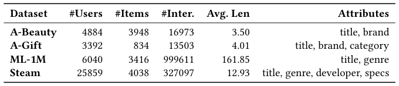
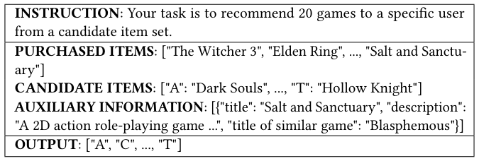
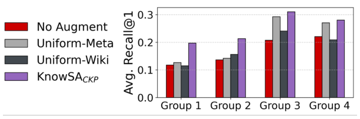
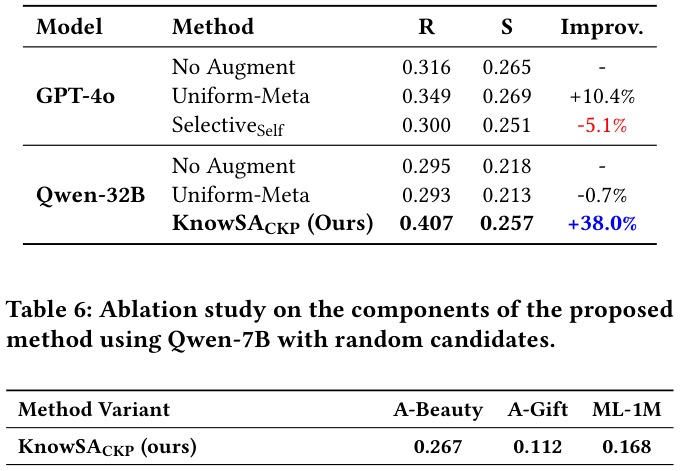

# Filling the Gaps: Selective Knowledge Augmentation for LLM Recommenders (填补知识缺口：面向 LLM 推荐器的选择性知识增强)

- **会议/期刊**: SIGIR 2026 (Full Papers Track)
- **推荐链路定位**: 重排 (Re-ranking) —— LLM 作为 training-free ranker 对候选集排序
- **研究方向**: 大语言模型推荐 (LLM4Rec) / 冷启动与长尾推荐
- **论文原文**: [https://arxiv.org/abs/2604.07825v2](https://arxiv.org/abs/2604.07825v2)
- **开源代码**: [https://github.com/nowhyun/KnowSA](https://github.com/nowhyun/KnowSA) （CKP 评分实现另见 [KnowSA_CKP](https://github.com/nowhyun/KnowSA_CKP)）

## TL;DR (核心速览)

LLM 免训练推荐器存在"知识缺口"：预训练曝光不均导致对长尾物品的协同关系掌握不足。本文提出 KnowSA_CKP，用**比较式知识探测 (CKP)** 以"内容中立标识符 + 混合干扰项"的 top-1 选择似然量化 LLM 对每个物品的协同知识，再通过 APS（增强优先级）与 RMS（参考匹配）**只对最需要的物品注入属性与参考物品标题**。在 4 个数据集、5 个 LLM 上，20 候选随机负例设定下 Recall@1 相对提升最高达 23.6%（A-Beauty/Qwen-7B），且推理 token 与延迟低于全量增强。

## Background & Motivation (背景与动机)

- **领域背景与主流范式**: 两阶段推荐（候选生成 + 排序）中，LLM 作为 **training-free ranker** 直接对候选集排序，无需微调即可利用其开放世界语义与事实知识，是 LLM4Rec 的低成本主流路线。
- **现有方法局限 (Limitations of Prior Work)**:
  1. **模型级适配 (fine-tuning)**：用交互数据微调 LLM 学习协同模式，计算开销大，且可能损害指令遵循与可解释性等通用能力。
  2. **提示级增强 (prompt-level augmentation)**：现有方法几乎都是 **uniform augmentation**——对提示中所有物品无差别追加元数据/外部知识。这既浪费有限上下文预算，又因长上下文干扰反而降低排序质量（图 1 显示 4 个数据集中 3 个性能下降）。
  3. **通用自适应检索 (Adaptive RAG)**：需在生成过程中顺序监测知识缺失，推理时开销大，且 LLM 难以在单个复杂提示中同时判别数十个物品的知识缺口。
- **核心挑战 (Key Challenge)**: 推荐所需的知识不是"物品是什么"的语义熟悉度，而是"用户历史与目标物品之间的**协同关系**（共消费模式）"。流行度、Min-K%、EigValLaplacian、SeaKR 等通用代理只测语义熟悉度，与 Recall@1 的 Spearman 相关性弱（图 2a），且无法在分位分组上呈现单调性（图 2b）。
- **核心洞察与切入点 (Key Insight)**: 作者通过 Pilot Study 发现：(i) 无差别增强有害；(ii) 现有知识代理与推荐性能错位。因此需要**推荐定制、离线可算、排序导向**的知识评分——把评分重构为"给定交互窗口，从含难负例的比较集中选出 top-1"的相对比较问题，并用内容中立标识符消除表面偏置。

## Problem Formulation & Method (问题定义与方法架构)

### 1. 符号定义与输入表征 (Notations & Input Representations)

- 数据集 $\mathcal{D}=(\mathcal{U},\mathcal{I},\mathcal{T},\mathcal{H})$：用户集 $\mathcal{U}$、物品集 $\mathcal{I}$、物品属性文本集 $\mathcal{T}$、交互历史集 $\mathcal{H}$。
- 用户 $u$ 的时序交互序列 $H_u=(i_{u,1},\dots,i_{u,|H_u|})$，实验截断至最近 50 条。
- 物品 $i$ 的文本特征 $(t_i,a_i)\in\mathcal{T}$：$t_i$ 为标题，$a_i$ 为附加属性（品牌、类目、开发者、描述等）。
- 两阶段：候选集 $C_u=\{i_{u,1},\dots,i_{u,m}\}$，$m=20\ll|\mathcal{I}|$；LLM 输出候选排序列表。
- 目标：估计每个物品的知识分 $K(t)$，并**选择性**注入信息，最小化上下文浪费。

### 2. 整体流水线 (Overall Architecture)

离线阶段：对每个物品构造交互上下文窗口 $\mathcal{W}_t$ → 流行度分层采样得 $\tilde{\mathcal{W}}_t$ → CKP 计算知识分 $K(t)$ 并归一化为 $k(t)$ → 预计算 APS 与 RMS 并存储。在线阶段：对 $H_u\cup C_u$ 按 APS 选 top-$K_{aug}$ 增强目标 → 为每个目标按 RMS 选 top-$K_{ref}$ 参考物品 → 拼接属性与参考标题 → LLM 排序。

### 3. 核心模块设计与数学原理 (Key Designs & Formulations)

**(1) 比较式知识探测 CKP（核心创新）**

对物品 $t$ 构造比较集 $C(t)=\{t\}\cup C_{rand}(t)\cup C_{sem}(t)$：
- 随机干扰项 $C_{rand}(t)\sim\text{UniformSample}(\mathcal{I}\setminus(\{t\}\cup w),\,n)$，提供多样性、作为 easy case；
- 语义干扰项 $C_{sem}(t)=\text{Top-}m_{j\in\mathcal{I}\setminus(\{t\}\cup w)}\cos(e_t,e_j)$，用 Sentence-BERT 文本嵌入选**难负例**，迫使模型只有在具备细粒度判别知识时才把概率集中到目标上。

关键设计：对 $C(t)$ 随机打乱并赋予**内容中立标识符**（如 [A]、[B]），切断标题 token 组成的表面偏置；只要求模型输出**单个 top-1 标识符**而非完整排序，避免自回归全排序中"越靠后候选池越小、概率被虚高"的结构性缺陷。top-1 选择似然采用 list-wise 形式：

$$P_{\text{LLM}}(t\mid P_w^{CKP})=\frac{\phi(z_t)}{\phi(z_t)+\sum_{j\in C(t)\setminus\{t\}}\phi(z_j)},\quad \phi(\cdot)=\exp(\cdot)$$

其中 $z_i$ 为各标识符的输出 logit。物品级知识分为采样窗口上的平均：

$$K(t):=\frac{1}{|\tilde{\mathcal{W}}_t|}\sum_{w\in\tilde{\mathcal{W}}_t}P_{\text{LLM}}(t\mid P_w)$$

对照基线 DKP 直接对标题做 token 级似然累加 $P_{\text{LLM}}(t\mid P_w^{DKP})=\exp(\sum_{j=1}^{L}\log P(y_j\mid P_w^{DKP},y_{<j}))$，易受词汇偏置与长度偏置影响。

**(2) 增强优先级 APS（增强什么）**

$$\text{APS}(i)=(1-k(i))\cdot f(i)\cdot r(i),\quad r(i)=\exp(-\lambda\cdot\text{pos}(i))$$

三项分别为知识亏缺、交互频次、时序新近度（$\text{pos}(i)$ 为逆时序位置，最近为 0）。各分量取对数后 min-max 归一化。物理直觉：知识越缺、越重要、越近期的物品，缺知识对排序伤害越大。

**(3) 参考匹配 RMS（用什么增强）**

$$\text{RMS}(t,r)=k(r)\cdot s(t,r)\cdot c(t,r),\quad c(t,r)=\frac{\text{freq}(t,r)}{\sqrt{\text{freq}(t)}\sqrt{\text{freq}(r)}}$$

$k(r)$ 为参考物品知识分（选 LLM 已充分理解的物品），$s(t,r)$ 为文本嵌入余弦相似度，$c(t,r)$ 为滑窗大小 2 的共现归一化频次。只注入参考物品**标题**（不注入其完整属性），以最小 token 激活 LLM 参数中已有知识。上下文感知变体：$\text{RMS}_{ctx}=\text{RMS}(t,r)\cdot\cos(h_u,e_r)$，复用 SASRec 的检索嵌入。

### 4. 训练目标、负采样与推理复杂度 (Optimization, Negative Sampling & Complexity)

- **损失函数**: 本文为 **training-free** 框架，无梯度训练目标；所有"学习"均通过 LLM 的似然/选择概率完成。SASRec 仅作为候选生成器与上下文感知嵌入来源，按常规训练。
- **负采样策略**: 知识评分阶段的比较集采用**混合负采样**——$n$ 个 Uniform 随机负例（easy）+ $m$ 个基于文本嵌入的语义难负例（hard negative），$n,m\in\{0,1,2\}$ 调参；评测阶段候选集为 1 正 + 19 负，分 Random（均匀采样未见物品）与 SASRec（top-19 预测）两种。
- **时间与空间复杂度**: 离线 CKP 全窗口计算昂贵，流行度分层采样（按窗口平均流行度分 3 个分位箱各均匀采样）将成本降低 1.9×–101.9×（表 7，ML-1M 仅采样 1% 窗口，61,362s → 602s，显存约 7.7–9.2GB）。在线阶段 APS/RMS 全部离线预计算，仅查表，无额外推理开销；相比 Uniform-Meta 反而**减少**输入 token 与延迟（表 8）。

## Experimental Setup & Evaluation Protocol (实验设置与评估协议)

- **数据集统计与预处理**: 4 个公开数据集，均过滤交互数 < 5 的用户与物品，并剔除缺失文本特征的物品；交互按时间排序成序列。

| 数据集 (Dataset) | 用户数 (#Users) | 物品数 (#Items) | 交互数 (#Interactions) | 平均序列长度 (Avg. Len) | 模态/辅助特征说明 |
| :--- | :---: | :---: | :---: | :---: | :--- |
| A-Beauty | 4,884 | 3,948 | 16,973 | 3.50 | title, brand |
| A-Gift | 3,392 | 834 | 13,503 | 4.01 | title, brand, category |
| ML-1M | 6,040 | 3,416 | 999,611 | 161.85 | title, genre |
| Steam | 25,859 | 4,038 | 327,097 | 12.93 | title, genre, developer, specs |

- **数据划分方式 (Splitting Strategy)**: **Leave-One-Out (留一法)**——每个用户序列最后一项为测试真值；每个数据集随机抽 1,500 用户测试，其余按 9:1 划分训练/验证用于 SASRec 训练、知识评分与超参调优。历史截断至最近 50 条。留一法本身存在"未来信息"风险较低，但需注意知识评分窗口来自训练/验证段，作者未显式讨论测试物品是否参与 CKP 窗口构造的泄露边界。
- **排名评测协议 (Ranking Protocol)**: **Sampled Ranking**——候选集 20 个（1 真值 + 19 负例），分 Random 与 SASRec 两种负例来源；**非 Full-Ranking**，这是本文评估协议的主要局限。
- **评价指标与显著性检验**: 主指标 `Recall@1`；辅助指标 `LTC@10`（长尾覆盖率，长尾定义为流行度后 80%）。LLM 覆盖 Llama-3.1-8B、Mistral-7B-v0.3、Qwen2.5-7B/32B、GPT-4o。**原文未报告**多随机种子方差与配对显著性检验（$p$ 值）。

## Key Experimental Results (核心实验结果)

### 1. 主实验对比 (Main Results)

表 2 覆盖 4 数据集 × 5 LLM × 2 候选来源。下表摘取代表性结果（R = Random 候选，S = SASRec 候选）：

| 数据集 | LLM / 指标 | No Augment (R/S) | 最强 Uniform (R/S) | 最强 Selective 基线 (R/S) | 本文 KnowSA_CKP (R/S) | 相对提升 (R/S) |
| :--- | :--- | :---: | :---: | :---: | :---: | :---: |
| A-Beauty | Qwen-7B / Recall@1 | 0.170 / 0.111 | 0.207 / 0.133 (Uniform-Meta) | 0.216 / 0.150 (Selective Acc) | **0.267 / 0.166** | +23.6% / +10.7% |
| A-Beauty | Qwen-32B / Recall@1 | 0.295 / 0.218 | 0.348 / 0.237 (Uniform-Wiki) | 0.361 / 0.226 (Selective Pop) | **0.407 / 0.257** | +12.7% / +8.4% |
| A-Gift | Qwen-7B / Recall@1 | 0.095 / 0.056 | 0.090 / 0.051 (Uniform-Wiki) | 0.099 / 0.070 (Selective Self) | **0.112 / 0.083** | +13.1% / +18.6% |
| ML-1M | Llama-8B / Recall@1 | 0.133 / 0.067 | 0.104 / 0.055 (Uniform-Wiki) | 0.136 / 0.071 (Selective Pop) | **0.152 / 0.088** | +11.8% / +23.9% |
| Steam | Qwen-32B / Recall@1 | 0.121 / 0.035 | 0.114 / 0.044 (Uniform-Wiki) | 0.126 / 0.043 (Selective Pop) | **0.150 / 0.053** | +19.0% / +12.8% |

关键观察：Uniform 增强在多数设定下**不如 No Augment**（表中红色标注），验证了"无差别增强有害"的动机；单视图启发式选择性增强跨数据集不稳定；KnowSA_CKP 在所有 4 数据集 × 5 LLM 上一致最优。

### 2. 消融实验与控制变量分析 (Ablation Study)

表 6（Qwen-7B，Random 候选）显示各模块移除后的 Recall@1 下降：

- **CKP 相关**：去掉相对比较（退化为 DKP）A-Beauty 0.267→0.214（−19.9%），去掉语义干扰项 →0.219；验证比较式探测与难负例设计均有效。
- **APS 相关**：去掉 APS（退化为带参考物品的均匀增强）A-Beauty 0.267→0.194、ML-1M 0.168→0.087（−48.2%），在长历史数据集 ML-1M 上下降最剧烈，说明长上下文中"优先增强"至关重要；去掉知识分 →0.213，去掉交互频次 →0.216，去掉新近度 →0.225。
- **RMS 相关**：去掉 RMS（仅文本属性）→0.223；仅用 Wikipedia 描述 →0.079（严重下降）；去掉知识分 →0.188；去掉语义相似度 →0.215；去掉共消费分 →0.169（降幅最大，说明行为协同信号最关键）；去掉 SASRec 上下文个性化 →0.233（该变体在 A-Gift 上 0.114 略高于完整版 0.112，说明上下文变体并非普适增益）。

**贡献最大模块**：APS（尤其长序列数据集）与 RMS 中的共消费分。消融未严格对齐参数量/上下文长度，属潜在控制变量缺口。

### 3. 稀疏度/冷启动分桶与超参敏感度 (Sparsity Buckets & Hyperparameters)

- **知识水平分桶**：按用户历史物品平均 CKP 分四等分，图 3 显示 KnowSA_CKP 在所有组均最优，且在知识最贫乏的 Group 1–2 上相对 Uniform 的领先幅度最大，直接印证"选择性增强填补知识缺口"的机制。
- **长尾覆盖**：图 4 显示选择性增强普遍优于均匀增强；KnowSA_CKP 的 LTC@10 略高于其他选择性基线，同时 Recall@1 显著更高，实现精度-多样性更优平衡。作者进一步检验"增强物品是否被人为抬高"：A-Beauty/Qwen-7B 上增强目标进入 Top-1 的次数从 393 降至 375，说明增强提供的是**澄清性知识**而非排名偏置。
- **前沿模型对照**：表 5 显示 GPT-4o 用 self-asking 选择性增强反而比 No Augment 下降 5.1%，而 Qwen-32B + KnowSA_CKP 提升 38.0%，说明"在单提示内诊断多达 70 个物品的知识缺口"对强 LLM 仍是难题。
- **超参敏感度**：$K_{aug}$ 增大性能先升后饱和（约平均 10 为佳），过大超出有效上下文预算；$K_{ref}$ 小值即足够，最优为 2（图 5，Steam/Qwen-7B）。$\lambda\in\{0.7,0.4,0.1\}$、$n,m\in\{0,1,2\}$ 为调参范围。
- **线上 A/B 测试**: **原文未报告**，仅离线实验。

## Highlights, Limitations & Critiques (亮点、局限与审稿级批判)

- **核心亮点与可迁移性**:
  1. **CKP 评分范式**极具迁移性：把"知识估计"重构为"带难负例的相对 top-1 选择似然 + 内容中立标识符"，可迁移到任何需要估计 LLM 对实体掌握度的任务（如 RAG 触发、工具调用路由、冷启动物品描述生成）。
  2. **离线预计算 + 在线查表**的工程范式，使选择性增强在推理时零额外开销甚至降低延迟，对工业 LLM 推荐落地友好。
  3. APS/RMS 的多因子设计（知识亏缺 × 频次 × 新近度；知识 × 语义 × 共消费）提供了可解释的增强优先级框架。
- **局限性与审稿视角批判 (Critical Limitations)**:
  1. **评估协议偏弱**：仅 20 候选的 Sampled Ranking + Recall@1，未做 Full-Ranking，也未报告 NDCG@K、MRR 等排序质量指标；20 候选场景下 Recall@1 的区分度与工业真实候选规模（数百至数千）差距大，结论外推性存疑。
  2. **统计严谨性不足**：未报告多随机种子方差、置信区间或配对显著性检验；表 2 中部分提升（如 A-Gift/Qwen-32B 仅 +6.1%）是否显著未知。
  3. **离线成本与可扩展性**：CKP 需对每个物品的多个窗口做 LLM 前向，即便采样后 ML-1M 仍需 602s、Steam 927s；物品库达百万级时预计算成本与存储（每物品一个分数 + APS/RMS 表）需重新评估，论文未给出大规模物品库的扩展分析。
  4. **超参依赖与上下文变体不一致**：$K_{aug}$、$K_{ref}$、$\lambda$、$n$、$m$ 均需按数据集调参；上下文感知 RMS 变体在 A-Gift 上反而略降，说明个性化参考选择并非稳定增益，论文对此解释不足。
  5. **知识评分的时序泄露边界未澄清**：CKP 窗口来自训练/验证段，测试物品的交互窗口是否与测试标签存在重叠未明确讨论。
  6. **LLM 版本敏感性**：Mistral-7B 上多个基线（含 Uniform）大幅劣于 No Augment，提示结论对基座模型指令遵循能力敏感，论文未深入分析原因。

## Rating (四维评分)

- **方法创新性 (Novelty)**: ⭐⭐⭐⭐ （CKP 的"相对比较 + 中立标识符 + 难负例"设计巧妙且切中推荐任务本质，但整体仍是提示工程层面的组合创新）
- **评估协议与实验扎实度 (Protocol & Experiments)**: ⭐⭐⭐ （4 数据集 × 5 LLM 覆盖广、消融充分，但仅 20 候选 Sampled Ranking、缺显著性检验与 Full-Ranking）
- **写作与数学规范度 (Clarity & Rigor)**: ⭐⭐⭐⭐ （动机分析（图 1、图 2）与三 desiderata 推导清晰，公式规范；部分符号与实现细节（如 $\phi$ 的具体形式、窗口构造）可更完整）
- **工业落地与复现价值 (Industrial & Practical Value)**: ⭐⭐⭐⭐ （training-free、离线预计算、在线降延迟，代码开源，落地门槛低；但大规模物品库的预计算成本是主要障碍）

## 论文图表

<figure class="paper-figure" markdown="span">
  <figcaption>图1：对所有物品进行统一增强时推荐性能的变化。对所有物品不加区分地增强反而可能损害性能。</figcaption>
</figure>

<figure class="paper-figure" markdown="span">
  <figcaption>图2：A-Beauty数据集上知识分数与推荐质量之间的一致性。(a) Recall@1与五种方法所得知识分数之间的Spearman相关性。(b) 按物品（左）和用户（右）层面的知识分数分组后四个分位箱上的平均Recall@1。第1组表示知识分数最低的箱，第4组最高。所提出的知识评分方法在所有视角下均与推荐性能保持一致。</figcaption>
</figure>

<figure class="paper-figure" markdown="span">
  ![表1：用于计算知识分数的提示示例。所有提示均以领域特定的系统指令为前缀（例如“You are a helpful assistant for \[DOMAIN\] recommendations.”）。](../../../../assets/papers/2604.07825v2/table_1.png)<figcaption>表1：用于计算知识分数的提示示例。所有提示均以领域特定的系统指令为前缀（例如“You are a helpful assistant for [DOMAIN] recommendations.”）。</figcaption>
</figure>

<figure class="paper-figure" markdown="span">
  <figcaption>表2：整体性能（Recall@1）。每个子列展示使用Random（R）和SASRec（S）候选时的结果。红色表示相较于No Augment无提升。最佳和次佳结果分别以粗体和下划线标出。</figcaption>
</figure>

<figure class="paper-figure" markdown="span">
  <figcaption>表3：实验中使用的数据集统计。Avg. Len表示用户的平均序列长度。</figcaption>
</figure>

<figure class="paper-figure" markdown="span">
  <figcaption>表4：推荐提示的结构。</figcaption>
</figure>

<figure class="paper-figure" markdown="span">
  <figcaption>图3：A-Beauty数据集上按知识分数（CKP）分组后四个分位箱上的平均Recall@1。结果为Qwen-7B使用随机候选时的结果。</figcaption>
</figure>

<figure class="paper-figure" markdown="span">
  <figcaption>表5：A-Beauty数据集上的性能比较。我们探究更强的LLM能否通过自询问有效执行选择性增强。Improv.表示相较于No Augment基线在Recall上的相对提升。</figcaption>
</figure>

