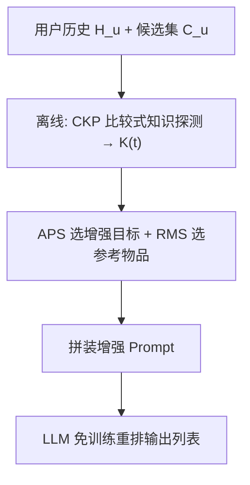

# Filling the Gaps: Selective Knowledge Augmentation for LLM Recommenders (填补知识缺口：面向 LLM 推荐器的选择性知识增强)

- **会议/期刊**: SIGIR 2026 (Full Paper)
- **作者与机构**: Jaehyun Lee, Sanghwan Jang, SeongKu Kang, Hwanjo Yu (POSTECH / Korea University)
- **推荐链路定位**: 重排 (LLM 作为 Training-Free Ranker，对候选集做列表排序)
- **研究方向**: 大语言模型推荐 / 冷启动与长尾推荐
- **论文原文**: [https://arxiv.org/abs/2604.07825v2](https://arxiv.org/abs/2604.07825v2)
- **开源代码**: [https://github.com/nowhyun/KnowSA](https://github.com/nowhyun/KnowSA)

## TL;DR (1分钟核心速览)

LLM 免训练推荐器存在"知识缺口"：预训练曝光不均导致对长尾物品的协同关系掌握薄弱，而现有做法对所有物品无差别追加元数据（Uniform Augmentation），既浪费上下文预算又干扰推理。本文提出 KnowSA_CKP：用"比较式知识探测"（CKP）离线量化 LLM 对每个物品的协同知识，再按 APS 优先级只对知识贫乏物品注入属性与参考物品标题。在 4 个数据集、5 个 LLM 上，Random 候选下 Recall@1 相对提升 5.5%–23.6%，且输入 token 开销远低于 Uniform。

## Background & Motivation (背景与核心矛盾)

- **主流范式**: 两阶段推荐中，LLM 作为免训练重排器，通过 prompt 注入物品标题/属性/外部知识来弥补参数知识不足（prompt-level augmentation）。
- **前人局限**: ① 现有方法采用 **Uniform Augmentation**，对所有物品无差别追加信息——图 1 显示在 4 个数据集中有 3 个反而掉点，长上下文稀释了关键信号；② 通用领域的知识代理（Popularity、Min-K%、EigValLaplacian、SeaKR）只衡量"物品是什么"的**语义熟悉度**，无法刻画"用户历史与目标物品的**协同共现关系**"，与 Recall@1 的 Spearman 相关性极弱（图 2a）。
- **核心洞察 (Key Insight)**: 知识缺口不是流行度缺口——同等流行度物品的协同上下文丰富度差异巨大；且 LLM 在单 prompt 内同时诊断多达 70 个物品的知识状态是不可靠的（GPT-4o 自问自答反而 -5.1%）。
- **本文切入点**: 把知识估计**离线化 + 比较化**：让 LLM 在给定交互窗口下从候选集中选出 top-1，用该选择的似然作为知识分数，从而对齐推荐的排序本质并消除表层 token 偏置。

## Method (核心方法设计)

### 1. 整体框架 (Overall Architecture)

KnowSA_CKP 分两阶段闭环：**离线知识打分**——对每个物品 $t$从其交互历史中按流行度分层采样上下文窗口$\tilde{W}_t$，构造含随机干扰项与语义干扰项的比较集$C(t)$，用内容中性标识符（[A]/[B]）提示 LLM 选 top-1，聚合选择似然得$K(t)$；**在线选择性增强**——用 APS 选出 top-$K_{aug}$个最需补知识的物品，为其追加文本属性，并用 RMS 匹配 top-$K_{ref}$ 个"LLM 已懂且语义/行为相关"的参考物品标题作为激活锚点，最后拼装 prompt 交由 LLM 输出候选排序。所有分数离线预计算，在线仅查表。

### 2. 关键设计拆解 (Key Designs)

1. **比较式知识探测 CKP（替代逐物品似然 DKP）**：DKP 直接算标题 token 似然，受词汇偏置与长度偏置污染，且与排序任务不对齐。CKP 构造 $C(t)=\{t\}\cup C_{rand}\cup C_{sem}$（$n$个均匀随机 +$m$ 个 SBERT 语义近邻作 hard negative），打乱顺序并赋中性 ID，用 list-wise 选择似然打分：
$$P_{\text{LLM}}(t|P_w^{CKP})=\frac{\phi(z_t)}{\phi(z_t)+\sum_{j\in C(t)\setminus\{t\}}\phi(z_j)},\quad K(t)=\frac{1}{|\tilde{W}_t|}\sum_{w\in\tilde{W}_t}P_{\text{LLM}}(t|P_w^{CKP})$$
直觉：语义干扰项逼迫模型"只有在真正具备判别知识时才把概率集中到目标上"，中性 ID 剥离表层偏置，top-1 而非全排序避免了自回归位置导致的概率虚高。

2. **增强优先级 APS 与参考匹配 RMS**：并非所有知识贫乏物品都同等重要，APS 融合三因子：
$$\text{APS}(i)=(1-k(i))\cdot f(i)\cdot r(i),\quad r(i)=\exp(-\lambda\cdot\text{pos}(i))$$
即知识亏缺 × 交互频次 × 时间近因性，保证长历史（如 ML-1M 平均 161.8）下预算花在刀刃上。RMS 则为目标 $t$ 挑参考物品：
$$\text{RMS}(t,r)=k(r)\cdot s(t,r)\cdot c(t,r)$$
要求参考物品"LLM 已懂（$k(r)$高）× 语义相似 × 协同共现高"，且只注入其**标题**而非全文——利用 LLM 已有参数知识做低成本激活。上下文感知变体再乘 SASRec 的$\cos(h_u,e_r)$ 做个性化。

3. **训练目标、负采样与推理效率**：全程**无微调、无对比损失**，仅前向似然计算。离线打分用流行度三分位分层采样，ML-1M 上仅需 1% 窗口即达 101.9× 加速（表 7）。在线相比 Uniform-Meta，Steam 上 token 开销从 +414.3% 降至 +99.0%，延迟仅 +4.1%。

## Experimental Setup & Evaluation Protocol (实验设置与评估协议)

- **数据集与预处理**（均 `5-core` 过滤并剔除缺失文本特征物品）：

| 数据集 | #Users | #Items | #Interactions | 平均序列长 | 特征/场景说明 |
| :--- | :---: | :---: | :---: | :---: | :--- |
| A-Beauty | 4,884 | 3,948 | 16,973 | 3.50 | 美妆，title+brand |
| A-Gift | 3,392 | 834 | 13,503 | 4.01 | 礼品卡，title+brand+category |
| ML-1M | 6,040 | 3,416 | 999,611 | 161.85 | 电影，title+genre |
| Steam | 25,859 | 4,038 | 327,097 | 12.93 | 游戏，title+genre+developer+specs |

- **数据划分与防穿越**: 标准 `Leave-One-Out`，每用户最后一项为测试目标；每数据集随机抽 1,500 用户测试，其余按 9:1 划分训练/验证（供 SASRec 训练、知识打分与调参）；历史截断至最近 50 项。
- **排名评测协议**: `Sampled Ranking`，候选集固定 20 项（1 正 + 19 负），两种负采样——**Random (R)** 均匀采样未见物品、**SASRec (S)** 取 SASRec top-19 预测作难负例；指标为 LLM 排序列表的 Recall@1。
- **对比基线与超参**: 基线三组——No Augment、Uniform-Meta/Uniform-Wiki、以及基于 5 种代理的选择性增强（Pop / MinK / EigV / SeaKR / Acc / Self）。LLM 覆盖 Llama-3.1-8B、Mistral-7B、Qwen2.5-7B/32B、GPT-4o；SASRec 维度 $\{64,128\}$，$n,m\in\{0,1,2\}$，$\lambda\in\{0.7,0.4,0.1\}$，$K_{aug}\in\{2,\dots,40\}$，$K_{ref}\in\{1,2,3\}$。

## Key Experimental Results (实验关键数据)

### 1. 主实验对比 (Main Results)

Recall@1（R = Random 候选 / S = SASRec 候选），节选代表性配置：

| 数据集-LLM | No Aug (R/S) | Uniform-Meta (R/S) | Selective-Pop (R/S) | Selective-SeaKR (R/S) | **KnowSA_CKP (R/S)** | Improv.% (R/S) |
| :--- | :---: | :---: | :---: | :---: | :---: | :---: |
| A-Beauty / Qwen-7B | 0.170 / 0.111 | 0.207 / 0.099 | 0.199 / 0.141 | 0.128 / 0.091 | **0.267 / 0.166** | +23.6 / +10.7 |
| A-Beauty / Qwen-32B | 0.295 / 0.218 | 0.293 / 0.213 | 0.361 / 0.221 | 0.271 / 0.216 | **0.407 / 0.257** | +12.7 / +8.4 |
| A-Gift / Llama-8B | 0.062 / 0.044 | 0.063 / 0.048 | 0.157 / 0.100 | 0.074 / 0.046 | **0.167 / 0.110** | +6.4 / +10.0 |
| ML-1M / Qwen-7B | 0.139 / 0.039 | 0.132 / 0.065 | 0.140 / 0.058 | 0.143 / 0.021 | **0.168 / 0.070** | +9.1 / +7.7 |
| Steam / Qwen-32B | 0.121 / 0.035 | 0.073 / 0.044 | 0.126 / 0.043 | 0.101 / 0.045 | **0.150 / 0.053** | +19.0 / +12.8 |
| Steam / Llama-8B | 0.078 / 0.042 | 0.063 / 0.041 | 0.095 / 0.066 | 0.097 / 0.048 | **0.152 / 0.072** | +7.8 / +9.1 |

### 2. 消融实验 (Ablation Study)

Qwen-7B + Random 候选，Recall@1：

| 变体 | A-Beauty | A-Gift | ML-1M |
| :--- | :---: | :---: | :---: |
| **KnowSA_CKP (full)** | **0.267** | **0.112** | **0.168** |
| w/o Relative Comparison (退化为 DKP) | 0.214 | 0.081 | 0.139 |
| w/o Semantic Distractors | 0.219 | 0.110 | 0.151 |
| w/o APS (Uniform + ref items) | 0.194 | 0.072 | 0.087 |
| w/o APS 中 Knowledge Score | 0.213 | 0.095 | 0.151 |
| w/o APS 中 Recency Score | 0.225 | 0.110 | 0.160 |
| w/o RMS (仅文本属性) | 0.223 | 0.087 | 0.123 |
| w/o RMS 中 Co-consumption | 0.169 | 0.109 | 0.135 |
| w/o RMS 中 Knowledge Score | 0.188 | 0.095 | 0.146 |

### 3. 关键实验发现 (Key Findings)

1. **比较式探测是最大增益源**：去掉相对比较（退化为 DKP）在 A-Beauty 上从 0.267 掉到 0.214（-19.9%），远超去掉语义干扰项的 0.219，说明"排序对齐 + 中性 ID"比"难负例构造"更关键；而 Uniform-Meta 在 ML-1M/Steam 上甚至低于 No Augment（0.132 vs 0.139；0.073 vs 0.121），实证了无差别增强的负效应。
2. **APS 的价值随历史长度放大**：ML-1M（平均 161.8 项历史）上去掉 APS 暴跌至 0.087（-48.2%），而 A-Gift（平均 4.0 项）仅降至 0.072；说明长上下文下"增强谁"的优先级排序是刚需，短序列场景则相对不敏感。
3. **增强不是"提权"而是"澄清"**：增强目标在 top-1 中的出现频次从 393 降至 375（A-Beauty/Qwen-7B），同时 LTC@10 长尾覆盖率优于 Uniform，证明模型是在获得判别力后**主动拒绝**不合适的候选，而非被额外信息诱导偏好；GPT-4o 自问自答 -5.1% 与 Qwen-32B+KnowSA_CKP +38.0% 的对比进一步说明离线打分不可被在线自省替代。

## Highlights & Limitations (亮点、对比与审稿批判)

- **与代表作对比 (vs. Prior Work)**: 相比 Uniform-Meta/Wiki（如 LLMRec 类工作）的无差别注入，本文首次把"增强预算分配"形式化为可离线计算的知识缺口估计问题；相比 SeaKR/EigValLaplacian 等 Adaptive RAG 代理，CKP 从"物品语义熟悉度"转向"用户历史条件下的协同判别力"，是任务对齐的本质差异；相比 LLM 微调路线（TALLRec 等），保持零训练、可插拔。
- **可迁移亮点**: ① "中性 ID + top-1 选择似然"是消除 token 级表层偏置的通用探针技巧，可直接用于 LLM 的 item 难度估计、课程采样或蒸馏样本加权；② "只注入参考物品标题而非全文"的锚点激活思路，可迁移到任何受上下文预算约束的 RAG 式推荐 prompt。
- **审稿级局限批判**: ① 评测仅用 20 候选的 Sampled Ranking 与 Recall@1，未报告 Full-Ranking 或 NDCG@10，绝对数值偏低且对负采样分布敏感；② 离线 CKP 需对每个物品的多个窗口做前向推理，物品库达百万级时预计算成本与存储仍是瓶颈（论文仅验证 4K 量级物品），且 $K_{aug}$、$\lambda$ 对上下文预算较敏感。

## Rating (四维评分)

- **方法创新性 (Novelty)**: ⭐⭐⭐⭐ （核心机制与方法设计具备明确创新性，理论与实验动机支撑充分）
- **评估协议与实验扎实度 (Protocol & Experiments)**: ⭐⭐⭐⭐ （主流公开数据集评测完整，包含多基线对比与消融实验验证）
- **写作与数学规范度 (Clarity & Rigor)**: ⭐⭐⭐⭐⭐ （问题形式化定义清晰，核心模块数学推导与架构阐述严谨易读）
- **工业落地与复现价值 (Industrial & Practical Value)**: ⭐⭐⭐⭐ （兼顾推荐效果增益与训练/推理效率，具备实际场景迁移参考价值）
