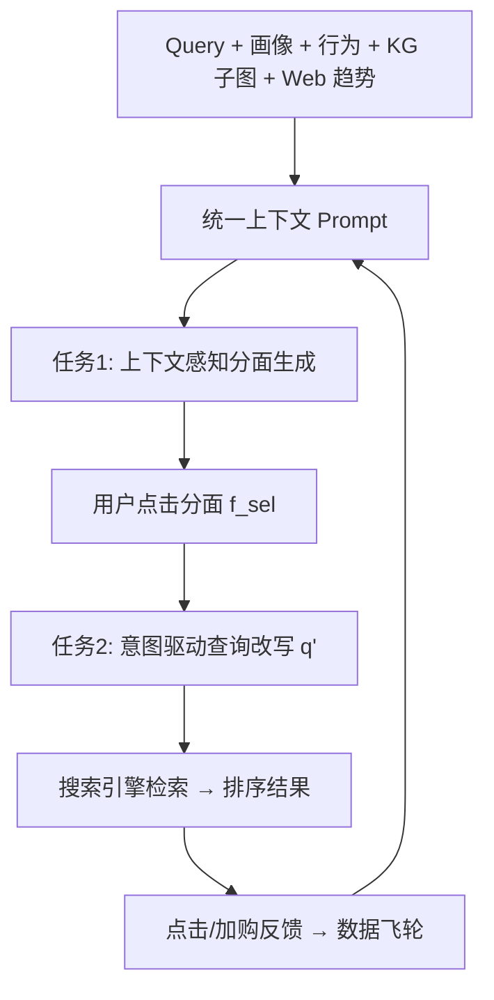
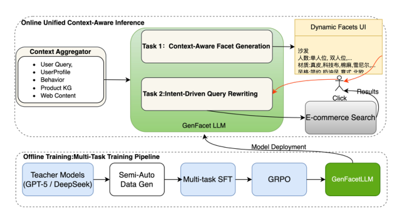

# GenFacet: End-to-End Generative Faceted Search via Multi-Task Preference Alignment in E-Commerce (面向电商多任务偏好对齐的端到端生成式分面搜索)

- **会议/期刊**: SIGIR 2026
- **作者与机构**: Zhouwei Zhai, Min Yang, Jin Li（京东 JD.com）
- **推荐链路定位**: 重排 / 交互式检索闭环（分面生成 + 查询改写）
- **研究方向**: 大语言模型推荐 / 对话推荐与智能体仿真
- **论文原文**: [https://arxiv.org/abs/2603.19665v1](https://arxiv.org/abs/2603.19665v1)
- **开源代码**: 暂未开源

## TL;DR (1分钟核心速览)

传统电商分面搜索依赖静态规则抽取或统计排序，存在时效性差、词汇鸿沟、分面选择与底层检索脱节三大痛点。GenFacet 把分面搜索重构为单一 LLM 内的两个耦合生成任务——上下文感知分面生成与意图驱动查询改写，并用「教师蒸馏 → 多任务 SFT → GRPO 偏好对齐」三阶段流水线直接优化下游搜索效用。在京东 5000 条人工标注会话上，P@10 达 0.920、nDCG@10 相对规则基线提升 15.1%；线上 A/B 分面 CTR 相对提升 42.0%、UCVR 提升 2.0%。

## Background & Motivation (背景与核心矛盾)

- **主流范式**: 分面搜索主流做法分两支——基于规则/外部知识库（WordNet、Wikipedia）的静态属性抽取，以及 DFDRF 这类基于 Gini 系数与历史交互信号的统计动态排序。
- **前人局限**: 其一，静态词典无法捕捉「多巴胺穿搭」这类新兴趋势与长尾隐式属性，过滤选项滞后于用户认知；其二，用户口语化 query 与系统结构化属性之间存在持久词汇鸿沟，ShopTalk 的 intent operator 仍依赖昂贵的人工映射规则。
- **前人局限（架构层）**: 传统「召回-分面生成-排序」三段式存在严重级联误差，用户点击分面这一显式反馈无法回传到底层检索模型，个性化工作只关心「展示哪些分面」而忽略后续检索逻辑。
- **核心洞察 (Key Insight)**: 分面点击本质是显式相关性反馈信号，若把「选分面」翻译成「改写 query」而非布尔过滤，就能让精化意图真正进入检索链路，避免长尾 query 的零召回。
- **本文切入点**: 用同一个 LLM 的共享语义空间同时承载分面生成与查询改写，并以 GRPO 把不可微的「搜索效用」直接写进奖励函数。

## Method (核心方法设计)

### 1. 整体框架 (Overall Architecture)

GenFacet 将分面搜索形式化为条件生成问题：学习参数化策略 $\pi_\theta$，任务一将$(q,\mathcal{C})$映射为动态分面列表$\mathcal{F}=\{f_1,\dots,f_k\}$，任务二将用户选中的$f_{sel}$映射回最大化下游效用的改写 query$q'$。上下文$\mathcal{C}$聚合原始 query、用户画像$u_{prof}$、会话点击/加购行为$u_{beh}$、商品知识图谱子图$\mathcal{G}$与实时 Web 趋势$\mathcal{W}$，序列化为结构化 prompt 驱动统一 LLM 推理。用户点击分面后触发改写，$q'$ 交由底层搜索引擎执行，从而闭合「属性选择—文档检索」回路。训练侧采用三阶段流水线：教师蒸馏构建冷启动数据、多任务 SFT 建立共享语义空间、GRPO 对齐搜索满意度。

<figure class="paper-figure" markdown="span">
  <figcaption>图1：GenFacet 概览</figcaption>
</figure>

### 2. 关键设计拆解 (Key Designs)

1. **上下文感知分面生成（Context-Aware Facet Generation）**：针对静态词典无法覆盖新兴趋势的问题，把多模态上下文序列化为模板 $T_{gen}$后做自回归生成，$P(\mathcal{F}|q,\mathcal{C})=\prod_{t=1}^{T}P(y_t|y_{<t},T_{gen}(q,u_{prof},u_{beh},\mathcal{G},\mathcal{W});\theta)$。关键在于引入实时 Web 检索（Baidu Search API）注入趋势词，使生成超越静态索引、捕捉隐式长尾需求，同时以 JSON 结构化输出约束可解析性。

2. **意图驱动查询改写（Intent-Driven Query Rewriting）**：针对布尔过滤在长尾 query 上零召回的问题，把分面点击视为显式相关性反馈，构造改写上下文 $x_{rw}$后生成$q'=\arg\max_{q^*}P(q^*|q,f_{sel},H_{click};\theta)$。与既有工作只对静态候选集做过滤不同，本文更新的是检索 query 本身，使 top 结果动态对齐精化意图，从根本上提升高维复杂需求的召回。

3. **三阶段训练与 GRPO 对齐**：SFT 阶段最小化联合负对数似然 $\mathcal{L}_{SFT}=\mathbb{E}_{\mathcal{D}_{distill}}[-\log P(\mathcal{F}|x_{ctx})-\lambda\log P(q'|x_{rw})]$，把两个任务嵌入共享语义空间。由于「搜索效用」不可微，第三阶段用 GRPO 去掉 value model、以组内归一化优势估计基线：$\mathcal{J}(\theta)=\mathbb{E}\big[\frac{1}{G}\sum_{i=1}^{G}\frac{\pi_\theta(o_i|q)}{\pi_{\theta_{old}}(o_i|q)}\hat{A}_i\big]-\beta D_{KL}(\pi_\theta\|\pi_{ref})$，其中$\hat{A}_i$由$R_{facet}$（分面覆盖率与预测 CTR）与$R_{query}$（伪搜索环境下的召回与语义相关性）之和归一化得到。免负采样、组内相对比较，显著降低 RL 训练开销。

## Experimental Setup & Evaluation Protocol (实验设置与评估协议)

- **数据集与预处理**: 自建 JD-Facet，源自京东脱敏搜索日志，含 5,000 条搜索会话、覆盖多品类；每条会话由领域专家标注「理想分面列表」及分面选择后检索商品的相关性分数作为 ground truth。蒸馏数据另采样 50k 真实流量实例，由 GPT-5 与 DeepSeek-R1 经 CoT 生成并经人工校验。

| 数据集 | #Sessions | 标注内容 | 场景说明 |
| :--- | :---: | :---: | :--- |
| JD-Facet | 5,000 | 理想分面列表 + 检索相关性 | 京东多品类搜索会话 |
| $\mathcal{D}_{distill}$ | 50,000 | 教师生成 + 人工校验 | 冷启动蒸馏语料 |

- **数据划分与防穿越 (Splitting Strategy)**: 原文未明确披露训练/验证/测试比例与切分方式，仅说明离线评估基于 JD-Facet 专家标注，属该工业论文的评估透明度短板。
- **排名评测协议 (Ranking Protocol)**: 分面质量用 P@10 / R@10；检索效果用 nDCG@10，覆盖「生成→交互→改写→检索」完整闭环，而非单点打分。
- **对比基线与超参设置**: 三类基线——规则式生产系统（静态 Category-Attribute KG）、DFDRF（Gini 系数动态排序）、Qwen3-4B Zero-shot（无领域微调）。学生模型为 Qwen3-4B 骨干，INT8 量化 + 投机解码 + KV-cache 优化；线上 A/B 取 10% 流量、为期两周，显著性 $p<0.05$。

## Key Experimental Results (实验关键数据)

### 1. 主实验对比 (Main Results)

| 方法 | P@10 | R@10 | nDCG@10 |
| :--- | :---: | :---: | :---: |
| Rule-based (Production) | 0.852 | 0.584 | 0.680 |
| DFDRF | 0.795 | 0.642 | 0.705 |
| Qwen3-4B (0-shot) | 0.631 | 0.715 | 0.612 |
| **GenFacet** | **0.920** | **0.847** | **0.783** |
| Improv. vs. Production | +7.9% | +45.0% | +15.1% |

### 2. 消融实验 (Ablation Study)

| 变体 | P@10 | R@10 | nDCG@10 |
| :--- | :---: | :---: | :---: |
| w/o GRPO | 0.895 | 0.812 | 0.741 |
| w/o Multi-task SFT | 0.764 | 0.730 | 0.695 |
| w/o Query Rewriting | 0.918 | 0.845 | 0.712 |
| Full GenFacet | 0.920 | 0.847 | 0.783 |

### 3. 关键实验发现 (Key Findings)

1. **GRPO 的收益几乎全部落在检索端而非分面端**：去掉 GRPO 后 P@10 仅从 0.920 降至 0.895，但 nDCG@10 从 0.783 骤降至 0.741（-5.4%），说明 RL 对齐的价值在于让生成概率与「能带来好商品」的效用耦合，而非单纯提升分面文本质量。
2. **查询改写是检索链路的第一瓶颈**：以布尔过滤替代改写后 nDCG@10 跌至 0.712，是三个消融中检索指标最差的一项，直接印证「用户选择与索引词之间的语义鸿沟」比「展示什么分面」更致命。
3. **多任务共享语义空间不可拆**：独立训练两任务使 P@10 崩至 0.764、nDCG@10 跌至 0.695，甚至低于 DFDRF 的 0.705，说明分面生成与查询改写的联合建模是框架成立的前提而非锦上添花。

## Highlights & Limitations (亮点、对比与审稿批判)

- **与代表作对比 (vs. Prior Work)**: 相比 Rule-based 与 DFDRF，本文把「分面」从静态分类/排序对象升级为生成式交互接口，并以改写替代布尔过滤闭合检索回路；相比 Qwen3-4B Zero-shot，SFT 把模型锚定在真实商品空间，P@10 从 0.631 拉回 0.920，抑制了库存无关的幻觉；相比 ShopTalk 的人工 intent operator，本文以蒸馏+RL 实现自动化泛化。
- **可迁移亮点**: 其一，「把用户点击分面视为显式反馈并翻译为 query 改写」这一范式可迁移到任何筛选式交互场景（如招聘、房产、本地生活）；其二，用伪搜索环境构造可执行奖励 $R_{query}$ 来训练不可微检索指标，是 LLM4Rec 中 RL 对齐的通用技巧。
- **审稿级局限批判**: 其一，离线评估仅 5,000 条会话、单一平台自建数据，且未披露训练/测试切分与显著性检验细节，基线也仅 3 个、缺少同规模 LLM 微调对照，外部效度存疑；其二，线上收益（CTR +42.0%）主要来自分面曝光形态变化，UCVR 仅 +2.0%，且 400ms 分面生成 + 180ms 改写的延迟依赖双 H800 与量化/投机解码，中小平台复现成本高。

## Rating (四维评分)

- **方法创新性 (Novelty)**: ⭐⭐⭐⭐ （首个把分面搜索统一为双生成任务并用 GRPO 对齐搜索效用的端到端框架，思路清晰但组件均为已有技术的巧妙组合）
- **评估协议与实验扎实度 (Protocol & Experiments)**: ⭐⭐⭐ （有线上 A/B 与闭环 nDCG 是加分项，但离线数据规模小、切分与显著性细节缺失、基线偏少）
- **写作与数学规范度 (Clarity & Rigor)**: ⭐⭐⭐⭐ （问题形式化与三阶段流水线叙述清楚，公式简洁；但奖励函数仅文字描述、缺具体定义与权重设置）
- **工业落地与复现价值 (Industrial & Practical Value)**: ⭐⭐⭐⭐ （京东全量部署、延迟与数据飞轮细节详实，工程参考价值高；但未开源，复现门槛较高）

