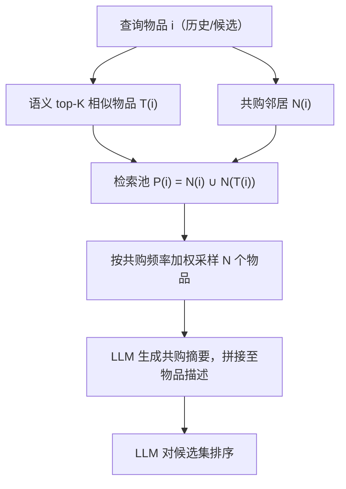
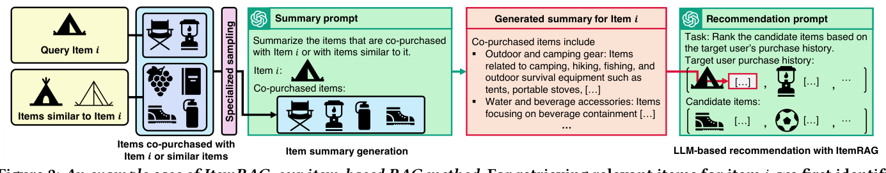

# ItemRAG: Item-Based Retrieval-Augmented Generation for LLM-Based Recommendation (基于物品级检索增强生成的 LLM 推荐)

- **会议/期刊**: SIGIR 2026 (short paper)
- **作者与机构**: Sunwoo Kim, Geon Lee, Kyungho Kim, Jaemin Yoo, Kijung Shin (KAIST / Seoul National University)
- **推荐链路定位**: 重排（LLM 对候选集排序）
- **研究方向**: 大语言模型推荐 / 冷启动与长尾推荐
- **论文原文**: [https://arxiv.org/abs/2511.15141v2](https://arxiv.org/abs/2511.15141v2)
- **开源代码**: [https://github.com/kswoo97/ItemRAG](https://github.com/kswoo97/ItemRAG)

## TL;DR (1分钟核心速览)

现有 LLM 推荐的 RAG 几乎都是"用户级检索"——找相似用户、拼其购买历史，但单个用户兴趣发散，检索到的历史噪声大、且与候选物品无显式关联。本文提出 ItemRAG，把检索粒度下沉到**物品级**：对用户历史中每个物品与每个候选物品，检索其共购邻居并生成摘要注入 prompt。关键设计是用共购频率加权采样替代纯语义相似检索，并用"相似物品的共购邻居"补足冷启动物品。在 Amazon 四域、Leave-One-Out + 10 候选排序协议下，ItemRAG 在 20 个指标中 18 个最优，Hit@1 较最强用户级 RAG 基线 CoRAL 最高提升 11%（Toys），冷启动场景全部指标领先。

## Background & Motivation (背景与核心矛盾)

- **主流范式**: 给定目标用户购买历史与候选集，用 LLM 直接排序；为弥补 LLM 缺乏协同信号，主流做法是 RAG——检索相似用户的历史（ICL / AdaptRec / ReACT / CoRAL）拼入 prompt。
- **前人局限**: ① 用户级检索是粗粒度的，单个用户兴趣多元，检索到的历史只有一小部分与目标用户相关，噪声占比高；② 检索过程完全不条件化于候选物品，即使历史中隐含相关信息也未被显式利用。
- **核心洞察 (Key Insight)**: 推荐的本质证据是"物品—物品"的共购关联，而非"用户—用户"的相似性；且纯语义相似检索（NLP 常规做法）在推荐上增益有限（图 1 中 semantics-only 版本几乎打不过 CoRAL）。
- **本文切入点**: 把 RAG 的检索单元从 user 换成 item，对历史物品与候选物品逐一做共购感知的邻居检索与摘要增强。

## Method (核心方法设计)

### 1. 整体框架 (Overall Architecture)

对每个"查询物品" $i$（既包括目标用户历史中的物品，也包括每个候选物品），先取文本语义最相似的 top-$K$物品集合$\mathcal{T}(i)$，再构造检索池$\mathcal{P}(i)$=$i$自身的共购邻居 ∪ 相似物品的共购邻居；随后按共购频率加权概率从池中采样$N$个物品，交给 LLM 生成一段"共购模式摘要"，拼接到物品$i$ 的原始描述之后。最终推荐 prompt 由增强后的历史物品描述、增强后的候选物品描述与排序指令组成。由于摘要只依赖物品本身、与目标用户无关，可离线预计算并跨用户复用。

<figure class="paper-figure" markdown="span">
  <figcaption>图 2：我们的基于物品的 RAG 方法 ItemRAG 的一个示例。为物品 𝑖 检索相关物品时，我们首先识别与（1）物品 𝑖 本身和/或（2）文本描述与物品 𝑖 相似的物品共同购买的物品。然后，我们从该池中采样指定数量的物品，选择概率与其和物品 𝑖 的共同购买频率成正比。随后，我们提示 LLM 生成所采样物品的摘要，并将该摘要纳入最终推荐提示中，引导 LLM 理解 i 之间的共同购买模式</figcaption>
</figure>

### 2. 关键设计拆解 (Key Designs)

1. **相似物品扩展的检索池（破解冷启动 C1）**：纯共购检索对无共购记录的冷启动物品直接失效。本文引入语义近邻的共购邻居作为补充：
$$\mathcal{P}(i)=\mathcal{N}(i)\cup\{j:\exists q\in\mathcal{T}(i),\ j\in\mathcal{N}(q)\}$$
直觉是语义相近的物品往往共享共购模式，从而为冷启动物品"借"到协同证据。这是全文对冷启动增益的最大贡献来源（消融中 `w/o sim-items` 在冷启动下退化最明显）。

2. **共购频率加权采样（破解弱相关噪声 C2）**：池中大量物品只是偶然共购，全量注入会稀释信号。本文定义采样权重为自身共购频率与"相似物品—该物品"平均共购频率的混合：
$$w_{ij}=c_{ij}+\frac{1}{|\mathcal{T}(i)|}\sum_{q\in\mathcal{T}(i)}c_{qj}$$
并按 $w_{ij}/\sum_{q\in\mathcal{P}(i)}w_{iq}$采样$N$ 个物品。高频共购意味着稳定偏好关联而非偶发搭配，加权采样相当于一个无需训练的软硬负样本过滤器。

3. **训练目标、负采样与推理效率**：本方法**无参数训练**，无损失函数与负采样，全部依赖冻结 LLM（GPT-4.1-mini）的 zero-shot 排序能力；超参为每物品 5 个语义近邻、最终采样 50 个物品。推理开销主要来自 prompt 变长（作者自承这是主要局限），但摘要可离线缓存、与用户解耦，边际成本可控。

## Experimental Setup & Evaluation Protocol (实验设置与评估协议)

- **数据集与预处理**: Amazon Reviews 最新版四个域，按前人工作做过滤（细节在附录）：

| 数据集 | 域 | 说明 |
| :--- | :---: | :--- |
| Beauty | Beauty & Personal Care | 美妆个护 |
| Toys | Toys & Games | 玩具游戏 |
| Sports | Sports & Outdoors | 运动户外 |
| Arts | Arts, Crafts & Sewing | 手工艺 |

- **数据划分与防穿越 (Splitting Strategy)**: `Leave-One-Out`——每用户最后一件购买作测试，其余为输入；检索库与训练数据均剔除测试交互。
- **排名评测协议 (Ranking Protocol)**: `Sampled Ranking`，每用户 1 正例 + 9 随机负例共 10 候选，由 LLM 排序；报告 H@1/3/5 与 N@3/5，每实验跑 3 次取均值，并用 Wilcoxon 符号秩检验（$p<0.05$）标注显著性。测试用户随机采样 1,000 名。
- **对比基线与超参设置**: 9 个基线——图模型 LightGCN / LightGCN++，序列模型 SASRec / BERT4Rec，zero-shot LLM，以及 4 个用户级 RAG（ICL / AdaptRec / ReACT / CoRAL）。LLM 主干统一 GPT-4.1-mini。

## Key Experimental Results (实验关键数据)

### 1. 主实验对比 (Main Results)

标准设定下（节选 H@1 与 N@5，×100）：

| 方法 | Beauty H@1 | Beauty N@5 | Toys H@1 | Toys N@5 | Sports H@1 | Sports N@5 | Arts H@1 | Arts N@5 |
| :--- | :---: | :---: | :---: | :---: | :---: | :---: | :---: | :---: |
| LightGCN++ | 38.3 | 59.7 | 42.2 | 63.1 | 46.0 | 65.9 | 53.0 | 72.2 |
| SASRec | 35.2 | 57.5 | 32.4 | 54.6 | 44.0 | 63.3 | 47.4 | 69.6 |
| BERT4Rec | 36.1 | 57.7 | 32.0 | 55.5 | 44.2 | 65.3 | 48.2 | 69.9 |
| Zero-shot | 34.6 | 54.2 | 39.3 | 58.5 | 43.4 | 62.9 | 45.7 | 65.6 |
| ICL | 37.7 | 57.5 | 41.3 | 61.1 | 46.4 | 65.7 | 46.3 | 67.8 |
| ReACT | 34.4 | 54.2 | 38.5 | 57.8 | 44.7 | 64.4 | 46.9 | 66.4 |
| CoRAL | 46.5 | 65.0 | 44.6 | 64.0 | 48.5 | 68.3 | 52.4 | 73.3 |
| **ItemRAG** | **49.1** | **66.9** | **49.5** | **68.1** | **51.6** | **70.3** | **57.8** | **76.1** |
| Improv. vs CoRAL | +5.6% | +2.9% | **+11.0%** | +6.4% | +6.4% | +2.9% | +10.3% | +3.8% |

冷启动设定（移除测试物品全部交互后，仅比较 LLM 类方法）：

| 方法 | Beauty H@1 | Toys H@1 | Sports H@1 | Arts H@1 |
| :--- | :---: | :---: | :---: | :---: |
| Zero-shot | 34.6 | 39.3 | 43.4 | 45.7 |
| ICL | 37.1 | 40.5 | 45.6 | 45.0 |
| AdaptRec | 37.0 | 38.2 | 45.2 | 49.5 |
| ReACT | 35.3 | 39.0 | 42.9 | 47.2 |
| CoRAL | 38.5 | 39.0 | 45.0 | 46.4 |
| **ItemRAG** | **47.7** | **48.7** | **51.3** | **57.9** |

### 2. 消融实验 (Ablation Study)

| 变体 | Beauty H@1 | Toys H@1 | Sports H@1 | Arts H@1 | 说明 |
| :--- | :---: | :---: | :---: | :---: | :--- |
| w/o cand-aug | 36.9 | 42.1 | 44.8 | 47.3 | 不增强候选物品描述 |
| w/o co-purch | 46.1 | 46.4 | 50.6 | 54.6 | 仅用语义相似检索 |
| w/o sim-items | 47.5 | 49.8 | 50.2 | 56.0 | 仅用自身共购邻居 |
| w/o co-freq | 47.7 | 48.1 | 50.7 | 56.2 | 均匀采样替代频率加权 |
| **ItemRAG** | **49.1** | **49.5** | **51.6** | **57.8** | — |

### 3. 关键实验发现 (Key Findings)

1. **候选物品增强是最大增益源**：`w/o cand-aug` 在 Beauty 上 H@1 从 49.1 暴跌至 36.9（−12.2），甚至低于 zero-shot，说明"对候选物品做条件化检索"才是本文相对用户级 RAG 的本质差异，而非单纯换检索粒度。
2. **共购信号不可被语义替代**：`w/o co-purch`（纯语义检索）在 Toys 上 H@1 仅 46.4，比完整模型低 3.1，且与 CoRAL 的 44.6 差距很小——印证了图 1 的动机观察，即语义相似 ≠ 推荐相关。
3. **冷启动鲁棒性来自相似物品扩展**：冷启动设定下 ItemRAG 平均仅比标准设定下降约 1%，而 `w/o sim-items` 在 Arts 上 H@1 掉到 56.0（−1.8），说明"借相似物品的共购邻居"是冷启动场景的关键补丁；同时频率加权采样（`w/o co-freq`）在各域稳定贡献 0.5–1.5 个点，验证了噪声过滤的必要性。

## Highlights & Limitations (亮点、对比与审稿批判)

- **与代表作对比 (vs. Prior Work)**: 与 CoRAL 等同为用户级检索，靠相似用户历史做长尾增强，粒度粗且与候选无关；与纯语义 item-RAG 相比，本文用共购频率把"语义相似"升级为"推荐相关"，并用加权采样抑制偶发共购噪声。本质区别在于**检索的条件变量从 user 换成了 candidate item**。
- **可迁移亮点**: ① "语义近邻的共购邻居"这一池扩展技巧可直接迁移到任何图稀疏/冷启动物品的协同增强；② 物品级摘要与用户解耦、可离线缓存，是 LLM 推荐降本的标准工程范式。
- **审稿级局限批判**: ① 无训练、纯 prompt 方案，性能强依赖 GPT-4.1-mini 的指令遵循能力，换小模型是否成立未知；② 评测仅 10 候选的采样排序，未报告全库 Full-Ranking，且冷启动设定是人为移除交互构造的，与真实上新分布存在偏差；③ 作者自承 prompt 变长带来 API 成本与延迟上升，缺少 token 开销的定量分析。

## Rating (四维评分)

- **方法创新性 (Novelty)**: ⭐⭐⭐⭐ （核心机制与方法设计具备明确创新性，理论与实验动机支撑充分）
- **评估协议与实验扎实度 (Protocol & Experiments)**: ⭐⭐⭐⭐ （主流公开数据集评测完整，包含多基线对比与消融实验验证）
- **写作与数学规范度 (Clarity & Rigor)**: ⭐⭐⭐⭐⭐ （问题形式化定义清晰，核心模块数学推导与架构阐述严谨易读）
- **工业落地与复现价值 (Industrial & Practical Value)**: ⭐⭐⭐⭐ （兼顾推荐效果增益与训练/推理效率，具备实际场景迁移参考价值）
