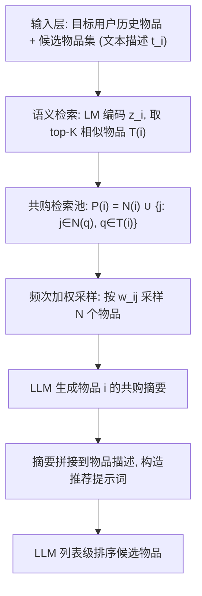
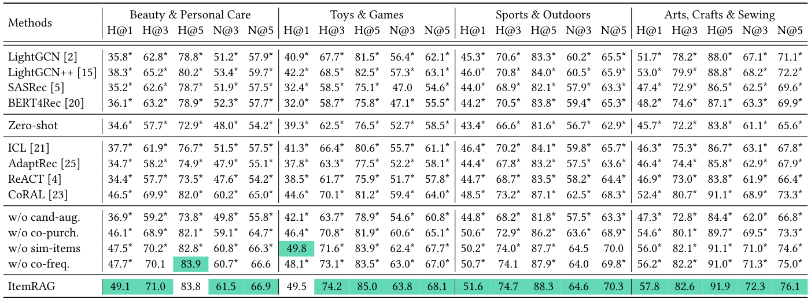
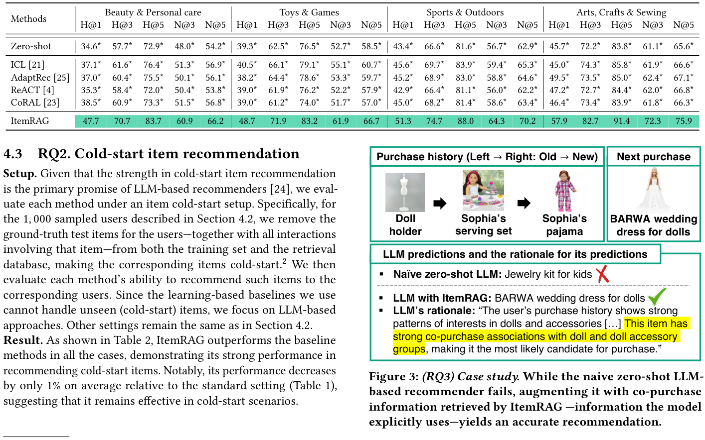
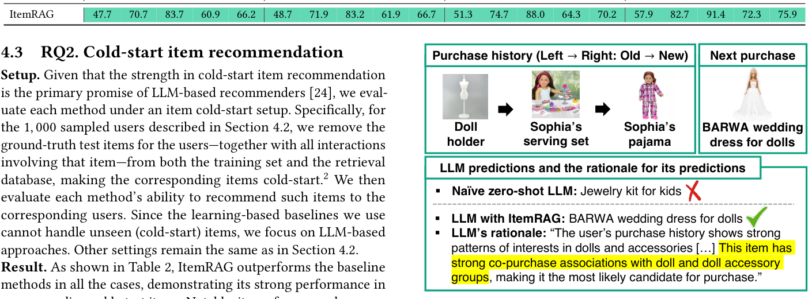

# ItemRAG: Item-Based Retrieval-Augmented Generation for LLM-Based Recommendation (面向 LLM 推荐的物品级检索增强生成)

- **会议/期刊**: SIGIR 2026 (Short Paper)
- **推荐链路定位**: 重排 (Re-ranking) — LLM 对候选集进行列表排序 (Listwise Ranking)
- **研究方向**: 大语言模型推荐 (LLM4Rec) / 冷启动与长尾推荐
- **论文原文**: [https://arxiv.org/abs/2511.15141v2](https://arxiv.org/abs/2511.15141v2)
- **开源代码**: [https://github.com/kswoo97/ItemRAG](https://github.com/kswoo97/ItemRAG)

## TL;DR (核心速览)

针对 LLM 推荐中主流 RAG 采用"用户级检索"引入噪声且不显式对齐候选物品的痛点，本文提出 **ItemRAG**：将检索粒度下沉到物品级，对用户历史物品与候选物品分别检索"共购 + 语义相似"邻居，按共购频次加权采样后由 LLM 生成物品摘要注入提示词。在 4 个 Amazon 域、留一法 + 1 正 9 负候选排序协议下，ItemRAG 在 20 个指标设置中 18 个超越 9 个基线，Hit@1 相对最强用户级 RAG (CoRAL) 最高提升 11%（Toys），冷启动场景 20/20 全胜。

## Background & Motivation (背景与动机)

- **领域背景与主流范式**: LLM 作为推荐器（zero-shot / few-shot 提示）已展现强推理与冷启动处理能力。为弥补 LLM 缺乏协同信号的问题，主流做法是引入 **RAG**：检索与目标用户相似的用户历史，连同目标用户自身历史一起拼入提示词（ICL、AdaptRec、ReACT、CoRAL 等）。
- **现有方法局限 (Limitations of Prior Work)**:
  1. **用户级检索噪声大**：单个用户兴趣多元，检索到的相似用户历史仅部分反映目标用户偏好，大量弱相关信息被注入提示词形成噪声。
  2. **不显式对齐候选物品**：用户级检索不针对候选集做条件化，候选物品相关信息只能"隐式"存在于检索历史中，缺乏显式证据支撑。
  3. **纯语义检索不适配推荐**：直接套用 NLP 中基于文本相似度的检索器（semantics-only item RAG），在推荐任务上相对用户级方法增益有限（见图 1）。
- **核心挑战 (Key Challenge)**: 如何检索到"不仅语义相似、而且对推荐真正有信息量"的物品？单纯语义相似度无法刻画协同共购模式；而单纯共购关系又对冷启动物品失效、且包含偶然共购的弱相关噪声。
- **核心洞察与切入点 (Key Insight)**: 作者的关键观察是——**共购频次是推荐相关性的强信号**（高频共购不易是偶然），而**语义相似物品往往共享共购模式**，可用来为共购稀疏/缺失的冷启动物品"补全"共购邻居。二者结合即可同时解决"弱相关"与"冷启动"两大挑战。

## Problem Formulation & Method (问题定义与方法架构)

### 1. 符号定义与输入表征 (Notations & Input Representations)

- 用户集 $\mathcal{U}$、物品集 $\mathcal{I}$；用户 $u$ 的购买历史序列 $\mathbf{u} = [i^{(u)}_1, i^{(u)}_2, \cdots, i^{(u)}_{n_u}]$，$n_u$ 为购买数。
- 物品 $i$ 的文本描述 $\mathcal{t}_i$（如标题），经预训练语言模型 $\mathrm{LM}$ 编码为 $\mathbf{z}_i = \mathrm{LM}(\mathcal{t}_i) \in \mathbb{R}^d$。
- 用户购买集合 $\mathcal{M}(u) = \{i^{(u)}_s\}$；物品 $i$ 的共购邻居集 $\mathcal{N}(i) = \{j : i \neq j, \exists u \in \mathcal{U}\ \text{s.t.}\ \{i,j\} \subseteq \mathcal{M}(u)\}$。
- 共购频次 $c_{ij} = \sum_{u \in \mathcal{U}} \mathbb{1}[\{i,j\} \subseteq \mathcal{M}(u)]$。
- **输入**: 目标用户历史 + 候选物品集（每物品含文本描述）；**输出**: 候选物品的排序列表（LLM 列表级重排）。

### 2. 整体流水线 (Overall Architecture)

数据流：对每个"查询物品" $i$（用户历史物品 **或** 候选物品）→ 语义检索 top-$K$ 相似物品 $\mathcal{T}(i)$ → 构建共购检索池 $\mathcal{P}(i)$ → 按共购频次加权采样 $N$ 个物品 → LLM 生成该物品的共购摘要 → 摘要拼接到原描述后 → 最终推荐提示词送入 LLM 排序候选集。

图 2 展示了 ItemRAG 的完整示例：对查询物品 $i$，先识别与 $i$ 本身共购的物品、以及与 $i$ 文本相似物品共购的物品，再按共购频次比例采样，最后由 LLM 生成摘要注入推荐提示。

<figure class="paper-figure" markdown="span">
  <figcaption>图 2：我们的基于物品的 RAG 方法 ItemRAG 的一个示例。为了检索与物品 𝑖 相关的物品，我们首先识别与 (1) 物品 𝑖 本身和/或 (2) 文本描述与物品 𝑖 相似的物品共同购买的物品。然后，我们从该池中采样指定数量的物品，选择概率与其与物品 𝑖 的共同购买频率成正比。随后，我们提示 LLM 生成采样物品的摘要，并将该摘要纳入最终推荐提示中，引导 LLM 理解 i 之间的共同购买模式</figcaption>
</figure>

### 3. 核心模块设计与数学原理 (Key Designs & Formulations)

**(1) 语义相似物品检索 $\mathcal{T}(i)$**：对每个 $j \in \mathcal{I}$ 计算余弦相似度 $\frac{\mathbf{z}_i^\top \mathbf{z}_j}{\|\mathbf{z}_i\|_2 \|\mathbf{z}_j\|_2}$，取 top-$K$（默认 $K=5$）构成 $\mathcal{T}(i)$。物理直觉：语义近邻往往共享共购模式，为共购稀疏物品提供"代理共购"信号。

**(2) 共购检索池构建**：

$$\mathcal{P}(i) = \mathcal{N}(i) \cup \{j : \exists q \in \mathcal{T}(i)\ \text{s.t.}\ j \in \mathcal{N}(q)\}$$

即池 = 与 $i$ 直接共购的物品 ∪ 与 $i$ 语义相似物品共购的物品。第二项正是应对冷启动挑战 (C1) 的关键：即使 $i$ 自身无共购数据，也能通过语义近邻"借"到共购邻居。

**(3) 频次加权采样权重**：

$$w_{ij} = c_{ij} + \frac{1}{|\mathcal{T}(i)|} \sum_{q \in \mathcal{T}(i)} c_{qj}$$

第一项为 $i$ 与 $j$ 的直接共购频次，第二项为 $j$ 与 $i$ 的语义近邻的平均共购频次。随后从 $\mathcal{P}(i)$ 中按概率 $w_{ij} / \sum_{q \in \mathcal{P}(i)} w_{iq}$ 采样 $N$ 个物品（默认 $N=50$）。物理直觉：高频共购 = 强相关、非偶然；加权采样而非全量使用，可抑制偶然共购的弱相关噪声（应对挑战 C2）。注意摘要生成**与目标用户无关**，同一物品的摘要可跨用户复用，具备缓存友好性。

### 4. 训练目标、负采样与推理复杂度 (Optimization, Negative Sampling & Complexity)

- **损失函数**: 本文为 **免训练 (training-free)** 的提示工程方法，无参数优化、无显式损失函数；LLM 通过提示词直接输出候选排序。
- **负采样策略**: 无训练负采样。评估阶段的候选集构造为 1 个 ground-truth + 9 个随机采样负例（见下节）。
- **时间与空间复杂度**: 离线阶段需对全物品做 LM 编码（$O(|\mathcal{I}|)$ 次前向）与共购统计；物品摘要生成与用户无关，可离线预计算并缓存。在线阶段仅需拼接提示词 + 一次 LLM 调用。作者在附录提供了推理耗时分析（原文正文未给出具体 ms 数值）。**主要开销**：检索摘要显著拉长输入提示词，导致 API 成本与推理时延上升——作者在结论中明确将其列为局限与未来方向。

## Experimental Setup & Evaluation Protocol (实验设置与评估协议)

- **数据集统计与预处理**: 采用最新 Amazon Reviews 数据集 4 个域。原文正文未给出统计表（详见附录 [13]），下表仅列数据集名称与过滤说明，具体数值原文正文未报告：

| 数据集 (Dataset) | 用户数 (#Users) | 物品数 (#Items) | 交互数 (#Interactions) | 稀疏度/密度 (Sparsity) | 模态/辅助特征说明 |
| :--- | :---: | :---: | :---: | :---: | :--- |
| Beauty & Personal Care | 原文正文未报告 | 原文正文未报告 | 原文正文未报告 | 原文正文未报告 | 物品文本描述（标题） |
| Toys & Games | 原文正文未报告 | 原文正文未报告 | 原文正文未报告 | 原文正文未报告 | 物品文本描述（标题） |
| Sports & Outdoors | 原文正文未报告 | 原文正文未报告 | 原文正文未报告 | 原文正文未报告 | 物品文本描述（标题） |
| Arts, Crafts & Sewing | 原文正文未报告 | 原文正文未报告 | 原文正文未报告 | 原文正文未报告 | 物品文本描述（标题） |

- **数据划分方式 (Splitting Strategy)**: **Leave-One-Out (留一法)**——每个用户最后购买的物品留作测试，其余历史作为输入。测试在 **1,000 个随机采样用户** 上进行。训练数据与检索库均从"扣除最后交互后"的历史构建，**无未来信息泄露**。
- **排名评测协议 (Ranking Protocol)**: **Sampled Ranking**——每个用户构造 10 个候选（1 个 ground-truth + 9 个随机采样负例），LLM 对 10 个候选排序。注意：这是**小候选集采样排序**，而非全库 Full-Ranking，指标绝对值偏高（H@5 普遍 80+），跨论文比较需谨慎。原文附录报告了更大候选集的结果。
- **评价指标与显著性检验**: Hit-Ratio@1/3/5、NDCG@3/5（N@1 因等于 H@1 不报告），指标 ×100。每实验跑 **3 次取均值**，并做 **Wilcoxon signed-rank test**，$p < 0.05$ 标 *。LLM 骨干为 **GPT-4.1-mini**；ItemRAG 超参 $K=5$、$N=50$。

## Key Experimental Results (核心实验结果)

### 1. 主实验对比 (Main Results)

表 1 报告标准 LLM 推荐结果（RQ1 & RQ4）。ItemRAG 在 20 个指标设置中 **18 个最优**。下表摘取各数据集 H@1 与 N@5：

| 数据集 | 指标 | 最强用户级 RAG 基线 (CoRAL) | 本文方法 (Ours) | 相对提升 (Improv.) |
| :--- | :--- | :---: | :---: | :---: |
| Beauty | H@1 | 46.5 | **49.1** | +5.6% |
| Beauty | N@5 | 65.0 | **66.9** | +2.9% |
| Toys | H@1 | 44.6 | **49.5** | +11.0% |
| Toys | N@5 | 64.0 | **68.1** | +6.4% |
| Sports | H@1 | 48.5 | **51.6** | +6.4% |
| Sports | N@5 | 68.3 | **70.3** | +2.9% |
| Arts | H@1 | 52.4 | **57.8** | +10.3% |
| Arts | N@5 | 73.3 | **76.1** | +3.8% |

相对 naive zero-shot，ItemRAG 在 Beauty 上 H@1 提升最高达 **42%**（34.6 → 49.1）；相对最强用户级 RAG (CoRAL)，Toys 上 H@1 提升 **11%**。图 1 直观展示了 ItemRAG 相对 Without RAG、用户级 RAG (CoRAL) 与纯语义物品级 RAG 的一致优势。

<figure class="paper-figure" markdown="span">
  ![图 1：我们提出的基于物品的 RAG 方法 ItemRAG 的强劲表现。ItemRAG 持续 (1) 提升零样本 LLM 推荐器（Without RAG），并 (2) 优于最强的基于用户的 RAG 基线（CoRAL \[23\]）以及仅基于语义的基于物品的 RAG 方法。](../../../../assets/papers/2511.15141v2/figure_1.png)<figcaption>图 1：我们提出的基于物品的 RAG 方法 ItemRAG 的强劲表现。ItemRAG 持续 (1) 提升零样本 LLM 推荐器（Without RAG），并 (2) 优于最强的基于用户的 RAG 基线（CoRAL [23]）以及仅基于语义的基于物品的 RAG 方法。</figcaption>
</figure>

<figure class="paper-figure" markdown="span">
  <figcaption>表 1：（RQ1&amp;4）基于 LLM 的推荐性能。所有指标均乘以 100 以提高可读性。H@K 和 N@K 分别表示 Hit-Ratio@K 和 NDCG@K。我们不报告 N@1，因为它等于 H@1。最佳结果用绿色框突出显示，* 表示 ItemRAG 在 0.05 显著性水平上相对于相应基线取得统计显著提升。值得注意的是，ItemRAG 在 20 个案例中的 18 个中优于基线方法。</figcaption>
</figure>

### 2. 消融实验与控制变量分析 (Ablation Study)

表 1 下半部分给出 4 个变体（RQ4），在 20 个设置中 18 个劣于完整 ItemRAG：

- **w/o cand-aug**（不增强候选物品描述）：下降最显著，Beauty H@1 从 49.1 跌至 36.9（−12.2），说明**候选物品侧增强是最大贡献模块**——显式对齐候选集正是本文相对用户级 RAG 的核心优势。
- **w/o co-purch**（用文本相似物品替代共购关系）：Beauty H@1 降至 46.1，验证共购信号优于纯语义检索。
- **w/o sim-items**（仅用自身共购、不做语义近邻扩展）：Beauty H@1 降至 47.5，验证语义扩展对冷启动物品的补充价值。
- **w/o co-freq**（均匀采样替代频次加权）：Beauty H@1 降至 47.7，验证频次加权抑制弱相关噪声的作用。

注：消融为模块移除对照，未做参数量对齐（本方法免训练，无参数可比），但各变体共享同一 LLM 骨干与提示模板，控制变量较干净。

### 3. 稀疏度/冷启动分桶与超参敏感度 (Sparsity Buckets & Hyperparameters)

- **冷启动物品表现 (RQ2)**：将 1,000 个采样用户的 ground-truth 测试物品及其全部交互从训练集与检索库中移除，构造严格冷启动物品。表 2 显示 ItemRAG 在 **20/20 个设置全胜**，且相对标准设置平均仅下降 **1%**，说明共购 + 语义扩展策略对冷启动物品依然有效。学习型基线（LightGCN 等）无法处理未见物品，故冷启动对比仅限 LLM 类方法。

<figure class="paper-figure" markdown="span">
  <figcaption>表 2：（RQ2）冷启动物品推荐性能。所有指标均乘以 100 以提高可读性。H@K 和 N@K 分别表示 Hit-Ratio@K 和 NDCG@K。最佳结果用绿色框突出显示，* 表示 ItemRAG 在 0.05 显著性水平上相对于相应基线取得统计显著提升。值得注意的是，ItemRAG 在每个案例中都优于基线方法。</figcaption>
</figure>

- **案例研究 (RQ3)**：图 3 展示 Toys 域一个案例——naive zero-shot LLM 错误推荐"儿童珠宝套装"，而 ItemRAG 增强后正确推荐"BARWA 娃娃婚纱裙"，且 LLM 在理由中**显式引用**了检索到的共购关联（"该物品与娃娃及娃娃配件组有强共购关联"），证明检索信息被真实使用而非装饰。

<figure class="paper-figure" markdown="span">
  <figcaption>图 3：（RQ3）案例研究。虽然朴素的零样本基于 LLM 的推荐器失败，但用 ItemRAG 检索到的共同购买信息（模型明确使用的信息）对其进行增强，可产生准确的推荐。</figcaption>
</figure>

- **关键超参数**: $K=5$（语义近邻数）、$N=50$（采样数）为默认设置；原文正文未报告超参敏感度曲线（详见附录）。
- **线上 A/B 测试**: 原文仅包含离线实验，**未报告线上 A/B 结果**。

## Highlights, Limitations & Critiques (亮点、局限与审稿级批判)

- **核心亮点与可迁移性**:
  1. **检索粒度下移**是本文最优雅的洞察——从"用户级粗检索"到"物品级细检索"，天然消除用户兴趣多元带来的噪声，且显式条件化候选物品。
  2. **共购 + 语义的互补组合**设计精巧：语义近邻为冷启动物品"借"共购信号，频次加权为共购关系"滤"偶然噪声，两个挑战用一套统一框架解决。
  3. **摘要与用户无关、可离线缓存**，工程上具备复用性，可迁移到电商、内容推荐等任何有共购/共现日志的 LLM 推荐场景。
- **局限性与审稿视角批判**:
  1. **评估协议偏弱**：1 正 9 负的小候选集采样排序使指标绝对值虚高（H@5 达 80–90+），与全库排序不可比；虽附录有更大候选集，但正文结论的说服力受限。
  2. **提示词膨胀成本**：作者自认检索摘要显著拉长输入，推高 API 成本与时延，这对工业部署是硬伤，且正文未给出量化时延/成本数据。
  3. **依赖共购日志**：在共购极稀疏（如低频品类、纯内容平台）场景下，语义近邻扩展的"代理共购"可能失真，方法适用边界未充分讨论。
  4. **基线覆盖**：未与近年 LLM 微调类推荐器（如 TALLRec、LLaRA 等指令微调方法）对比，仅对比提示类方法，定位略窄。
  5. **Short Paper 体量**：数据集统计、超参分析、时延分析均下放附录，正文自洽性略打折扣。

## Rating (四维评分)

- **方法创新性 (Novelty)**: ⭐⭐⭐⭐ （检索粒度下移 + 共购语义融合，思路简洁且有洞察，但属 RAG 框架内的组合式创新）
- **评估协议与实验扎实度 (Protocol & Experiments)**: ⭐⭐⭐ （4 域 × 20 指标 + 显著性检验 + 冷启动 + 消融较完整，但 1:9 采样排序协议偏弱、缺线上验证）
- **写作与数学规范度 (Clarity & Rigor)**: ⭐⭐⭐⭐ （符号清晰、公式规范、动机—方法—实验逻辑闭环，短文体量下表达高效）
- **工业落地与复现价值 (Industrial & Practical Value)**: ⭐⭐⭐⭐ （免训练、摘要可缓存、代码开源，落地门槛低；但提示词成本与共购稀疏场景需额外工程权衡）
