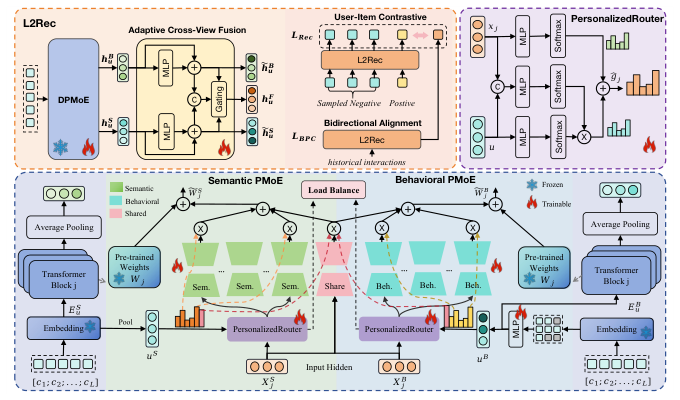
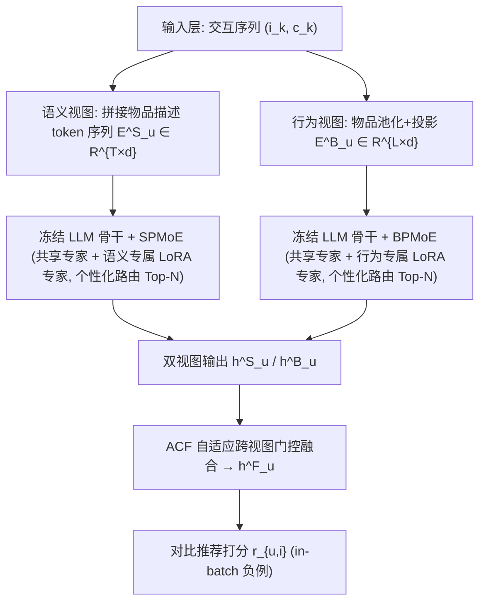
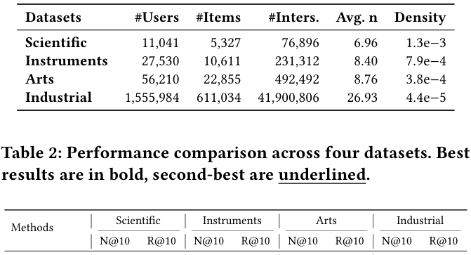
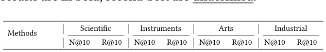
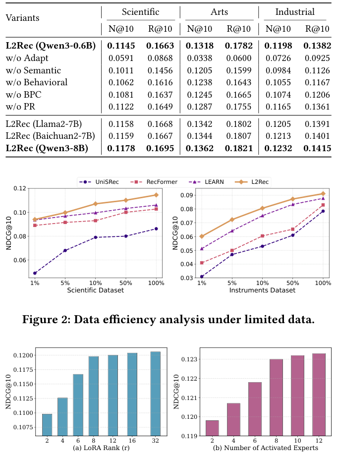
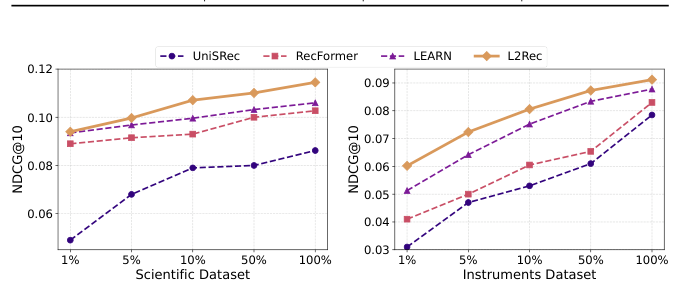
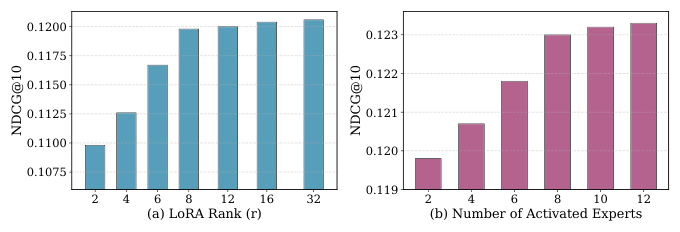

# L2Rec: Towards Dual-View Understanding of LLMs for Personalized Recommendation (面向个性化推荐的大语言模型双视图理解)

- **会议/期刊**: SIGIR 2026 (第 49 届 ACM SIGIR)
- **推荐链路定位**: 召回 (Retrieval) — 作为上游表征模块，输出双视图用户/物品 embedding 供下游 matching & ranking 使用
- **研究方向**: 大语言模型推荐 (LLM4Rec) / 序列推荐
- **论文原文**: [https://arxiv.org/abs/2605.26717v1](https://arxiv.org/abs/2605.26717v1)
- **开源代码**: 暂未开源（原文与预提取均未发现代码链接）

## TL;DR (核心速览)

针对 LLM 推荐中"任务对齐"与"行为/语义信号融合"两大痛点，L2Rec 放弃在表征空间（输入级注入 ID embedding 或输出级对比对齐）融合，转而在 **LLM 参数空间** 用双视图个性化 MoE（DPMoE，基于 LoRA 专家 + 用户感知三信号路由）为同一冻结骨干生成语义/行为两条适配通路，再用自适应跨视图融合 (ACF) 合成统一偏好。在 3 个 Amazon 域 + 1 个工业数据集上，Leave-One-Out 协议下 N@10 相对最强基线提升 3.87%–8.02%，线上 A/B 的 CTR +9.24%、回复率 +3.15%（p<0.01）。

## Background & Motivation (背景与动机)

- **领域背景与主流范式**: LLM 用于推荐主要有两条路线。其一是 **输出级 (output-level)**：LLM 作为冻结特征提取器产出语义 item embedding，交给下游独立模型（如 LLMRec、RLMRec、LEARN 的蒸馏思路）；其二是 **输入级 (input-level)**：把协同过滤预训练的 ID embedding 投影进 LLM 的 token 空间联合训练（如 LLaRA、CoLLM、IntegrateCF）。
- **现有方法局限**:
  1. **输出级** 将 LLM 与推荐监督解耦，梯度无法任务对齐，形成信息瓶颈；
  2. **输入级** 虽端到端，但迫使同一组参数同时处理异构表征（稀疏交互矩阵的 ID embedding vs 稠密文本语料的 token embedding），梯度来源冲突、优化困难；
  3. 两者本质上都在 **表征空间** 做对齐，分布错配难以避免。
- **核心挑战**: 行为信号（点击序列）与语义信号（物品描述）来自不同数据源、不同粒度（item 级 vs token 级），简单拼接或加深网络无法消除分布鸿沟。
- **核心洞察与切入点**: 作者提出把融合点从表征空间上移到 **参数空间**——同一组 Transformer 参数本身即可作为双视图的共享媒介。对同一冻结骨干施加视图专属的低秩扰动 $\Delta W_S$、$\Delta W_B$，得到 $\tilde W_S = W + \Delta W_S$、$\tilde W_B = W + \Delta W_B$。由于两者都锚定在 LLM 预训练知识上，行为与语义视图天然处于共同表征邻域，跨视图对齐难度大幅降低。

## Problem Formulation & Method (问题定义与方法架构)

### 1. 符号定义与输入表征 (Notations & Input Representations)

- 用户集 $\mathcal{U}$、物品集 $\mathcal{I}$；用户交互序列 $\{(i_1, c_1), \dots, (i_L, c_L)\}$，其中 $c_k$ 为物品 $i_k$ 的文本内容。
- **语义视图**: $E^S_u = \mathrm{Embed}([c_1; c_2; \dots; c_L]) \in \mathbb{R}^{T \times d}$，拼接全部物品描述为 token 序列，保留 token 级细节。
- **行为视图**: $E^B_u = P_U\big([\mathrm{pool}(\mathrm{Embed}(c_i))]_{i=1}^{L}\big) \in \mathbb{R}^{L \times d}$，每个物品池化为单向量，经轻量投影 $P_U$ 映射，类比 SASRec 的 item 级序列建模。
- 视图用户表征: $u^S = \mathrm{pool}(E^S_u)$，$u^B = \mathrm{pool}(E^B_u)$。
- 输出: 融合用户表征 $h^F_u$ 与候选物品表征 $h^F_i$ 的内积打分 $r_{u,i}$，取 $\hat i_u = \arg\max_{i \in \mathcal{I}} r_{u,i}$。

### 2. 整体流水线 (Overall Architecture)

数据流：双视图输入构造（语义 token 序列 / 行为 item 序列）→ 冻结 LLM 骨干 + DPMoE（SPMoE 语义通路、BPMoE 行为通路，共享专家 + 视图专属专家）→ 双视图输出 $h^S_u, h^B_u$ → ACF 自适应门控融合 → 对比推荐损失 + 双向偏好对比损失 + 负载均衡损失端到端训练（仅更新 DPMoE 与 ACF）。

<figure class="paper-figure" markdown="span">
  <figcaption>图1：L2Rec的整体框架。</figcaption>
</figure>

### 3. 核心模块设计与数学原理 (Key Designs & Formulations)

**(1) DPMoE：参数级双视图个性化 MoE。** 对 Transformer 第 $j$ 个参数矩阵 $W_j$ 的调整为：

$$\Delta W_j = \sum_{i \in \mathcal{E}_{sh}} B_{j,i} A_{j,i} + \sum_{i \in \mathcal{E}_v} g_{j,i} B_{j,i} A_{j,i}, \quad \mathcal{E}_v \in \{\mathcal{E}_s, \mathcal{E}_b\}$$

其中 $B_{j,i} \in \mathbb{R}^{d \times r}$、$A_{j,i} \in \mathbb{R}^{r \times d}$（$r \ll d$）为 LoRA 低秩矩阵。第一项为 **始终激活的共享专家**（借鉴 DeepSeekMoE，捕获跨视图共性，如"科幻"偏好同时体现在点击与描述中），第二项为 **稀疏选择的视图专属专家**（捕获用户/视图特化信号）。物理直觉：共享专家提供稳定基础，专属专家提供个性化增量，二者叠加即"共同邻域 + 视图偏移"。

**(2) 三信号个性化路由。** 标准 MoE 路由只看当前输入 $x_j$，对所有用户一视同仁。L2Rec 设计三路信号：上下文 $z^c_j = x_j$（处理什么）、用户 $z^u_j = u$（服务谁）、交互 $z^f_j = [u; x_j]$（用户偏好如何与上下文交互）。每路经两层轻量网络得分数：

$$g^{(m)}_j = \mathrm{Softmax}\big(R^{(m)}_{2,j} \cdot \mathrm{ReLU}(R^{(m)}_{1,j} z^{(m)}_j + b^{(m)}_{1,j}) + b^{(m)}_{2,j}\big), \quad m \in \{c, u, f\}$$

最终路由权重采用 **加性-乘性融合 + Top-$N$ 稀疏化**：

$$\hat g_j = g^c_j + (g^u_j + g^f_j) \odot g^c_j, \quad g_{j,i} = \hat g_{j,i} \cdot \mathbb{1}[\hat g_{j,i} \in \mathrm{Top}\text{-}N(\hat g_j)]$$

设计要点：上下文为主路由信号，用户偏好作为"个性化修正项"调制专家激活，避免用户信号淹没上下文选择。两条通路实例化为 $\mathrm{SPMoE}_j = \mathrm{DPMoE}_j(u^S, x^S_j; \mathcal{E}_{sh}, \mathcal{E}_s)$、$\mathrm{BPMoE}_j = \mathrm{DPMoE}_j(u^B, x^B_j; \mathcal{E}_{sh}, \mathcal{E}_b)$。

**(3) ACF 自适应跨视图融合。** 因双视图输出已处于共享参数空间，轻量融合即可：$\tilde h^v_u = h^v_u + P_v(h^v_u)$（残差投影），门控 $\delta = \sigma(W_g[\tilde h^B_u; \tilde h^S_u] + b_g)$，$h^F_u = \delta \tilde h^B_u + (1-\delta)\tilde h^S_u$。$\delta$ 按用户自适应地强调信息量更大的视图。

### 4. 训练目标、负采样与推理复杂度 (Optimization, Negative Sampling & Complexity)

- **损失函数**: $\mathcal{L} = \mathcal{L}_{Rec} + \gamma \mathcal{L}_{BPC} + \beta \mathcal{L}_{LB}$。
  - 对比推荐损失（in-batch 负例增强）：$\mathcal{L}_{Rec} = -\log \frac{e^{r_{u,i^+}}}{e^{r_{u,i^+}} + \sum_{i^- \in \mathcal{N}} e^{r_{u,i^-}}}$，其中 $r_{u,i} = \mathrm{sim}(h^F_u, h^F_i)/\tau$。
  - 双向偏好对比 (BPC)：对齐同一用户 $\tilde h^B_u$ 与 $\tilde h^S_u$、分离不同用户，并加 $\lambda \|\tilde h^B_u - \tilde h^S_u\|_2^2$ 一致性正则：$\mathcal{L}_{BPC} = -\log \frac{e^{r^{B\to S}_u}}{\sum_{u'} e^{r^{B\to S}_{u,u'}}} - \log \frac{e^{r^{S\to B}_u}}{\sum_{u'} e^{r^{S\to B}_{u,u'}}} + \lambda\|\tilde h^B_u - \tilde h^S_u\|_2^2$。
  - 负载均衡损失 $\mathcal{L}_{LB}$ 防专家路由坍缩。
- **训练负采样策略**: 对比损失采用 **10 个随机采样负例**（原文 "contrastive loss with 10 randomly sampled negatives"），未提及难负例挖掘。
- **参数效率与复杂度**: 骨干冻结，仅更新 DPMoE + ACF 共 **32M 参数（约骨干的 5%）**；LoRA $r=8$、$\alpha=16$，9 个专家（1 共享 + 8 视图专属），每视图 Top-2 激活。推理时用户与候选物品均走同一双视图管线得 $h^F$，按内积全库排序；原文未报告单次推理延迟 (ms/request) 与峰值显存。

## Experimental Setup & Evaluation Protocol (实验设置与评估协议)

- **数据集统计与预处理**: 3 个 Amazon Review 目标域（Scientific / Instruments / Arts，遵循 RecFormer 的域迁移设定：7 个源类目预训练、3 个目标类目微调）+ 1 个工业数据集（某社交平台，含曝光/点击/回复，每物品 10 个属性）。工业集前 3 个月日志预训练、后 1 个月微调。

<figure class="paper-figure" markdown="span">
  <figcaption>表1：数据集的总体统计。</figcaption>
</figure>

| 数据集 (Dataset) | 用户数 (#Users) | 物品数 (#Items) | 交互数 (#Interactions) | 平均序列长 (Avg. n) | 密度 (Density) |
| :--- | :---: | :---: | :---: | :---: | :---: |
| Scientific | 11,041 | 5,327 | 76,896 | 6.96 | 1.3e-3 |
| Instruments | 27,530 | 10,611 | 231,312 | 8.40 | 7.9e-4 |
| Arts | 56,210 | 22,855 | 492,492 | 8.76 | 3.8e-4 |
| Industrial | 1,555,984 | 611,034 | 41,900,806 | 26.93 | 4.4e-5 |

- **数据划分方式 (Splitting Strategy)**: Amazon 采用 **Leave-One-Out (留一法)** 协议（遵循 SASRec）；工业集采用 **时间切分**（前 3 月预训练 / 后 1 月微调），属全局时间戳切分，无未来信息泄露。原文未明确说明 Amazon 是否采用 5-core 过滤（沿用 RecFormer 设定）。
- **排名评测协议 (Ranking Protocol)**: 原文仅说明 "Evaluation follows the leave-one-out protocol"，**未明确是全库 Full-Ranking 还是采样负例排序**（此为评估协议披露的薄弱点，见批判部分）。
- **评价指标与显著性检验**: Recall@10 (R@10)、NDCG@10 (N@10)。离线实验未报告多随机种子方差或配对显著性检验；线上 A/B 采用 **双样本 t 检验**，用户级指标 $p < 0.01$。
- **实现细节**: 骨干 Qwen3-0.6B；AdamW，预训练 lr=2e-4、微调 lr=1e-4；序列长度 $L=80, T=2048$（工业）/ $L=50, T=1024$（Amazon）；A100 GPU。基线含 ID-based（SASRec、BERT4Rec）、Text-enhanced（S³-Rec、UniSRec、RecFormer）、LLM-based（LLaRA/Llama2-7B、LEARN/Baichuan2-7B）。

## Key Experimental Results (核心实验结果)

### 1. 主实验对比 (Main Results)

<figure class="paper-figure" markdown="span">
  <figcaption>表2：四个数据集上的性能比较。最佳结果以粗体显示，次佳结果以下划线显示。</figcaption>
</figure>

| 数据集 | 指标 | ID-based 最强 (SASRec/BERT4Rec) | Text/LLM 最强基线 (LEARN) | 本文方法 (L2Rec) | 相对提升 (Improv.) |
| :--- | :--- | :---: | :---: | :---: | :---: |
| Scientific | N@10 / R@10 | 0.0797 / 0.1305 (SASRec) | 0.1060 / 0.1594 | **0.1145 / 0.1663** | +8.02% / +4.33% |
| Instruments | N@10 / R@10 | 0.0707 / 0.0972 (BERT4Rec) | 0.0878 / 0.1240 | **0.0912 / 0.1273** | +3.87% / +2.66% |
| Arts | N@10 / R@10 | 0.0848 / 0.1342 (SASRec) | 0.1225 / 0.1701 | **0.1318 / 0.1782** | +5.27% / +4.76% |
| Industrial | N@10 / R@10 | 0.1015 / 0.1167 (SASRec) | 0.1127 / 0.1299 | **0.1198 / 0.1382** | +5.74% / +6.39% |

趋势观察：文本增强方法显著优于纯 ID 方法（Arts 上 RecFormer 0.1252 vs SASRec 0.0848，+47.6%）；LLM 方法进一步提升但增益递减（工业集 LEARN 0.1127 仅比 RecFormer 0.1098 高 2.6%），说明输入级/输出级融合已触及天花板，L2Rec 的参数级适配突破该上限。

### 2. 消融实验与控制变量分析 (Ablation Study)

<figure class="paper-figure" markdown="span">
  <figcaption>表3：组件与骨干网络的消融研究</figcaption>
</figure>

| 变体 | Scientific N@10 | Arts N@10 | Industrial N@10 | 相对完整模型下降 |
| :--- | :---: | :---: | :---: | :---: |
| L2Rec (Qwen3-0.6B) | 0.1145 | 0.1318 | 0.1198 | — |
| w/o Adapt（纯冻结骨干） | 0.0591 | 0.0338 | 0.0726 | −39.4%（工业） |
| w/o Semantic | 0.1011 | 0.1205 | 0.0984 | −11.7% / −8.6% / −17.9% |
| w/o Behavioral | 0.1062 | 0.1238 | 0.1055 | −7.2% / −6.1% / −11.9% |
| w/o BPC | 0.1081 | 0.1245 | 0.1074 | −5.6% ~ −10.4% |
| w/o PR（用户无关路由） | 0.1122 | 0.1287 | 0.1165 | −2.0% ~ −2.8% |

- **贡献最大**: 任务适配本身（w/o Adapt 掉 39.4%），其次语义视图（工业集 −17.9%）> 行为视图（−11.9%），二者互补不可替代；BPC 对稳定双视图适配关键；个性化路由贡献虽小（2%–2.8%）但稳定。
- **骨干控制变量**: 作者承认表 2 各基线用各自骨干、比较非严格受控，故在相同 7B 骨干上实例化 L2Rec：L2Rec(Llama2-7B) 与 L2Rec(Baichuan2-7B) 在 N@10 上分别超 LLaRA +6.4%~12.1%、超 LEARN +7.6%~9.7%，证明增益来自适配设计而非骨干本身；Qwen3-0.6B→8B 亦稳定提升（工业 0.1198→0.1232）。

### 3. 稀疏度/冷启动分桶与超参敏感度 (Sparsity Buckets & Hyperparameters)

- **数据效率 (图2)**: 训练比例 {1%, 5%, 10%, 50%, 100%} 下 L2Rec 全面领先。Scientific 上仅用 10% 数据 (0.1071) 即超 LEARN 全量 (0.1060)；Instruments 上 1% 数据时超 LEARN +17.3% (0.0602 vs 0.0513)。文本增强方法在数据稀缺时陡降，LLM 方法曲线更平缓，说明 LLM 强初始化 + DPMoE 视图特化适配在少监督下更高效。原文未做长尾物品/冷启动用户分桶分析。

<figure class="paper-figure" markdown="span">
  <figcaption>图2：有限数据下的数据效率分析。</figcaption>
</figure>

- **超参敏感度 (图3)**: LoRA rank $r \in [2, 32]$ 增大时性能提升但逐渐收敛；每视图激活专家数 Top-N 从 2 增至 12 持续提升但趋于饱和，暗示中等配置性价比最佳。

<figure class="paper-figure" markdown="span">
  <figcaption>图3：L2Rec的超参数分析</figcaption>
</figure>

- **线上 A/B 测试**: 某大型社交平台首页 feed，约 150 万 DAU，2025 年 4–5 月为期一个月，6% 用户级流量为实验组，对照组为长期优化的 DLRM matching 系统。L2Rec 作为上游表征模块，双视图 embedding 喂入下游 matching & ranking，其余组件不变。结果：**CTR +9.24%、回复率 +3.15%**，双样本 t 检验 $p < 0.01$ 显著。

## Highlights, Limitations & Critiques (亮点、局限与审稿级批判)

- **核心亮点与可迁移性**:
  1. **参数空间融合** 的视角具有普适性——任何需要融合异构信号（多模态、跨域、社交+行为）的 LLM 推荐场景都可复用"共享冻结骨干 + 视图专属低秩扰动"范式；
  2. **三信号路由**（上下文/用户/交互的加性-乘性融合）是通用 MoE 个性化改造算子，可迁移到多任务精排的 PLE/MMoE 结构；
  3. 仅训练 5% 参数即获稳定增益，工业部署成本可控，且线上 A/B 验证了真实收益。
- **局限性与审稿视角批判**:
  1. **评估协议披露不足**：仅称 "leave-one-out protocol"，未说明是全库 Full-Ranking 还是采样负例排序，也未说明 Amazon 是否 5-core 过滤、正样本如何界定，复现与横向比较存在歧义；
  2. **离线实验统计严谨性欠缺**：未报告多随机种子方差与配对显著性检验，表 2 各基线骨干不一致（作者自认），虽补充了 7B 受控实验但 0.6B 主表结论仍受骨干质量混淆；
  3. **效率数据缺失**：未报告训练单 epoch 耗时、推理延迟 (ms/request)、峰值显存，而双视图（语义 token 序列 $T=2048$ + 行为序列 $L=80$）推理开销是工业落地的关键疑点；
  4. **超参 $\gamma, \beta, \lambda, \tau$ 取值未在正文给出**，仅展示 $r$ 与 Top-N 敏感度；
  5. **理论承诺与实现落差**：声称"最小表征错配"，但 BPC 损失的存在本身说明双视图仍有表征漂移需显式约束，参数空间共享并未完全消除对齐问题；
  6. 线上收益归因于"更高质量表征"，但未做下游消融（如仅用单视图 embedding 的线上对照），因果归因略弱。

## Rating (四维评分)

- **方法创新性 (Novelty)**: ⭐⭐⭐⭐ （参数空间双视图融合 + 三信号个性化路由，视角新颖且工程优雅）
- **评估协议与实验扎实度 (Protocol & Experiments)**: ⭐⭐⭐ （四数据集 + 线上 A/B 亮眼，但划分/排序协议披露不足、缺方差与显著性检验）
- **写作与数学规范度 (Clarity & Rigor)**: ⭐⭐⭐⭐ （公式与架构清晰，超参与效率细节略缺）
- **工业落地与复现价值 (Industrial & Practical Value)**: ⭐⭐⭐⭐ （5% 参数微调 + 真实线上 CTR +9.24%，落地价值高；但代码未开源降低复现性）
