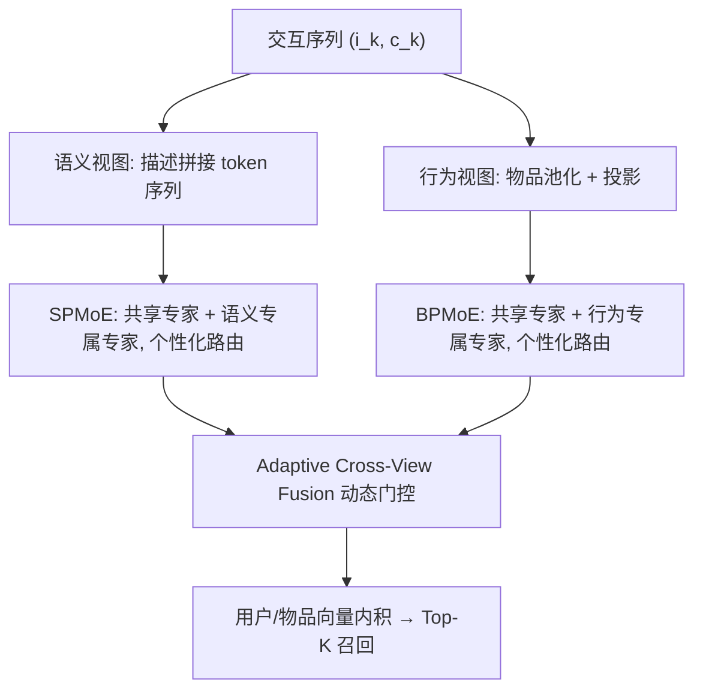

# L2Rec: Towards Dual-View Understanding of LLMs for Personalized Recommendation (面向个性化推荐的大模型双视图理解)

- **会议/期刊**: SIGIR 2026
- **作者与机构**: Pingjun Pan, Tingting Zhou, Peiyao Lu, Tingting Fei, Hongxiang Chen (通讯), Chuanjiang Luo — 网易云音乐
- **推荐链路定位**: 召回（上游表征模块，双视图用户/物品向量喂入下游匹配与排序）
- **研究方向**: 大语言模型推荐 / 序列推荐
- **论文原文**: [https://arxiv.org/abs/2605.26717v1](https://arxiv.org/abs/2605.26717v1)
- **开源代码**: 暂未开源

## TL;DR (1分钟核心速览)

LLM4Rec 中行为信号（ID 序列）与语义信号（文本）的融合长期困在表征空间：输出级两阶段解耦了任务监督，输入级把异构 embedding 塞进同一 token 空间引发梯度冲突。L2Rec 把融合点搬到**参数空间**——冻结同一 LLM 主干，用双视图个性化 MoE（DPMoE）为每个用户生成语义/行为两套低秩扰动，再经自适应跨视图门控融合。在 3 个 Amazon 域 + 1 个 4200 万交互工业集上，Leave-One-Out 全库排序 N@10 相对最强基线提升 3.87%–8.02%，线上 A/B 的 CTR +9.24%、回复率 +3.15%（p<0.01）。

## Background & Motivation (背景与核心矛盾)

- **主流范式**: 一条线是输出级——LLM 当冻结特征提取器产出语义 embedding，交给下游推荐模型；另一条是输入级——把协同过滤预训练的 ID embedding 投影进 token 空间做端到端联合训练（LLaRA、LEARN 等）。
- **前人局限**: 输出级切断了推荐监督向 LLM 的梯度回流，形成信息瓶颈；输入级则强迫同一组参数同时消化稀疏交互矩阵与稠密文本语料两种异构分布，优化目标互相拉扯。二者共同的死穴是**都在表征空间做对齐**，分布错配几乎无法消除。
- **核心洞察 (Key Insight)**: 作者注意到 LLM-based 方法相对文本增强方法的增益正在收窄（工业集上 LEARN 仅比 RecFormer 高 2.6%），说明瓶颈不在主干能力，而在融合位置。既然两视图共享同一套预训练知识，那么让**同一组 Transformer 参数**分别被两种低秩扰动"染色"，天然落在同一表征邻域内，跨视图对齐难度骤降。
- **本文切入点**: 用参数级适配（LoRA 专家池 + 用户感知路由）取代表征级拼接/对齐，把"融合"变成"同一主干的两条参数分支"。

## Method (核心方法设计)

### 1. 整体框架 (Overall Architecture)

输入侧对用户交互序列 $\{(i_1,c_1),\dots,(i_L,c_L)\}$ 构造两个粒度互补的视图：语义视图把全部物品描述拼成 token 序列 $\mathbf{E}^S_u\in\mathbb{R}^{T\times d}$ 保留细粒度文本；行为视图对每个物品的 token embedding 做池化压成单向量再经投影 $P_U$ 得到 $\mathbf{E}^B_u\in\mathbb{R}^{L\times d}$，对齐 SASRec 式的物品级序列动力学。两视图分别送入冻结主干的 SPMoE 与 BPMoE 分支，得到 $\mathbf{h}^S_u,\mathbf{h}^B_u$；ACF 模块用残差投影 + 动态门控把二者融成统一偏好 $\mathbf{h}^F_u$，与同样流程编码的物品向量做内积排序。训练时主干全程冻结，只更新 DPMoE 与 ACF（约 32M 参数，占主干 5%）。

<figure class="paper-figure" markdown="span">
  <figcaption>图1：L2Rec的整体框架。</figcaption>
</figure>

### 2. 关键设计拆解 (Key Designs)

1. **双视图个性化 MoE（DPMoE）**：单一 LoRA 适配器对所有用户施加同一扰动，抹平了偏好差异。DPMoE 把专家池拆成**始终激活的共享专家** $\mathcal{E}_{sh}$（承载跨视图共性，如"科幻"既体现在点击也在描述里）与**稀疏激活的视图专属专家** $\mathcal{E}_v$，第 $j$ 个参数矩阵的扰动为
$$\Delta W_j=\sum_{i\in\mathcal{E}_{sh}}B_{j,i}A_{j,i}+\sum_{i\in\mathcal{E}_v}g_{j,i}B_{j,i}A_{j,i},\quad r\ll d$$
共享项提供稳定底座、专属项负责个性化特化，避免 MoE 在推荐场景下退化为纯输入路由。

2. **三信号个性化路由器**：标准 MoE 路由只看当前输入 $x_j$，对所有用户一视同仁。本文并行构造上下文 $z^c_j=x_j$、用户 $z^u_j=u$、交互 $z^f_j=[u;x_j]$ 三路打分，再做加乘融合与 Top-$N$ 稀疏化：
$$\hat{g}_j=g^c_j+(g^u_j+g^f_j)\odot g^c_j,\qquad g_{j,i}=\hat{g}_{j,i}\cdot\mathbb{1}[\hat{g}_{j,i}\in\text{Top-}N(\hat{g}_j)]$$
物理直觉很清晰：上下文是主路由信号，用户偏好只作**乘性修正**，防止个性化信号喧宾夺主导致路由漂移。

3. **训练目标、负采样与推理效率**：总损失 $\mathcal{L}=\mathcal{L}_{Rec}+\gamma\mathcal{L}_{BPC}+\beta\mathcal{L}_{LB}$。$\mathcal{L}_{Rec}$ 为批内负采样对比损失（每正样本配 10 个随机负例，温度 $\tau$）；$\mathcal{L}_{BPC}$ 做双向偏好对比（$\tilde{h}^B_u\!\to\!\tilde{h}^S_u$ 与反向各一次）并加 $\lambda\|\tilde{h}^B_u-\tilde{h}^S_u\|_2^2$ 的 L2 项，抑制异构输入与专家特化带来的表征漂移；$\mathcal{L}_{LB}$ 为负载均衡损失防路由坍缩。推理时物品侧走同一双视图管线离线编码，在线仅需内积检索，主干冻结使训练成本可控。

## Experimental Setup & Evaluation Protocol (实验设置与评估协议)

- **数据集与预处理**: Amazon Review 采用 RecFormer 的域迁移设定（7 个源类预训练，3 个目标类微调）；工业集为某社交平台 4 个月日志，前 3 月预训练、后 1 月微调。

| 数据集 | #Users | #Items | #Interactions | 稀疏度/密度 | 特征/场景说明 |
| :--- | :---: | :---: | :---: | :---: | :--- |
| Scientific | 11,041 | 5,327 | 76,896 | 1.3e-3 | Amazon 目标域，平均序列 6.96 |
| Instruments | 27,530 | 10,611 | 231,312 | 7.9e-4 | Amazon 目标域，平均序列 8.40 |
| Arts | 56,210 | 22,855 | 492,492 | 3.8e-4 | Amazon 目标域，平均序列 8.76 |
| Industrial | 1,555,984 | 611,034 | 41,900,806 | 4.4e-5 | 曝光/点击/回复，物品 10 个属性 |

- **数据划分与防穿越 (Splitting Strategy)**: Amazon 用 `Leave-One-Out`（末位交互作测试）；工业集用**全局时间戳切分**（前 3 月预训练 / 后 1 月微调），天然防穿越。
- **排名评测协议 (Ranking Protocol)**: 采用无偏 `Full-Ranking`（全库未交互物品排序），报告 R@10 与 N@10；训练阶段用 10 个随机负例的批内对比损失。
- **对比基线与超参设置**: 7 个基线分三组——ID 类（SASRec、BERT4Rec）、文本增强类（S³-Rec、UniSRec、RecFormer）、LLM 类（LLaRA/Llama2-7B、LEARN/Baichuan2-7B）。主干 Qwen3-0.6B，9 个专家（1 共享 + 8 专属），LoRA $r=8,\alpha=16$，每视图 Top-2 激活；序列长 $L=80,T=2048$（工业）/ $L=50,T=1024$（Amazon）；AdamW，预训练 2e-4、微调 1e-4。为控制主干差异，额外把 L2Rec 实例化到 Llama2-7B / Baichuan2-7B / Qwen3-8B 上做同主干对比。

## Key Experimental Results (实验关键数据)

### 1. 主实验对比 (Main Results)

| Methods | Scientific N@10 | Scientific R@10 | Instruments N@10 | Instruments R@10 | Arts N@10 | Arts R@10 | Industrial N@10 | Industrial R@10 |
| :--- | :---: | :---: | :---: | :---: | :---: | :---: | :---: | :---: |
| SASRec | 0.0797 | 0.1305 | 0.0634 | 0.0995 | 0.0848 | 0.1342 | 0.1015 | 0.1167 |
| BERT4Rec | 0.0790 | 0.1061 | 0.0707 | 0.0972 | 0.0942 | 0.1236 | 0.0816 | 0.0918 |
| UniSRec | 0.0862 | 0.1255 | 0.0785 | 0.1119 | 0.0894 | 0.1333 | 0.0881 | 0.1037 |
| RecFormer | 0.1027 | 0.1448 | 0.0830 | 0.1052 | 0.1252 | 0.1614 | 0.1098 | 0.1183 |
| LLaRA | 0.1033 | 0.1502 | 0.0812 | 0.1078 | 0.1216 | 0.1630 | 0.1133 | 0.1257 |
| LEARN | 0.1060 | 0.1594 | 0.0878 | 0.1240 | 0.1225 | 0.1701 | 0.1127 | 0.1299 |
| **L2Rec** | **0.1145** | **0.1663** | **0.0912** | **0.1273** | **0.1318** | **0.1782** | **0.1198** | **0.1382** |
| **Improv.%** | **+8.02%** | **+4.33%** | **+3.87%** | **+2.66%** | **+5.27%** | **+4.76%** | **+5.74%** | **+6.39%** |

### 2. 消融实验 (Ablation Study)

| Variants | Scientific N@10 | Scientific R@10 | Arts N@10 | Arts R@10 | Industrial N@10 | Industrial R@10 |
| :--- | :---: | :---: | :---: | :---: | :---: | :---: |
| L2Rec (Qwen3-0.6B) | **0.1145** | **0.1663** | **0.1318** | **0.1782** | **0.1198** | **0.1382** |
| w/o Adapt | 0.0591 | 0.0868 | 0.0338 | 0.0600 | 0.0726 | 0.0925 |
| w/o Semantic | 0.1011 | 0.1456 | 0.1205 | 0.1599 | 0.0984 | 0.1126 |
| w/o Behavioral | 0.1062 | 0.1616 | 0.1238 | 0.1643 | 0.1055 | 0.1167 |
| w/o BPC | 0.1081 | 0.1637 | 0.1245 | 0.1665 | 0.1074 | 0.1206 |
| w/o PR (个性化路由) | 0.1122 | 0.1649 | 0.1287 | 0.1755 | 0.1165 | 0.1361 |
| L2Rec (Llama2-7B) | 0.1158 | 0.1668 | 0.1342 | 0.1802 | 0.1205 | 0.1391 |
| L2Rec (Baichuan2-7B) | 0.1159 | 0.1667 | 0.1344 | 0.1807 | 0.1213 | 0.1401 |
| L2Rec (Qwen3-8B) | 0.1178 | 0.1695 | 0.1362 | 0.1821 | 0.1232 | 0.1415 |

### 3. 关键实验发现 (Key Findings)

1. **参数级适配本身是最大贡献项，而非主干规模**：去掉全部适配（w/o Adapt）后工业集 N@10 从 0.1198 崩到 0.0726（−39.4%），跌幅远超任何单一组件；而在同主干对照下，L2Rec(Llama2-7B)/L2Rec(Baichuan2-7B) 仍比 LLaRA/LEARN 高 6.4%–12.1% 与 7.6%–9.7%，说明增益来自 DPMoE 设计而非 Qwen3 主干的新旧优势。
2. **两视图互补且不可替代，语义侧更"贵"**：去掉语义视图在工业集掉 17.9%、科学集掉 11.7%，去掉行为视图分别掉 11.9% 与 7.2%——语义视图贡献更大但两者缺一即显著退化，印证"物品是什么"与"兴趣如何演化"是正交信号。
3. **数据稀缺时参数级适配的样本效率优势被放大**：Scientific 上 L2Rec 仅用 10% 数据（0.1071）即超过 LEARN 用满 100% 数据（0.1060）；Instruments 上 1% 数据即领先 LEARN +17.3%（0.0602 vs 0.0513），说明视图专属低秩扰动比单通路适配更充分地榨取了冻结主干的先验。

## Highlights, Limitations & Rating (亮点、对比与审稿评价)

- **与代表作对比 (vs. Prior Work)**: 与 LLaRA/LEARN 这类输入级方法相比，L2Rec 不在 token 空间硬拼异构 embedding，而是让同一主干被两套低秩扰动"分色"，从根上绕开梯度冲突；与 RecFormer 这类输出级两阶段方法相比，它恢复了端到端任务监督，同时只更新 5% 参数。相较标准 MoE-LoRA，其增量在于路由信号从"仅上下文"扩展为"上下文 × 用户"的加乘融合。
- **可迁移亮点**: ① 三信号加乘路由（上下文为主、用户为乘性修正）可直接移植到任何用户条件化的 MoE 精排/召回模型；② 双向偏好对比 + L2 一致性项是抑制多分支表征漂移的通用轻量正则，适用于多场景/多模态多塔结构。
- **审稿级局限批判**: ① 双视图意味着用户与物品都要跑两遍前向，尽管主干冻结，在线物品编码成本翻倍，论文未给出延迟/吞吐数据；② 主实验各基线沿用各自原始主干（0.6B vs 7B 混比），虽用同主干消融补救，但主表对比的公平性仍可质疑；③ 路由超参（Top-N、专家数、$r$）在工业集上呈饱和趋势但未给出最优性价比点的显式推荐，跨域迁移时需重新调参。
- **四维评分**: 创新性 ⭐⭐⭐⭐ | 实验扎实度 ⭐⭐⭐⭐ | 方法清晰度 ⭐⭐⭐⭐⭐ | 落地价值 ⭐⭐⭐⭐⭐

