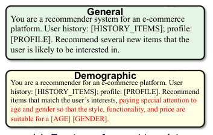
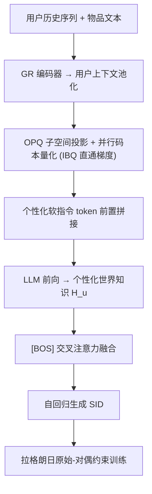

# LWGR: Lagrangian-Constrained Personalized World Knowledge for Generative Recommendation (拉格朗日约束的个性化世界知识生成式推荐)

- **会议/期刊**: SIGIR 2026
- **作者与机构**: Lingyu Mu, Hao Deng, Haibo Xing 等（中科院信息工程研究所 & 阿里巴巴国际数字商业集团）
- **推荐链路定位**: 召回（生成式端到端）
- **研究方向**: 大语言模型推荐 / 生成式推荐
- **论文原文**: [https://arxiv.org/abs/2605.18771v1](https://arxiv.org/abs/2605.18771v1)
- **开源代码**: 暂未开源

## TL;DR (1分钟核心速览)

现有 LLM 增强生成式推荐（GR）依赖**固定人工指令**抽取世界知识并**无约束地直接注入**，导致两个问题：固定指令无法刻画用户兴趣的多维异质性；知识融合不可控，与行为信号冲突时反而掉点。LWGR 从"抽取"与"融合"两轴破局：用 OPQ 并行码本把用户上下文量化成个性化软指令引导 LLM 抽取行为相关知识；再把融合建模为带显式性能退化上界的约束优化，用拉格朗日原始-对偶法自适应选择有益知识。在 Beauty/Toys 与 2.95B 交互工业数据集上，Leave-One-Out + Full-Ranking 协议下相对 8 个 SOTA 最高提升 11.23%，线上广告收入 +1.35%、CTR +1.17%（$p<0.05$）。

## Background & Motivation (背景与核心矛盾)

- **主流范式**: 基于 SID 的生成式推荐（TIGER/Cobra）将推荐转为自回归生成离散语义 ID；为引入外部知识，KAR、SeRALM 等采用"提示词两阶段融合"——先用固定任务指令让 LLM 生成语义知识，再经 MoE/文本编码器注入 GR。
- **前人局限**: (1) 统一设计的人工指令无法适配异构用户兴趣结构，LLM 世界知识被低效调用；(2) 知识注入缺乏显式约束，知识与行为信号不一致时造成**不可控的性能退化**。
- **核心洞察 (Key Insight)**: 作者在真实电商场景做 pilot 实验（按年龄×性别分 4 组，各采样 1 万用户，TIGER 为底座）：人口统计引导指令在多数群体上抬高 Recall@5 上限，但在 young-male 组反而**低于无知识底座**——证明"指令与用户匹配度决定知识价值"，且"并非所有世界知识都有益"。
- **本文切入点**: 用可端到端学习的**个性化软指令**替代人工指令，用**带退化上界的约束优化**替代无约束融合。

<figure class="paper-figure" markdown="span">
  <figcaption>图2：(a) 通用与人口统计引导的指令模板。(b) Base、General和Demographic指令在4个用户群体上的性能。</figcaption>
</figure>

## Method (核心方法设计)

### 1. 整体框架 (Overall Architecture)

LWGR 分四段闭环：(1) **知识抽取**：对 GR 编码器输出的用户上下文做均值池化，经 OPQ 投影到 $K$个子空间，在并行码本中量化得到个性化离散码，映射为软指令 token 前置拼接到历史物品文本，送入 LLM 前向得到个性化世界知识表示$\mathbf{H}_u$；(2) **知识融合**：以解码器 [BOS] 向量为 query、$\mathbf{H}_u$ 为 key/value 做交叉注意力，使知识全局影响整个自回归解码；(3) **约束优化**：以无知识参考模型为基准，将融合训练写成带置信度退化上界的不等式约束问题，用拉格朗日原始-对偶交替更新；(4) **部署**：LLM 推理全部下沉到近线预计算，在线仅做一次向量检索 + 单层交叉注意力。

### 2. 关键设计拆解 (Key Designs)

1. **并行码本个性化软指令（替代逐用户可学习向量）**：逐用户分配 $K$个可学习向量会使参数量随用户数线性增长、且仅能表达线性规模兴趣模式。本文对用户向量$\mathbf{h}_k$做$K$子空间投影$\mathbf{u}_k=f_k(\mathbf{h}_k)$，在各子码本$\mathbf{C}_k$中取最近码字$c_u^k=\arg\min_{j}\|\mathbf{u}_k-\mathbf{C}_k[j]\|_2^2$，组合表达能力从线性$K$扩张到$K^m$且跨用户共享参数。为使 argmin 可微、让推荐损失塑造**整个码本**而非仅被选中码字，采用 IBQ 直通估计：$\mathbf{e}^k=\mathbf{e}^k_{\text{hard}}-\text{sg}[\mathbf{p}^k]+\mathbf{p}^k$，前向硬量化、反向经 softmax 分布$\mathbf{p}^k$ 回传梯度。

2. **拉格朗日约束的知识融合（把"选择性吸收"写成约束优化）**：直接拼接知识会与行为信号冲突。本文先预训练并冻结无知识参考模型 $\theta_{\text{ref}}$，以平均 token 对数概率$s_\theta(u,i^+)=\frac{1}{L}\sum_{\ell}\log p_\theta(c^\ell_{i^+}\mid c^{<\ell}_{i^+},s_u)$度量生成置信度，定义退化惩罚$C_{\text{margin}}=\max(0,\,s_{\text{ref}}-s_\theta-\delta)$，聚合成$C(\theta)=\mathbb{E}[C_{\text{margin}}]$，求解$\min_\theta \mathcal{L}_{\text{rec}}(\theta)\ \text{s.t.}\ C(\theta)\le\varepsilon$。相比固定权重 hinge 惩罚$\mathcal{L}_{\text{rec}}+\beta\max(0,C-\varepsilon)$（$\beta$难调），引入乘子$\lambda\ge0$构成鞍点目标$\min_\theta\max_{\lambda\ge0}\mathcal{L}_{\text{rec}}+\lambda(C-\varepsilon)$，$\lambda\leftarrow\max(0,\lambda+\eta_\lambda(C-\varepsilon))$ 自适应调节约束强度——违反约束则加大惩罚，满足则回归主目标。

3. **训练目标、负采样与推理效率**：总损失即上述拉格朗日目标，主项为 SID 逐 token 负对数似然 $\mathcal{L}_{\text{rec}}=-\sum_{\ell}\log p_\theta(c^\ell_{i^+}\mid c^{<\ell}_{i^+},s_u)$，**无需显式负采样**（全库 SID 生成式检索）。提供两种策略：冻结 LLM（仅训软指令模块、融合模块与 GR）与 LoRA 微调（rank=8，仅作用于 Q/V 投影）。在线仅一次索引查表 + 单层交叉注意力，实测延迟 13.35ms → 13.55ms（+1.5%）。

<figure class="paper-figure" markdown="span">
  ![图3：LWGR概览：一个在拉格朗日约束下将用户个性化世界知识集成到GR中的框架。LWGR首先应用OPQ对用户上下文进行量化，并使用并行码本生成个性化软指令。这些指令与文本化的历史行为拼接后输入LLM，以获得用户个性化世界知识。该知识通过交叉注意力注入\[BOS\]向量，从而影响整个解码过程。融合被建模为约束优化问题，以自适应地选择有益](../../../../assets/papers/2605.18771v1/figure_3.png)<figcaption>图3：LWGR概览：一个在拉格朗日约束下将用户个性化世界知识集成到GR中的框架。LWGR首先应用OPQ对用户上下文进行量化，并使用并行码本生成个性化软指令。这些指令与文本化的历史行为拼接后输入LLM，以获得用户个性化世界知识。该知识通过交叉注意力注入[BOS]向量，从而影响整个解码过程。融合被建模为约束优化问题，以自适应地选择有益</figcaption>
</figure>

## Experimental Setup & Evaluation Protocol (实验设置与评估协议)

- **数据集与预处理**:

| 数据集 | #Users | #Items | #Interactions | 稀疏度/密度 | 特征/场景说明 |
| :--- | :---: | :---: | :---: | :---: | :--- |
| Beauty | ~22K | ~12K | ~296K | 极稀疏 | Amazon 评论，5-core 过滤，按时间排序 |
| Toys | ~35K | ~18K | ~167K | 极稀疏 | Amazon Toys & Games，5-core 过滤 |
| Industry | 14.7M | 20.1M | 2.95B | 极稀疏 | 东南亚电商，2025.01–07，点击+转化，含图文多模态 |

- **数据划分与防穿越 (Splitting Strategy)**: 标准 `Leave-One-Out`——每用户最后一条交互作测试、倒数第二条作验证、其余训练。
- **排名评测协议 (Ranking Protocol)**: 生成式 SID 检索，指标 Recall@5/10 与 NDCG@5/10；基线 TIGER/Cobra 等均为全库 SID 生成式排序（无采样负例）。
- **对比基线与超参设置**: 三组基线——ID 类（SASRec、PinnerFormer、HeterRec、VQ-Rec）、SID 生成式（TIGER、Cobra）、提示词知识融合（TIGER+KAR、TIGER+SeRALM），共 8 个 SOTA。统一底座 LLM 为 Qwen3-4B，embedding 维度 128、Transformer 隐层 640、码本数 $K=5$、$\lambda_0=0.05$、$\eta_\theta=1\times10^{-4}$、$\eta_\lambda=5\times10^{-4}$、$\delta=\varepsilon=1\times10^{-4}$；线上 A/B 采用双侧显著性检验$p<0.05$。

## Key Experimental Results (实验关键数据)

### 1. 主实验对比 (Main Results)

| 方法 | Beauty R@5 | Beauty N@5 | Toys R@5 | Toys N@5 | Industry R@5 | Industry N@5 | Industry R@10 | Industry N@10 |
| :--- | :---: | :---: | :---: | :---: | :---: | :---: | :---: | :---: |
| SASRec | 0.0512 | 0.0326 | 0.0543 | 0.0344 | 0.1637 | 0.1092 | 0.2092 | 0.1396 |
| PinnerFormer | 0.0529 | 0.0335 | 0.0579 | 0.0371 | 0.1718 | 0.1145 | 0.2162 | 0.1447 |
| HeterRec | 0.0521 | 0.0332 | 0.0574 | 0.0366 | 0.1763 | 0.1187 | 0.2219 | 0.1482 |
| TIGER | 0.0534 | 0.0341 | 0.0612 | 0.0395 | 0.1842 | 0.1227 | 0.2317 | 0.1551 |
| Cobra | 0.0527 | 0.0334 | 0.0634 | 0.0408 | 0.1821 | 0.1214 | 0.2345 | 0.1574 |
| TIGER+KAR | 0.0543 | 0.0347 | 0.0629 | 0.0403 | 0.1893 | 0.1245 | 0.2422 | 0.1611 |
| TIGER+SeRALM | 0.0539 | 0.0344 | 0.0637 | 0.0411 | 0.1945 | 0.1273 | 0.2467 | 0.1639 |
| **LWGR (Ours)** | **0.0595** | **0.0376** | **0.0694** | **0.0443** | **0.2145** | **0.1416** | **0.2684** | **0.1804** |
| **Improv.** | +9.58% | +8.36% | +8.95% | +7.79% | +10.28% | +11.23% | +8.80% | +10.07% |

### 2. 消融实验 (Ablation Study)

| 设置 (Industry) | R@5 | ΔR@5 | N@5 | ΔN@5 |
| :--- | :---: | :---: | :---: | :---: |
| LWGR 完整 | 0.2145 | - | 0.1416 | - |
| w/o 并行码本 (MLP 投影上下文) | 0.2061 | -3.92% | 0.1346 | -4.94% |
| 并行码本 → 残差量化 RQ | 0.2120 | -1.17% | 0.1402 | -0.99% |
| w/o 交叉注意力融合 (直接拼接) | 0.2103 | -1.96% | 0.1375 | -2.90% |
| w/o 不等式约束 | 0.2117 | -1.31% | 0.1399 | -1.20% |
| 拉格朗日 → 固定惩罚 $\beta$ | 0.2118 | -1.26% | 0.1391 | -1.77% |

### 3. 关键实验发现 (Key Findings)

1. **个性化软指令是最大增益来源**：移除并行码本改用 MLP 投影上下文后 R@5 掉 3.92%、N@5 掉 4.94%，远超其他消融项；且并行码本优于残差量化（RQ 掉 1.17%），说明"多子空间独立量化 + 跨用户码字共享"比逐级残差更能刻画细粒度用户偏好。
2. **约束机制的价值在"稳定性"而非"上限"**：去掉不等式约束仅掉 1.31%，但固定惩罚 $\beta$变体（调优后最优）仍低于自适应拉格朗日 1.26%，印证固定权重难以在"抑制有害知识"与"保留主目标"间取得平衡，乘子$\lambda$ 的数据自适应调节更优。
3. **LLM 规模与策略存在清晰权衡**：冻结 LLM 从 0.6B→8B，R@5 单调提升 6.69%，但训练 QPS 从 2.435 降至 1.038（-57.37%）；LoRA 在同规模下额外提升 1.09%–3.76%，但 QPS 再降 21%–42%。4B/8B 冻结模型已优于 0.6B/1.7B 的 LoRA 变体，为算力受限场景提供"只放大冻结底座"的实用路线。码本数 $K$在 5 处达峰，$K>5$ 因冗余与稀疏交互下难学而回落。

## Highlights & Limitations (亮点、对比与审稿批判)

- **与代表作对比 (vs. Prior Work)**: 与 KAR/SeRALM 的本质区别在于——它们把"指令设计"当作超参、把"知识注入"当作无约束拼接；LWGR 把前者变成可端到端学习的离散码本查询，把后者变成带显式退化上界的约束优化。与 TIGER/Cobra 相比，本文不改 SID 生成骨架，仅以 [BOS] 交叉注意力做最小侵入式增强，兼容性强。
- **可迁移亮点**: (1) "参考模型 + 置信度退化 hinge 约束 + 拉格朗日乘子"是一套通用的**知识/辅助信号安全注入模板**，可迁移到多模态特征融合、跨域迁移等易掉点场景；(2) OPQ 并行码本 + IBQ 直通梯度可作为大规模用户表征的轻量离散化方案，替代逐用户 embedding。
- **审稿级局限批判**: (1) 约束依赖一个预训练冻结的参考模型，参考模型质量直接决定约束基准的合理性，且需额外一份完整预训练开销；(2) 近线预计算的知识向量按分钟级刷新，对**秒级兴趣漂移**（如突发爆款点击）不敏感，且论文未报告知识库存储与刷新成本；(3) 公共数据集仅两个 Amazon 子类、规模偏小（22K/35K 用户），主结论的统计稳健性主要依赖单一工业集。

## Rating (四维评分)

- **方法创新性 (Novelty)**: ⭐⭐⭐⭐ （把"知识融合不可控"形式化为带退化上界的不等式约束并用原始-对偶求解，视角新颖；软指令码本化属工程巧思而非全新范式）
- **评估协议与实验扎实度 (Protocol & Experiments)**: ⭐⭐⭐⭐ （三数据集 + 8 基线 + 完整消融 + 规模/超参分析 + 线上 A/B 显著性检验，链条完整；公共集规模偏小略扣分）
- **写作与数学规范度 (Clarity & Rigor)**: ⭐⭐⭐⭐ （pilot 实验→两大局限→两轴设计的论证闭环清晰，约束优化推导规范；部分符号在正文与附录间略有重复定义）
- **工业落地与复现价值 (Industrial & Practical Value)**: ⭐⭐⭐⭐ （近线预计算 + 在线单层注意力的部署方案务实，延迟仅 +1.5%、收入 +1.35% 有说服力；但代码未开源、参考模型与知识库运维成本未披露）
