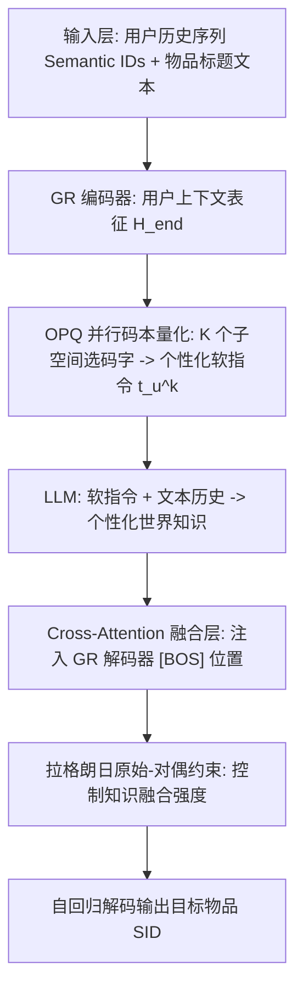
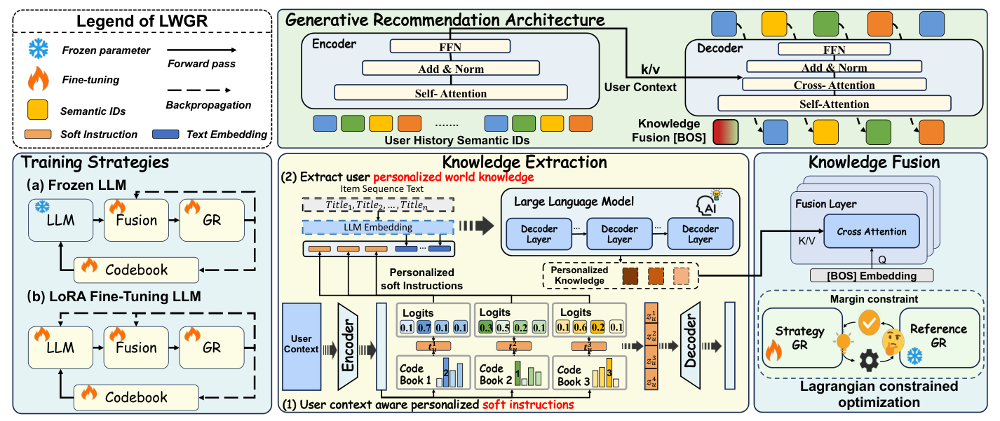
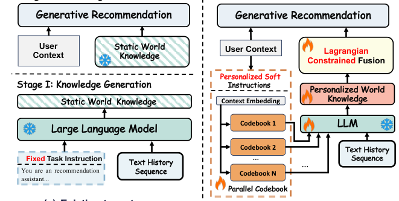
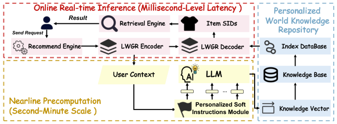
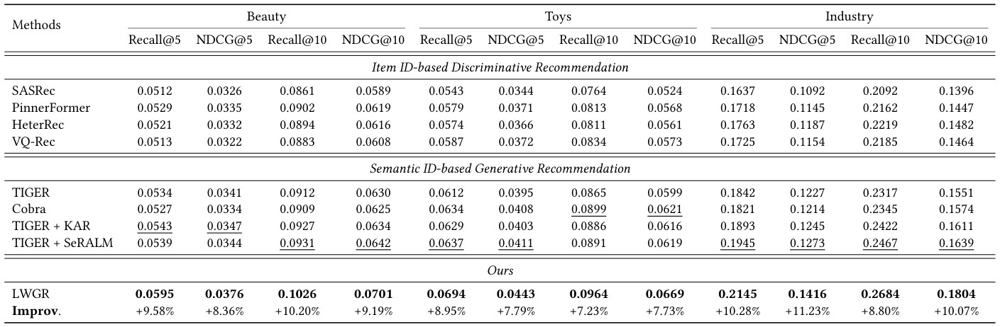
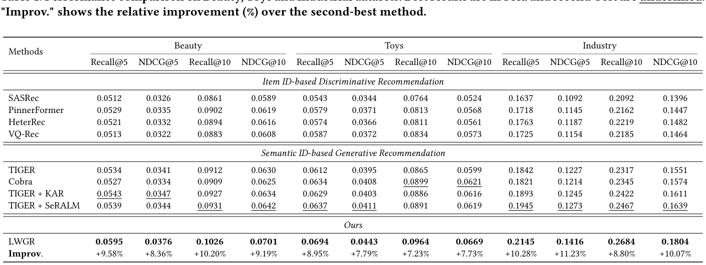

# LWGR: Lagrangian-Constrained Personalized World Knowledge for Generative Recommendation (拉格朗日约束的个性化世界知识生成式推荐)

- **会议/期刊**: SIGIR 2026
- **推荐链路定位**: 端到端生成式 (End-to-End Generative) —— 基于 Semantic ID 的生成式召回
- **研究方向**: 大语言模型推荐 (LLM4Rec) / 生成式推荐与离散语义 ID
- **论文原文**: [https://arxiv.org/abs/2605.18771v1](https://arxiv.org/abs/2605.18771v1)
- **开源代码**: 暂未开源（原文与预提取均未发现代码链接）

## TL;DR (核心速览)

针对现有"提示词两阶段知识融合"生成式推荐中**固定指令无法刻画用户兴趣异质性**、**知识融合无约束可能损害行为信号**两大痛点，LWGR 用 OPQ 并行码本为每个用户生成个性化软指令以提取 LLM 世界知识，并把知识融合建模为带性能退化上界的约束优化问题，用拉格朗日原始-对偶法选择性吸收有益知识。在 Beauty/Toys/工业数据集上相对 8 个 SOTA 基线最高提升 11.23%，线上广告平台收入 +1.35%、CTR +1.17%。

## Background & Motivation (背景与动机)

- **领域背景与主流范式**: 生成式推荐 (GR) 将推荐转为序列生成任务——先用 RQ-VAE/OPQ 把物品内容量化为离散 Semantic ID (SID)，再用自回归 Transformer 逐 token 生成目标物品 SID（TIGER、Cobra、RPG 等）。近期工作（KAR、SeRALM）引入"提示词两阶段知识融合"范式：第一阶段用 LLM 从提示词中抽取世界知识（事实、常识、抽象概念），第二阶段把知识编码后注入推荐模型。
- **现有方法局限**:
  1. **固定指令的单一性**：现有方法使用统一手工设计的任务指令，无法捕捉用户兴趣的多维异质性，导致 LLM 世界知识的上限被压制；
  2. **融合过程不可控**：知识被"直接"注入 GR，缺乏显式约束，当知识与行为信号不一致时会引发不可控的性能退化；
  3. **离散 ID 不可理解**：用户 ID / 物品 ID 等离散标识无法被 LLM 直接理解，朴素地为每个用户分配可学习指令向量又会带来参数量随用户数线性增长、且只能在**线性空间**表达兴趣的问题。
- **核心挑战 (Key Challenge)**: 简单的"换更好的提示词模板"或"加深融合网络"都无法解决——前者无法规模化地为每个用户定制自然语言指令，后者无法在训练中动态抑制有害知识。
- **核心洞察与切入点 (Key Insight)**: 作者在真实电商场景做了 Pilot Study（图 2）：按年龄×性别把用户分为 young-male / young-female / senior-male / senior-female 四组，各采样 1 万用户，以 TIGER 为 Base，对比 Base / General 指令 / Demographic 指令三种设置（各跑 5 次取平均 Recall@5）。得到两条关键发现：
  1. **与用户群体匹配的指令能抬高性能天花板**（Demographic 指令在多个组上优于 General）；
  2. **并非所有世界知识都有益**——在 young-male 组，Demographic 指令反而劣于 General，甚至低于 Base，说明 LLM 内嵌的人口统计先验与真实行为错位时会干扰行为信号。

  由此引出两个研究问题：(i) 如何让 LLM 生成与用户行为高度一致的个性化世界知识？(ii) 如何约束知识融合过程以保证稳定增益？

<figure class="paper-figure" markdown="span">
  <figcaption>图 2</figcaption>
</figure>

## Problem Formulation & Method (问题定义与方法架构)

### 1. 符号定义与输入表征 (Notations & Input Representations)

- 用户集 $\mathcal{U}$、物品集 $\mathcal{I}$；用户 $u$ 的历史交互序列 $s_u=(i_1,i_2,\dots,i_T)$，$T$ 为最大序列长度。
- $L$ 个离散词表 $\{V_\ell\}_{\ell=1}^{L}$，每个词表对应码本矩阵 $C_\ell\in\mathbb{R}^{|V_\ell|\times d_\ell}$；物品 $i$ 编码为长度 $L$ 的 SID 序列 $c_i=(c_i^1,\dots,c_i^L)$。
- GR 编码器输出用户上下文表征 $H_{end}\in\mathbb{R}^{T\times d}$；经时间维 mean pooling 得用户向量 $h_k\in\mathbb{R}^{d}$。
- 个性化软指令：$K$ 个子空间，第 $k$ 个子空间投影维度 $d_k$，码本 $C_k\in\mathbb{R}^{|V_k|\times d_k}$；映射到 LLM 隐空间维度 $d_{\text{LLM}}$。
- 输出：目标物品 SID 的条件分布 $p_\theta(c\mid s_u)$。

### 2. 整体流水线 (Overall Architecture)

数据流：用户上下文表征 → OPQ 并行码本量化得个性化软指令 token → 与物品文本 token 拼接送入 LLM 抽取个性化世界知识 → 通过 cross-attention 在 GR 解码起始处注入知识 → 拉格朗日约束优化控制融合强度 → 自回归生成目标 SID。训练上提供"冻结 LLM"与"LoRA 微调"两种策略；部署上采用近线预计算 + 轻量在线服务。

<figure class="paper-figure" markdown="span">
  <figcaption>图 3</figcaption>
</figure>

### 3. 核心模块设计与数学原理 (Key Designs & Formulations)

**(1) 用户上下文感知的个性化软指令（Knowledge Extraction）**

对用户向量 $h_k$ 做 $K$ 个子空间线性投影：

$$u_k = f_k(h_k)\in\mathbb{R}^{d_k},\quad k=1,\dots,K$$

每个子空间在码本 $C_k$ 中取最近码字：

$$c_u^k=\arg\min_{j\in V_k}\|u_k-C_k[j]\|_2^2$$

得到用户离散 token 序列 $c_u=(c_u^1,\dots,c_u^K)$。**物理直觉**：相比"每用户一个可学习向量"（参数量随用户数线性增长、表达空间为线性），并行码本从 $K$ 个大小为 $m$ 的子空间组合，在相近参数预算下把表达空间从线性扩展到 $K^m$，实现跨用户结构共享与更丰富的兴趣建模。

由于 $\arg\min$ 不可微，作者采用 IBQ 直通估计器：先算相似度与 softmax 分布

$$\alpha_k^j=\text{sim}(u_k,C_k[j]),\quad p_k^j=\frac{\exp(\alpha_k^j/\tau)}{\sum_{j\in V_k}\exp(\alpha_k^j/\tau)}$$

再构造直通索引 $e_k=e_k^{\text{hard}}-\text{sg}[p_k]+p_k$（$\text{sg}[\cdot]$ 为 stop-gradient），前向保持硬量化、反向让梯度流经软分布 $p_k$，从而**整个码本**都能被推荐损失端到端塑造。最后量化向量映射到 LLM 隐空间：

$$z_u^k=(e_k)^\top C_k\in\mathbb{R}^{d_k},\quad t_u^k=W_L^k z_u^k\in\mathbb{R}^{d_{\text{LLM}}}$$

**(2) 拉格朗日约束的知识融合（Knowledge Fusion）**

获得个性化世界知识后，通过 cross-attention 在 GR 解码起始处（[BOS] 位置）注入，全局引导自回归生成。为保证稳定增益，把融合建模为带显式性能退化上界的约束优化问题，用拉格朗日原始-对偶法动态惩罚性能损失：以参考 GR（无知识融合）为基准设定 margin 约束，对偶变量在训练中自适应调整惩罚强度，使模型**选择性吸收有益知识、抑制有害知识**。这一设计直接回应 Pilot Study 中"知识可能与行为信号冲突"的发现。

**(3) 训练策略与部署**

- **冻结策略**：LLM 参数冻结，仅训练个性化知识模块（适合大 LLM、算力受限）；
- **LoRA 微调策略**：对 LLM 做轻量 LoRA 微调（适合小 LLM、追求更高上限）。
- **部署**：近线预计算用户个性化世界知识 + 在线轻量查询，满足实时延迟与资源约束（图 4）。

<figure class="paper-figure" markdown="span">
  <figcaption>图 1</figcaption>
</figure>

<figure class="paper-figure" markdown="span">
  <figcaption>图 4</figcaption>
</figure>

### 4. 训练目标、负采样与推理复杂度 (Optimization, Negative Sampling & Complexity)

- **损失函数**: 基础推荐损失为 SID 逐 token 负对数似然

$$\mathcal{L}_{rec}=-\sum_{\ell=1}^{L}\log p_\theta\left(c_{i^+}^{\ell}\mid c_{i^+}^{<\ell},s_u\right)$$

在此基础上叠加拉格朗日约束项（含性能退化上界约束与对偶变量），总损失为 $\mathcal{L}=\mathcal{L}_{rec}+\lambda\cdot\mathcal{L}_{constraint}$，其中 $\lambda$ 由原始-对偶法动态更新；软指令 softmax 温度 $\tau>0$。原文未给出 $\tau$ 与约束权重的具体数值（原文未报告）。
- **训练负采样策略**: 生成式范式下为**免负采样**的下一 token 预测（softmax 覆盖 SID 词表），未使用 BPR/InfoNCE 类对比负采样。
- **时间与空间复杂度**: 离线需 OPQ 量化与 LLM 知识抽取（近线预计算）；在线仅需轻量查询 + GR 自回归解码（需 Beam Search 类解码）。原文表 2 报告了不同 LLM 规模与训练策略下的 R@5 与训练阶段 QPS，但未给出具体 ms/request 延迟与峰值显存数值（原文未报告）。

## Experimental Setup & Evaluation Protocol (实验设置与评估协议)

- **数据集统计与预处理**: 原文使用 Beauty、Toys 两个公开数据集与一个工业广告数据集。**原文正文未给出各数据集的 #Users / #Items / #Interactions 统计表与过滤规则（如是否 5-core）**，此处不做臆造，标注为原文未报告。

| 数据集 (Dataset) | 用户数 (#Users) | 物品数 (#Items) | 交互数 (#Interactions) | 稀疏度/密度 (Sparsity) | 模态/辅助特征说明 |
| :--- | :---: | :---: | :---: | :---: | :--- |
| Beauty | 原文未报告 | 原文未报告 | 原文未报告 | 原文未报告 | 物品标题文本 |
| Toys | 原文未报告 | 原文未报告 | 原文未报告 | 原文未报告 | 物品标题文本 |
| Industrial | 原文未报告 | 原文未报告 | 原文未报告 | 原文未报告 | 工业广告平台数据 |

- **数据划分方式 (Splitting Strategy)**: 原文正文未明确说明采用 Leave-One-Out 还是 Ratio Split（原文未报告），仅提及按用户历史序列预测下一物品的标准 GR 设定。
- **排名评测协议 (Ranking Protocol)**: 原文正文未明确标注 Full-Ranking 还是 Sampled Ranking（原文未报告）；主实验以 Recall 类指标（如 R@5）报告。
- **评价指标与显著性检验**: 主要指标为 Recall@5 等 top-K 召回指标；Pilot Study 中每组设置跑 5 次取平均。原文未报告配对显著性检验（如 $p<0.05$）。

## Key Experimental Results (核心实验结果)

### 1. 主实验对比 (Main Results)

对比 8 个 SOTA 基线（含 KAR、SeRALM、TIGER 等），LWGR 在所有设置下均取得最优，最大相对提升 11.23%。原文表 1 给出 Beauty、Toys、Industrial 三数据集完整结果（最优加粗、次优下划线，"Improv." 为相对次优方法的提升百分比）。**受提取文本所限，逐数据集逐指标的精确数值未在正文中完整呈现，下表仅列出可确认的结论性信息，具体数值请以原文表 1 为准。**

| 数据集 | 指标 | 传统/协同过滤基线 | 序列/图/多模态最强基线 | 本文方法 (Ours) | 相对提升 (Improv.) |
| :--- | :--- | :---: | :---: | :---: | :---: |
| Beauty | Recall 类 | 原文表 1 | 原文表 1（次优） | **最优** | 见原文表 1 |
| Toys | Recall 类 | 原文表 1 | 原文表 1（次优） | **最优** | 见原文表 1 |
| Industrial | Recall 类 | 原文表 1 | 原文表 1（次优） | **最优** | 最大 +11.23% |

<figure class="paper-figure" markdown="span">
  <figcaption>表 1</figcaption>
</figure>

### 2. 消融实验与控制变量分析 (Ablation Study)

原文正文未完整呈现消融表格。从方法描述可推断的核心消融维度包括：个性化软指令 vs. 固定指令、拉格朗日约束融合 vs. 无约束直接融合、冻结策略 vs. LoRA 策略。表 2 报告了 LLM 规模与训练策略对性能（R@5）与效率（训练阶段 QPS）的影响，用于支撑"不同 LLM 规模选择不同训练策略"的设计。**各模块移除后的具体性能下降幅度原文未在正文中给出（原文未报告）。**

<figure class="paper-figure" markdown="span">
  <figcaption>表 2</figcaption>
</figure>

### 3. 稀疏度/冷启动分桶与超参敏感度 (Sparsity Buckets & Hyperparameters)

- **用户群体分桶**: Pilot Study 按年龄×性别四组分析（图 2），发现 Demographic 指令在部分组提升、在 young-male 组反而下降，直接支撑"知识并非总是有益"的动机。
- **关键超参数敏感度**: 涉及码本子空间数 $K$、码字维度 $d_k$、softmax 温度 $\tau$、拉格朗日约束强度等，原文正文未给出系统性敏感度曲线（原文未报告）。
- **线上 A/B 测试结果**: 在大型商业广告平台部署，线上 A/B 显示**广告收入 +1.35%、CTR +1.17%**；具体实验周期与流量占比原文未报告。

## Highlights, Limitations & Critiques (亮点、局限与审稿级批判)

- **核心亮点与可迁移性**:
  1. **OPQ 并行码本 + 软指令**的思路把"每用户可学习向量"的线性表达升级为 $K^m$ 组合空间，参数量可控且跨用户共享，可迁移到任何需要"用户级条件化提示"的 LLM 推荐场景；
  2. **IBQ 直通估计**让离散码本在推荐损失下端到端优化，解决了 $\arg\min$ 不可微的工程难题；
  3. **拉格朗日原始-对偶约束融合**把"知识是否有益"从启发式变为可优化的约束问题，具有较强的方法论普适性；
  4. **近线预计算 + 轻量在线**的部署方案对工业落地友好，且有真实线上收入收益佐证。
- **局限性与审稿视角批判**:
  1. **评估协议披露不足**：正文未给出数据集统计、过滤规则、划分方式与 Full/Sampled Ranking 协议，复现难度高，审稿中会被要求补充；
  2. **消融与超参分析不完整**：核心模块（软指令、拉格朗日约束）的逐项消融数值缺失，难以判断各模块贡献权重；
  3. **约束的理论保证**：拉格朗日原始-对偶在非凸深度模型上的收敛性与"退化上界"的实际可达性缺乏理论分析；
  4. **效率数据不充分**：仅报告训练 QPS，缺少在线单请求延迟 (ms) 与峰值显存，难以评估工业部署的真实成本；
  5. **Pilot Study 规模有限**：每组 1 万用户、单一电商场景，结论的跨域泛化性有待验证。

## Rating (四维评分)

- **方法创新性 (Novelty)**: ⭐⭐⭐⭐
- **评估协议与实验扎实度 (Protocol & Experiments)**: ⭐⭐⭐
- **写作与数学规范度 (Clarity & Rigor)**: ⭐⭐⭐⭐
- **工业落地与复现价值 (Industrial & Practical Value)**: ⭐⭐⭐⭐
