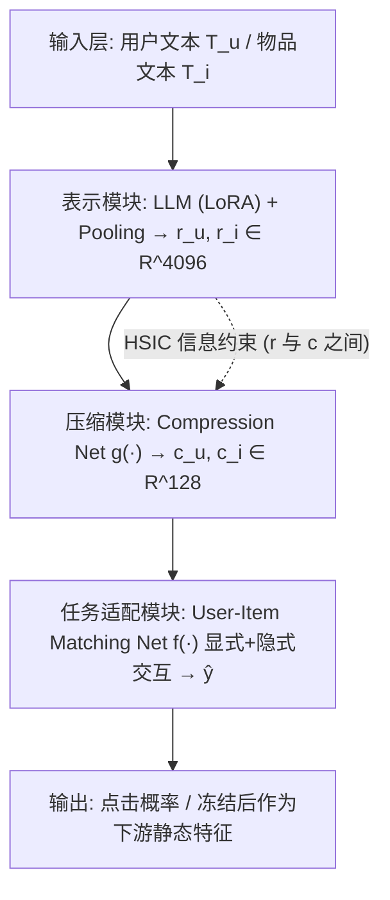
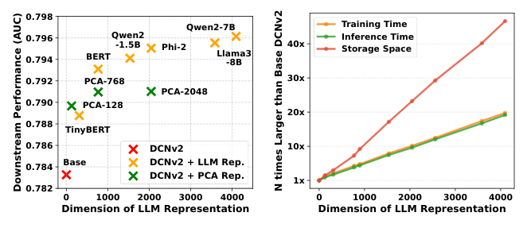
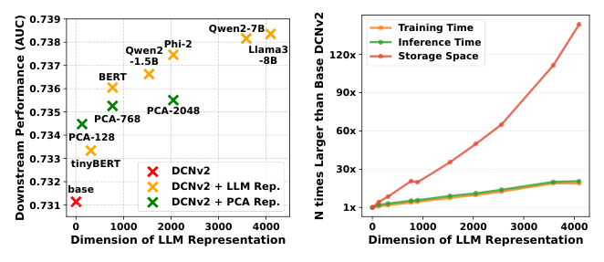
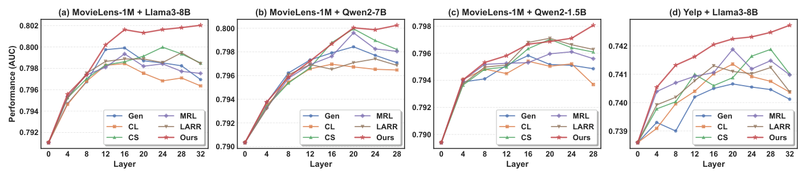
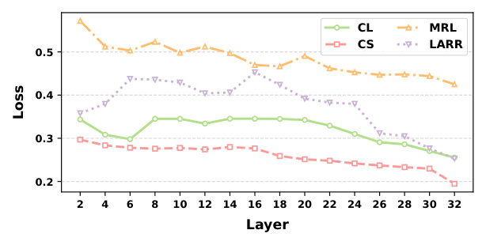
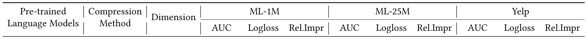
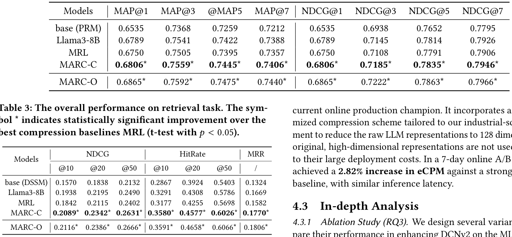
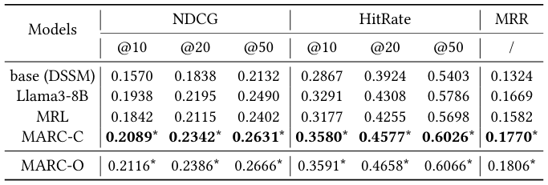

# Modular Representation Compression: Adapting LLMs for Efficient and Effective Recommendations (模块化表示压缩：面向高效推荐的大语言模型适配)

- **会议/期刊**: SIGIR 2026
- **推荐链路定位**: 精排 (CTR/CVR Ranking) 为主，兼验召回 (Retrieval) 与重排 (Re-ranking) 阶段的 LLM 特征增强
- **研究方向**: 大语言模型推荐 (LLM4Rec) / CTR 预估与特征交叉
- **论文原文**: [https://arxiv.org/abs/2604.18146v2](https://arxiv.org/abs/2604.18146v2)
- **开源代码**: 暂未开源

## TL;DR (核心速览)

针对工业推荐系统离线预缓存 LLM 表示时高维表示带来巨大存储与计算开销的问题，本文发现"中间层表示优势 (MRA)"现象——LLM 中间层表示在下游推荐任务上优于末层，导致现有在末层压缩的方法次优。作者从模块化理论出发，提出 MARC：通过模块调整显式引入压缩网络与用户-物品匹配网络，并用 HSIC 信息约束与异构网络结构实现任务解耦，使 LLM 末层保持通用表示能力。在 ML-1M/ML-25M/Yelp 上以 128 维压缩表示取得显著 AUC 提升，线上 A/B 测试 eCPM 提升 2.82%。

## Background & Motivation (背景与动机)

- **领域背景与主流范式**: 由于 LLM 推理延迟难以满足推荐系统 100ms 级在线响应要求，主流可落地方案是**离线用 LLM 编码用户/物品文本为表示并预缓存**，再作为静态特征注入传统推荐模型（如 DCNv2）。LLM 越大，下游增益越明显（图 1a、图 2a：BERT < Phi-2 < Llama3-8B）。
- **现有方法局限 (Limitations of Prior Work)**:
  1. **效率-效果权衡**: 更大 LLM 产生更高维表示（Llama3-8B 为 4096 维），带来约 140× 存储、20× 训练时间开销（图 1b、图 2b），工业规模下不可承受。
  2. **免训练压缩失效**: PCA 将 Llama3-8B 表示降至 BERT 维度 (768) 后性能反而不如 BERT，说明无训练压缩难以保留下游有用信息。
  3. **微调压缩的末层次优**: 现有嵌套式 (MRL/ESE) 与投影式 (LARR/BAHE) 方法均在**末层**压缩，但作者发现末层表示本身已被代理任务"污染"。
- **核心挑战 (Key Challenge)**: 为什么不能直接在最优的中间层压缩？因为最优层随模型与任务变化（图 3），实际不可预先确定；且简单增加投影头无法屏蔽监督信号回传。
- **核心洞察与切入点 (Key Insight)**: 作者通过逐层探针实验（图 3、图 4）发现 **Mid-layer Representation Advantage (MRA)**：下游性能在中间层达到峰值后向末层下降，且该现象在 CTR 对齐损失 (MRL) 下依然存在，排除"目标错配"解释。作者用**模块化理论**解释：LLM 自发形成"表示学习模块（早-中层）+ 任务适配模块（末层）"，末层在强监督下成为信息瓶颈，过滤掉对代理目标冗余但对推荐关键的语义。

## Problem Formulation & Method (问题定义与方法架构)

### 1. 符号定义与输入表征 (Notations & Input Representations)

- 用户集 $\mathcal{U}$、物品集 $\mathcal{I}$；物品 $i$ 的属性与描述经模板转为文本 $T_i$，用户 $u$ 的属性与历史行为 $H_u$ 转为文本 $T_u$。
- LLM 编码并池化得原始表示 $r_i, r_u \in \mathbb{R}^{d_o}$（$d_o=4096$，Llama3-8B）。
- 压缩网络输出 $c_i, c_u \in \mathbb{R}^{d_c}$（$d_c=128 \ll d_o$）。
- 下游任务：CTR 预测（主）、重排、召回。

### 2. 整体流水线 (Overall Architecture)

数据流：文本模板化 $\to$ LLM 表示模块（LoRA 微调，**不对 $r_u, r_i$ 直接施加任务监督**）$\to$ 压缩网络 $g(\cdot)$ 得低维表示 $\to$ 用户-物品匹配网络 $f(\cdot)$ 做显式+隐式交互并输出点击概率 $\hat{y}$。三模块端到端训练，训练完成后冻结，产出稳定低维表示作为下游静态特征。

对比图 5：左侧现有投影式方法将"压缩"与"目标任务"耦合在同一路径，监督信号回传污染 LLM 末层；右侧 MARC 通过外部模块与 HSIC 约束显式划分模块边界。

### 3. 核心模块设计与数学原理 (Key Designs & Formulations)

**(1) 模块调整 (Modular Adjustment)**：显式引入两个轻量外部模块——压缩网络（专职压缩）与用户-物品匹配网络（专职任务适配）。关键设计是**不在原始 LLM 表示 $r_u, r_i$ 上施加任何直接监督**，任务损失仅施加于外部模块，LLM 通过外部模块间接反传优化。物理直觉：让任务适配压力被外部模块吸收，避免 LLM 末层坍缩为任务专用头，从而在全网络深度上保留中间层式的通用信息。

**(2) 压缩模块与 HSIC 信息约束**：压缩为 $c_i = g(r_i),\ c_u = g(r_u)$。目标是最大化互信息 $\max_\theta MI(r_u, c_u)$。由于 $r_u$ 与 $c_u$ 维度与概念层级差异巨大，MSE/InfoNCE/DIM 需维度匹配的投影会扭曲信息，故采用 **HSIC 的采样形式**：

$$\mathcal{L}_{HSIC} = HSIC(X,Y) = \frac{1}{(n-1)^2} Tr(K_X J K_Y J)$$

其中 $K_X, K_Y \in \mathbb{R}^{n\times n}$ 为高斯核矩阵 $k(x_i,x_j)=e^{-\|x_i-x_j\|^2/2\sigma^2}$，$J = I_n - \frac{1}{n}\mathbf{1}_n\mathbf{1}_n^T$ 为中心化矩阵。核函数将不同维度向量映射到 RKHS，从而在**无需维度匹配投影**的前提下最大化非线性依赖，兼顾信息保留与任务解耦。计算复杂度 $O(n^2)$，相对 LLM 主干可忽略。

**(3) 任务适配模块 (User-Item Matching Network)**：输入 $(c_u, c_i)$ 先做显式人工交互 $|c_i - c_u|$ 与 $c_i \odot c_u$，再经交互网络 $f(\cdot)$ 做隐式交互：

$$\hat{y} = f(c_i, c_u, |c_i - c_u|, c_i \odot c_u)$$

该结构与压缩网络（逐表示独立处理）在输入与网络结构上均不同，进一步强化任务解耦，并使信息瓶颈严格发生在轻量外部模块内。

### 4. 训练目标、负采样与推理复杂度 (Optimization, Negative Sampling & Complexity)

- **损失函数**: 匹配任务用交叉熵 $\mathcal{L}_{match} = -\sum_{(i,u,y)\in D'} y\log\hat{y} + (1-y)\log(1-\hat{y})$；总损失 $\mathcal{L} = \mathcal{L}_{match} + \alpha \mathcal{L}_{HSIC}$，$\alpha=0.01$（作者称在该量级附近性能稳健）。
- **训练负采样策略**: 原文未显式报告负采样方案；CTR 训练数据由评分二值化构造（4-5 分为正，其余为负），可视为隐式负例。对比学习类基线（LARR）将点击用户-物品对作为正样本。
- **时间与空间复杂度**: 压缩网络为 MLP [256,128]，匹配网络为 MLP [128,1]，LLM 用 LoRA 微调；作者称训练时间与现有微调压缩方法相当（仅引入轻量模块）。HSIC 为 $O(n^2)$。推理阶段表示离线预缓存，在线仅需 128 维查表，支持低延迟服务；原文未报告具体 ms/request 与峰值显存数值。

## Experimental Setup & Evaluation Protocol (实验设置与评估协议)

- **数据集统计与预处理**: 三个公开数据集，评分 4-5 分为正、其余为负，按用户 ID 以 9:1 划分训练/测试。

| 数据集 (Dataset) | 用户数 (#Users) | 物品数 (#Items) | 交互数 (#Interactions) | 稀疏度/密度 (Sparsity) | 模态/辅助特征说明 |
| :--- | :---: | :---: | :---: | :---: | :--- |
| MovieLens-1M | 6,000 | 4,000 | 1,000,000 | 原文未报告 | 用户属性+历史行为文本、电影标题/类别文本 |
| Yelp | 1,968,703 | 209,393 | ~8,000,000 条评论 | 原文未报告 | 商户属性与评论文本 |
| MovieLens-25M | 162,000 | 62,000 | 25,000,000 | 原文未报告 | 同 ML-1M 文本模板 |

- **数据划分方式 (Splitting Strategy)**: 按用户 ID 的 **9:1 比例划分 (Ratio Split)**，非全局时间戳切分；原文未说明是否按时间排序，存在一定未来信息泄露风险（未明确声明防穿越）。
- **排名评测协议 (Ranking Protocol)**: CTR 任务为逐样本二分类评估（AUC/Logloss），非全库排序；召回任务基于 DSSM 的候选评估，原文未明确说明是 Full-Ranking 还是 Sampled Ranking（**原文未报告**具体候选集构造）。
- **评价指标与显著性检验**: CTR 用 AUC、Logloss；重排用 MAP@K、NDCG@K ($K=1,5,10$)；召回用 NDCG@K、HitRate@K、MRR ($K=10,20,50$)。压缩维度统一 128 维（MARC-O 为 4096 维上界）。采用 **t-test，$p<0.05$** 标注统计显著性（表 1-3 中 * 号）。可复现性：从训练集随机采样 200,000 条训练 LLM 表示模型，再在全训练集训练下游任务。

## Key Experimental Results (核心实验结果)

### 1. 主实验对比 (Main Results)

CTR 预测（下游 DCNv2，表 1）：

| 数据集 | 指标 | base (DCNv2) | 免训练压缩 (PCA/AE/VAE) | 最强微调压缩基线 MRL (128d) | 本文 MARC-C (128d) | 相对提升 (vs MRL) |
| :--- | :--- | :---: | :---: | :---: | :---: | :---: |
| ML-1M | AUC / Logloss | 0.7833 / 0.5512 | PCA 0.7897 / AE 0.7893 / VAE 0.7840 | 0.7943 / 0.5404 | **0.8011\* / 0.5317\*** | +0.89% AUC |
| ML-25M | AUC / Logloss | 0.7945 / 0.5469 | PCA 0.8138 / AE 0.8145 / VAE 0.8094 | 0.8186 / 0.5188 | **0.8233\* / 0.5127\*** | +0.57% AUC |
| Yelp | AUC / Logloss | 0.7311 / 0.5203 | PCA 0.7345 / AE 0.7329 / VAE 0.7323 | 0.7372 / 0.5166 | **0.7427\* / 0.5109\*** | +0.74% AUC |

注：MARC-C 在 ML-1M 上较冻结 Llama3-8B 的 4096 维表示 (0.7961) 提升 0.63%，较 MARC-O 上界 (0.8020) 仅损失 0.11%。

重排任务（PRM，表 2，ML-1M）：MARC-C 的 MAP@1=0.6806、NDCG@1=0.6806，均显著优于 MRL (0.6750) 与冻结 Llama3-8B (0.6789)。

召回任务（DSSM，表 3，ML-1M）：MARC-C 的 HitRate@10=0.3580，较 MRL (0.3177) 提升 **12.67%**，较冻结 Llama3-8B (0.3291) 提升 8.76%；MRR=0.1770 亦为最优压缩结果。

### 2. 消融实验与控制变量分析 (Ablation Study)

图 6（ML-1M，DCNv2）显示移除任一组件均导致性能下降：
- **w/o HSIC** 降幅最大（原始与压缩表示均显著下降），说明信息约束对信息保留最关键。
- **w/o EI**（去显式交互）与 **w/o MN**（去匹配网络）对原始表示影响有限，但对压缩表示影响显著，说明二者在压缩过程中维持信息的作用。
- 即便去掉 EI 或 MN，MARC 仍优于最强基线 MRL，证明**核心增益来自模块化解耦框架**而非交互结构本身。
- 替换损失（w/ CS、w/ AoE）均导致表示质量下降；AoE 因无法配合匹配网络而表现较差。

图 7 进一步验证：替换损失函数或去掉交互组件后，MRA 现象均消失（最优表示回到末层），说明**缓解 MRA 的主因是模块化结构**，损失函数与交互网络主要提升表示质量。消融对照未显式做参数量对齐，但各变体共享同一 LLM 主干与轻量模块规模。

### 3. 稀疏度/冷启动分桶与超参敏感度 (Sparsity Buckets & Hyperparameters)

- **交互频次分桶**: 原文未报告长尾/冷启动分桶实验。
- **关键超参数敏感度**: 压缩维度从 16 到 512 扫描（图 9），MARC 在所有维度上均优于 MRL；维度增至 128 后 MARC-O 性能开始下降（训练难度增大），MARC-C 随之下降。$\alpha=0.01$ 附近性能稳健。
- **兼容性**: 表 4 显示 MARC-C 在 xDeepFM/FiBiNet/DeepFM/FiGNN/DCNv1/DIN/AutoInt 七种 CTR 模型上均优于 MRL 与冻结 Llama3-8B，与 MARC-O 差距 <0.1%；图 8 显示在 Qwen2-1.5B/Phi-2/Qwen2.5-3B/Qwen2-7B 等不同骨干上同样有效。
- **线上 A/B 测试**: 大规模商业搜索广告场景（千万级用户与广告），10% 流量实验组 vs 对照组，7 天测试，MARC 将表示压缩至 128 维，**eCPM 提升 2.82%**，推理延迟与生产基线相近。

## Highlights, Limitations & Critiques (亮点、局限与审稿级批判)

- **核心亮点与可迁移性**:
  1. **MRA 现象的发现与模块化解释**具有普适价值，可迁移到任何"LLM 离线编码 + 下游任务"的特征增强范式（如多模态编码器压缩、跨域特征迁移）。
  2. **HSIC 跨维度信息约束**无需维度匹配投影即可最大化非线性互信息，可复用于任意高维到低维的特征蒸馏。
  3. **"监督信号外置"的解耦思想**（不在主干表示上直接加任务损失）对 LLM 微调推荐、知识蒸馏均有借鉴意义。
  4. 同时覆盖精排/重排/召回三阶段并含真实线上 A/B，工业说服力强。
- **局限性与审稿视角批判**:
  1. **评估协议偏弱**: 数据按用户 ID 9:1 划分而非全局时间戳切分，未声明防数据穿越；召回任务未明确 Full-Ranking 还是采样排序，削弱结论无偏性。
  2. **负采样与训练细节缺失**: 未报告负采样策略、batch size、随机种子方差，仅以 t-test 标注显著性，统计严谨性可加强。
  3. **效率论证不完整**: 声称训练开销与现有微调方法相当，但未给出具体单 epoch 耗时、峰值显存与在线 ms/request 数值；HSIC 的 $O(n^2)$ 在大 batch 下的实际开销未量化。
  4. **MRA 理论解释偏定性**: 模块化理论与信息瓶颈的论证主要靠逐层损失曲线（图 4）间接支撑，缺乏更严格的因果或探针实验。
  5. **超参 $\alpha$ 与压缩维度耦合**: 图 9 显示维度 >128 后性能下降，最优维度需调参，工业部署的自动化选择未讨论。

## Rating (四维评分)

- **方法创新性 (Novelty)**: ⭐⭐⭐⭐
- **评估协议与实验扎实度 (Protocol & Experiments)**: ⭐⭐⭐⭐
- **写作与数学规范度 (Clarity & Rigor)**: ⭐⭐⭐⭐
- **工业落地与复现价值 (Industrial & Practical Value)**: ⭐⭐⭐⭐⭐

## 论文图表

<figure class="paper-figure" markdown="span">
  <figcaption>图1：在MovieLens-1M中不同LLM表示对下游性能和成本的影响。</figcaption>
</figure>

<figure class="paper-figure" markdown="span">
  <figcaption>图2：在Yelp中不同规模LLM对下游DCNv2性能和成本的影响。</figcaption>
</figure>

<figure class="paper-figure" markdown="span">
  <figcaption>图3：不同数据集和LLM下的中间层表示优势。</figcaption>
</figure>

<figure class="paper-figure" markdown="span">
  <figcaption>图4：代理目标任务上的逐层性能。</figcaption>
</figure>

<figure class="paper-figure" markdown="span">
  <figcaption>图5：现有基于投影的压缩方法（左）与MARC（右）的对比。注意，用户和物品表示（Rep.）用于下游任务。</figcaption>
</figure>

<figure class="paper-figure" markdown="span">
  <figcaption>表1：CTR预测任务上的整体性能。最佳结果以粗体给出，次优压缩基线以下划线标出。MARC-C和MARC-O分别表示我们MARC的压缩表示和原始表示。MARC-O是MARC-C的上界。Rel. Impr表示MARC-C相对于其他模型的相对AUC提升。符号*表示相对于最佳压缩基线具有统计显著提升（t检验，𝑝&lt; 0.05）。</figcaption>
</figure>

<figure class="paper-figure" markdown="span">
  <figcaption>表2：重排序任务上的整体性能。符号*表示相对于最佳压缩基线MRL具有统计显著提升（t检验，𝑝&lt; 0.05）。</figcaption>
</figure>

<figure class="paper-figure" markdown="span">
  <figcaption>表3：检索任务上的整体性能。符号*表示相对于最佳压缩基线MRL具有统计显著提升（t检验，𝑝&lt; 0.05）。</figcaption>
</figure>

