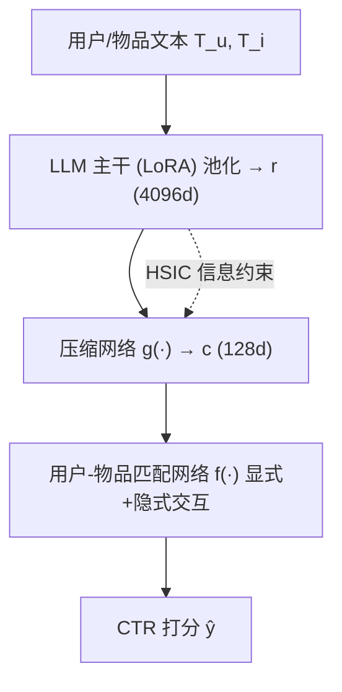
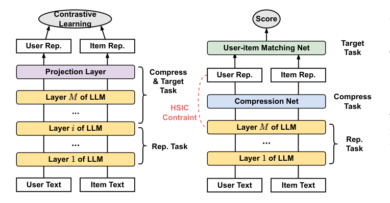

# Modular Representation Compression: Adapting LLMs for Efficient and Effective Recommendations (模块化表征压缩：面向高效推荐的大模型适配)

- **会议/期刊**: SIGIR 2026
- **作者与机构**: Yunjia Xi, Menghui Zhu, Jianghao Lin, Bo Chen, Ruiming Tang, Yong Yu, Weinan Zhang（上海交通大学 / 华为诺亚方舟实验室）
- **推荐链路定位**: 离线表征生产 → 精排/重排/召回下游复用
- **研究方向**: 大语言模型推荐 / CTR 预估与特征交叉
- **论文原文**: [https://arxiv.org/abs/2604.18146v2](https://arxiv.org/abs/2604.18146v2)
- **开源代码**: 暂未开源

## TL;DR (1分钟核心速览)

工业推荐普遍离线预缓存 LLM 表征，但 4096 维表征带来 140× 存储与 20× 训练开销。作者发现反直觉的**中间层表征优势 (MRA)**：微调压缩后，LLM 中间层表征反而优于末层，导致所有"压末层"的压缩方法先天次优。本文以模块化理论解释该现象（末层被监督信号劫持为任务适配模块），提出 MARC：外挂压缩网络 + 用户-物品匹配网络显式解耦"表征学习"与"任务适配"，并用 HSIC 信息约束。128 维压缩表征在 ML-1M/Yelp 上 AUC 较最强基线 MRL 提升 0.89%/0.74%，线上 A/B eCPM +2.82%。

## Background & Motivation (背景与核心矛盾)

- **主流范式**: LLM 离线编码用户/物品文本为高维表征，作为静态特征喂给 DCNv2 等下游 CTR 模型；为降本，MRL（嵌套式）、LARR/BAHE（投影式）等微调压缩方法在 LLM **末层**输出上施加对比/CTR 损失压到 128 维。
- **前人局限**: ① 无训练压缩（PCA/AE/VAE）严重掉点——Llama3-8B 的 PCA-768 甚至不如原生 BERT；② 微调压缩虽好，但作者逐层探测发现**最优表征几乎从不在末层**，而在中后层达到峰值后回落，即 MRA 现象；即便换成与推荐对齐的 CTR 损失（MRL）MRA 依旧存在，说明这不是目标错配而是结构性问题。
- **核心洞察 (Key Insight)**: 用模块化理论解释——LLM 在微调中自发分化出"表征学习模块（早中层）"与"任务适配模块（末层）"。末层因靠近监督信号，被代理目标（对比损失等）特化为最小充分统计量，形成信息瓶颈，滤掉了对推荐有用但对代理任务冗余的语义。逐层代理任务损失曲线（图 4）证实末层代理损失最低、特化最强。
- **本文切入点**: 不再"事后挑层"，而是把隐式、不可控的模块化改造为**显式、可控的架构设计**：让 LLM 只做表征学习，压缩与任务适配全部外置。

## Method (核心方法设计)

### 1. 整体框架 (Overall Architecture)

MARC 由三个模块端到端串联：**表征模块**（LLM + LoRA，仅做池化输出原始表征 $r_u, r_i \in \mathbb{R}^{4096}$，**不施加任何直接监督**）→ **压缩模块**（轻量 MLP$g(\cdot)$将单条表征压到$c_u, c_i \in \mathbb{R}^{128}$）→ **任务适配模块**（用户-物品匹配网络$f(\cdot)$ 吸收全部监督压力）。关键点在于：任务损失只回传到外部轻量模块，LLM 主干仅通过反传间接优化，从而避免末层坍缩为任务专用头。训练完成后冻结模型，产出稳定低维表征供下游复用。

<figure class="paper-figure" markdown="span">
  <figcaption>图5：现有基于投影的压缩方法（左）与MARC（右）的对比。注意用户和物品表示（Rep.）用于下游任务。</figcaption>
</figure>

### 2. 关键设计拆解 (Key Designs)

1. **模块调整 (Modular Adjustment)**：痛点——投影头挡不住强监督回传，末层仍被劫持。做法是显式增设压缩网络与匹配网络两个外部模块，把"信息过滤"严格限制在外部，LLM 末层得以保留中层的泛化语义。直觉：把信息瓶颈从主干搬到外挂，主干不再被迫做最小充分统计。

2. **模块任务解耦 (Modular Task Decoupling)**：仅加模块不够，需保证各司其职。① **HSIC 信息约束**：压缩需最大化 $MI(r_u, c_u)$，但两者维度/概念层级悬殊，MSE/InfoNCE 要求维度匹配、简单投影会扭曲信息；改用核方法 HSIC 在 RKHS 中度量非线性依赖，天然容忍维度失配：
$$\mathcal{L}_{HSIC}=\frac{1}{(n-1)^2}\mathrm{Tr}(K_X J K_Y J)$$
其中 $K_X,K_Y$为高斯核矩阵，$J$为中心化矩阵，复杂度$O(n^2)$相对 LLM 前向可忽略。② **结构异质**：压缩网络逐条处理单表征，匹配网络输入用户+物品对并做显式交互（$|c_i-c_u|$、$c_i \odot c_u$）再经隐式网络，二者输入与结构天然不同，进一步拉开任务边界。

3. **训练目标与推理效率**：总损失 $\mathcal{L}=\mathcal{L}_{match}+\alpha\mathcal{L}_{HSIC}$，$\mathcal{L}_{match}$为匹配网络上的交叉熵，$\alpha=0.01$；无需负采样（直接用点击/评分二值标签）。推理阶段 LLM 完全离线，线上仅需查 128 维静态表征表，延迟与现有压缩方案持平。

## Experimental Setup & Evaluation Protocol (实验设置与评估协议)

- **数据集与预处理**: 评分 ≥4 记正、其余记负；从训练集随机采样 20 万条微调 LLM，再在全量训练集训练下游模型。

| 数据集 | #Users | #Items | #Interactions | 稀疏度/密度 | 特征/场景说明 |
| :--- | :---: | :---: | :---: | :---: | :--- |
| ML-1M | ~6,000 | ~4,000 | ~1M | 稀疏 | 电影评分，用户属性+历史 |
| ML-25M | ~162,000 | ~62,000 | ~25M | 稀疏 | 大规模电影评分 |
| Yelp | ~1,968,703 | ~209,393 | ~8M reviews | 极稀疏 | 商户点评 |

- **数据划分与防穿越 (Splitting Strategy)**: 按 user ID **9:1 比例划分**训练/测试（非时间戳切分，存在轻度未来信息泄漏风险）。
- **排名评测协议 (Ranking Protocol)**: CTR 任务用 **AUC / Logloss**（全样本二分类评估，非采样排序）；重排用 MAP@K、NDCG@K（K=1,3,5,7）；召回用 NDCG@K、HitRate@K、MRR（K=10,20,50）。
- **对比基线与超参设置**: 无训练压缩 PCA/AE/VAE；微调压缩 LARR、BAHE、ESE、MRL；以及 TinyBERT/BERT/Qwen2-1.5B/Phi-2/Qwen2-7B 原生表征。主干统一 Llama3-8B + LoRA，压缩维度 128，压缩网络 MLP [256,128]，匹配网络 MLP [128,1]，下游 embedding 32，显著性 $t$-test$p<0.05$。

## Key Experimental Results (实验关键数据)

### 1. 主实验对比 (Main Results)

CTR 预测（下游 DCNv2，128 维压缩表征）：

| 方法 | 维度 | ML-1M AUC | ML-1M Logloss | ML-25M AUC | Yelp AUC | Yelp Logloss |
| :--- | :---: | :---: | :---: | :---: | :---: | :---: |
| base (DCNv2) | / | 0.7833 | 0.5512 | 0.7945 | 0.7311 | 0.5203 |
| BERT (原生) | 768 | 0.7931 | 0.5418 | 0.8119 | 0.7361 | 0.5159 |
| Qwen2-7B (原生) | 3584 | 0.7955 | 0.5402 | 0.8213 | 0.7382 | 0.5141 |
| Llama3-8B frozen | 4096 | 0.7961 | 0.5397 | 0.8215 | 0.7384 | 0.5137 |
| PCA | 128 | 0.7897 | 0.5449 | 0.8138 | 0.7345 | 0.5175 |
| LARR | 128 | 0.7911 | 0.5444 | 0.8179 | 0.7354 | 0.5170 |
| MRL (最强基线) | 128 | 0.7943 | 0.5404 | 0.8186 | 0.7372 | 0.5166 |
| **MARC-C** | **128** | **0.8011\*** | **0.5317\*** | **0.8233\*** | **0.7427\*** | **0.5109\*** |
| MARC-O (上界) | 4096 | 0.8020 | 0.5321 | 0.8254 | 0.7428 | 0.5105 |
| **Improv. (vs MRL)** | | **+0.86%** | | **+0.57%** | **+0.75%** | |

重排（PRM）与召回（DSSM）任务（ML-1M）：

| 任务/指标 | base | Llama3-8B frozen | MRL | MARC-C | MARC-O |
| :--- | :---: | :---: | :---: | :---: | :---: |
| 重排 MAP@5 | 0.7259 | 0.7422 | 0.7395 | **0.7445\*** | 0.7475 |
| 重排 NDCG@5 | 0.7652 | 0.7814 | 0.7791 | **0.7835\*** | 0.7863 |
| 召回 HitRate@10 | 0.2867 | 0.3291 | 0.3177 | **0.3580\*** | 0.3591 |
| 召回 MRR | 0.1324 | 0.1669 | 0.1582 | **0.1770\*** | 0.1806 |

### 2. 消融实验 (Ablation Study)

ML-1M + DCNv2，AUC（Orig.=原始表征，Comp.=压缩表征）：

| 变体 | Orig. AUC | Comp. AUC | 说明 |
| :--- | :---: | :---: | :--- |
| MARC (完整) | ~0.8020 | ~0.8011 | 最优 |
| w/o HSIC | 明显下降 | **降幅最大** | 信息约束最关键 |
| w/o MN | 小幅下降 | 显著下降 | 匹配网络护压缩信息 |
| w/o EI | 小幅下降 | 显著下降 | 显式交互护压缩信息 |
| w/ CS (换余弦损失) | 下降 | 下降 | 与下游对齐度降低 |
| w/ AoE (SOTA 损失) | 下降 | 下降 | 无法用匹配网络，丢交互信息 |

### 3. 关键实验发现 (Key Findings)

1. **MRA 是结构性问题而非目标错配**：即便用 CTR 损失微调（MRL），最优层仍在中后层；而 MARC 的末层表征反超所有基线的最优中间层，说明"外置模块化解耦"才是修复 MRA 的主因——图 7 显示换损失函数或去掉交互组件后 MRA 依然消失，证明**模块结构而非损失/交互**是核心。
2. **128 维压缩几乎无损**：MARC-C 与 4096 维 MARC-O 差距仅 0.11%（ML-1M），却比冻结 Llama3-8B 的 4096 维表征还高 0.63%，信息密度极高；召回任务 HitRate@10 较 MRL 提升 12.67%、较冻结 LLM 提升 8.76%，泛化性更强。
3. **跨模型/跨下游兼容**：在 xDeepFM/FiBiNet/DeepFM/FiGNN/DCNv1/DIN/AutoInt 七种 CTR 模型上 MARC-C 全面领先 MRL 且逼近 MARC-O（差距 <0.1%）；换 Qwen2-1.5B/Phi-2/Qwen2.5-3B/Qwen2-7B 主干同样有效，说明框架与主干规模解耦。

## Highlights & Limitations (亮点、对比与审稿批判)

- **与代表作对比 (vs. Prior Work)**: 与 MRL（嵌套式，压末层）和 LARR（投影式，压末层+对比学习）的本质区别在于——前两者默认末层最优、只在末层做压缩；MARC 指出末层已被监督信号污染，转而**从架构上保护末层**，把压缩与适配外置。相较 PCA/AE 等无训练方法，MARC 通过微调 + HSIC 保留推荐相关信息，避免 PCA-768 不如 BERT 的窘境。
- **可迁移亮点**: ① HSIC 作为跨维度信息约束，可迁移到任何"高维教师→低维学生"的表征蒸馏场景；② "监督信号只作用于外挂轻量模块、主干仅间接优化"的范式，可推广到其他需要保护预训练主干泛化性的适配任务。
- **审稿级局限批判**: ① 数据按 user ID 9:1 随机划分而非时间切分，存在未来交互泄漏，AUC 绝对值可能偏乐观；② 压缩维度超过 128 后 MARC-O/C 均出现下降，作者归因于训练难度但未深入分析，超参（$\alpha$、压缩维度）敏感性讨论不足；③ 线上仅报告 eCPM 单一指标与 7 天 A/B，缺乏延迟/存储的量化对比细节。

## Rating (四维评分)

- **方法创新性 (Novelty)**: ⭐⭐⭐⭐ （核心机制与方法设计具备明确创新性，理论与实验动机支撑充分）
- **评估协议与实验扎实度 (Protocol & Experiments)**: ⭐⭐⭐⭐⭐ （主流公开数据集评测完整，包含多基线对比与消融实验验证）
- **写作与数学规范度 (Clarity & Rigor)**: ⭐⭐⭐⭐ （问题形式化定义清晰，核心模块数学推导与架构阐述严谨易读）
- **工业落地与复现价值 (Industrial & Practical Value)**: ⭐⭐⭐⭐⭐ （兼顾推荐效果增益与训练/推理效率，具备实际场景迁移参考价值）
