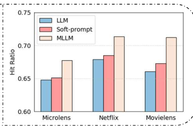
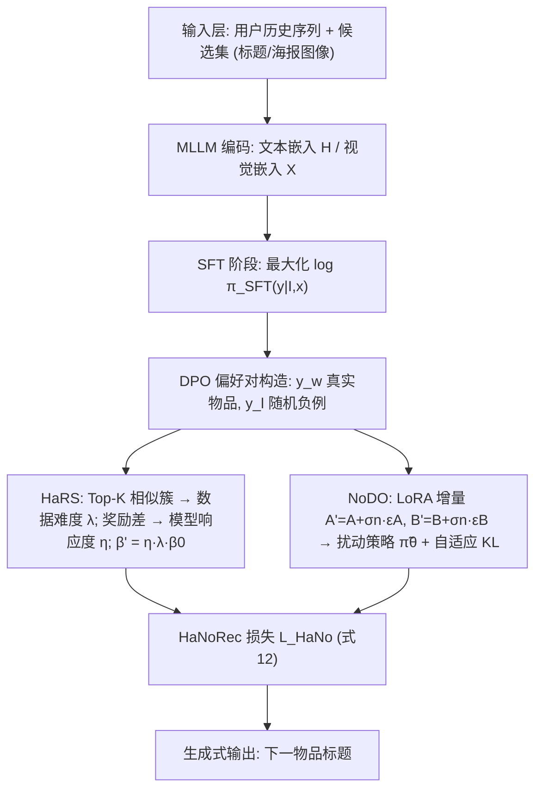
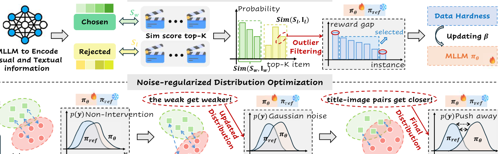
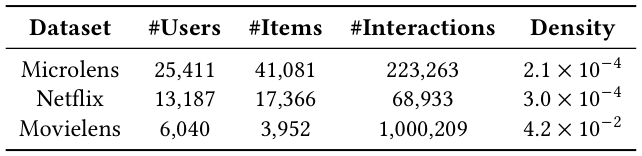
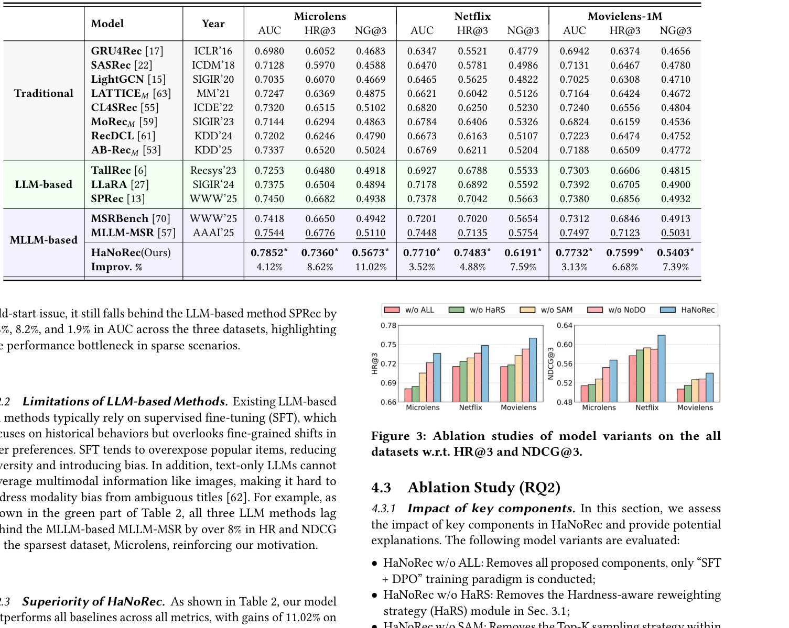
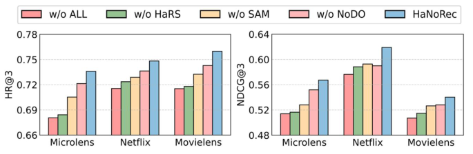
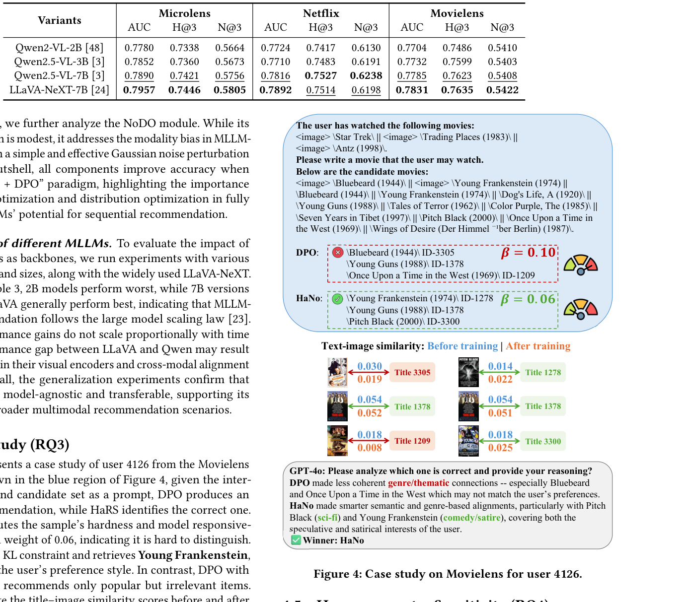
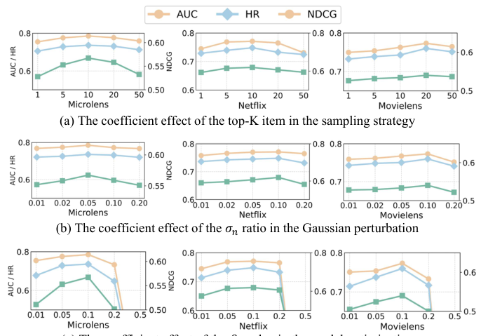
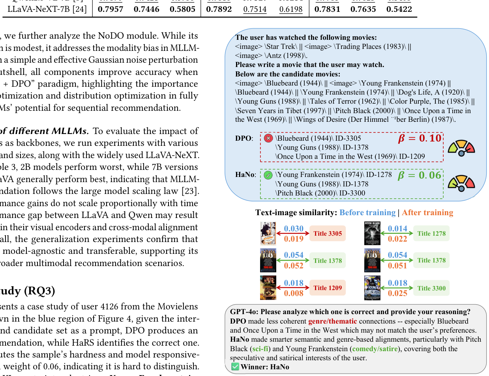

# Multimodal Large Language Models with Adaptive Preference Optimization for Sequential Recommendation (面向序列推荐的多模态大模型自适应偏好优化)

- **会议/期刊**: SIGIR 2026 (Full Paper)
- **推荐链路定位**: 端到端生成式 (End-to-End Generative) — 以 MLLM 直接对候选集做生成式选择/排序
- **研究方向**: 大语言模型推荐 (LLM4Rec) / 多模态推荐
- **论文原文**: [https://arxiv.org/abs/2511.18740v2](https://arxiv.org/abs/2511.18740v2)
- **开源代码**: [https://github.com/wangyu0627/HaNoRec](http://github.com/wangyu0627/HaNoRec)

## TL;DR (核心速览)

本文针对 MLLM 序列推荐中"样本难度失衡"（随机负采样导致易样本过拟合、难样本欠训练）与"跨模态语义偏差"（DPO 固定参考模型使标题-图像错配在长序列上"弱者愈弱"）两大痛点，提出 HaNoRec：用难度感知重加权策略 (HaRS) 动态缩放 DPO 权重 $\beta'$，并用噪声正则分布优化 (NoDO) 对 LoRA 增量注入高斯扰动 + 自适应 KL 约束。在 Microlens/Netflix/Movielens 上采用 1 正 9 负候选集协议，NDCG@3 相对最强基线 MLLM-MSR 提升 7.39%–11.02%。

## Background & Motivation (背景与动机)

- **领域背景与主流范式**: LLM4Rec 将用户交互序列转为文本 prompt，通过 SFT 学习下一物品；MLLM 进一步把物品图像（海报/封面）作为视觉 token 注入，形成 "SFT + DPO" 的两阶段偏好对齐范式（代表工作 MLLM-MSR、MSRBench）。
- **现有方法局限**:
  1. **样本难度失衡**: DPO 偏好数据中负例从用户未交互物品中**随机采样**，导致大量"易区分"样本（如 *Godfather* vs *Roman Holiday* 语义差距大）反复被优化，而"难区分"样本（如 *Up* 这类短标题、易受模态偏差干扰的样本）被忽视，奖励差持续放大易样本优化。
  2. **跨模态语义偏差**: DPO 的固定参考模型 $\pi_{\text{ref}}$ 施加反向 KL 约束，使策略模型 $\pi_\theta$ 集中于参考模型高概率区域，无法纠正标题-图像错配；长序列累积局部语义漂移，放大偏差。
- **核心挑战**: 简单增加网络深度或常规对比学习无法解决——问题根源在于 DPO 的**固定权重机制**与**固定参考分布约束**，而非表征容量不足。
- **核心洞察与切入点**: 作者做了两项先验观察（图1）：(b) 不同负例与正例的标题-图像相似度差异悬殊（0.05 vs 0.24），说明样本难度天然不均衡；(c) 训练过程中初始相似度高的样本（*Titanic*）保持稳定，初始相似度低的样本（*Flipped*）进一步下降，呈现"the weak get weaker"的表征退化趋势。由此引出"按难度调权 + 平滑分布纠偏"的设计。

<figure class="paper-figure" markdown="span">
  <figcaption>图1：(a) 现有基于大模型的序列推荐范式与性能对比；(b) MLLM-SR 在 DPO 训练中的数据构建与样本难度问题；(c) 由于 DPO 训练后的 MLLM 模态偏差，标题-图像相似度分数呈现“弱者愈弱”趋势。</figcaption>
</figure>

## Problem Formulation & Method (问题定义与方法架构)

### 1. 符号定义与输入表征 (Notations & Input Representations)

- 用户集 $\mathcal{U}$、物品集 $\mathcal{V}$，用户 $u$ 的交互序列 $S_u=\{v_1^u,\dots,v_t^u\}$，目标预测 $v_{t+1}^u$。
- 训练样本 $(x, I, y)$：$x$ 为指令（编码历史序列 + 候选集），$I$ 为图像输入（历史与目标物品海报），$y$ 为期望回答（真实下一物品）。
- 偏好数据 $\mathcal{D}=\{(I,x,y_w,y_l)\}$，$y_w$ 为真实下一物品，$y_l$ 为随机采样的未观测物品。
- 预训练 MLLM 将物品标题集与图像集编码为文本嵌入矩阵 $H\in\mathbb{R}^{|\mathcal{V}|\times d}$ 与视觉嵌入矩阵 $X\in\mathbb{R}^{|\mathcal{I}|\times d}$，$d$ 为共享嵌入维度（原文未报告具体 $d$ 值）。
- 序列截断：所有模型仅使用**最近 6 次交互**，最后 1 个作为预测目标。

### 2. 整体流水线 (Overall Architecture)

数据流：物品标题/图像 $\to$ MLLM 编码为语义嵌入 $\to$ 构造 SFT 数据（图6 给出 AUC 与 HR/NDCG 两种 prompt 模板）$\to$ SFT 阶段 $\to$ 构造 DPO 偏好对 $\to$ HaRS 估计样本难度 $\lambda$ 与模型响应度 $\eta$ 并动态缩放 $\beta'$ $\to$ NoDO 对 LoRA 增量注入高斯噪声并施加自适应 KL $\to$ 输出下一物品标题。

### 3. 核心模块设计与数学原理 (Key Designs & Formulations)

**(1) HaRS：难度感知重加权策略**

- **数据难度 $\lambda$**：以 $y_w$、$y_l$ 为锚点，在嵌入空间计算与全库物品的余弦相似度并取 Top-$K$，形成正/负样本簇：
$$S^*=\text{Top-}K_{v_j\in\mathcal{V}}\left(\frac{(h_j+x_j)^\top(h_{y^*}+x_{y^*})}{\|h_j+x_j\|_2\|h_{y^*}+x_{y^*}\|_2}\right),\quad *\in\{w,l\}$$
- 对簇内相似度做 Softmax 得概率 $Z_w, Z_l$，难度定义为概率差经 sigmoid 归一化：
$$\Delta=\left|Z_{w,k}-Z_{l,k}\right|_{k=1}^K,\qquad \lambda=\sigma(\Delta)/\sigma(\bar{\Delta})$$
物理直觉：$\lambda$ 大表示正负样本在图文语义上清晰可分（易样本），$\lambda$ 小表示难区分样本，应给予**更小的 $\beta$**（放松 KL 约束）以投入更多优化。

- **模型响应度 $\eta$**：用隐式奖励差刻画模型当前偏好：
$$R_i=\beta\log\frac{\pi_\theta(y_{w,i}|x_i,I_i)}{\pi_{\text{ref}}(y_{w,i}|x_i,I_i)}-\beta\log\frac{\pi_\theta(y_{l,i}|x_i,I_i)}{\pi_{\text{ref}}(y_{l,i}|x_i,I_i)}$$
均值归一化后，用掩码向量 $M_i=[0,1,\dots,1,0]$ 过滤最高/最低两个极端样本抑制离群值：
$$\eta=\sigma\left(\frac{1}{N-2}\sum_{i=1}^N M_i\bar{R}_i\right)/\sigma(\bar{R})$$
- **动态权重**：$\beta'_{\mathcal{B}}=\bar{\eta}_{\mathcal{B}}\cdot\lambda_{\mathcal{B}}\cdot\beta_0$，$\beta_0$ 默认 0.1。$\lambda$ 反映数据内在难度（离线），$\eta$ 反映实时学习状态（在线），二者互补。

**(2) NoDO：噪声正则分布优化**

- 对策略模型最后一层 logits $z$ 注入高斯噪声：
$$\tilde{\pi}_\theta(y|x,I)=\mathbb{E}_{\epsilon\sim\mathcal{N}(0,I)}\left[\pi_\theta(y|x,I;z+\epsilon\odot z)\right]$$
- 由于采用 LoRA 微调 $W=W_0+BA$，实际扰动施加在可训练增量上：$A'=A+\sigma_n\epsilon_A$，$B'=B+\sigma_n\epsilon_B$，前向计算 $W'=W_0+B'A'$，从而对 $\pi_\theta$ 与 $\pi_{\text{ref}}$ 同时产生平滑分布。
- 理论支撑（式13–15）：DPO 梯度 $\nabla L_{\text{DPO}}=-\mathbb{E}[\sigma(-\beta\Delta_\theta)\nabla\Delta_\theta]$，当 $|\Delta_\theta|$ 大时 $\sigma(-\beta\Delta_\theta)\to 0$ 导致梯度饱和衰减，弱语义/长序列样本受害更重；引入零均值参数噪声 $\delta$ 后 $\mathbb{E}[\sigma(-\beta\Delta_\theta+\delta)]>\sigma(-\beta\Delta_\theta)$，将概率质量重新分配到非饱和区，恢复有效梯度。

**(3) 最终损失**

$$\mathcal{L}_{\text{HaNo}}=-\mathbb{E}_{(I,x,y_w,y_l)}\left[\log\sigma\left(\beta'\log\frac{\tilde{\pi}_\theta(y_w|I,x)}{\pi_{\text{ref}}(y_w|I,x)}-\beta'\log\frac{\tilde{\pi}_\theta(y_l|I,x)}{\pi_{\text{ref}}(y_l|I,x)}\right)\right]$$

<figure class="paper-figure" markdown="span">
  <figcaption>图2：HaNoRec 示意图。难度感知重加权策略（HaRS）按样本难度成比例缩放 DPO 权重，聚焦困难样本。噪声正则化分布优化（NoDO）加入高斯噪声与自适应 KL，以对齐标题-图像语义并抑制模态偏差。</figcaption>
</figure>

### 4. 训练目标、负采样与推理复杂度 (Optimization, Negative Sampling & Complexity)

- **损失函数**: 上述 $\mathcal{L}_{\text{HaNo}}$，即带动态 $\beta'$ 与扰动策略 $\tilde{\pi}_\theta$ 的 DPO 损失；$\beta_0=0.1$，LoRA rank $r=8$，学习率 $1\times10^{-4}$，梯度累积步数 8。
- **训练负采样策略**: DPO 阶段 $y_l$ 从用户**未观测物品中随机采样**（Uniform 随机负例），这是本文批判并试图通过重加权缓解的对象；HaRS 内部另用 Top-$K$ 相似簇构造难度梯度（$K$ 默认 10 或 20）。
- **时间与空间复杂度**: 设文本 token 数 $T$、视觉 token 数 $V$、$N=T+V$、batch size $B$、维度 $d$、Transformer 层数 $L$。标准 DPO 为 $\mathcal{O}(BL[4N^2d+4Nd^2])$，HaNoRec 额外仅 $\mathcal{O}(B)+\mathcal{O}(BN)$（Top-K 检索与噪声注入），在 $L,d$ 为常数时二者均退化为 $\mathcal{O}(4BN^2)$。**推理阶段与标准 MLLM 完全一致，无额外延迟**（原文未报告具体 ms/request 与峰值显存数值）。

## Experimental Setup & Evaluation Protocol (实验设置与评估协议)

- **数据集统计与预处理**（表1）：

<figure class="paper-figure" markdown="span">
  <figcaption>表1：实验数据集统计。</figcaption>
</figure>

| 数据集 (Dataset) | 用户数 (#Users) | 物品数 (#Items) | 交互数 (#Interactions) | 稀疏度/密度 (Density) | 模态/辅助特征说明 |
| :--- | :---: | :---: | :---: | :---: | :--- |
| Microlens | 25,411 | 41,081 | 223,263 | $2.1\times10^{-4}$ | 短视频：标题 + 封面图（仅用标题与图像），平均交互 8.79 |
| Netflix | 13,187 | 17,366 | 68,933 | $3.0\times10^{-4}$ | 电影：标题 + 海报，高度稀疏，平均交互 5.23 |
| Movielens | 6,040 | 3,952 | 1,000,209 | $4.2\times10^{-2}$ | 电影：标题 + 年份 + 海报，稠密，平均序列长 165.56 |

- **数据划分方式 (Splitting Strategy)**: 按序列数量以 **8:1:1 比例划分**训练/验证/测试（遵循 LLaRA 设置），非全局时间戳切分；所有模型仅取最近 6 次交互、最后 1 个为预测目标。原文未讨论时间泄露风险。
- **排名评测协议 (Ranking Protocol)**: **Sampled Ranking**——HR@3 与 NDCG@3 使用"1 个真实目标 + 9 个随机采样负例"构成 10 候选集；AUC 为二分类判断（无需候选集），采用图6(a) 的 Yes/No prompt。**非 Full-Ranking**，存在采样偏差风险。
- **评价指标与显著性检验**: AUC、HR@3、NDCG@3；所有结果**五次运行取平均**，表2 中带 `*` 表示 $p<0.05$ 的统计显著性。Embedding 维度 $d$ 原文未报告。

## Key Experimental Results (核心实验结果)

### 1. 主实验对比 (Main Results)

<figure class="paper-figure" markdown="span">
  <figcaption>表2：不同数据集上的推荐性能对比。下标 𝑀 表示多模态方法。</figcaption>
</figure>

| 数据集 | 指标 | 传统最强基线 (CL4SRec/AB-Rec) | LLM/MLLM 最强基线 (MLLM-MSR) | 本文方法 (Ours) | 相对提升 (Improv.) |
| :--- | :--- | :---: | :---: | :---: | :---: |
| Microlens | AUC | 0.7337 (AB-Rec) | 0.7544 | **0.7852*** | +4.12% |
| Microlens | HR@3 | 0.6520 (AB-Rec) | 0.6776 | **0.7360*** | +8.62% |
| Microlens | NDCG@3 | 0.5102 (CL4SRec) | 0.5110 | **0.5673*** | +11.02% |
| Netflix | AUC | 0.6820 (CL4SRec) | 0.7448 | **0.7710*** | +3.52% |
| Netflix | HR@3 | 0.6406 (MoRec) | 0.7135 | **0.7483*** | +4.88% |
| Netflix | NDCG@3 | 0.5326 (MoRec) | 0.5754 | **0.6191*** | +7.59% |
| Movielens | AUC | 0.7240 (CL4SRec) | 0.7497 | **0.7732*** | +3.13% |
| Movielens | HR@3 | 0.6556 (CL4SRec) | 0.7123 | **0.7599*** | +6.68% |
| Movielens | NDCG@3 | 0.4932 (SPRec) | 0.5031 | **0.5403*** | +7.39% |

关键观察：性能呈"传统 < LLM-based < MLLM-based"的清晰梯度；在稀疏数据集 Microlens 上，LLM 方法落后 MLLM-MSR 超 8%（HR/NDCG），印证视觉信号的必要性；NDCG@3 提升幅度最大，作者归因于推荐多样性改善与流行度偏差降低。

### 2. 消融实验与控制变量分析 (Ablation Study)

<figure class="paper-figure" markdown="span">
  <figcaption>图3：模型变体在所有数据集上关于 HR@3 和 NDCG@3 的消融研究。</figcaption>
</figure>

- **HaNoRec w/o ALL**（仅 SFT+DPO）：性能接近基础模型。
- **w/o HaRS**：性能下降**最大**，说明动态缩放 DPO 权重是核心贡献——有效区分难/易样本，避免易样本过拟合。
- **w/o SAM**（移除 HaRS 内 Top-$K$ 采样）：性能下降，说明多正例捕获多维偏好、分层负例形成难度梯度的作用。
- **w/o NoDO**：增益**较温和**，但以简单有效的高斯扰动缓解了模态偏差。
- 注：原文未报告参数量对齐或图度数匹配等控制变量细节，消融为模块级移除。

**不同 MLLM 骨干**（表3）：

<figure class="paper-figure" markdown="span">
  <figcaption>表3：不同 MLLM 在三个数据集上关于 AUC、HR@3 和 NDCG@3 的消融研究。</figcaption>
</figure>

| 骨干 | Microlens AUC / H@3 / N@3 | Netflix AUC / H@3 / N@3 | Movielens AUC / H@3 / N@3 |
| :--- | :---: | :---: | :---: |
| Qwen2-VL-2B | 0.7780 / 0.7338 / 0.5664 | 0.7724 / 0.7417 / 0.6130 | 0.7704 / 0.7486 / 0.5410 |
| Qwen2.5-VL-3B | 0.7852 / 0.7360 / 0.5673 | 0.7710 / 0.7483 / 0.6191 | 0.7732 / 0.7599 / 0.5403 |
| Qwen2.5-VL-7B | 0.7890 / 0.7421 / 0.5756 | 0.7816 / 0.7527 / 0.6238 | 0.7785 / 0.7623 / 0.5408 |
| LLaVA-NeXT-7B | **0.7957 / 0.7446 / 0.5805** | **0.7892 / 0.7514 / 0.6198** | **0.7831 / 0.7635 / 0.5422** |

结论：2B 最差，7B 普遍最优，符合大模型缩放律；但性能增益与时间成本不成比例，方法具备模型无关的可迁移性。

### 3. 稀疏度/冷启动分桶与超参敏感度 (Sparsity Buckets & Hyperparameters)

- **稀疏度分桶**: 原文未做用户/物品交互频次分桶实验；仅定性指出传统方法在稀疏数据（Microlens/Netflix）上瓶颈明显，而 MLLM 方法退化更慢。
- **关键超参数敏感度**（图5）：

<figure class="paper-figure" markdown="span">
  <figcaption>图5：不同超参数下的性能对比。左侧 𝑦 轴对应指标 AUC 和 HR，右侧对应 NDCG。</figcaption>
</figure>

  - **Top-$K$**：$K=10$ 或 $20$ 最佳；$K=1$ 无法捕获多维偏好，$K=50$ 引入过多弱/错误样本使正负簇边界模糊，均导致性能下降。
  - **高斯噪声强度 $\sigma_n$**：影响有限；Microlens 上 0.05 最佳，其他数据集 0.1 最佳——低方差视觉特征数据集（Netflix）适合更强扰动，高方差数据集（Microlens）适合更弱扰动。
  - **初始 DPO 权重 $\beta_0$**：随 $\beta_0$ 增大正负概率差扩大更快、精度提升；$\beta_0=0.5$ 时性能显著下降，因权重过大破坏 SFT 阶段建立的固定响应模式。
- **线上 A/B 测试**: 原文仅包含离线实验，未报告线上 A/B 结果。

**案例研究**（图4，Movielens 用户 4126）：DPO 固定权重推荐流行但无关物品（*Bluebeard*、*Once Upon a Time in the West*），HaRS 计算得该样本权重 0.06（难区分），放松 KL 约束后检索到 *Young Frankenstein*，匹配用户科幻 + 黑色喜剧偏好；标题-图像相似度分析显示 DPO 检索物品相似度普遍下降，HaRS 检索物品相似度提升，验证 NoDO 缓解模态偏差；GPT-4o 盲测判定 "Winner: HaNo"。

<figure class="paper-figure" markdown="span">
  <figcaption>图4：Movielens 上用户 4126 的案例研究。</figcaption>
</figure>

## Highlights, Limitations & Critiques (亮点、局限与审稿级批判)

- **核心亮点与可迁移性**:
  1. **难度感知动态 $\beta$** 将 DPO 的固定 KL 权重改为数据难度 $\lambda$（离线）与模型响应度 $\eta$（在线）的乘积，思路可直接迁移到任意 LLM/多模态偏好对齐任务（如对话推荐、可解释推荐理由生成）。
  2. **参数噪声平滑恢复梯度**的理论分析（式13–15）为"弱样本梯度饱和"提供了简洁解释，LoRA 增量扰动实现零额外推理开销，工程友好。
  3. **模型无关性**经 Qwen2-VL-2B/3B/7B 与 LLaVA-NeXT-7B 四骨干验证，具备较好泛化性。
- **局限性与审稿视角批判**:
  1. **评估协议偏弱**：HR/NDCG 采用 1 正 9 负的 Sampled Ranking，候选集仅 10 个，远小于真实全库规模，指标可能显著高估；缺少 Full-Ranking 结果，且 AUC 与 HR/NDCG 使用不同 prompt 模板（图6），跨指标可比性存疑。
  2. **数据划分未防泄露**：8:1:1 按序列数量随机划分而非全局时间戳切分，存在未来信息穿越风险；原文未讨论。
  3. **效率论证不充分**：仅给出渐近复杂度，未报告实际训练单 epoch 耗时、峰值显存与推理延迟（ms/request）；"推理无额外开销"的论断缺少实测支撑。
  4. **NoDO 增益有限**：消融显示 NoDO 贡献温和，且 $\sigma_n$ 最优值随数据集变化（0.05 vs 0.1），超参需逐数据集调优，削弱实用性。
  5. **基线公平性**：传统基线（GRU4Rec/SASRec 等）与 MLLM 基线参数量、预训练数据规模差异巨大，性能差距部分源于骨干容量而非方法本身；缺少同骨干下 SFT-only 与 DPO 的严格对照（w/o ALL 变体部分承担此角色但未给具体数值表）。
  6. **可复现细节缺失**：嵌入维度 $d$、Top-$K$ 默认值在正文中未统一明确、随机负例采样分布未详述。

## Rating (四维评分)

- **方法创新性 (Novelty)**: ⭐⭐⭐⭐ （难度感知 + 噪声正则的组合对 DPO 有实质改进，但各组件在偏好对齐领域均有先例，属增量式创新）
- **评估协议与实验扎实度 (Protocol & Experiments)**: ⭐⭐⭐ （三数据集 + 五种子 + 显著性检验尚可，但 Sampled Ranking 候选集过小、无 Full-Ranking、无效率实测）
- **写作与数学规范度 (Clarity & Rigor)**: ⭐⭐⭐⭐ （公式推导完整、梯度饱和分析清晰，但部分符号与超参默认值交代不够统一）
- **工业落地与复现价值 (Industrial & Practical Value)**: ⭐⭐⭐⭐ （推理零额外开销、代码开源、模型无关，落地门槛低；但依赖 3B–7B MLLM 的在线部署成本仍需评估）
