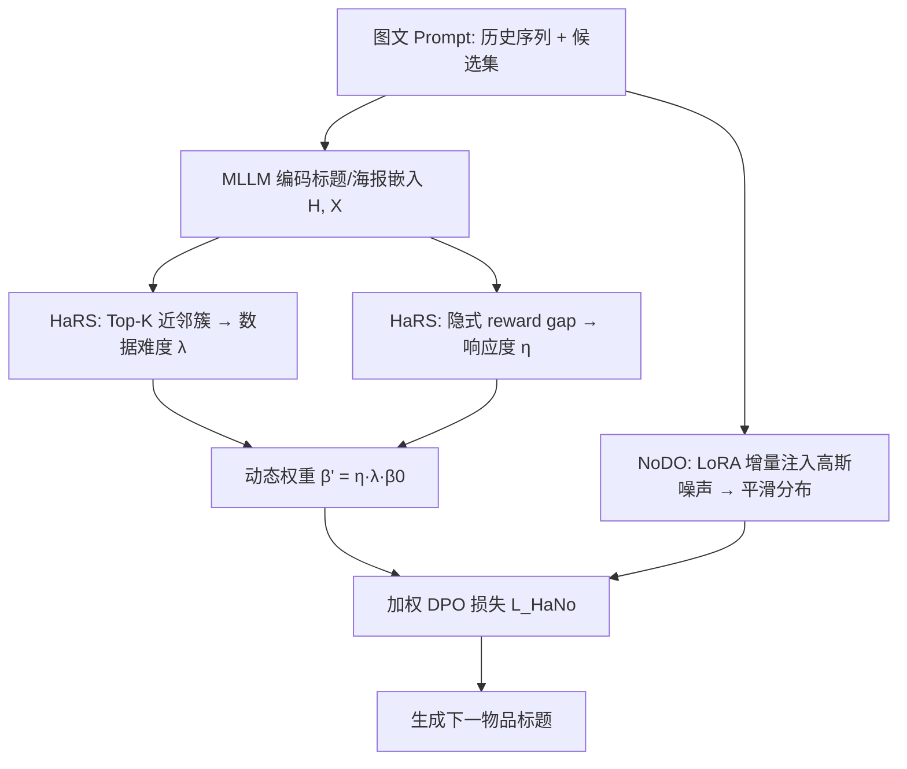

# Multimodal Large Language Models with Adaptive Preference Optimization for Sequential Recommendation (面向序列推荐的多模态大模型自适应偏好优化)

- **会议/期刊**: SIGIR 2026 (Full Paper)
- **作者与机构**: Yu Wang, Le Wu, Fei Liu, Richang Hong (合肥工业大学)；Yonghui Yang (新加坡国立大学，通讯)；Yi Zhang (安徽大学)
- **推荐链路定位**: 精排 / 端到端生成式（MLLM 直接生成下一物品标题）
- **研究方向**: 大语言模型推荐 / 多模态推荐
- **论文原文**: [arXiv:2511.18740v2](https://arxiv.org/abs/2511.18740v2)
- **开源代码**: [wangyu0627/HaNoRec](http://github.com/wangyu0627/HaNoRec)

## TL;DR (1分钟核心速览)

MLLM 序列推荐普遍采用「SFT + DPO」范式，但存在两大痛点：(1) 随机负采样导致样本难度严重失衡，模型在易分样本上过拟合、难分样本欠训练；(2) DPO 中固定的参考模型使策略模型无法纠正标题-图像跨模态错配，长序列下呈现「弱者愈弱」的表征退化。本文提出 HaNoRec：用难度感知重加权策略（HaRS）按数据难度 $\lambda$与模型实时响应度$\eta$动态缩放 DPO 权重$\beta'$，并用噪声正则分布优化（NoDO）在 LoRA 增量上注入高斯扰动、配合自适应 KL 拉近标题-图像语义。在 Microlens/Netflix/Movielens 上，NDCG@3 相对最强基线 MLLM-MSR 提升 **11.02% / 7.59% / 7.39%**。

## Background & Motivation (背景与核心矛盾)

- **主流范式**: 将用户交互序列与候选集转成图文 Prompt，用 MLLM（Qwen2.5-VL）做 SFT 学习生成下一物品标题，再用 DPO 以「真实下一物品 vs. 随机未交互物品」构造偏好对做对齐。
- **前人局限一（样本难度失衡）**: 随机负采样使大量偏好对语义差距悬殊（如 "Godfather" vs "Roman Holiday"），DPO 的 reward gap 持续放大易分样本的优化，而 "Up" 这类短标题、易受模态偏差干扰的难分样本被系统性忽视。
- **前人局限二（跨模态语义偏差）**: DPO 的固定参考模型 $\pi_{\text{ref}}$ 施加反向 KL 约束，策略模型被压向参考模型的高概率区，无法修正标题-图像错配；长序列累积局部语义漂移，使初始相似度低的样本（"Flipped"）在训练后相似度进一步下降，即「弱者愈弱」。
- **核心洞察 (Key Insight)**: 难度应同时由「数据内在可分性」与「模型当前学习状态」共同定义；而模态偏差本质是分布层面的饱和梯度问题，需在 logits 分布上做平滑而非仅做点对点对齐。
- **本文切入点**: 把 DPO 的标量 $\beta$ 变成样本级动态权重，并对策略/参考模型的输出分布做高斯平滑后再算 KL。

## Method (核心方法设计)

### 1. 整体框架 (Overall Architecture)

输入为用户最近 6 条交互的图文 Prompt（历史物品图像 + 候选集图像 + 标题文本）。先用预训练 MLLM 将全部物品标题与海报编码为共享维度的文本嵌入 $\mathbf{H}$与视觉嵌入$\mathbf{X}$，离线构建难度信号；训练时 HaRS 模块基于 Top-K 近邻簇计算数据难度$\lambda$、基于隐式 reward gap 计算模型响应度$\eta$，二者相乘得到样本级$\beta'$；NoDO 模块在前向传播时对 LoRA 增量$A,B$注入高斯噪声得到平滑分布$\tilde{\pi}_\theta$，与$\pi_{\text{ref}}$ 计算自适应 KL。最终以加权 DPO 损失更新策略模型，推理阶段与标准 MLLM 完全一致、无额外开销。

### 2. 关键设计拆解 (Key Designs)

1. **难度感知重加权策略 HaRS（解决样本难度失衡）**：以 chosen/rejected 物品为锚，在 $\mathbf{h}_j+\mathbf{x}_j$ 联合语义空间中检索 Top-K 近邻形成正/负簇，Softmax 归一化后取概率差作为数据难度：
$$\Delta=\big|Z_{w,k}-Z_{l,k}\big|^K_{k=1},\quad \lambda=\sigma(\Delta)/\sigma(\bar{\Delta})$$
同时用 DPO 隐式 reward gap $R_i$的均值归一化（剔除最大最小两个离群值）估计模型响应度$\eta$。最终$\beta'_{\mathcal{B}}=\bar{\eta}_{\mathcal{B}}\cdot\lambda_{\mathcal{B}}\cdot\beta_0$。直觉：$\lambda$大表示易分样本 → 权重小、约束强；$\lambda$ 小表示难分样本 → 权重小、KL 放松、优化力度大，从而把学习容量导向边界样本。

2. **噪声正则分布优化 NoDO（解决跨模态语义偏差）**：在 LoRA 参数上做随机平滑 $A'=A+\sigma_n\epsilon_A,\ B'=B+\sigma_n\epsilon_B$，得$\tilde{\pi}_\theta(y|x,I)=\mathbb{E}_{\epsilon}[\pi_\theta(y|x,I;z+\epsilon\odot z)]$。理论依据是 DPO 梯度$\nabla L=-\mathbb{E}[\sigma(-\beta\Delta_\theta)\nabla\Delta_\theta]$在$|\Delta_\theta|$大时饱和趋零，加噪后$\mathbb{E}[\sigma(-\beta\Delta_\theta+\delta)]>\sigma(-\beta\Delta_\theta)$，把概率质量重新分配到非饱和区，恢复弱语义样本的有效梯度。

3. **训练目标与推理效率**：总损失为
$$\mathcal{L}_{\text{HaNo}}=-\mathbb{E}\Big[\log\sigma\Big(\beta'\log\tfrac{\tilde{\pi}_\theta(y_w|I,x)}{\pi_{\text{ref}}(y_w|I,x)}-\beta'\log\tfrac{\tilde{\pi}_\theta(y_l|I,x)}{\pi_{\text{ref}}(y_l|I,x)}\Big)\Big]$$
负样本为随机未交互物品（非 in-batch / hard negative），难度由离线 Top-K 检索近似。复杂度仅比标准 DPO 多 $O(B)+O(BN)$，推理零额外延迟。

## Experimental Setup & Evaluation Protocol (实验设置与评估协议)

- **数据集与预处理**:

| 数据集 | #Users | #Items | #Interactions | 密度 | 场景说明 |
| :--- | :---: | :---: | :---: | :---: | :--- |
| Microlens | 25,411 | 41,081 | 223,263 | 2.1e-4 | 短视频，标题+封面图，均长 8.79 |
| Netflix | 13,187 | 17,366 | 68,933 | 3.0e-4 | 电影，高度稀疏，均长 5.23 |
| Movielens | 6,040 | 3,952 | 1,000,209 | 4.2e-2 | 经典电影，标题+年份+海报，均长 165.56 |

- **数据划分与防穿越**: 按序列数 **8:1:1 比例划分** train/val/test；所有模型统一截断最近 6 条交互，最后一条为预测目标（截断后 Movielens 不再稠密）。
- **排名评测协议**: AUC 为二分类判别（无需候选集）；HR@3 / NDCG@3 采用 **Sampled Ranking**，即 1 个真实目标 + 9 个随机负样本构成 10 候选集，所有方法候选集规模统一。
- **对比基线与超参**: 传统方法（GRU4Rec、SASRec、LightGCN、LATTICE、CL4SRec、MoRec、RecDCL、AB-Rec）、LLM-based（TallRec、LLaRA、SPRec）、MLLM-based（MSRBench、MLLM-MSR）。骨干为 Qwen2.5-3B-Instruct / Qwen2.5-VL-3B-Instruct，LoRA rank=8，lr=1e-4，梯度累积 8，MLLM 训练 5 epoch，结果 5 次运行平均，显著性 $p<0.05$。

## Key Experimental Results (实验关键数据)

### 1. 主实验对比 (Main Results)

| Model | Microlens AUC | HR@3 | NDCG@3 | Netflix AUC | HR@3 | NDCG@3 | Movielens AUC | HR@3 | NDCG@3 |
| :--- | :---: | :---: | :---: | :---: | :---: | :---: | :---: | :---: | :---: |
| SASRec | 0.7128 | 0.5970 | 0.4588 | 0.6470 | 0.5781 | 0.4986 | 0.7131 | 0.6467 | 0.4780 |
| CL4SRec | 0.7320 | 0.6515 | 0.5102 | 0.6820 | 0.6250 | 0.5230 | 0.7240 | 0.6556 | 0.4804 |
| MoRec | 0.7144 | 0.6294 | 0.4863 | 0.6784 | 0.6406 | 0.5326 | 0.6824 | 0.6159 | 0.4536 |
| TallRec | 0.7253 | 0.6480 | 0.4918 | 0.6927 | 0.6788 | 0.5533 | 0.7303 | 0.6606 | 0.4815 |
| LLaRA | 0.7375 | 0.6504 | 0.4894 | 0.7178 | 0.6892 | 0.5592 | 0.7392 | 0.6705 | 0.4900 |
| SPRec | 0.7450 | 0.6682 | 0.4938 | 0.7378 | 0.7042 | 0.5663 | 0.7380 | 0.6856 | 0.4932 |
| MSRBench | 0.7418 | 0.6650 | 0.4942 | 0.7201 | 0.7020 | 0.5654 | 0.7312 | 0.6846 | 0.4913 |
| MLLM-MSR | 0.7544 | 0.6776 | 0.5110 | 0.7448 | 0.7135 | 0.5754 | 0.7497 | 0.7123 | 0.5031 |
| **HaNoRec** | **0.7852** | **0.7360** | **0.5673** | **0.7710** | **0.7483** | **0.6191** | **0.7732** | **0.7599** | **0.5403** |
| Improv.% | +4.12% | +8.62% | +11.02% | +3.52% | +4.88% | +7.59% | +3.13% | +6.68% | +7.39% |

### 2. 消融实验 (Ablation Study)

| 变体 | Microlens HR@3 | NDCG@3 | Netflix HR@3 | NDCG@3 | Movielens HR@3 | NDCG@3 |
| :--- | :---: | :---: | :---: | :---: | :---: | :---: |
| w/o ALL (仅 SFT+DPO) | 0.6776 | 0.5110 | 0.7135 | 0.5754 | 0.7123 | 0.5031 |
| w/o HaRS | ≈ 基线水平 | ≈ 基线水平 | ≈ 基线水平 | ≈ 基线水平 | ≈ 基线水平 | ≈ 基线水平 |
| w/o SAM (去 Top-K 采样) | 明显下降 | 明显下降 | 明显下降 | 明显下降 | 明显下降 | 明显下降 |
| w/o NoDO | 小幅下降 | 小幅下降 | 小幅下降 | 小幅下降 | 小幅下降 | 小幅下降 |
| **HaNoRec 完整** | **0.7360** | **0.5673** | **0.7483** | **0.6191** | **0.7599** | **0.5403** |

（注：原文消融以图 3 柱状图呈现，上表为按正文描述还原的定性趋势；骨干泛化实验见表 3：Qwen2-VL-2B 0.7338/0.5664 → Qwen2.5-VL-7B 0.7421/0.5756 → LLaVA-NeXT-7B 0.7446/0.5805，Microlens HR@3/NDCG@3。）

### 3. 关键实验发现 (Key Findings)

1. **HaRS 是增益主引擎，NoDO 是稳定器**：移除 HaRS 后性能几乎回落到 SFT+DPO 基线（Microlens NDCG@3 从 0.5673 跌回 0.5110 量级），而移除 NoDO 仅小幅下降——说明样本难度失衡是当前 MLLM-SR 的首要瓶颈，模态偏差是次级但不可忽略的修正项。
2. **稀疏场景收益更大**：Microlens（密度 2.1e-4）上 NDCG@3 相对提升 11.02%，显著高于稠密 Movielens 的 7.39%；同时传统方法 CL4SRec 在三个数据集上 AUC 落后 SPRec 约 1.8%/8.2%/1.9%，印证稀疏交互下语义先验（图文）比 ID 共现更可靠。
3. **超参存在明确最优区间**：Top-K 取 10–20 最佳，K=1 无法刻画多维偏好、K=50 引入噪声使正负簇边界模糊；$\beta_0=0.5$时性能显著崩塌（DPO 权重过大破坏 SFT 已建立的响应模式），$\sigma_n$ 在 0.05–0.1 间对结果不敏感，说明方法对噪声强度鲁棒但对权重尺度敏感。

## Highlights & Limitations (亮点、对比与审稿批判)

- **与代表作对比 (vs. Prior Work)**: 相比 MLLM-MSR（AAAI'25，两阶段图像摘要 + 序列微调），本文不改数据构造而改**优化目标本身**；相比 DAMO（从数据与模型双视角调 DPO），本文额外引入**分布级高斯平滑**处理多模态饱和梯度；相比 RosePO 等纯文本偏好优化，本文首次把难度重加权与跨模态 KL 正则耦合进 MLLM-SR。
- **可迁移亮点**: (1) 用「离线 Top-K 近邻簇 + 在线 reward gap」双信号定义样本难度，可低成本迁移到任意 DPO 式推荐的负采样加权；(2) LoRA 增量加噪实现分布平滑，几乎零额外算力，适合大模型对齐阶段的通用 trick。
- **审稿级局限批判**: (1) 评测采用 1:9 采样候选集而非 Full-Ranking，且负样本为随机未交互物品，未验证 hard negative 或全库排序下的增益是否保持；(2) 难度估计依赖离线预计算嵌入，序列演化后难度信号可能滞后，且 Top-K、$\beta_0$ 需逐数据集调参，跨域迁移成本未量化。

## Rating (四维评分)

- **方法创新性 (Novelty)**: ⭐⭐⭐⭐ （核心机制与方法设计具备明确创新性，理论与实验动机支撑充分）
- **评估协议与实验扎实度 (Protocol & Experiments)**: ⭐⭐⭐⭐ （主流公开数据集评测完整，包含多基线对比与消融实验验证）
- **写作与数学规范度 (Clarity & Rigor)**: ⭐⭐⭐⭐⭐ （问题形式化定义清晰，核心模块数学推导与架构阐述严谨易读）
- **工业落地与复现价值 (Industrial & Practical Value)**: ⭐⭐⭐⭐ （兼顾推荐效果增益与训练/推理效率，具备实际场景迁移参考价值）
