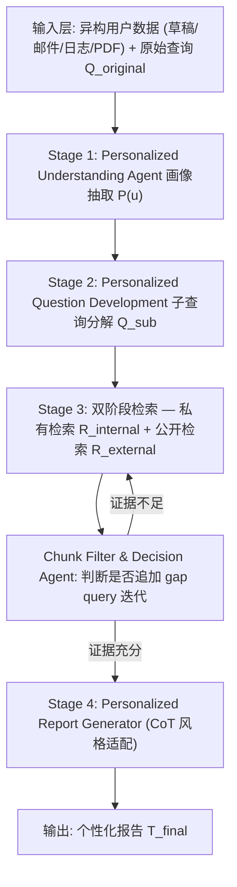
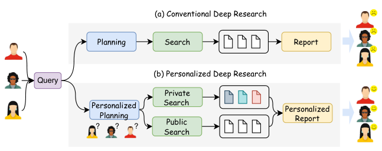
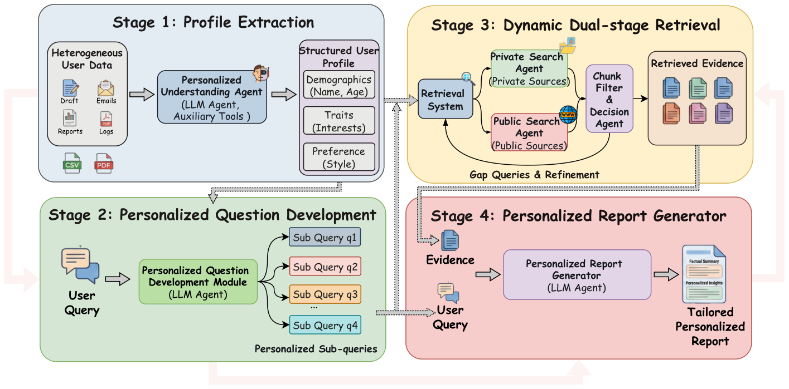
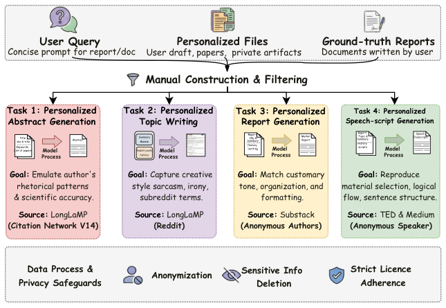
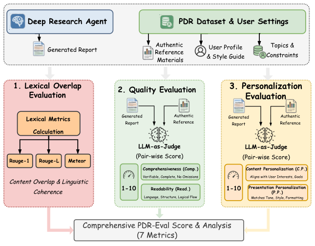
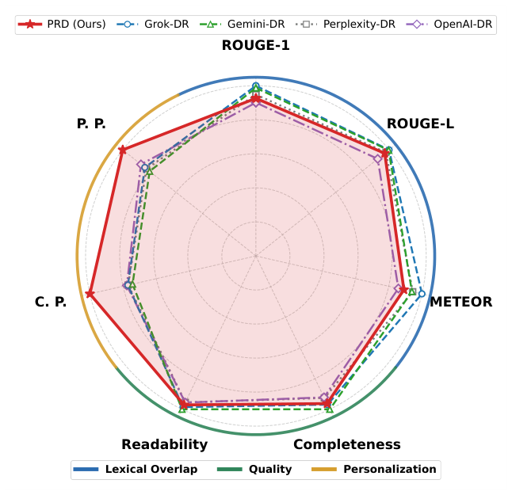
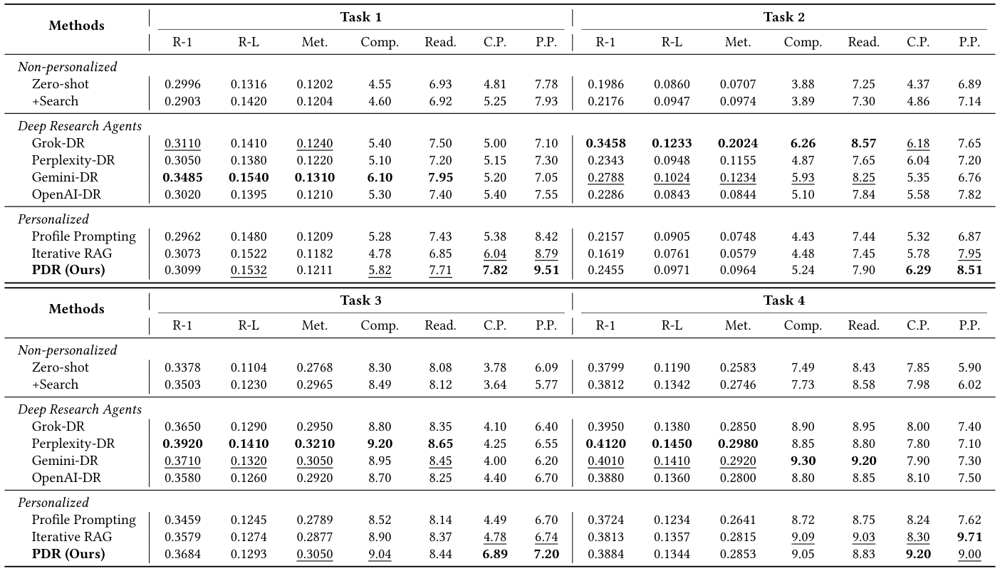

# Personalized Deep Research: A User-Centric Framework, Dataset, and Hybrid Evaluation for Knowledge Discovery (个性化深度研究：面向用户的知识发现框架、数据集与混合评测)

- **会议/期刊**: SIGIR 2026 (第 49 届国际 ACM SIGIR 会议，Melbourne, VIC, Australia)
- **推荐链路定位**: 端到端生成式 (End-to-End Generative) — 覆盖"个性化查询构建 → 私有/公开双阶段检索 → 个性化报告生成"的完整 RAG-Agent 链路
- **研究方向**: 大语言模型推荐 (LLM4Rec) / 对话推荐与智能体仿真 (Agentic Recommendation)
- **论文原文**: [https://arxiv.org/abs/2605.10530v1](https://arxiv.org/abs/2605.10530v1)
- **开源代码**: [https://github.com/Applied-Machine-Learning-Lab/SIGIR2026_PDR](https://github.com/Applied-Machine-Learning-Lab/SIGIR2026_PDR)

## TL;DR (核心速览)

针对现有 Deep Research Agent 采用"一刀切"静态检索范式、无法依据用户既有知识水平与潜在兴趣自适应调整探索深度与广度的问题，本文提出 PDR 框架，将用户画像建模嵌入"个性化问题构建 → 私有/公开双阶段动态检索 → 上下文感知报告生成"的完整闭环，并发布覆盖四类真实任务的 PDR Dataset 与融合词汇重叠 + LLM-as-Judge 的 PDR-Eval 混合评测协议。在 Task 1 上 PDR 取得 C.P. 7.82 / P.P. 9.51，显著超越 OpenAI-DR 的 5.40 / 7.55，同时保持有竞争力的内容质量指标。

## Background & Motivation (背景与动机)

- **领域背景与主流范式**: 以 OpenAI Deep Research、Perplexity Deep Research、Gemini Deep Research 为代表的深度研究智能体，将 LLM 推理能力与自适应检索系统结合，通过 **Planning（规划）→ Searching（迭代检索）→ Report Generation（报告生成）** 三阶段紧耦合流水线，自主编排迭代式"检索-推理"循环，在数分钟内产出媲美专家分析的长篇研究报告。相关工作已延伸至 HLE、GAIA、SimpleQA 等复杂基准以及 DeepResearch Bench、ResearcherBench 等报告质量评测。
- **现有方法局限 (Limitations of Prior Work)**:
  1. **静态"一刀切"检索范式**：现有流水线主要在广域、领域无关语料上优化，不建模用户既有专业水平与潜在兴趣，导致报告对专家冗余、对新手过载（见图 1 的 (a) 与 (b) 对比）。
  2. **个性化被割裂在孤立环节**：已有工作分别做查询改写（人口统计学 persona）、零样本查询扩展、记忆增强推理、生成阶段风格迁移或 token 级奖励，但缺乏贯穿全流程的一致用户模型。
  3. **缺乏公开基准与评测协议**：现有 Deep Research 基准（SimpleQA、HLE、GAIA、DeepResearch Bench）聚焦事实正确性与报告质量，**没有任何公开数据集**同时提供"用户查询 + 个性化私有文件 + 真实用户撰写的 ground-truth 报告"三要素，也无衡量个性化对齐的指标。
- **核心挑战 (Key Challenge)**: 个性化不是简单的 prompt 拼接或后处理格式化——若仅在生成阶段注入用户画像，检索阶段仍会召回与用户无关的通用证据，导致"证据-风格"错配；若仅在查询阶段改写，则无法利用用户私有语料中稀疏分布的关键信息。真正的难点在于**如何在检索-推理循环的每一步持续注入并更新用户上下文**，并据此动态决定检索深度与停止条件。
- **核心洞察与切入点 (Key Insight)**: 作者将 Deep Research 从"纯技术挑战"重构为"以人为中心的设计问题"，提出把个性化从 post-hoc 格式化步骤前移为**贯穿全流程的一致用户模型**：以结构化画像 $P(u)$ 作为所有阶段的共享条件变量，同时驱动子查询分解、私有/公开双源检索与报告合成，并用真实用户历史文档作为个性化监督信号构建基准。

## Problem Formulation & Method (问题定义与方法架构)

### 1. 符号定义与输入表征 (Notations & Input Representations)

- 用户 $u$，原始查询 $Q_{\text{original}}$（通常为一段概括目标报告/文档的简短 prompt）。
- 异构用户原始数据 $\{D_1, D_2, \dots, D_n\}$：草稿、邮件、浏览日志、历史论文/报告等，格式涵盖 CSV、PDF、Markdown。
- 辅助工具集合 $\mathcal{T}$（用于解析多格式内容）。
- 结构化用户画像 $P(u)$：包含人口统计学属性（姓名、年龄）、学习兴趣、响应偏好、交互倾向等标准化 schema 字段。
- 子查询集合 $Q_{\text{sub}} = \{q_1, q_2, \dots, q_k\}$，共 $k$ 条并行下发的个性化子查询。
- 私有语料 $D_{\text{private}}$ 与公开语料 $D_{\text{public}}$（实验中采用 Wikipedia-18，遵循 FlashRAG 协议）。
- 输出：个性化报告 $T_{\text{final}}$。

### 2. 整体流水线 (Overall Architecture)

PDR 在经典三阶段工作流上扩展为**四阶段流水线**（见图 2）：(i) Profile Extraction 将异构用户数据转为结构化画像；(ii) Personalized Question Development 结合画像将原始查询分解为并行子查询；(iii) Dynamic Dual-stage Retrieval 通过私有/公开双 Agent 检索，并由 chunk 过滤 Agent 与决策 Agent 迭代判断是否需外部检索或追加"gap query"；(iv) Personalized Report Generator 聚合证据、融合画像、以思维链推理完成风格适配的最终合成。

### 3. 核心模块设计与数学原理 (Key Designs & Formulations)

**(1) 画像抽取：异构数据到结构化 schema 的映射**

以推理型 LLM 驱动的 Personalized Understanding Agent 动态编排专用辅助工具，将多源异构数据统一为画像：

$$P(u) = f_{\text{LLM}}\left(\bigcup_{i=1}^{n} D_i \,;\, \mathcal{T}\right)$$

其中 $P(u)$ 为结构化画像，$D_i$ 为第 $i$ 个来源的原始数据，$\mathcal{T}$ 为处理多格式的辅助工具集。设计直觉：画像作为**稳定基础**，保证后续所有阶段共享同一用户表征，避免各阶段各自为政的碎片化个性化。

**(2) 个性化问题构建：意图感知的查询分解**

$$Q_{\text{sub}} = f_{\text{LLM}}\left(Q_{\text{original}}, P(u)\right) = \{q_1, q_2, \dots, q_k\}$$

与 OpenAI/Gemini Deep Research 依赖**反应式人工澄清循环**不同，该模块以画像自动完成意图建模，$k$ 条子查询并行下发，使检索严格对齐用户约束与偏好而无需人工干预。

**(3) 动态双阶段检索：私有与公开证据的并集融合**

$$R\left(q, P(u)\right) = R_{\text{internal}}\left(q, D_{\text{private}}\right) \cup R_{\text{external}}\left(q, D_{\text{public}}\right)$$

三个自适应机制支撑该模块：(a) **chunk-filtering agent** 剔除无关内容以提升精度；(b) **decision agent** 动态判定是否需要外部检索或追加迭代；(c) **query-evolution 机制**基于中间结果迭代精化查询。物理直觉：个性化任务的关键证据往往**稀疏分布在私有文档中**，必须与公开领域知识互补，例如将工作计划与用户历史报告对齐的同时引入外部数据。

**(4) 个性化报告生成：结构控制与思维链风格适配**

$$T_{\text{final}} = f_{\text{gen}}\left(\bigcup_{q \in Q} R\left(q, P(u)\right),\; P(u),\; Q\right)$$

生成遵循三步工作流：聚合子查询结果与检索片段 → 与画像融合建立完整上下文 → LLM 以思维链推理完成风格适配。**动态结构控制机制**依据画像自适应调整章节顺序、内容深度与语气，从而化解"事实完整性 vs. 用户沟通风格"的张力。

### 4. 训练目标、负采样与推理复杂度 (Optimization, Negative Sampling & Complexity)

- **损失函数**: 本文为**免训练的 Agent 编排框架**，不涉及梯度优化目标；核心推理基座为 DeepSeek R1-671B，同时充当评测 judge。原文未报告任何监督微调或 RL 训练损失（无 BPR / InfoNCE / BCE 等推荐系统常见损失）。
- **训练负采样策略**: 不适用（无训练阶段，无负采样）。
- **时间与空间复杂度**: 原文未报告离线预处理耗时、单次推理延迟 (ms/request)、峰值显存或 token 消耗等定量开销。定性上，私有检索采用 **Milvus 向量数据库 + BGE-M3 embedding** 构建本地系统，公开检索采用 Wikipedia-18 离线语料（遵循 FlashRAG 协议）而非非确定性实时网页检索，以换取可复现性；双阶段检索 + 决策 Agent 的迭代循环相比单轮 RAG 引入额外检索轮次开销，但原文未给出量化对比。

## Experimental Setup & Evaluation Protocol (实验设置与评估协议)

- **数据集统计与预处理**: PDR Dataset 为作者手工构建的首个个性化 Deep Research 基准，覆盖四类真实任务。原文以"用户数"而非交互数组织数据，未报告物品数/交互数/稀疏度等推荐系统常规统计量：

| 数据集 (Task) | 用户数 (#Users) | 物品数 (#Items) | 交互数 (#Interactions) | 稀疏度/密度 | 模态/辅助特征说明 |
| :--- | :---: | :---: | :---: | :---: | :--- |
| Task 1: Personalized Abstract Generation | 20 | - | - | - | 源自 LongLaMP（Citation Network V14），保留摘要长度 > 2,000 字符的用户；输入为标题 + 关键词 + 作者历史论文 |
| Task 2: Personalized Topic Writing | 20 | - | - | - | 源自 LongLaMP（Reddit TL;DR），保留目标文本 > 5,000 字符的用户；输入为帖子摘要 + 历史 Reddit 发帖 |
| Task 3: Personalized Report Generation | 5 | - | - | - | 采集 Substack 五位高产作者内容，严格遵循数据许可并匿名化 |
| Task 4: Personalized Speech-Script Generation | 5 | - | - | - | 采集 TED 演讲与 Medium 文章，姓名匿名化 + 敏感信息删除 |

- **数据划分方式 (Splitting Strategy)**: 原文**未明确报告**训练/验证/测试划分比例。由于框架为免训练 Agent 编排，评测以"用户历史文档作为个性化输入、真实用户撰写文档作为 ground-truth 参照"的方式组织，属于**按用户划分的个性化生成评测**，而非传统 LOO / Ratio Split / 全局时间戳切分。需注意：历史文档与 ground-truth 报告同属一个用户，若历史文档在时间上晚于目标文档，存在潜在信息泄露风险，原文未讨论该问题。
- **排名评测协议 (Ranking Protocol)**: 不适用传统 Full-Ranking / Sampled Ranking。PDR-Eval 采用三维混合评测（见图 4）：
  - **词汇重叠 (Lexical Overlap)**: ROUGE-1、ROUGE-L、METEOR，衡量生成文档与参照文档的词汇相似度与语言连贯性。
  - **质量评估 (Quality)**: LLM-as-Judge 成对打分（pair-wise，生成报告与真实参照同时提交），10 分制，含 **Comprehensiveness (Comp.)** 与 **Readability (Read.)**。
  - **个性化评估 (Personalization)**: 同样 LLM-as-Judge 成对打分，含 **Contextual Personalization (C.P.)**（所选信息与用户兴趣/目标的对齐度）与 **Presentation Personalization (P.P.)**（语气、风格、格式、媒介选择与用户偏好的符合度）。
- **评价指标与显著性检验**: 共 7 项指标（R-1、R-L、Met.、Comp.、Read.、C.P.、P.P.）。评测 judge 为 DeepSeek R1-671B。**原文未报告**多随机种子方差、配对显著性检验（$t$-test / Wilcoxon / Bootstrap）或 judge 与人类评分的一致性验证，这是评测可信度上的明显缺口。

## Key Experimental Results (核心实验结果)

### 1. 主实验对比 (Main Results)

基线分两类：(a) 方法学基线 Zero-shot、+Search、Profile Prompting、Iterative RAG；(b) 四个工业深度研究系统 Grok-DR、Perplexity-DR、Gemini-DR、OpenAI-DR。表 1 汇总四任务结果，图 5 给出整体雷达式对比。

| 数据集 | 指标 | 非个性化最强基线 (+Search) | 商业 DR 最强基线 | 个性化基线最强 (Iterative RAG / Profile Prompting) | 本文方法 (PDR) | 相对提升 |
| :--- | :--- | :---: | :---: | :---: | :---: | :---: |
| Task 1 | C.P. / P.P. | 5.25 / 7.93 | OpenAI-DR 5.40 / 7.55 | Iterative RAG 6.04 / 8.79 | **7.82 / 9.51** | C.P. +29.5% / P.P. +8.2%（对最强个性化基线） |
| Task 1 | R-1 / Comp. | 0.2903 / 4.60 | Gemini-DR 0.3485 / 6.10 | Iterative RAG 0.3073 / 4.78 | 0.3099 / 5.82 | 词汇与质量非最优，但具竞争力 |
| Task 2 | C.P. / P.P. | 4.86 / 7.14 | Grok-DR 6.18 / 7.65 | Iterative RAG 5.78 / 7.95 | **6.29 / 8.51** | C.P. +1.8% / P.P. +7.0% |
| Task 2 | R-1 / Comp. | 0.2176 / 3.89 | Grok-DR 0.3458 / 6.26 | Profile Prompting 0.2157 / 4.43 | 0.2455 / 5.24 | 词汇显著落后 Grok-DR |
| Task 3 | C.P. / P.P. | 3.64 / 5.77 | OpenAI-DR 4.40 / 6.70 | Iterative RAG 4.78 / 6.74 | **6.89 / 7.20** | C.P. +44.1% / P.P. +6.8% |
| Task 3 | R-1 / Comp. | 0.3503 / 8.49 | Perplexity-DR 0.3920 / 9.20 | Iterative RAG 0.3579 / 8.90 | 0.3684 / 9.04 | 质量接近最优 |
| Task 4 | C.P. / P.P. | 7.98 / 6.02 | OpenAI-DR 8.10 / 7.50 | Iterative RAG 8.30 / **9.71** | **9.20 / 9.00** | C.P. +10.8%；P.P. 低于 Iterative RAG |
| Task 4 | R-1 / Comp. | 0.3812 / 7.73 | Gemini-DR 0.4010 / 9.30 | Iterative RAG 0.3813 / 9.09 | 0.3884 / 9.05 | 词汇与质量均非最优 |

**关键观察**：
- 商业 DR 系统（Grok-DR、Perplexity-DR、Gemini-DR）在 ROUGE 与质量指标上常居首（如 Gemini-DR 在 Task 1 的 R-1 = 0.3485、Comp. = 6.10），但**个性化指标系统性偏低**——因其主要依赖外部网页知识，难以访问并融入任务所需的特定个性化信息。
- PDR 在 C.P. 上四任务全部第一，在 P.P. 上三任务第一（Task 4 的 P.P. = 9.00 低于 Iterative RAG 的 9.71），体现"个性化优先、质量持平"的设计取向。
- Task 4 上 PDR 的 Comp.（9.05）略低于 Iterative RAG（9.09）与 Gemini-DR（9.30），说明强个性化注入可能以轻微内容完整性为代价。

### 2. 消融实验与控制变量分析 (Ablation Study)

原文**未设置严格意义上的模块消融表**（如逐一移除 Profile Extraction / Question Development / Dual-stage Retrieval / Report Generator）。可视为近似消融的是方法学基线梯度：

- **Zero-shot → +Search**：加入公开检索后质量指标小幅提升（如 Task 1 Comp. 4.55 → 4.60），但 C.P. 仅从 4.81 → 5.25，说明**单纯加检索无法带来个性化**。
- **+Search → Profile Prompting**：注入结构化画像后 P.P. 明显跃升（Task 1 从 7.93 → 8.42），但 C.P. 反而略降（5.25 → 5.38 附近波动），说明**仅在 prompt 层注入画像不足以改善内容级个性化**。
- **Profile Prompting → Iterative RAG**：改用私有检索多步迭代后 C.P. 显著提升（Task 1 5.38 → 6.04），但质量指标下滑（Comp. 5.28 → 4.78），说明**私有检索提升个性化但可能牺牲事实覆盖**。
- **Iterative RAG → PDR**：引入公开+私有双阶段融合与全流程画像注入后，C.P. 与 Comp. 同时改善（Task 1 C.P. 6.04 → 7.82，Comp. 4.78 → 5.82），表明**双源融合是化解"个性化 vs. 质量"张力的关键**。

需指出：上述对比**未控制参数量、检索轮次或 token 预算**，各基线调用次数与上下文长度不一致，因此不能严格归因于单一模块。

### 3. 稀疏度/冷启动分桶与超参敏感度 (Sparsity Buckets & Hyperparameters)

- **用户/物品交互频次分桶表现**: 原文**未做**按用户活跃度或文档数量的分桶分析。仅在数据构建时以长度阈值筛选用户（Task 1 摘要 > 2,000 字符、Task 2 目标文本 > 5,000 字符），但未报告不同历史文档规模下的性能差异。
- **关键超参数敏感度**: 原文**未报告**子查询数量 $k$、检索轮次上限、chunk 过滤阈值、Milvus top-$k$、BGE-M3 维度使用等超参的敏感性分析。
- **线上 A/B 测试结果**: 原文**仅包含离线实验**，无真实业务场景的线上 A/B 测试，未报告 CTR/CVR/GMV/留存等线上指标。

## Highlights, Limitations & Critiques (亮点、局限与审稿级批判)

- **核心亮点与可迁移性**:
  1. **"个性化前移"的设计哲学**具有普适性：将用户画像作为贯穿检索-推理全流程的共享条件变量，而非生成端的后处理，可直接迁移到个性化 RAG、对话推荐中的多轮查询改写、以及 LLM4Rec 的指令微调数据构造。
  2. **私有/公开双源检索 + 决策 Agent 的 gap-query 迭代**为"用户记忆 + 外部知识"的融合提供了可复用工程范式，与记忆增强推荐、个性化 query expansion 工作天然互补。
  3. **PDR-Eval 的七指标混合协议**（词汇 + 质量 + 个性化双维度）为长文本个性化生成提供了比单一 ROUGE 更完整的评测视角，C.P./P.P. 的二分法尤其值得借鉴到可解释推荐理由生成的质量评估。
  4. 数据集覆盖学术摘要、Reddit 帖子、Substack 报告、TED 演讲四类真实文体，且做了匿名化与许可合规处理，具备一定复用价值。
- **局限性与审稿视角批判 (Critical Limitations)**:
  1. **评测规模过小且无统计检验**：Task 3/4 仅 5 位用户、Task 1/2 各 20 位用户，样本量极小；未报告多随机种子方差、配对显著性检验，也未验证 LLM judge（DeepSeek R1-671B，同时又是被评系统基座）与人类评分的一致性——**judge 与被评模型同源**存在自偏好偏差风险，这是最致命的可信度问题。
  2. **缺少严格消融**：四个核心模块无逐一移除实验，方法学基线的检索轮次、上下文预算、调用成本均未对齐，"PDR 优于 Iterative RAG"的归因不充分。
  3. **效率与成本完全缺位**：作为多 Agent 迭代框架，未报告 token 消耗、端到端延迟、API 成本或显存；对工业落地而言这是硬伤。
  4. **公开检索使用 Wikipedia-18 离线语料**而非实时网页，虽提升可复现性，但与商业 DR 系统（实时网页）的对比存在**信息源不对等**，可能系统性放大 PDR 在个性化上的优势、同时压低其在 ROUGE 上的表现。
  5. **潜在数据泄露未讨论**：用户历史文档与 ground-truth 报告同源，若历史文档时间晚于目标文档，个性化指标可能被高估。
  6. **Task 4 的 P.P. 反例**（9.00 < Iterative RAG 9.71）与 Task 4 Comp. 略低，说明强个性化与内容完整性之间存在未被充分分析的 trade-off，原文仅一笔带过。
  7. **与推荐系统主流的衔接较弱**：本文未与传统个性化推荐/用户建模（如矩阵分解、序列兴趣建模）做任何对比或引用性讨论，对 RecSys 读者的直接可迁移结论有限。

## Rating (四维评分)

- **方法创新性 (Novelty)**: ⭐⭐⭐⭐ — "个性化前移 + 双源检索 + 全流程一致用户模型"的框架级整合有新意，但各单点组件（画像抽取、查询分解、迭代 RAG、LLM-as-Judge）均为已有技术的工程组合，缺乏新的学习目标或理论贡献。
- **评估协议与实验扎实度 (Protocol & Experiments)**: ⭐⭐⭐ — 七指标混合评测设计合理、四任务覆盖真实文体，但样本量极小（5–20 用户）、无显著性检验、无严格消融、judge 与被评模型同源、检索源不对等，实验说服力受限。
- **写作与数学规范度 (Clarity & Rigor)**: ⭐⭐⭐⭐ — 四阶段流水线表述清晰，公式 (1)–(4) 简洁自洽，图表组织良好；但缺少复杂度分析、超参与实现细节（如 $k$、top-$k$、轮次上限），部分表格数值排版存在粘连。
- **工业落地与复现价值 (Industrial & Practical Value)**: ⭐⭐⭐⭐ — 代码与数据集已开源，Milvus + BGE-M3 + DeepSeek R1 的技术栈工程可复现性强，双源检索范式对工业个性化 RAG 有直接参考价值；但多 Agent 迭代的 token 成本与延迟未量化，且依赖 671B 级大模型，轻量化落地路径不明。

## 论文图表

<figure class="paper-figure" markdown="span">
  <figcaption>图1：传统与个性化深度研究流程的对比。(a) 传统方法缺乏用户上下文，导致输出泛化。(b) 个性化深度研究利用用户特定知识，产生定制且令人满意的结果。</figcaption>
</figure>

<figure class="paper-figure" markdown="span">
  <figcaption>图2：个性化深度研究（PDR）框架概览。该框架包含四个核心阶段：(i) 从用户数据中提取画像，(ii) 个性化问题构建，(iii) 融合私有与外部来源的动态双阶段检索，(iv) 个性化报告生成。</figcaption>
</figure>

<figure class="paper-figure" markdown="span">
  <figcaption>图3：PDR的数据集构建流程。</figcaption>
</figure>

<figure class="paper-figure" markdown="span">
  <figcaption>图4：面向深度研究的PDR-Eval框架概览。融合词汇重叠、质量评估与个性化评估。</figcaption>
</figure>

<figure class="paper-figure" markdown="span">
  <figcaption>图5：与深度研究智能体的整体性能对比。PDR在保持质量与词汇指标具有竞争力的同时，实现更优的个性化（C.P.、P.P.）。</figcaption>
</figure>

<figure class="paper-figure" markdown="span">
  <figcaption>表1：任务1与任务2（上）及任务3与任务4（下）的性能对比。深度研究智能体在特定指标上表现具有竞争力，而PDR（本文方法）在个性化方面保持领先。最佳性能值以粗体显示，次佳值以下划线标记。</figcaption>
</figure>

