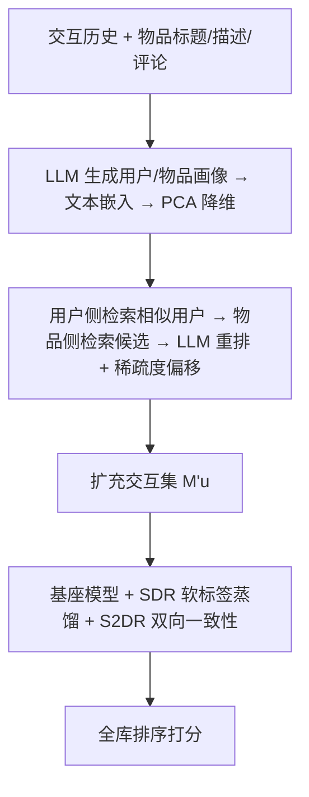
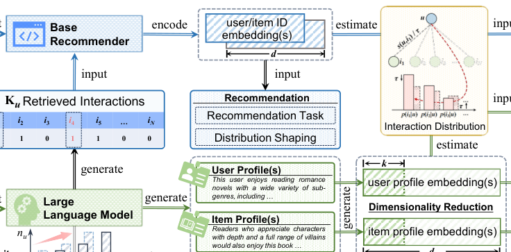

# ProMax: Exploring the Potential of LLM-derived Profiles with Distribution Shaping for Recommender Systems (以分布重塑释放 LLM 画像潜力的推荐框架)

- **会议/期刊**: SIGIR 2026
- **作者与机构**: Yi Zhang, Yiwen Zhang (安徽大学); Kai Zheng (电子科技大学); Tong Chen, Hongzhi Yin (昆士兰大学)
- **推荐链路定位**: 召回（通用协同过滤全库排序）
- **研究方向**: 大语言模型推荐 / 协同过滤
- **论文原文**: [https://arxiv.org/abs/2604.26231v1](https://arxiv.org/abs/2604.26231v1)
- **开源代码**: [https://github.com/BlueGhostYi/ProRec](https://github.com/BlueGhostYi/ProRec)

## TL;DR (1分钟核心速览)

现有 LLM 画像增强推荐普遍用 MLP 做非线性对齐融合，既引入语义损失又把高维画像降格为边缘特征。ProMax 换视角：把画像当作**检索信号**而非融合特征，先用稠密检索+LLM 重排挖掘画像中的协同关系，再以**双路分布重塑**（监督 SDR + 自监督 S2DR）把画像分布作为软标签引导基座模型。在 Amazon-Book/Yelp/Steam 三数据集、Full-Ranking 协议下，LightGCN 上 NDCG@10 相对最强基线 ProEx 提升 8.44%/4.75%/3.31%。

## Background & Motivation (背景与核心矛盾)

- **主流范式**: LLM 作为语义增强器，从标题/描述/评论生成用户与物品画像，经文本嵌入后通过 MLP 适配器与 ID 嵌入对齐融合（RLMRec、KAR、IRLLRec），或直接替换 ID 嵌入（AlphaRec）。
- **前人局限**: ① 非线性对齐强制维度匹配，把高维抽象画像压缩为边缘信号，语义损失严重；② 画像仅作辅助特征，模型仍被稀疏交互模式束缚，无法泛化到未观测物品；③ 画像高维抽象（"喜欢科幻"）但缺乏物品级粒度，直接替换 ID 嵌入会产出泛化而非精准的推荐。
- **核心洞察 (Key Insight)**: 从检索视角可视化发现，LLM 画像在特征空间中具备**良好的协同连通性**——相似用户画像聚拢、其交互物品也聚拢（图 2a），说明画像本身已编码协同信号，可作监督指示器而无需二次融合。
- **本文切入点**: 画像不参与模型训练，仅以其诱导的**用户-物品分布**作为软监督信号，通过分布重塑引导基座模型超越已观测交互。

## Method (核心方法设计)

### 1. 整体框架 (Overall Architecture)

离线阶段：GPT 生成用户/物品文本画像 → 文本嵌入得 $d_s$ 维向量 → PCA 降至 $\kappa=d=32$ 维得 $\tilde{c}_u,\tilde{c}_i$。检索阶段：用户侧稠密检索 Top-$K_1$ 相似用户，聚合其交互得候选集 $C_u$；物品侧以均值池化用户向量 $\tilde{c}^*_u$ 对 $C_u$ 排序，再经 GPT-4o-mini 重排并按稀疏度偏移预算 $K_u$ 取新物品，扩充交互集为 $M'_u$。训练阶段：基座模型架构不变，仅额外计算 SDR 与 S2DR 两个损失。

<figure class="paper-figure" markdown="span">
  <figcaption>图1：所提出的ProMax的信息流。</figcaption>
</figure>

### 2. 关键设计拆解 (Key Designs)

1. **稀疏度偏移的画像引导检索 (Sparsity Level Shift)**：固定追加 $K$ 个物品会淹没长尾用户、对头部用户几乎无影响。本文按交互量四分位 $\{Q_{0.25},Q_{0.5},Q_{0.75}\}$ 将用户分为最稀疏/稀疏/常规/活跃四组，令每用户补足至下一分位：
$$K_u=\max(0,\ T(|M_u|)-|M_u|+1),\quad T(|M_u|)=\min\{Q\in\{Q_{0.25},Q_{0.5},Q_{0.75}\}:|M_u|<Q\}$$
直觉：让中段用户（$U_2,U_3$）获得最多补充，活跃用户几乎不动，从而在不扭曲原始分布的前提下抬升整体交互密度。检索打分采用 item-CF 式加权 $\frac{1}{\sqrt{\text{count}(i)}}s(\tilde{c}^*_u,\tilde{c}_i)$ 抑制流行度偏置。

2. **监督分布重塑 SDR**：画像分布 $p_{\text{LLM}}(i|u)=\text{Softmax}(s(\tilde{c}_u,\tilde{c}_i)/\tau)$ 作为软标签，用 stop-gradient 蒸馏给基座模型：
$$\mathcal{L}_{\text{SDR}}=-\frac{1}{|\mathcal{U}_B|}\sum_{u}w(u)\sum_{i\in\mathcal{I}}\text{sg}[p_{\text{LLM}}(i|u)]\log p_\Theta(i|u)$$
关键在不确定性加权 $w(u)=1-\hat{H}(u)$，$\hat{H}(u)=H(p_{\text{LLM}})/\log|\mathcal{I}|$ 为归一化熵：画像分布越集中（越自信）权重越大，避免噪声画像污染训练。因画像不参与训练，$p_{\text{LLM}}$ 可离线预计算。

3. **自监督分布重塑 S2DR 与总损失**：SDR 过度依赖原始画像质量，故对同一用户构造 $M_u$ 与 $M'_u$ 两个视图，强制双向一致性：
$$\mathcal{L}_{\text{S2DR}}=-\frac{1}{2|\mathcal{B}|}\sum_{\langle u,i\rangle\in\mathcal{B}}\sum_{o\in\{M_u,M'_u\}}\log p_\Theta(i_{\bar{o}}|u_o)$$
总损失 $\mathcal{L}_{\text{ProMax}}=\mathcal{L}_{\text{rec}}+\lambda_1\mathcal{L}_{\text{SDR}}+\lambda_2\mathcal{L}_{\text{S2DR}}$，$\mathcal{L}_{\text{rec}}$ 为 BPR 成对损失。负采样沿用基座模型默认策略；SDR 复杂度 $O(|\mathcal{B}|N\max(d,\kappa))$、S2DR 为 $O(|\mathcal{B}|^2d)$，均低于基座编码开销，训练时间仅温和增加。

## Experimental Setup & Evaluation Protocol (实验设置与评估协议)

- **数据集与预处理**: 过滤评分 < 3.0 的交互，仅保留隐式反馈：

| 数据集 | #Users | #Items | #Interactions | 稀疏度 | 场景说明 |
| :--- | :---: | :---: | :---: | :---: | :--- |
| Amazon-Book | 11,000 | 9,332 | 200,860 | 99.80% | 图书评论 |
| Yelp | 11,091 | 11,010 | 277,535 | 99.77% | 本地商户 |
| Steam | 23,310 | 5,237 | 525,922 | 99.57% | 游戏平台 |

- **数据划分与防穿越**: 训练/验证/测试按 **3:1:1 比例划分**。
- **排名评测协议**: 无偏 **Full-Ranking（全库未交互物品排序）**，指标 Recall@{10,20} 与 NDCG@{10,20}，10 个随机种子取均值，双尾配对 t 检验（$p<0.05$）。
- **对比基线与超参**: 9 个 LLM 增强基线（KAR、LLMRec、CARec、RLMRec-C/G、AlphaRec(+)、LLMESR、AlphaFuse、IRLLRec、ProEx）；统一以 LightGCN（3 层，$d=32$）为骨干，学习率 1e-3，batch 4096，$\tau=0.2$，$K_1=100$，$\lambda_1\in[0,2]$、$\lambda_2\in[0,0.2]$。

## Key Experimental Results (实验关键数据)

### 1. 主实验对比 (Main Results)

| 方法 | Amazon R@20 | Amazon N@10 | Yelp R@20 | Yelp N@10 | Steam R@20 | Steam N@10 |
| :--- | :---: | :---: | :---: | :---: | :---: | :---: |
| Base (LightGCN) | 0.1411 | 0.0694 | 0.1157 | 0.0580 | 0.1348 | 0.0687 |
| KAR | 0.1416 | 0.0705 | 0.1194 | 0.0602 | 0.1353 | 0.0690 |
| LLMRec | 0.1469 | 0.0715 | 0.1203 | 0.0605 | 0.1431 | 0.0722 |
| RLMRec-C | 0.1483 | 0.0734 | 0.1230 | 0.0614 | 0.1421 | 0.0724 |
| AlphaRec+ | 0.1421 | 0.0710 | 0.1213 | 0.0590 | 0.1420 | 0.0719 |
| IRLLRec | 0.1513 | 0.0759 | 0.1267 | 0.0632 | 0.1445 | 0.0737 |
| ProEx | 0.1533 | 0.0770 | 0.1308 | 0.0653 | 0.1473 | 0.0756 |
| **ProMax** | **0.1603** | **0.0835** | **0.1338** | **0.0684** | **0.1500** | **0.0781** |
| Improv.% (vs ProEx) | +4.57% | +8.44% | +2.29% | +4.75% | +1.83% | +3.31% |

模型无关性验证（图 4）：ProMax 对 MF/GCCF/LightGCN/SimGCL 全部正增益，LightGCN 上 Recall@20 分别提升 13.3%/15.64%/12.28%（三数据集）。

### 2. 消融实验 (Ablation Study)

| 变体 | Amazon R@20 | Yelp R@20 | Steam R@20 |
| :--- | :---: | :---: | :---: |
| Base | 0.1411 | 0.1157 | 0.1348 |
| V1: w/o S2DR | 下降 | 下降 | 下降 |
| V2: w/o SDR | 下降 | 下降 | 下降 |
| V3: 用 $R^{\text{item}}_u$ 替代 $R^{\text{LLM}}_u$ | 略低于 ProMax | 略低于 ProMax | 略低于 ProMax |
| **ProMax** | **0.1603** | **0.1338** | **0.1500** |

### 3. 关键实验发现 (Key Findings)

1. **双路重塑缺一不可**：V1（仅原始画像）与 V2（缺 LLM 直接引导）均显著退化，说明 SDR 提供跨物品泛化监督、S2DR 抑制画像噪声，二者互补；V3 去掉 LLM 重排仅小幅下降，证明稠密检索已捕获主要协同信号，LLM 重排是细粒度增益。
2. **稀疏度偏移精准命中中段用户**：图 5 显示 ProMax 在常规用户组 $U_3$ 增益最大，因其在偏移后获得最多补充交互；最稀疏组 $U_1$ 亦显著受益，验证了按分位补足而非固定追加的设计合理性。
3. **效率-效果帕累托占优**：图 6 中 ProMax 训练时间仅略高于 Base、明显低于 ProEx，但 NDCG@10 三数据集全面最优；$\lambda_1$ 在 [0.5,1.5]、$\lambda_2$ 在 [0.05,0.1] 区间性能平稳，超参鲁棒性强。

## Highlights, Limitations & Rating (亮点、对比与审稿评价)

- **与代表作对比 (vs. Prior Work)**: RLMRec 用 MLP 对齐画像与 ID 嵌入，语义损失且画像仅作辅助特征；IRLLRec 引入意图画像但构造与训练成本更高；ProEx 多画像策略需额外 LLM 调用。ProMax 仅用**单份画像 + 两个损失项**，画像完全不参与训练，以分布级软监督替代点级对齐，成本更低而增益更大。
- **可迁移亮点**: ① "画像作软标签、stop-gradient 蒸馏"可无缝迁移到任何有外部语义先验的召回/精排模型；② 基于分位数的稀疏度偏移预算分配，是缓解长尾用户监督不足的通用数据增广技巧。
- **审稿级局限批判**: ① 依赖 GPT-4o-mini 做重排，离线预处理成本与 LLM 版本敏感性未量化；② 仅在三个中等规模隐式反馈数据集验证，未涉及序列推荐或工业级千万物品全库检索的延迟评估；③ 画像质量继承自 RLMRec 的固定画像，未讨论画像本身错误传播的上界。
- **四维评分**: 创新性 ⭐⭐⭐⭐ | 实验扎实度 ⭐⭐⭐⭐ | 方法清晰度 ⭐⭐⭐⭐⭐ | 落地价值 ⭐⭐⭐⭐

