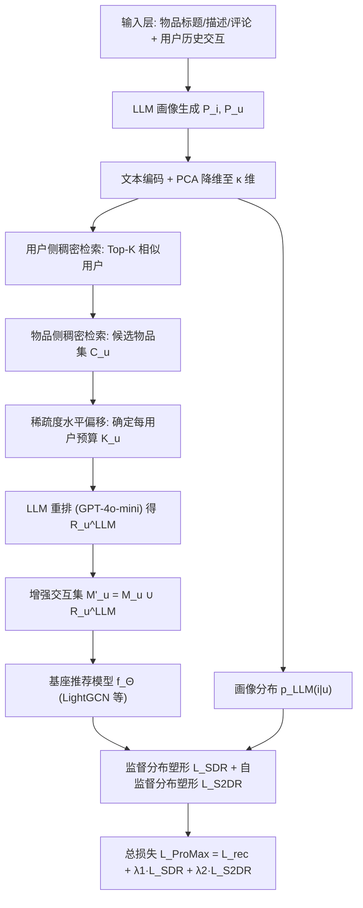
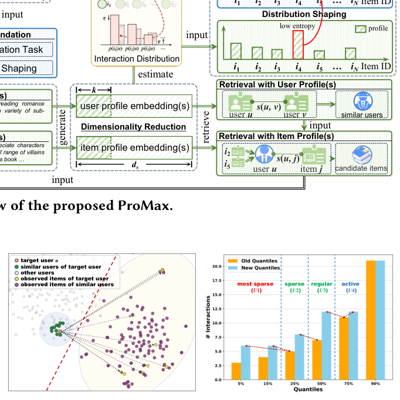
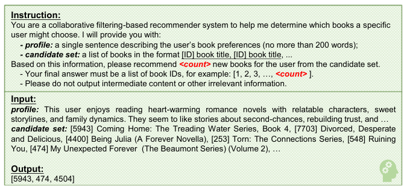
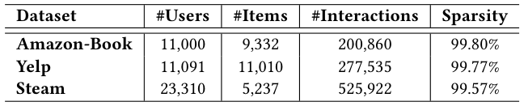
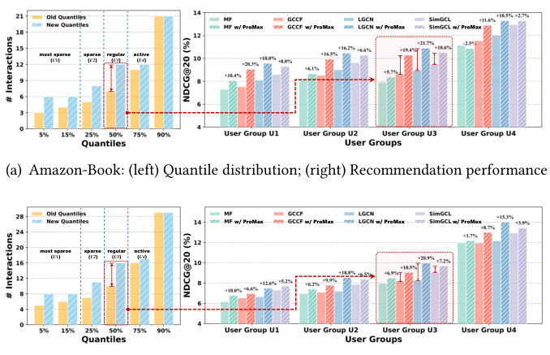
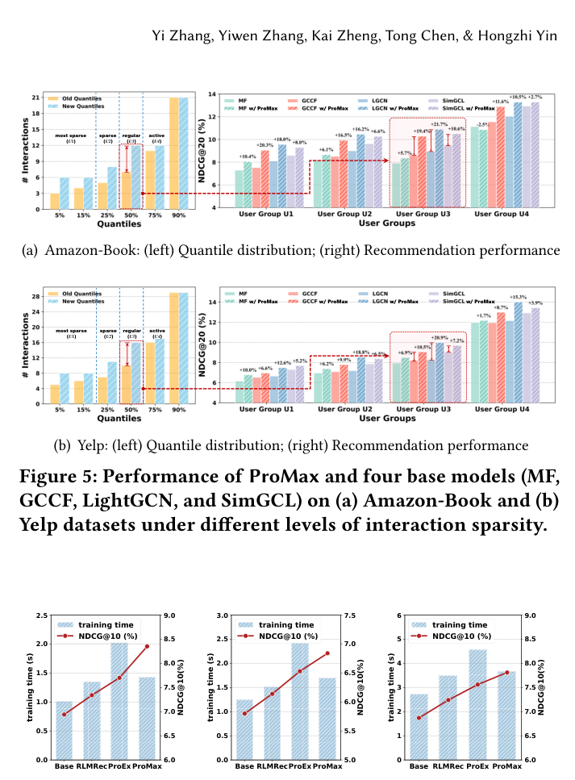

# ProMax: Exploring the Potential of LLM-derived Profiles with Distribution Shaping for Recommender Systems (探索 LLM 派生画像结合分布塑形在推荐系统中的潜力)

- **会议/期刊**: SIGIR 2026
- **推荐链路定位**: 召回 (Retrieval) — 画像引导的候选检索 + 基座模型训练增强
- **研究方向**: 大语言模型推荐 (LLM4Rec) / 协同过滤与双塔召回
- **论文原文**: [https://arxiv.org/abs/2604.26231v1](https://arxiv.org/abs/2604.26231v1)
- **开源代码**: [https://github.com/BlueGhostYi/ProRec](https://github.com/BlueGhostYi/ProRec)

## TL;DR (核心速览)

针对 LLM 派生用户/物品画像"如何真正增强推荐"这一未解问题，ProMax 从检索视角出发，先用稠密检索验证画像蕴含强协同信号，再提出监督分布塑形（以画像分布为软标签、熵加权）与自监督分布塑形（原始交互 vs. 画像检索增强交互的双向一致性）两个即插即用损失，不改变基座架构。在 Amazon-Book/Yelp/Steam 三数据集、全库排序协议下，集成 LightGCN 后 NDCG@10 相对最强基线 ProEx 分别提升 8.44%/4.75%/3.31%。

## Background & Motivation (背景与动机)

- **领域背景与主流范式**: 通用推荐（general recommendation）主流范式是基于隐式反馈的 ID 嵌入协同过滤（MF、LR-GCCF、LightGCN、SimGCL），在统一隐空间中学习用户/物品表征，推理仅需一次内积或浅层投影。为缓解交互稀疏，近年兴起"LLM 作为语义增强器"路线：用 LLM 从物品标题、描述、评论中抽取结构化画像，再经文本编码器转为向量注入推荐模型（RLMRec、KAR、IRLLRec、ProEx 等）。
- **现有方法局限 (Limitations of Prior Work)**:
  1. **机制不明**：画像为何能增强推荐缺乏解释，多数工作默认"拼接即有用"，未分析画像在特征空间中的作用方式。
  2. **非线性对齐引入语义损失**：RLMRec 等用 MLP 强制画像维度与 ID 嵌入对齐，IRLLRec 构造多模态意图，ProEx 构造多份画像——额外人工设计与训练开销，且语言空间与推荐空间缺乏天然对齐，融合时引入语义不一致与噪声。
  3. **画像仅作辅助特征被"边缘化"**：把高维抽象画像降格为外围信号，削弱其跨物品泛化性与抽象性；而直接用画像替换 ID 嵌入（AlphaRec）又会丢失细粒度区分能力（画像说"喜欢科幻"，但无法区分"哪一部科幻"），且画像冗余噪声会污染训练。
- **核心挑战 (Key Challenge)**: 画像来自预训练语言空间，ID 嵌入来自推荐场景塑造的协同空间，二者联系天然薄弱；简单拼接/加深网络/常规对比学习都无法回答"画像到底以何种形式、在何处起作用"。
- **核心洞察与切入点 (Key Insight)**: 作者用 Pilot Study（图 2(a)）在 Amazon-Book 上可视化画像表征分布，发现：(i) 目标用户与其相似用户、交互物品在画像空间中高度聚集，说明 LLM 画像**本身蕴含显著协同信号**；(ii) 用户画像与物品画像在特征空间中被清晰分离（红色虚线），说明二者由不同管线生成、语义信号不同。由此得出结论：画像无需被"塞回"模型二次训练，而应作为**检索信号与分布级监督**来引导基座模型。

## Problem Formulation & Method (问题定义与方法架构)

### 1. 符号定义与输入表征 (Notations & Input Representations)

- 用户集 $\mathcal{U}=\{u_1,\dots,u_M\}$（$M$ 用户），物品集 $\mathcal{I}=\{i_1,\dots,i_N\}$（$N$ 物品）。
- 用户 $u$ 的历史交互向量 $\mathbf{x}_u\in\mathbb{R}^{1\times N}$，交互过则 $x_{ui}=1.0$。
- 基座模型 $f_\Theta$ 学习用户/物品嵌入 $\mathbf{z}_u,\mathbf{z}_i\in\mathbb{R}^{1\times d}$（默认 $d=32$），输出偏好分 $p_\Theta(j|u)$。
- LLM 画像：物品侧画像 $P_i$（由标题、描述、采样评论生成），用户侧画像 $P_u$（聚合物品-用户关系生成）；文本编码器 $f_{\text{text}}$ 将画像转为语义表征 $\mathbf{c}_u=f_{\text{text}}(P_u)\in\mathbb{R}^{1\times d_s}$，$d_s\gg d$。
- 降维后画像表征 $\tilde{\mathbf{c}}_u\in\mathbb{R}^{1\times\kappa}$，实验中 $\kappa=d=32$。

### 2. 整体流水线 (Overall Architecture)

数据流：LLM 生成画像 → 文本编码 → PCA 降维 → 用户侧/物品侧稠密检索 → 稀疏度水平偏移控制预算 → LLM 重排 → 构造增强交互集 $\mathcal{M}'_u$ → 基座模型训练时叠加两个分布塑形损失。

<figure class="paper-figure" markdown="span">
  <figcaption>图1：所提出的ProMax的信息流。</figcaption>
</figure>

### 3. 核心模块设计与数学原理 (Key Designs & Formulations)

**(1) 画像降维（PCA 压缩）**：对全体用户画像求均值 $\boldsymbol{\mu}$ 与协方差 $\boldsymbol{\Sigma}=\mathbf{V}\text{diag}(\boldsymbol{\Lambda})\mathbf{V}^\top$，取前 $\kappa$ 个主成分 $\{\mathbf{v}_1,\dots,\mathbf{v}_\kappa\}$，中心化后投影：

$$\tilde{\mathbf{c}}_u=\big(\mathbf{v}_1^\top(\mathbf{c}_u-\boldsymbol{\mu}),\dots,\mathbf{v}_\kappa^\top(\mathbf{c}_u-\boldsymbol{\mu})\big)\in\mathbb{R}^{1\times\kappa}.$$

物理直觉：高维语义表征含大量弱语义冗余维度，PCA 在保留语义信息的同时把维度压到与 ID 嵌入一致（$\kappa=d$），使后续检索与分布计算开销可忽略。

**(2) 画像引导候选检索（双阶段）**：
- 用户侧：$\mathcal{R}^{\text{user}}_u=\text{TopK}\big(\{s(\tilde{\mathbf{c}}_u,\tilde{\mathbf{c}}_v)\mid v\in\mathcal{U}\setminus\{u\}\}\big)$，$s$ 为余弦相似度，$K=100$。
- 物品侧：统计相似用户交互过、目标用户未交互的物品计数 $\text{count}_{\mathcal{R}^{\text{user}}_u}(i)$，按 item-based CF 思路排序：

$$\mathcal{R}^{\text{item}}_u=\text{Rank}\Big(\Big\{\tfrac{1}{\sqrt{\text{count}_{\mathcal{R}^{\text{user}}_u}(i)}}\,s(\tilde{\mathbf{c}}^*_u,\tilde{\mathbf{c}}_i)\ \Big|\ i\in\mathcal{C}_u\Big\}\Big),$$

其中 $\tilde{\mathbf{c}}^*_u=\bigoplus_{j\in\mathcal{M}_u}\tilde{\mathbf{c}}_j/|\mathcal{M}_u|$ 为交互物品画像的均值池化，$\tfrac{1}{\sqrt{\text{count}}}$ 用于抑制流行度偏置。统计仅限相似用户集内，避免全局偏置。

**(3) 稀疏度水平偏移 (Sparsity Level Shift)**：以全体用户交互数的四分位数 $\{Q_{0.25},Q_{0.5},Q_{0.75}\}$ 将用户分为最稀疏 $U_1$、稀疏 $U_2$、常规 $U_3$、活跃 $U_4$ 四组，令

$$K_u=\max\big(0,\ T(|\mathcal{M}_u|)-|\mathcal{M}_u|+1\big),\quad T(|\mathcal{M}_u|)=\min\{Q\in\{Q_{0.25},Q_{0.5},Q_{0.75}\}:|\mathcal{M}_u|<Q\}.$$

即把每个用户的交互数抬升到"下一档"，避免固定预算对长尾用户过度主导、对头部用户几乎无影响。随后用 LLM（GPT-4o-mini）对 $\mathcal{R}^{\text{item}}_u$ 重排得 $\mathcal{R}^{\text{LLM}}_u$（图 3 给出指令模板与输入输出示例），最终 $\mathcal{M}'_u=\{i\mid i\in\mathcal{M}_u\ \text{or}\ i\in\mathcal{R}^{\text{LLM}}_u\}$。LLM 重排既做细粒度语义过滤、缓解曝光偏置，又以检索集为候选池规避幻觉。

<figure class="paper-figure" markdown="span">
  <figcaption>图2：(a) 一个采样目标用户的画像表示分布，及其相似用户和交互物品；(b) 在Amazon-Book数据集上应用稀疏度水平偏移前后的分位数分布比较。</figcaption>
</figure>

<figure class="paper-figure" markdown="span">
  <figcaption>图3：基于LLM的重排序过程的详细指令，以及输入和输出示例。</figcaption>
</figure>

**(4) 双重分布塑形**：定义分布 $p_*(i|u)=\text{Softmax}_{i\in\mathcal{I}}\big(s(\mathbf{e}_u,\mathbf{e}_i)/\tau\big)$，$\tau=0.2$；对基座模型 $\mathbf{e}=\mathbf{z}$，对画像 $\mathbf{e}=\tilde{\mathbf{c}}$。
- **监督分布塑形 (SDR)**：以画像分布为软标签（stop-gradient），熵加权：

$$\mathcal{L}_{\text{SDR}}=-\frac{1}{|\mathcal{U}_B|}\sum_{u\in\mathcal{U}_B}w(u)\sum_{i\in\mathcal{I}}\text{sg}\big[p_{\text{LLM}}(i|u)\big]\log p_\Theta(i|u),$$

其中 $w(u)=1-\hat{H}(u)$，$\hat{H}(u)=H(u)/\log|\mathcal{I}|$，$H(u)=-\sum_i p_{\text{LLM}}(i|u)\log p_{\text{LLM}}(i|u)$。直觉：画像分布越集中（熵越低）说明 LLM 越确信，监督权重越大；该损失推动模型超越对已观测交互的记忆，对未观测物品给出偏好分布。
- **自监督分布塑形 (S2DR)**：对同一用户，原始交互集 $\mathcal{M}_u$ 与增强集 $\mathcal{M}'_u$ 产生语义不同的表征，强制双向一致性：

$$\mathcal{L}_{\text{S2DR}}=-\frac{1}{2|\mathcal{B}|}\sum_{\langle u,i\rangle\in\mathcal{B}}\sum_{o\in\{\mathcal{M}_u,\mathcal{M}'_u\}}\big[\log p_\Theta(i^{\bar{o}}|u^o)\big],$$

其中 $u^o,i^o$ 为交互集 $o$ 输入模型所得的用户/物品语义源，$\bar{o}$ 为相反视图。此外还引入同质节点（用户-用户、物品-物品）间的对比对齐。该模块缓解对原始画像的过度依赖，抵御 LLM 噪声与幻觉。

### 4. 训练目标、负采样与推理复杂度 (Optimization, Negative Sampling & Complexity)

- **损失函数**：$\mathcal{L}_{\text{ProMax}}=\mathcal{L}_{\text{rec}}+\lambda_1\cdot\mathcal{L}_{\text{SDR}}+\lambda_2\cdot\mathcal{L}_{\text{S2DR}}$，$\mathcal{L}_{\text{rec}}$ 为基座成对排序损失（BPR 类）。$\lambda_1\in[0,2]$、$\lambda_2\in[0,0.2]$，最优值：Amazon-Book 上 $\lambda_1=1.5,\lambda_2=0.05$；Yelp/Steam 上 $\lambda_1=0.5,\lambda_2=0.1$。
- **训练负采样策略**：原文未显式报告负采样细节，仅说明"交互过的物品为正样本，其余为负样本"，沿用基座模型（LightGCN/BPR）默认设置；SDR 的软标签覆盖全物品集，S2DR 为批内双向视图对比，均非显式负采样。
- **时间与空间复杂度**：$\mathcal{L}_{\text{SDR}}$ 为 $O(|\mathcal{B}|N\max(d,\kappa))$，$\mathcal{L}_{\text{S2DR}}$ 为 $O(|\mathcal{B}|^2 d)$，均低于基座编码开销。画像生成、PCA 降维、稠密检索、LLM 重排全部在预处理阶段完成，与推荐模型训练解耦；因 $\kappa\ll d_s$，检索耗时在实际中可忽略。图 6 显示 ProMax 训练耗时高于基座但低于 ProEx，性能最优。

## Experimental Setup & Evaluation Protocol (实验设置与评估协议)

- **数据集统计与预处理**: 三个极稀疏数据集，过滤评分低于 3.0 的交互，交互过即正样本：

| 数据集 (Dataset) | 用户数 (#Users) | 物品数 (#Items) | 交互数 (#Interactions) | 稀疏度 (Sparsity) | 模态/辅助特征说明 |
| :--- | :---: | :---: | :---: | :---: | :--- |
| Amazon-Book | 11,000 | 9,332 | 200,860 | 99.80% | 书籍标题/描述/用户评论，画像来自 RLMRec |
| Yelp | 11,091 | 11,010 | 277,535 | 99.77% | 商户评论文本 |
| Steam | 23,310 | 5,237 | 525,922 | 99.57% | 游戏描述与评论文本 |

<figure class="paper-figure" markdown="span">
  <figcaption>表1：数据集统计信息。</figcaption>
</figure>

- **数据划分方式 (Splitting Strategy)**: 按 **3:1:1 比例划分**训练/验证/测试集（非时间戳切分，原文未说明是否按全局时间排序，存在一定未来信息泄露风险，属该基准的常见设定）。
- **排名评测协议 (Ranking Protocol)**: **Full-Ranking（全库排序）**，对每个用户对全量未交互物品打分，无负采样偏差。
- **评价指标与显著性检验**: Recall@10/20、NDCG@10/20；所有模型嵌入维度 $d=32$、LightGCN 三层图卷积、无 dropout、学习率 1.0e-3、批大小 4096、Xavier 初始化、Adam 优化；10 个随机种子取平均；采用**双尾配对 $t$ 检验**，表 2 报告 $p$ 值（最低至 $9.6\times10^{-9}$，全部远小于 0.05）。

## Key Experimental Results (核心实验结果)

### 1. 主实验对比 (Main Results)

以 LightGCN 为统一基座，对比 9 个 LLM 增强基线（KAR、LLMRec、CARec、RLMRec-C/G、AlphaRec/AlphaRec+、LLMESR、AlphaFuse、IRLLRec、ProEx）：

| 数据集 | 指标 | 基座 LightGCN | 最强基线 ProEx | 本文 ProMax | 相对提升 (Improv.) | $p$ 值 |
| :--- | :--- | :---: | :---: | :---: | :---: | :---: |
| Amazon-Book | R@10 / N@10 | 0.0915 / 0.0694 | 0.1008 / 0.0770 | **0.1079 / 0.0835** | +7.04% / +8.44% | 3.6e-7 / 9.6e-9 |
| Amazon-Book | R@20 / N@20 | 0.1411 / 0.0856 | 0.1533 / 0.0940 | **0.1603 / 0.1006** | +4.57% / +7.02% | 2.2e-7 / 8.0e-9 |
| Yelp | R@10 / N@10 | 0.0706 / 0.0580 | 0.0800 / 0.0653 | **0.0826 / 0.0684** | +3.25% / +4.75% | 1.2e-5 / 4.3e-8 |
| Yelp | R@20 / N@20 | 0.1157 / 0.0733 | 0.1308 / 0.0826 | **0.1338 / 0.0858** | +2.29% / +3.87% | 9.3e-8 / 5.9e-7 |
| Steam | R@10 / N@10 | 0.0852 / 0.0687 | 0.0937 / 0.0756 | **0.0965 / 0.0781** | +2.99% / +3.31% | 1.3e-7 / 1.9e-8 |
| Steam | R@20 / N@20 | 0.1348 / 0.0855 | 0.1473 / 0.0939 | **0.1500 / 0.0964** | +1.83% / +2.66% | 3.3e-7 / 2.1e-8 |

<figure class="paper-figure" markdown="span">
  ![表2：在Amazon-Book、Yelp和Steam数据集上关于Recall@N（缩写为R@N）和NDCG@N（缩写为N@N）的总体性能比较，其中N∈\[10, 20\]。每个数据集和指标上表现最佳的模型以粗体突出显示。'Improv.%'表示ProMax相对于最佳基线基于双尾配对t检验的相对改进。](../../../../assets/papers/2604.26231v1/table_2.png)<figcaption>表2：在Amazon-Book、Yelp和Steam数据集上关于Recall@N（缩写为R@N）和NDCG@N（缩写为N@N）的总体性能比较，其中N∈[10, 20]。每个数据集和指标上表现最佳的模型以粗体突出显示。'Improv.%'表示ProMax相对于最佳基线基于双尾配对t检验的相对改进。</figcaption>
</figure>

**模型无关性验证**（图 4）：ProMax 集成到 MF、LR-GCCF、LightGCN、SimGCL 四个基座，所有数据集全部指标均有提升。以 Recall@20 为例，LightGCN 上分别提升 13.3%（Amazon-Book）、15.64%（Yelp）、12.28%（Steam）；GCCF 受益次之（原文归因于其冗余特征变换被额外监督缓解）；SimGCL 提升最小（其自监督信号已丰富，ProMax 更多是互补）。

<figure class="paper-figure" markdown="span">
  ![图4：ProMax与基础模型MF \[22\]、LR-GCCF（缩写为GCCF）\[5\]、LightGCN（缩写为LGCN）\[10\]和SimGCL \[42\]在Amazon-Book、Yelp和Steam数据集上关于Recall@10/20和NDCG@10/20的性能比较。](../../../../assets/papers/2604.26231v1/figure_4.png)<figcaption>图4：ProMax与基础模型MF [22]、LR-GCCF（缩写为GCCF）[5]、LightGCN（缩写为LGCN）[10]和SimGCL [42]在Amazon-Book、Yelp和Steam数据集上关于Recall@10/20和NDCG@10/20的性能比较。</figcaption>
</figure>

### 2. 消融实验与控制变量分析 (Ablation Study)

三个变体：V1 移除自监督分布塑形（式 14）；V2 移除监督分布塑形（式 12）；V3 用原始候选集 $\mathcal{R}^{\text{item}}_u$ 替换 LLM 重排集 $\mathcal{R}^{\text{LLM}}_u$（同样施加稀疏度偏移以保证公平）。

- 所有变体均显著优于基座，说明核心组件有效；相对 ProMax 均有不同程度下降，说明两个分布塑形缺一不可——V1 仅依赖原始画像，V2 缺失 LLM 画像的直接引导。
- V3 略逊于 ProMax，验证 LLM 细粒度语义重排的必要性与有效性（提升幅度较小，属"锦上添花"）。
- 原文未报告参数量对齐或图度数匹配的额外控制变量消融。

### 3. 稀疏度/冷启动分桶与超参敏感度 (Sparsity Buckets & Hyperparameters)

- **交互频次分桶**（图 5）：按四分位分 $U_1$（最稀疏）至 $U_4$（活跃）四组，ProMax 在**所有用户组**均优于四个基座，且对低活跃组提升尤为明显；**常规用户组 $U_3$ 提升最大**——因稀疏度偏移后 $U_3$ 获得最多潜在交互，候选集显著扩充；活跃用户 $U_4$ 因交互已充足几乎不受影响。这直接验证了稀疏度水平偏移的设计动机。
- **超参敏感度**（图 8）：$\lambda_1$ 最优值 Amazon-Book 1.5、Yelp/Steam 0.5；$\lambda_2$ 最优值 0.05/0.1/0.1。Amazon-Book 趋势与其他两数据集不同（归因于数据分布差异），但 ProMax 对两超参整体鲁棒，未精确取到最优组合时性能仍稳定。
- **效率对比**（图 6）：基座 LightGCN 训练耗时最低但性能最弱；RLMRec 中等开销、明显增益；ProEx 性能更高但耗时显著增加（多画像策略）；ProMax 在三数据集上性能最优，额外耗时相对基座属"适度"范围。
- **线上 A/B 测试**: 原文未报告，仅含离线实验。

<figure class="paper-figure" markdown="span">
  <figcaption>图5：ProMax和四个基础模型（MF、GCCF、LightGCN和SimGCL）在(a) Amazon-Book和(b) Yelp数据集上不同交互稀疏度水平下的性能。</figcaption>
</figure>

<figure class="paper-figure" markdown="span">
  <figcaption>图6：ProMax与不同方法在平均运行时间（左y轴，越低越好）和推荐性能（右y轴，越高越好）方面的比较。</figcaption>
</figure>

## Highlights, Limitations & Critiques (亮点、局限与审稿级批判)

- **核心亮点与可迁移性**:
  1. **视角转换**：把 LLM 画像从"待融合的特征"重新定义为"检索信号 + 分布级软监督"，绕开语言空间与协同空间的强制对齐难题，无需额外 MLP/adapter，架构零改动、即插即用。
  2. **熵加权软标签**：用画像分布熵 $w(u)=1-\hat{H}(u)$ 自适应校准监督强度，是对 LLM 不确定性的一种轻量、可解释的利用方式，可迁移到任何"外部软标签蒸馏"场景。
  3. **稀疏度水平偏移**：按分位数把用户交互抬升到下一档，兼顾长尾扶持与头部不扰动，是一个简洁且可复用的数据增强预算分配策略。
  4. **双向一致性自监督**：原始视图与画像检索增强视图互为监督，天然缓解 LLM 幻觉噪声，思路可迁移到其他"外部知识增强"的自监督框架。
- **局限性与审稿视角批判 (Critical Limitations)**:
  1. **评估协议**：3:1:1 随机划分而非全局时间戳切分，存在未来信息穿越风险；且仅三个中等规模公开数据集，缺少工业级大规模验证与线上 A/B。
  2. **LLM 依赖与成本**：画像生成 + GPT-4o-mini 重排均为预处理阶段的外部 API 调用，论文未报告 token 成本、重排延迟与失败率；LLM 版本更替会带来画像分布漂移，可复现性受外部服务影响。
  3. **负采样与损失细节缺失**：$\mathcal{L}_{\text{rec}}$ 的具体形式、批内负采样方式未明确交代；S2DR 的批内双向对比在 $|\mathcal{B}|=4096$ 下的实际显存开销未报告。
  4. **提升幅度递减**：Steam 上相对 ProEx 的 NDCG@10 提升仅 3.31%，且 V3 消融显示 LLM 重排贡献有限，核心增益主要来自两个分布塑形损失，LLM 重排的边际价值需更细粒度论证。
  5. **画像质量上限**：方法效果受制于初始画像质量（沿用 RLMRec 画像），若画像本身噪声大，熵加权只能缓解而非根治；论文未做画像质量劣化的鲁棒性压力测试。

## Rating (四维评分)

- **方法创新性 (Novelty)**: ⭐⭐⭐⭐ — 检索视角重释画像 + 双重分布塑形，思路简洁且有洞察，但组件（软标签蒸馏、一致性正则、分位数预算）均为已有技术的巧妙组合。
- **评估协议与实验扎实度 (Protocol & Experiments)**: ⭐⭐⭐⭐ — 全库排序、10 种子、配对 $t$ 检验、9 个 LLM 基线 + 4 个基座模型无关性验证、稀疏度分桶充分；扣分于随机划分与缺少线上验证。
- **写作与数学规范度 (Clarity & Rigor)**: ⭐⭐⭐⭐ — 公式推导清晰、算法伪代码完整、动机图（图 2）直观；部分符号（如式 4 中 $\mathbf{v}_\kappa$ 重复出现）存在笔误，负采样细节略欠。
- **工业落地与复现价值 (Industrial & Practical Value)**: ⭐⭐⭐⭐ — 即插即用、预处理与训练解耦、代码已开源；但依赖 LLM API 的预处理成本与画像漂移是落地主要顾虑。
