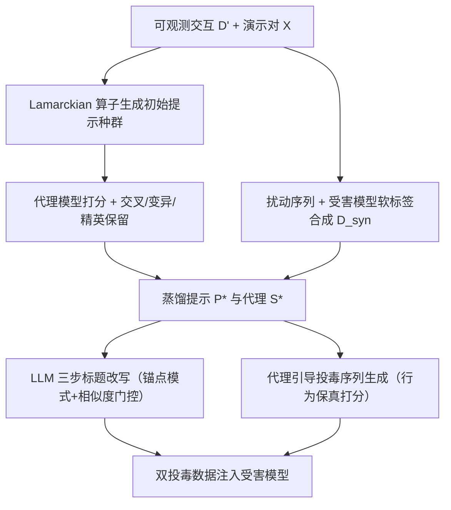
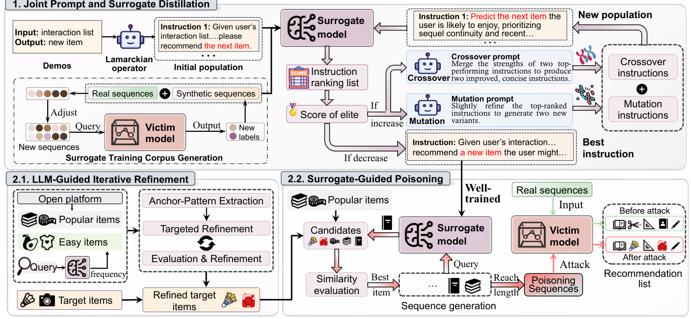

# Prompt-Unknown Promotion Attacks against LLM-based Sequential Recommender Systems (面向 LLM 序列推荐系统的提示词未知推广攻击)

- **会议/期刊**: SIGIR 2026
- **作者与机构**: Yuchuan Zhao, Tong Chen, Junliang Yu, Zongwei Wang, Lizhen Cui, Hongzhi Yin（昆士兰大学、格里菲斯大学、重庆大学、山东大学）
- **推荐链路定位**: 端到端生成式（LLM-SRS 的提示驱动推理与训练数据投毒）
- **研究方向**: 大语言模型推荐 / 去偏公平、可信隐私与工业架构
- **论文原文**: [论文原文链接](https://arxiv.org/abs/2604.23640v1)
- **开源代码**: 暂未开源（仅引用 LLaMA 权重仓库）

## TL;DR (1分钟核心速览)

现有 LLM-SRS 推广攻击普遍假设攻击者可访问受害模型或系统提示词，这在真实部署中不成立。本文提出 PUDA：先用 LLM 驱动的进化式提示蒸馏（交叉+变异+精英保留）反推离散系统指令，并用少量可观测交互+受害模型软标签训练行为对齐的代理模型；再在代理上做"文本改写 + 行为保真投毒序列"双投毒。在 Beauty/Goodreads/Steam 三个数据集、2% 恶意用户预算下，Beauty 的 HR@10 从 0.0105 提升至 0.0405（约 3.9 倍），全面超越 TextFooler/BertAttack/DeepWordBug/PuncAttack 等基线。

## Background & Motivation (背景与核心矛盾)

- **主流范式**: LLM-SRS（P5、TALLRec、SPRec）将用户交互序列 verbalize 为自然语言提示，由 LLM 做 next-item 生成式预测；攻击侧则以文本改写（TextSimu、Zhang et al.）或提示注入（CheatAgent）为主。
- **前人局限**: 其一，CheatAgent 等需直接读写系统提示词，Zhang et al. 需白盒访问模型，在"模型+提示词双黑盒"下完全不成立；其二，纯文本改写只模仿热门商品措辞，既扭曲语义易被审核识别，又忽略交互序列中的共现与转移依赖，长尾商品仅靠改标题难以被推起。
- **核心洞察 (Key Insight)**: 系统提示词虽是离散文本，但其诱导的推荐行为可由少量可观测交互反推——把提示词搜索当作黑盒优化问题，用代理模型在下游 HR 上的得分作为适应度，即可蒸馏出高保真指令；同时 LLM-SRS 的排序同时受交互频次与文本语义双重驱动，故需文本与行为两条通道协同投毒。
- **本文切入点**: 以"进化式提示蒸馏 → 行为对齐代理 → 双投毒"的闭环，把不可见的提示词转化为可优化的攻击基础设施。

## Method (核心方法设计)

### 1. 整体框架 (Overall Architecture)

PUDA 分两阶段。阶段一：用 Lamarckian 算子从可观测样本 $\mathcal{X}$ 逆向生成初始提示种群 $\mathcal{P}^{(0)}$，每个候选提示训练代理模型 $\mathcal{S}$ 并以 HR 打分；随后迭代执行交叉、变异与精英保留，直至精英得分不再提升，得到蒸馏提示 $P^*$。代理训练语料由可观测交互 $\mathcal{D}'$ 与"扰动序列 + 受害模型软标签"合成数据 $\mathcal{D}_{syn}$ 组成，以缓解数据可见性不足。阶段二：在 $P^*$ 与代理 $S^*$ 之上，一方面用 LLM 三步推理改写目标商品标题（锚点模式抽取→受约束改写→相似度门控迭代），另一方面自回归生成行为保真的投毒序列，二者合并后迁移至受害模型评估。

<figure class="paper-figure" markdown="span">
  <figcaption>图1：所提出的PUDA框架。上部分（第1部分）展示了联合提示与代理蒸馏阶段。左下模块（第2.1部分）展示了基于锚点模式模仿的LLM引导文本精炼模块，右下模块（第2.2部分）展示了在黑盒LLM-SRS设置下用于有效商品推广的代理引导投毒序列生成过程。</figcaption>
</figure>

### 2. 关键设计拆解 (Key Designs)

1. **进化式提示蒸馏（Evolutionary Prompt Distillation）**：痛点是无梯度、离散、搜索空间巨大的提示词无法直接优化。核心是以代理模型的下游推荐得分为适应度：$\text{score}(P^{(t)}_k)=\mathbb{E}_{(s,y)\sim\mathcal{X}}[f(\mathcal{S}(P^{(t)}_k,s),y)]$，每代由交叉算子 $\mathcal{O}_C$ 重组两个最优父代、变异算子 $\mathcal{O}_M$ 扰动 top-$\kappa$ 提示，并按 $\mathcal{P}^{(t+1)}=\{P^{(t)}_{\text{elite}}\}\cup\mathcal{P}^{(t)}_{\text{cross}}\cup\mathcal{P}^{(t)}_{\text{mut}}$ 组装新种群，收敛条件为 $\text{score}(P^{(t+1)}_{\text{elite}})\le \text{score}(P^{(t)}_{\text{elite}})$。直觉上，把"提示词写得好不好"直接折算成"代理推荐得准不准"，使离散文本搜索获得稠密可比的反馈信号，且精英保留保证单调不退化。

2. **LLM 引导的锚点模式标题改写（Anchor-Pattern Refinement）**：痛点是长尾商品标题缺乏吸引力且直接同义替换扰动太弱。方法构造两个锚点集——热门集 $\mathcal{I}_{pop}$ 与"易推集" $\mathcal{I}_{easy}=\{i\mid \text{Freq}_{S^*}(i)\ge\gamma\}$（由代理高频推荐项定义，捕捉系统归纳偏置而非全局热度），令 LLM 先抽取锚点标题的体裁线索/结构模板/语气信号，再在"保留核心实体"约束下重写目标标题，并用语义相似度 $\text{Sim}_{sem}=\cos(e(\mathcal{T}),e(\tilde{\mathcal{T}}))$ 与词法 Jaccard 相似度 $\text{Sim}_{lex}$ 双阈值门控迭代。直觉是：把标题推向推荐器语义偏好区，同时用双阈值防止语义漂移被审核识破。

3. **代理引导的行为保真投毒序列 + 训练目标**：痛点是纯文本攻击无法建立目标商品与高曝光商品的共现。每步以热门种子初始化前缀，候选池 $\mathcal{C}=\mathcal{R}^{(t)}_J\cup\mathcal{I}_{tar}\cup\mathcal{I}_{pop}^{10\%}$ 显式注入目标与头部商品，再以行为相似度 $\text{BehSim}(c\mid s)=\text{Sim}(e_{[s;c]},e_{avg})$ 选下一项 $\hat{c}_t=\arg\max_{c\in\mathcal{C}}\text{BehSim}$，保证序列与真实用户行为分布一致。代理训练用标准自回归 SFT 损失 $\theta^*=\arg\min_\theta \mathbb{E}_{(s,y)\in\mathcal{D}_{st}}[-\frac{1}{|y|}\sum_t \log \mathcal{S}_\theta(y_t\mid P^*,s,y_{<t})]$，无需负采样；推理侧仅需对受害模型做有限次查询获取软标签，攻击成本由 2% 恶意用户预算控制。

## Experimental Setup & Evaluation Protocol (实验设置与评估协议)

- **数据集与预处理**: 三个公开数据集，均按 5-core 过滤：

| 数据集 | #Users | #Items | #Interactions | 密度 | 场景说明 |
| :--- | :---: | :---: | :---: | :---: | :--- |
| GoodReads | 6,031 | 4,058 | 160,398 | 0.655% | 图书评论 |
| Steam | 29,876 | 32,094 | 178,961 | 0.019% | 游戏平台 |
| Beauty | 40,226 | 54,542 | 353,989 | 0.016% | 亚马逊美妆 |

- **数据划分与防穿越 (Splitting Strategy)**: 采用序列推荐标准的 `Leave-Last-Two-Out`——每个用户最后两次交互分别作验证与测试，其余前缀作训练。
- **排名评测协议 (Ranking Protocol)**: 以目标商品为唯一相关项计算 HR@10/50 与 NDCG@10/50（全库生成式排序，非采样排序）；另用 Agreement@10/50（代理与受害推荐列表重叠率）衡量代理保真度。所有结果三次独立运行取均值。
- **对比基线与超参设置**: 基线分三类——文本攻击（TextFooler、BertAttack、DeepWordBug、PuncAttack，均报告"纯文本"与"文本+随机投毒"两版）、数据投毒（Random、Bandwagon）、提示优化（RLPrompt、APE）。骨干为 SPRec + LoRA SFT（lr $1\times10^{-4}$，batch 8，序列长 512）；代理为 LLaMA-1B-Instruct（仅用 20% 真实交互训练），受害模型为 LLaMA-3B-Instruct；恶意用户预算 2%，目标为 5 个最冷门商品；标题改写用 GPT-4o，Beauty 阈值（语义 0.9/词法 0.7），Goodreads 与 Steam 词法放宽至 0.3。

## Key Experimental Results (实验关键数据)

### 1. 主实验对比 (Main Results)

| 方法 | Beauty HR@10 | Beauty N@50 | Goodreads HR@50 | Steam HR@50 | Steam N@50 |
| :--- | :---: | :---: | :---: | :---: | :---: |
| Clean（无攻击） | 0.0105 | 0.0135 | 0.0000 | 0.0843 | 0.0174 |
| TextFooler w/ poisoning | 0.0080 | 0.0123 | 0.0563 | 0.1160 | 0.0243 |
| DeepWordBug w/ poisoning | 0.0318 | 0.0329 | 0.0375 | 0.1300 | 0.0267 |
| PuncAttack w/ poisoning | 0.0159 | 0.0203 | 0.0552 | 0.1470 | 0.0300 |
| BertAttack w/ poisoning | 0.0079 | 0.0123 | 0.0469 | 0.1213 | 0.0249 |
| **PUDA (Ours)** | **0.0405** | **0.0522** | **0.0657** | **0.1635** | **0.0348** |
| Improv. vs 最强基线 | +27.4% | +58.7% | +17.1% | +11.2% | +16.0% |

### 2. 消融实验 (Ablation Study)

原文未设标准组件消融表，以下为按模块拆解的关键对照（数据取自正文与图 3/图 4）：

| 配置 | 关键指标 | 说明 |
| :--- | :---: | :--- |
| 仅文本改写（无投毒） | Beauty HR@10 0.0105→0.0405 区间低端 | 文本单独作用有限，Goodreads 上 Clean 为 0 |
| 文本 + Random 投毒 | 低于 PUDA 投毒 | 通用投毒信号缺乏精确引导 |
| 文本 + Bandwagon 投毒 | 低于 PUDA 投毒 | 仅靠热度共现，跨数据集不稳定 |
| RLPrompt 蒸馏 + 投毒 | AGR 与 HR 均低于本文 | 提示语义不连贯 |
| APE 蒸馏 + 投毒 | AGR 与 HR 均低于本文 | 缺乏面向推荐的优化机制 |
| **PUDA 完整版** | **AGR 与 HR 全面最优** | 进化蒸馏 + 双投毒协同 |

### 3. 关键实验发现 (Key Findings)

1. **双通道协同是主要增益来源**：Beauty 上 PUDA 将 NDCG@50 从 0.0135 拉到 0.0522（+287%），而最强文本基线 DeepWordBug 配随机投毒仅 0.0329；说明标题改写负责"语义可被看见"，投毒序列负责"行为可被学到"，缺一不可。
2. **代理保真度直接决定攻击上限**：图 4 中本文蒸馏提示在三个数据集上 AGR@10/50 均最高，且对应 HR 也最高；图 7 显示训练数据从 10% 增至 30% 时一致性单调上升，且 Top-50/100 的一致性显著高于 Top-5，说明代理更擅长复现粗粒度排序偏好而非精确头部。
3. **攻击预算与语义信号双重驱动**：图 6 显示恶意用户从 0.5% 增至 2.0% 时 HR@50/NDCG@50 单调上升；但预算为 0 时目标商品仍有非零曝光，印证 LLM-SRS 的排序并非纯频次驱动，文本语义本身即可贡献曝光——这也是纯文本攻击在 Goodreads 上能把 HR@50 从 0 抬到 0.0587 的原因。

## Highlights, Limitations & Rating (亮点、对比与审稿评价)

- **与代表作对比 (vs. Prior Work)**: 相比 CheatAgent（需改写系统提示词）与 Zhang et al.（需白盒/测试期访问），PUDA 首次在"模型+提示词双黑盒"下成立；相比 TextSimu 的纯热门模仿改写，本文引入 $\mathcal{I}_{easy}$ 捕捉系统归纳偏置并叠加行为级投毒，攻击面从文本扩展到交互序列。
- **可迁移亮点**: ①"以下游任务指标为适应度的进化式离散提示蒸馏"可直接迁移到黑盒 LLM 推荐器的模型窃取与鲁棒性评测；②"语义+词法双阈值门控的 LLM 改写"是通用的可控文本对抗扰动模板，可用于红队测试与内容审核阈值标定。
- **审稿级局限批判**: ①标题改写与提示蒸馏均依赖 GPT-4o 多次调用，攻击成本与可复现性未量化，且蒸馏收敛需多代代理重训，实际部署开销偏高；②受害模型仅覆盖 LLaMA-3B + SPRec 单一组合，未验证对 P5/TALLRec 或商用 API 的迁移性，防御侧（如投毒检测、标题一致性校验）也完全未讨论。
- **四维评分**: 创新性 ⭐⭐⭐⭐ | 实验扎实度 ⭐⭐⭐⭐ | 方法清晰度 ⭐⭐⭐⭐ | 落地价值 ⭐⭐⭐⭐

