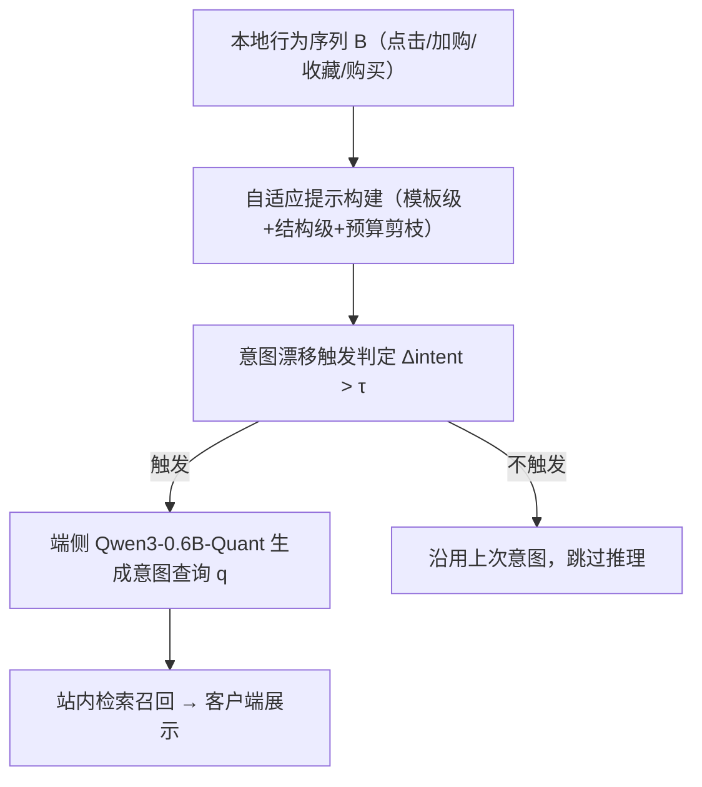
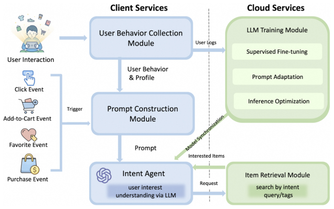

# RecGPT-Mobile: On-Device Large Language Models for User Intent Understanding in Taobao Feed Recommendation (端侧大语言模型驱动的淘宝信息流用户意图理解)

- **会议/期刊**: SIGIR 2026
- **作者与机构**: Bin Zhang, Weipeng Huang, Dimin Wang, Jialin Zhu, Yuning Jiang, Zhaode Wang, Chengfei Lv, Jian Wang, Qichao Ma, Li Chen, Junqing Wu, Yipeng Yu（淘宝天猫集团 / 阿里巴巴）
- **推荐链路定位**: 召回（意图查询生成 → 站内检索召回）
- **研究方向**: 大语言模型推荐 / 序列与会话推荐
- **论文原文**: [https://arxiv.org/abs/2605.04726v1](https://arxiv.org/abs/2605.04726v1)
- **开源代码**: 暂未开源

## TL;DR (1分钟核心速览)

云端 LLM 做"下一查询意图预测"存在通信延迟高、推理成本大、无法感知意图快速漂移三大痛点。本文提出 RecGPT-Mobile：把 Qwen3-0.6B 经 LoRA 微调 + 量化后直接部署在手机端，配合"模板级 + 结构级"自适应提示构建与基于熵差/Jaccard/JS 散度的意图漂移触发机制，仅在意图真正变化时才调用 LLM。离线 LLM 自动评测总分 0.794（LoRA+Quant），线上淘宝四场景 A/B 平均 CLICK +1.8%、PAY +2.7%、GMV +2.5%。

## Background & Motivation (背景与核心矛盾)

- **主流范式**: 云端推荐系统集中收集行为、集中推理；近期 RecGPT 等工作用云端 LLM 做意图挖掘与下一查询预测，替代传统 log-fitting。
- **前人局限**: ① 端云通信延迟使"实时感知意图"不可行，用户意图在分钟级内漂移时云端结果已过期；② 云端 LLM 推理成本随用户规模线性膨胀，难以全量铺开。
- **核心洞察 (Key Insight)**: 端侧推荐（EdgeRec、DIR）已证明本地处理可降延迟，但从未有人把 LLM 放到手机上——瓶颈不在算法而在"模型太大 + 每步都推理太浪费"。
- **本文切入点**: 用 0.6B 小模型 + 量化解决"放得下"，用意图漂移触发机制解决"不必每步都算"，从而把 LLM 意图智能体真正落到端侧。

## Method (核心方法设计)

### 1. 整体框架 (Overall Architecture)

系统由五个模块闭环构成：用户行为采集模块在本地缓存行为序列 $\mathcal{B}=\{(i_t,a_t,t_t)\}$；提示构建模块在"高意图动作"触发下把原始行为与画像合成为结构化 prompt；意图智能体（端侧 LLM）将隐式行为翻译为显式搜索意图查询$q$；物品检索模块以$q$发起检索并回传候选物品到客户端；LLM 训练模块负责 SFT、提示适配与推理优化。核心优化目标是$q^{*}=\arg\max_{q\in\mathcal{Q}}P(q\mid\mathcal{B})$，且受端侧资源约束。

<figure class="paper-figure" markdown="span">
  <figcaption>图1：RecGPT-Mobile 框架。</figcaption>
</figure>

### 2. 关键设计拆解 (Key Designs)

1. **多源训练样本构建 + LoRA 轻量微调**：纯行为日志样本语义单一、模板化严重。作者按 60% 行为驱动（购买/搜索日志关联购后查询）、20% 共购矩阵、15% LLM 改写增强、5% 人工标注校准配比构造训练集，再对 Qwen3-0.6B 做 LoRA 微调并量化。直觉是：小模型容量有限，必须靠"数据多样性"而非"参数规模"补足语义覆盖，LLM 改写样本专门对抗模板复用导致的表达退化。

2. **自适应提示构建（Algorithm 1）**：端侧 token/延迟预算极紧，固定长 prompt 不可行。先抽取行为特征 $\Phi=[\Phi_{act},\Phi_{rec},\Phi_{div},\Phi_{freq}]$（动作类型、时近性、多样性、频次），用轻量打分器$M_{score}$对模板池做 softmax 选择$p_k=\exp(\beta\alpha_k)/\sum_j\exp(\beta\alpha_j)$；再对候选结构组件按边际增益$\Delta(c)=M_{score}(P\oplus c,\Phi,s)-M_{score}(P,\Phi,s)$逐个贪心加入，仅当$\Delta(c)>\tau$且$\text{Cost}(P\oplus c)\le C_{max}$时保留；最后做预算感知剪枝，取满足成本约束下效用最大的子集$P^{*}$。有效性来自"按场景定制提示"而非"统一长提示"，在同等预算下信息密度更高。

3. **意图漂移触发机制（推理省算力的关键）**：若每步交互都调 LLM，端侧电量和延迟都不可接受。作者把滑窗内交互映射为离散语义标签分布 $P_{\mathcal{B}}$，从三个互补角度量化漂移：熵差$\Delta H=|H(P_{\mathcal{B}}^{(t)})-H(P_{\mathcal{B}}^{(t-1)})|$刻画意图聚焦/发散；Jaccard 相似度$JA(\mathcal{Z}^{(t)},\mathcal{Z}^{(t-1)})$ 刻画语义重叠；JS 散度刻画分布整体偏移。融合为
$$\Delta_{intent}=\lambda_1\Delta H+\lambda_2(1-JA)+\lambda_3\,JS(P_{\mathcal{B}}^{(t)},P_{\mathcal{B}}^{(t-1)})$$
仅当 $\Delta_{intent}>\tau$才触发推理。物理直觉：三信号分别覆盖"不确定性变化、标签集合变化、概率质量迁移"，单一信号易漏判，融合后对"换品类""同品类深挖"两类漂移都敏感。线上取$\lambda_1=0.4,\lambda_2=\lambda_3=0.3,\tau=0.8$。

**训练与推理开销**：SFT 采用标准下一 token 预测损失（无负采样，生成式范式），LoRA 微调 + 量化后部署 Qwen3-0.6B-Quant；在线推理因触发机制而稀疏化，P50–P95 延迟曲线趋势一致，尾部延迟放大但无系统性退化。

## Experimental Setup & Evaluation Protocol (实验设置与评估协议)

- **数据集与场景**: 淘宝移动端真实行为日志（购买、搜索、共购矩阵），线上实验覆盖四个信息流场景、数千万用户、为期一个月。论文未给出离线数据集统计表（工业界内部数据，无 #Users/#Items 明细）。

| 场景 | 说明 | 实验周期 |
| :--- | :--- | :---: |
| 支付成功页 | 交易完成后推荐 | 1 个月 |
| 物流跟踪页 | 履约中推荐 | 1 个月 |
| 购物车页 | 加购未购推荐 | 1 个月 |
| 订单列表页 | 历史订单关联推荐 | 1 个月 |

- **数据划分与防穿越**: 论文未明确说明离线划分方式；线上采用标准 A/B 分流（实验组 vs 对照组），属工业界常规做法。
- **排名评测协议**: 离线不采用传统 Full-Ranking / Sampled Ranking，而是用 LLM 自动评测（Prompt 2）将生成查询质量分解为语义一致性 $S_{sem}$、逻辑连贯性$S_{logic}$、表达质量$S_{style}$ 三维打分；线上以 CLICK / PAY / GMV 业务指标衡量。
- **对比基线与超参**: 离线对比 Base（Qwen3-0.6B 原始）、LoRA、LoRA+Quant 三种部署配置，并在 Qwen3-4B/8B/30B 三种评测模型下交叉验证；线上超参 $\lambda_1=0.4,\lambda_2=0.3,\lambda_3=0.3,\tau=0.8$ 由启发式搜索确定。

## Key Experimental Results (实验关键数据)

### 1. 主实验对比 (Main Results)

离线 LLM 自动评测（Qwen3-0.6B 为基座，三种评测模型交叉打分）：

| 评测模型 | 配置 | $S_{sem}$|$S_{logic}$|$S_{style}$ | Total |
| :--- | :--- | :---: | :---: | :---: | :---: |
| Qwen3-4B | Base | 0.752 | 0.621 | 0.657 | 0.677 |
| Qwen3-4B | LoRA | **0.885** | **0.792** | **0.811** | **0.829** |
| Qwen3-4B | LoRA+Quant | 0.844 | 0.754 | 0.785 | 0.794 |
| Qwen3-8B | Base | 0.657 | 0.554 | 0.627 | 0.613 |
| Qwen3-8B | LoRA | **0.807** | **0.755** | **0.786** | **0.783** |
| Qwen3-8B | LoRA+Quant | 0.780 | 0.746 | 0.754 | 0.760 |
| Qwen3-30B | Base | 0.671 | 0.654 | 0.663 | 0.654 |
| Qwen3-30B | LoRA | **0.839** | **0.797** | **0.787** | **0.808** |
| Qwen3-30B | LoRA+Quant | 0.812 | 0.774 | 0.762 | 0.780 |

线上 A/B（Qwen3-0.6B-Quant 部署）：

| 场景 | CLICK | PAY | GMV |
| :--- | :---: | :---: | :---: |
| 支付成功页 | +1.3% | +2.3% | +2.5% |
| 物流跟踪页 | +2.4% | +2.9% | +3.0% |
| 购物车页 | +2.5% | +2.7% | +2.9% |
| 订单列表页 | +0.8% | +1.8% | +1.8% |
| **平均** | **+1.8%** | **+2.7%** | **+2.5%** |

### 2. 消融实验 (Ablation Study)

论文未提供传统模块级消融表（`w/o 触发机制`、`w/o 自适应提示` 等均缺失），仅以"Base vs LoRA vs LoRA+Quant"的部署配置对比替代：

| 配置 | Qwen3-4B Total | Qwen3-8B Total | Qwen3-30B Total |
| :--- | :---: | :---: | :---: |
| Base | 0.677 | 0.613 | 0.654 |
| LoRA | **0.829** | **0.783** | **0.808** |
| LoRA+Quant | 0.794 | 0.760 | 0.780 |
| LoRA 相对 Base 提升 | +22.5% | +27.7% | +23.5% |
| 量化损失 | −4.2% | −2.9% | −3.5% |

### 3. 关键实验发现 (Key Findings)

1. **LoRA 微调是收益主来源，量化代价可控**：三种评测模型下 LoRA 相对 Base 总分提升 22.5%–27.7%，而量化仅损失 2.9%–4.2%，说明 0.6B 小模型的能力瓶颈在"任务对齐"而非"精度位宽"，量化换来的端侧可部署性是划算交易。
2. **场景收益与"意图漂移强度"正相关**：购物车页（+2.5% CLICK）与物流跟踪页（+2.4%）收益最高，订单列表页最低（+0.8%）——前者用户意图处于活跃探索期、漂移频繁，触发机制能及时捕捉；后者意图稳定，LLM 增量信息有限，反向印证了触发机制的设计合理性。
3. **PAY 提升幅度系统性高于 CLICK**（+2.7% vs +1.8%）：意图查询更精准地命中"高购买意愿"商品，说明生成式意图对转化漏斗后段的价值大于对曝光点击的价值，这对工业界"重转化"目标更友好。

## Highlights & Limitations (亮点、对比与审稿批判)

- **与代表作对比 (vs. Prior Work)**: 相比 RecGPT（云端生产级 LLM 推荐框架），本文把推理搬到端侧，用 0.6B 量化模型 + 稀疏触发替代云端大模型全量推理；相比 EdgeRec / DIR 等端侧推荐工作，本文首次把生成式 LLM 而非传统排序模型放到手机上，实现"隐式行为 → 显式意图查询"的语义跃迁。
- **可迁移亮点**: ① 意图漂移三信号融合触发（熵差 + Jaccard + JS）可直接迁移到任何"按需调用大模型"的端侧/边缘场景；② 模板级 + 结构级 + 预算剪枝的三段式自适应提示构建，是资源受限下 prompt 工程的通用范式。
- **审稿级局限批判**: ① 离线评测完全依赖 LLM 自动打分（且用 Qwen 系列自评），缺乏人工标注的 ground-truth 查询与召回率/NDCG 等标准检索指标，评测客观性存疑；② 缺少关键消融——触发机制、自适应提示各自的贡献未被单独量化，无法判断收益究竟来自 LLM 意图生成还是触发策略；③ 仅报告 P50–P95 延迟趋势图，未给出绝对延迟数值与端侧功耗数据，工程可复现性不足。

## Rating (四维评分)

- **方法创新性 (Novelty)**: ⭐⭐⭐⭐ （首个端侧 LLM 推荐系统落地，意图漂移触发机制设计巧妙且有物理直觉，但各组件均为已有技术的工程组合）
- **评估协议与实验扎实度 (Protocol & Experiments)**: ⭐⭐⭐ （线上四场景数千万用户 A/B 极具说服力，但离线仅靠 LLM 自评、缺标准检索指标与模块级消融，学术严谨度打折）
- **写作与数学规范度 (Clarity & Rigor)**: ⭐⭐⭐⭐ （公式与算法伪代码清晰，触发机制三信号定义完整，但部分符号如 $\mathcal{Z}$与$P_{\mathcal{B}}$ 的关系交代略简）
- **工业落地与复现价值 (Industrial & Practical Value)**: ⭐⭐⭐⭐⭐ （真实淘宝全量场景验证、GMV +2.5%，端侧部署路径完整可复制，是 LLM4Rec 工业落地的标杆案例；可惜未开源）
