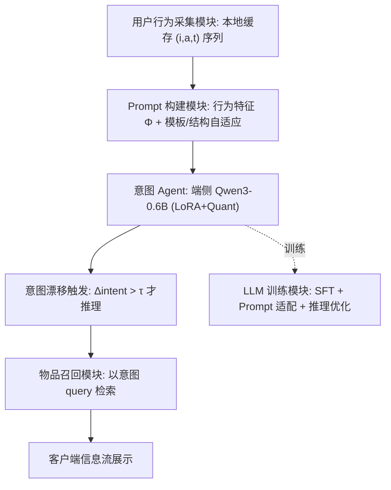
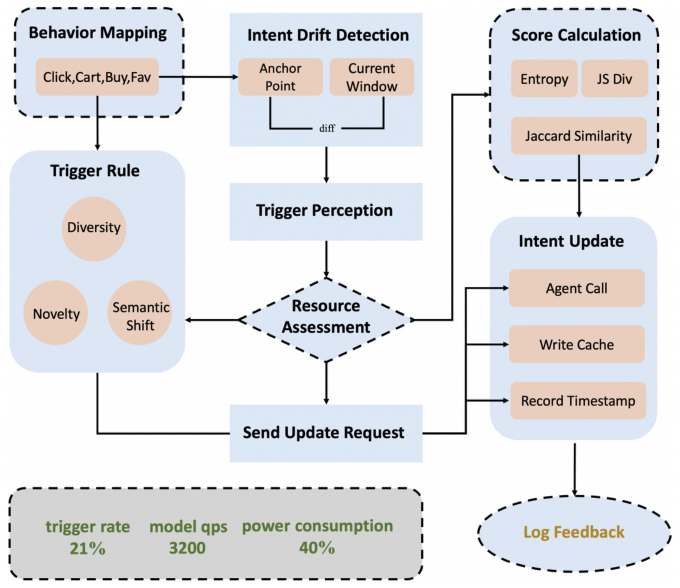
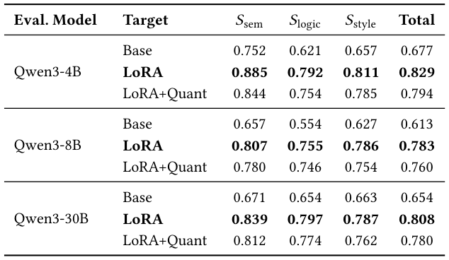
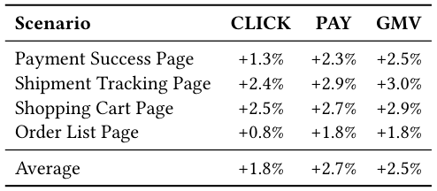
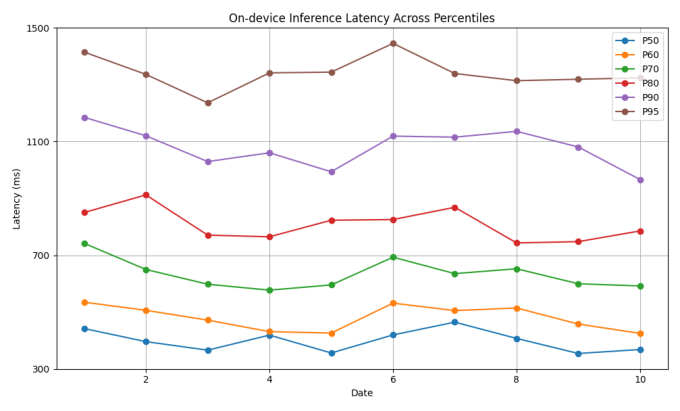

# RecGPT-Mobile: On-Device Large Language Models for User Intent Understanding in Taobao Feed Recommendation (端侧大语言模型驱动的淘宝信息流推荐用户意图理解)

- **会议/期刊**: SIGIR 2026 (49th International ACM SIGIR Conference, Melbourne, VIC, Australia)
- **推荐链路定位**: 召回触发 / 意图理解前置模块 (Intent Agent → Item Retrieval)，服务于信息流推荐与搜索意图预测
- **研究方向**: 大语言模型推荐 (LLM4Rec) / 对话与智能体推荐 (Agentic Recommendation)
- **论文原文**: [https://arxiv.org/abs/2605.04726v1](https://arxiv.org/abs/2605.04726v1)
- **开源代码**: 暂未开源（原文与预提取均未发现开源代码链接）

## TL;DR (核心速览)

针对云端 LLM 意图理解推理成本高、无法实时感知移动端用户意图快速漂移的痛点，本文提出 RecGPT-Mobile：将 Qwen3-0.6B 经 LoRA 微调 + 量化后直接部署在手机端，作为"意图 Agent"把异构隐式行为序列翻译为显式搜索 query，并设计自适应 Prompt 构建（模板级 + 结构级 + 预算约束）与基于熵差/Jaccard/JS 散度的意图漂移触发机制以降低冗余推理。离线 LLM 自动评测（LoRA 总分 0.829 vs Base 0.677）与淘宝四场景一个月线上 A/B（千万级用户）显示平均 +1.8% CLICK、+2.7% PAY、+2.5% GMV。

## Background & Motivation (背景与动机)

- **领域背景与主流范式**: 现代电商推荐主流仍是云端集中式架构（特征中心 + 云服务器推理），近期 LLM4Rec 工作（HSTU、OneRec、RecGPT）把推荐重构为生成式/意图推理任务，显著提升语义理解能力。
- **现有方法局限 (Limitations of Prior Work)**:
  1. **通信延迟与意图感知滞后**：云端架构存在端-云通信延迟，难以捕捉移动场景下快速演化的用户意图；
  2. **推理成本高**：LLM 参数量大、算力密集，云端部署的推理开销难以支撑高频实时调用；
  3. **端侧资源约束**：直接在资源受限设备上部署复杂 LLM 不可行，需依赖量化/剪枝/蒸馏等压缩手段。
- **核心挑战 (Key Challenge)**: 端侧推荐系统（EdgeRec、快手端上实时框架、DIR）已证明本地处理可降延迟，但如何在**严格延迟/内存/Token 预算**下运行 LLM 并保持意图理解质量，同时避免行为稳定时的频繁无效推理，是尚未解决的矛盾。
- **核心洞察与切入点 (Key Insight)**: 作者认为意图理解不必每次行为都重算——只有当用户意图发生"显著漂移"时才触发 LLM 推理；同时 Prompt 应随行为特征与场景自适应裁剪以适配端侧预算。这一"按需推理 + 预算感知 Prompt"的组合是本文的核心切入点。

## Problem Formulation & Method (问题定义与方法架构)

### 1. 符号定义与输入表征 (Notations & Input Representations)

- 用户行为序列：$\mathcal{B}=\{(i_1,a_1,t_1),(i_2,a_2,t_2),\dots,(i_T,a_T,t_T)\}$，其中 $i_T$ 为交互物品，$a_T\in\{\text{click},\text{cart},\text{favorite},\text{purchase}\}$ 为行为类型，$t_T$ 为时间戳。
- 目标：在资源约束下预测下一潜在搜索 query $q\in\mathcal{Q}$：
$$q^*=\arg\max_{q\in\mathcal{Q}} P(q\mid \mathcal{B}) \quad \text{s.t. Resource Constraints}$$
- 行为特征向量：$\Phi(\mathcal{B})=[\Phi_{act},\Phi_{rec},\Phi_{div},\Phi_{freq}]$，分别编码行为类型分布、时间近因性、语义多样性与交互频次。
- 端侧预算：$C_{\max}$（延迟/内存/Token 上限）。

### 2. 整体流水线 (Overall Architecture)

系统由五个模块构成：**用户行为采集模块**（本地缓存行为）→ **Prompt 构建模块**（将原始行为与画像合成为结构化 Prompt）→ **意图 Agent**（LLM 将行为信号转为显式意图 query）→ **物品召回模块**（以意图 query 检索并回传物品）→ **LLM 训练模块**（SFT、Prompt 适配与推理优化）。论文重点阐述训练模块与端侧推理优化。

<figure class="paper-figure" markdown="span">
  <figcaption>图 1</figcaption>
</figure>
图 1: RecGPT-Mobile 整体框架。

### 3. 核心模块设计与数学原理 (Key Designs & Formulations)

**(1) 监督微调与训练样本构造**：训练集由四类互补样本构成（表 1）：行为驱动样本（购买/搜索日志，60%）、共购关系样本（物品共购矩阵，20%）、LLM 增强样本（GPT 改写提升语言多样性，15%）、人工标注样本（质量校准，5%）。Prompt 1 将时间戳与行为序列作为输入，要求模型输出最可能的搜索 query。

**(2) 自适应 Prompt 构建（算法 1）**：分四阶段——
- **特征提取**：计算 $\Phi(\mathcal{B})=[\Phi_{act},\Phi_{rec},\Phi_{div},\Phi_{freq}]$；
- **模板级适配**：对候选模板 $T_k$ 用轻量打分器 $M_{score}$ 打分 $\alpha_k$，经 softmax（温度 $\beta$）选最优模板 $T^*=\arg\max_{T_k\in\mathcal{T}_s} p_k$；
- **结构级适配**：对每个候选组件 $c$，计算边际效用 $\Delta(c)=M_{score}(P\oplus c,\Phi,s)-M_{score}(P,\Phi,s)$，仅当 $\Delta(c)>\tau$ 且 $\text{Cost}(P\oplus c)\le C_{\max}$ 时并入；
- **预算约束与定稿**：在 $\text{Cost}(P')\le C_{\max}$ 下取效用最大的 $P^*$，再实例化具体行为 token。

**(3) 端侧意图漂移触发机制**：将滑窗内每次交互映射为离散语义标签（类目/品牌/意图类型），得到标签分布 $P_\mathcal{B}$。从三个视角量化意图漂移：
- 熵差：$\Delta H=|H(P_\mathcal{B}^{(t)})-H(P_\mathcal{B}^{(t-1)})|$，$H(P_\mathcal{B})=-\sum_k P_\mathcal{B}(k)\log P_\mathcal{B}(k)$；
- 语义重叠：$\text{JA}(\mathcal{Z}^{(t)},\mathcal{Z}^{(t-1)})=\frac{|\mathcal{Z}^{(t)}\cap\mathcal{Z}^{(t-1)}|}{|\mathcal{Z}^{(t)}\cup\mathcal{Z}^{(t-1)}|}$；
- 分布漂移：$\text{JS}(P_\mathcal{B}^{(t)},P_\mathcal{B}^{(t-1)})=\frac12\text{KL}(P_\mathcal{B}^{(t)}\|M)+\frac12\text{KL}(P_\mathcal{B}^{(t-1)}\|M)$，$M=\frac12(P_\mathcal{B}^{(t)}+P_\mathcal{B}^{(t-1)})$。

融合为单一漂移分数：
$$\Delta_{intent}=\lambda_1\Delta H+\lambda_2(1-\text{JA})+\lambda_3\text{JS}(P_\mathcal{B}^{(t)},P_\mathcal{B}^{(t-1)}),\quad \lambda_1+\lambda_2+\lambda_3=1$$
仅当 $\Delta_{intent}>\tau$ 时才触发 LLM 更新 Prompt 并重新预测。线上取 $\lambda_1=0.4,\lambda_2=0.3,\lambda_3=0.3,\tau=0.8$（启发式搜索确定）。

<figure class="paper-figure" markdown="span">
  <figcaption>图 2</figcaption>
</figure>
图 2: 移动端意图 Agent 触发流水线。

### 4. 训练目标、负采样与推理复杂度 (Optimization, Negative Sampling & Complexity)

- **损失函数**: 原文采用监督微调（LoRA），**未给出显式损失函数公式**（标准自回归交叉熵 SFT，原文未展开）；无对比学习/温度系数 $\tau$ 的损失项（文中 $\tau$ 为触发阈值与结构适配阈值，非 InfoNCE 温度）。
- **训练负采样策略**: 本文为生成式 next-query 预测，**免负采样**（自回归生成目标 query），原文未报告负采样设计。
- **时间与空间复杂度**: 端侧部署 Qwen3-0.6B-Quant（量化版），通过意图漂移触发机制减少冗余推理；原文未给出理论复杂度分析，仅报告真实设备 P50–P95 延迟曲线（图 3），并指出高百分位延迟上升但趋势稳定、无系统性退化。离线训练/量化耗时原文未报告。

## Experimental Setup & Evaluation Protocol (实验设置与评估协议)

- **数据集统计与预处理**: 原文**未提供标准基准数据集统计表**（无 #Users/#Items/#Interactions/稀疏度表格），实验基于淘宝真实生产日志（购买/搜索日志、共购矩阵）与人工标注数据。训练样本构成如下：

| 样本类型 (Sample Type) | 数据来源 (Data Source) | 占比 (Ratio) |
| :--- | :--- | :---: |
| 行为驱动 (Behavior-driven) | 购买 & 搜索日志 | 60% |
| 共购关系 (Co-purchase) | 物品共购矩阵 | 20% |
| LLM 增强 (LLM-based) | GPT 改写 | 15% |
| 人工标注 (Human-annotated) | 人工标注 | 5% |

- **数据划分方式 (Splitting Strategy)**: 原文**未明确报告**训练/验证/测试划分细节（无 LOO / Ratio / 全局时间戳切分的显式说明），存在审稿层面的可复现性缺口。
- **排名评测协议 (Ranking Protocol)**: 本文**不采用传统 Top-K 排序评测**（无 Full-Ranking / Sampled Ranking、无 Recall@K / NDCG@K）。离线采用 **LLM 自动评测**（Prompt 2），将生成质量分解为语义一致性 $S_{sem}$、逻辑连贯性 $S_{logic}$、表达质量 $S_{style}$ 三个 $[0,1]$ 归一化子分并加权聚合为 Total；线上采用真实流量 A/B 测试。
- **评价指标与显著性检验**: 离线指标为 $S_{sem}/S_{logic}/S_{style}$/Total；线上指标为 CLICK、PAY、GMV 相对提升。**原文未报告**多随机种子方差或配对显著性检验（$p$ 值），仅以"definitely significant improvement"定性表述。

## Key Experimental Results (核心实验结果)

### 1. 主实验对比 (Main Results)

离线 LLM 自动评测（基座 Qwen3-0.6B，对比 Base / LoRA / LoRA+Quant，评测模型分别为 Qwen3-4B/8B/30B）：

<figure class="paper-figure" markdown="span">
  <figcaption>表 2</figcaption>
</figure>
表 2: 基于 LLM 的自动评测结果。

| 评测模型 | 目标模型设置 | $S_{sem}$ | $S_{logic}$ | $S_{style}$ | Total |
| :--- | :--- | :---: | :---: | :---: | :---: |
| Qwen3-4B | Base | 0.752 | 0.621 | 0.657 | 0.677 |
| Qwen3-4B | LoRA | 0.885 | 0.792 | 0.811 | **0.829** |
| Qwen3-4B | LoRA+Quant | 0.844 | 0.754 | 0.785 | 0.794 |
| Qwen3-8B | Base | 0.657 | 0.554 | 0.627 | 0.613 |
| Qwen3-8B | LoRA | 0.807 | 0.755 | 0.786 | **0.783** |
| Qwen3-8B | LoRA+Quant | 0.780 | 0.746 | 0.754 | 0.760 |
| Qwen3-30B | Base | 0.671 | 0.654 | 0.663 | 0.654 |
| Qwen3-30B | LoRA | 0.839 | 0.797 | 0.787 | **0.808** |
| Qwen3-30B | LoRA+Quant | 0.812 | 0.774 | 0.762 | 0.780 |

关键结论：LoRA 微调在所有评测模型下均取得最高分（如 4B 评测下 Total 0.829 vs Base 0.677，相对提升约 +22.5%）；量化后 LoRA 仅轻微下降（4B 下 0.794，保留约 95.8% 的 LoRA 总分），验证端侧量化部署的可行性。

### 2. 消融实验与控制变量分析 (Ablation Study)

原文**未设置传统模块级消融实验**（无移除自适应 Prompt / 触发机制 / 各样本类型的对照表）。可视为"消融"的对照为表 2 中 Base → LoRA → LoRA+Quant 的三档设置：LoRA 贡献最大（语义分从 0.752 提升至 0.885），量化带来可控退化。**未控制参数量对齐或进行组件级贡献拆解**，这是实验扎实度的主要短板。

### 3. 稀疏度/冷启动分桶与超参敏感度 (Sparsity Buckets & Hyperparameters)

- **分桶表现**: 原文**未报告**长尾物品/冷启动用户分桶结果。
- **关键超参数**: 线上取 $\lambda_1=0.4,\lambda_2=0.3,\lambda_3=0.3,\tau=0.8$，由"实验启发式搜索"确定；原文**未给出敏感度曲线**。
- **线上 A/B 测试结果**: 淘宝移动端四个信息流场景，为期一个月，覆盖千万级用户，部署模型为 Qwen3-0.6B-Quant：

<figure class="paper-figure" markdown="span">
  <figcaption>表 3</figcaption>
</figure>
表 3: 线上实验结果。

| 场景 (Scenario) | CLICK | PAY | GMV |
| :--- | :---: | :---: | :---: |
| 支付成功页 (Payment Success Page) | +1.3% | +2.3% | +2.5% |
| 物流跟踪页 (Shipment Tracking Page) | +2.4% | +2.9% | +3.0% |
| 购物车页 (Shopping Cart Page) | +2.5% | +2.7% | +2.9% |
| 订单列表页 (Order List Page) | +0.8% | +1.8% | +1.8% |
| **平均 (Average)** | **+1.8%** | **+2.7%** | **+2.5%** |

端侧延迟方面（图 3），真实设备上 P50–P95 延迟随百分位上升而增加，但跨日期趋势一致，表明模型在尾部延迟放大条件下仍保持稳定执行，百分位曲线间的适度差异反映真实设备差异而非系统性性能退化。

<figure class="paper-figure" markdown="span">
  <figcaption>图 3</figcaption>
</figure>
图 3: 真实移动设备上不同百分位的运行延迟。

## Highlights, Limitations & Critiques (亮点、局限与审稿级批判)

- **核心亮点与可迁移性**:
  1. **首个端侧 LLM 推荐系统落地**：将 0.6B 量化 LLM 直接部署手机端做意图理解，为 LLM4Rec 的"端云协同"提供了可复制的工程范式；
  2. **意图漂移触发机制**（熵差 + Jaccard + JS 散度融合）具有强普适性，可迁移到任意"按需调用大模型"的推荐/对话系统中，直接降低推理成本；
  3. **预算感知的自适应 Prompt 构建**（模板级 + 结构级 + 边际效用剪枝）为端侧资源约束下的 Prompt 工程提供了可复用算法框架；
  4. 千万级用户、一个月、四场景的线上 A/B 结果（+1.8% CLICK / +2.7% PAY / +2.5% GMV）具备较强工业说服力。
- **局限性与审稿视角批判 (Critical Limitations)**:
  1. **评估协议不严谨**：离线仅用 LLM 自动评测（且评测模型与被评模型同属 Qwen3 家族，存在自偏好偏差风险），缺少与传统 next-query 预测基线（如序列模型、云侧 LLM）的定量对比，也无 Recall@K/NDCG@K 等标准排序指标；
  2. **缺少模块级消融**：自适应 Prompt、触发机制、四类训练样本各自的贡献未被拆解，无法判断性能增益来源；
  3. **可复现性缺口**：未报告数据划分策略、训练超参、量化方案细节（bit 数、量化算法）、端侧内存占用与峰值显存，也未开源代码；
  4. **统计严谨性不足**：线上提升未给出置信区间或显著性检验，离线分数无多随机种子方差；
  5. **触发阈值 $\tau=0.8$ 与 $\lambda$ 权重为启发式设定**，缺少敏感度分析，跨场景泛化性存疑；
  6. 论文仅 5 页（短文），方法细节（如 Item Retrieval 模块如何消费意图 query、与主推荐链路的融合方式）阐述较浅。

## Rating (四维评分)

- **方法创新性 (Novelty)**: ⭐⭐⭐⭐（端侧 LLM + 意图漂移触发 + 预算感知 Prompt 的组合具有首创性与工程创新）
- **评估协议与实验扎实度 (Protocol & Experiments)**: ⭐⭐⭐（线上 A/B 规模大且真实，但离线评测单一、缺消融与标准排序指标、无显著性检验）
- **写作与数学规范度 (Clarity & Rigor)**: ⭐⭐⭐（触发机制公式清晰，但损失函数、数据划分、复杂度分析缺失，5 页篇幅限制细节）
- **工业落地与复现价值 (Industrial & Practical Value)**: ⭐⭐⭐⭐（真实生产系统千万级用户验证，端侧部署路径明确；但未开源、关键实现细节不足影响复现）
