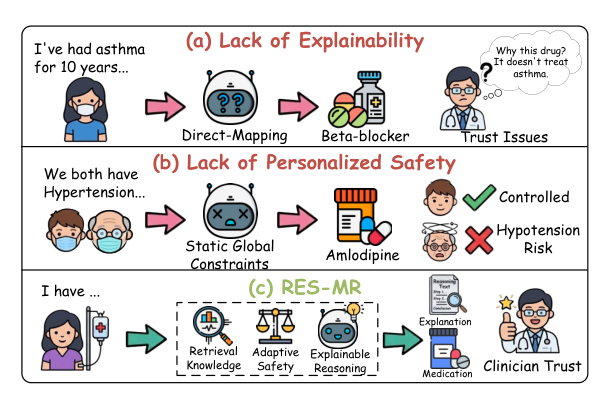
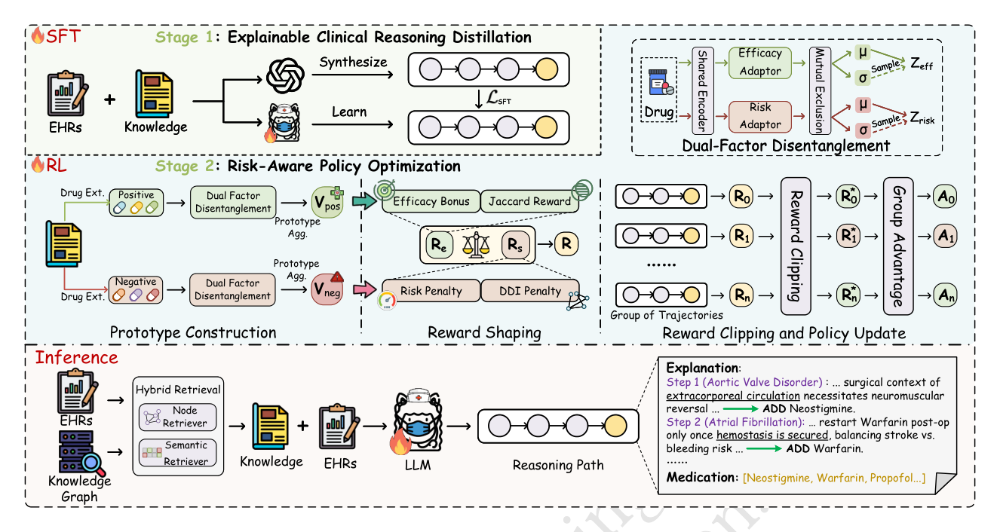
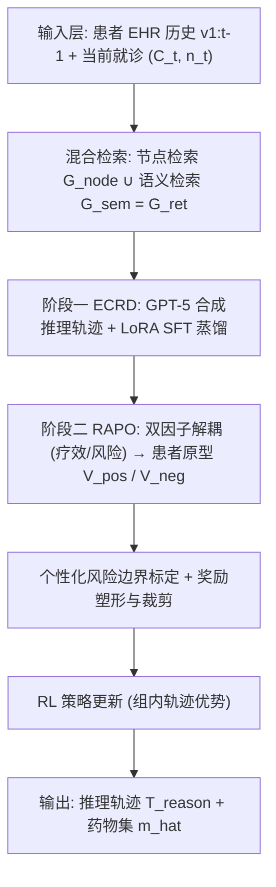
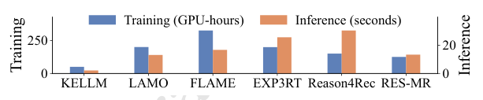
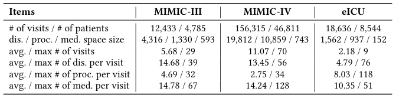
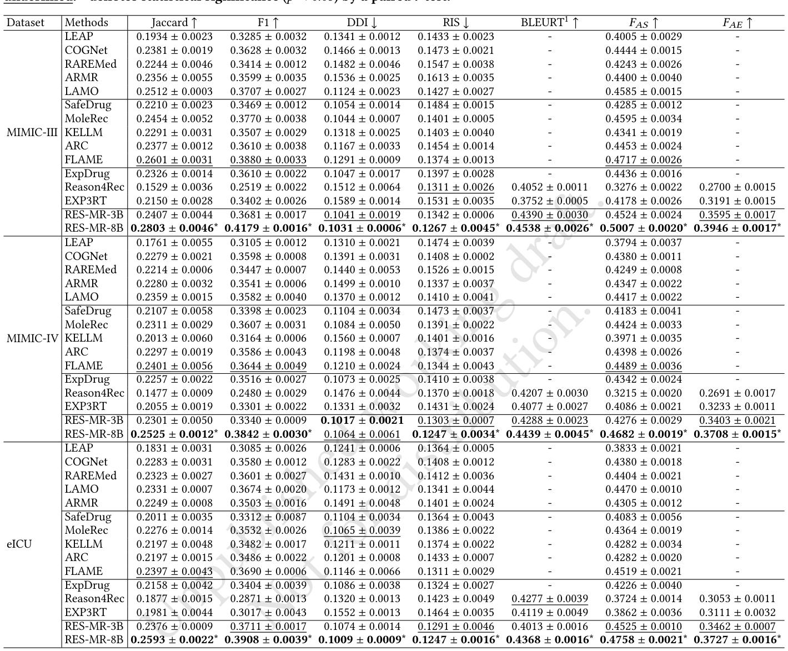
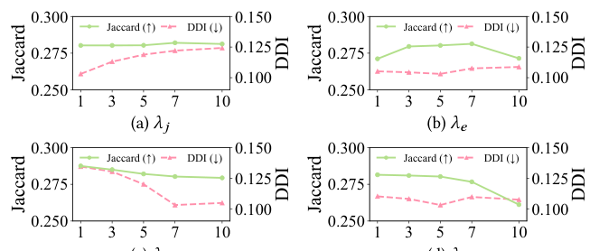

# RES-MR: Risk-Aware Reasoning for Explainable and Safe Medication Recommendation (风险感知推理的可解释安全用药推荐)

- **会议/期刊**: SIGIR 2026
- **推荐链路定位**: 端到端生成式 (End-to-End Generative) — LLM 直接生成推理轨迹与药物集合
- **研究方向**: 大语言模型推荐 (LLM4Rec) / 去偏公平、可信隐私与工业架构（安全约束与个性化风险边界）
- **论文原文**: [https://arxiv.org/abs/2610.14474v1](https://arxiv.org/abs/2610.14474v1)
- **开源代码**: [https://github.com/wangcong2001/RES-MR](https://github.com/wangcong2001/RES-MR)

## TL;DR (核心速览)

针对用药推荐中"黑箱决策不可验证"与"全局静态安全约束忽视个体风险耐受异质性"两大痛点，RES-MR 提出两阶段 LLM 框架：阶段一用知识图谱混合检索（节点+语义）为患者构造证据，并以 GPT-5 合成的推理轨迹做 SFT 推理蒸馏；阶段二用双因子解耦（疗效/风险）构建患者原型以标定个性化风险边界，通过奖励塑形与裁剪的 RL 策略优化平衡疗效与安全。在 MIMIC-III/IV、eICU 上于准确率、安全（DDI 率）与可解释性三类指标上全面超越 SOTA。

## Background & Motivation (背景与动机)

- **领域背景与主流范式**: EHR 用药推荐已从 instance-based（LEAP，仅用单次就诊）转向 longitudinal 建模（RNN 类 COGNet/ARMR 建模病程演化；GNN 类 SafeDrug/MoleRec 引入 DDI 图与分子结构）；近期 LLM 生成范式（LAMO、KELLM、FLAME）利用语言理解与医学知识做端到端药物集合生成。
- **现有方法局限**:
  1. **不可验证的黑箱（CH1）**：判别式 GNN 与生成式 LLM 均采用"直接映射"范式，跳过症状→病理→治疗逻辑的显式推理链；注意力/方面对齐仅提供 post-hoc 特征归因，无法说明"结论如何被推导出来"，导致临床医生无法定位错误来源（如给哮喘患者开 β 阻滞剂究竟是疾病状态误读还是禁忌症忽略）。
  2. **患者无关的静态安全约束（CH2）**：SafeDrug 等在损失中加全局 DDI 惩罚、MoleRec 用分子结构表征，均假设"一刀切"的风险耐受；而真实临床中风险可接受度高度依赖个体状态（年轻体健高血压患者可耐受激进方案，多病共存衰弱老年患者需保守以避免低血压），导致对健壮患者过度保守、对脆弱患者潜在危险。
- **核心挑战**: 简单增加网络深度或拼接特征无法同时解决"推理透明性"与"个体化风险边界"——前者需要显式生成可核验的逻辑链，后者需要可量化的患者级风险标定信号，二者均超出传统监督学习目标（NLL）的表达能力。
- **核心洞察与切入点**: 作者以图 1 的三联示例（(a) 缺可解释性、(b) 缺个性化安全、(c) RES-MR 的检索增强推理+个性化边界）引出设计：用 KG 检索把推理"锚定"在客观医学事实上，用 RL 奖励塑形把"个体风险边界"变成可优化的策略信号。

<figure class="paper-figure" markdown="span">
  <figcaption>图 1</figcaption>
</figure>

## Problem Formulation & Method (问题定义与方法架构)

### 1. 符号定义与输入表征 (Notations & Input Representations)

- 诊断集 $\mathcal{D}$、手术集 $\mathcal{P}$、药物集 $\mathcal{M}$，规模 $|\mathcal{D}|,|\mathcal{P}|,|\mathcal{M}|$。
- 患者 EHR 为就诊序列 $V=[v_1,\dots,v_T]$，第 $t$ 次就诊 $v_t=(C_t, n_t, m_t)$：结构化临床上下文 $C_t=[d_t,p_t,a_t]$（诊断集 $d_t\subseteq\mathcal{D}$、手术集 $p_t\subseteq\mathcal{P}$、人口学属性 $a_t$），非结构化临床笔记 $n_t$，处方药物集 $m_t\subseteq\mathcal{M}$。所有字段均以自然语言描述。
- 医学知识图谱 $\mathcal{G}_{kg}=(\mathcal{E},\mathcal{R},\mathcal{T}_{kg})$，三元组 $(h,r,t)$，关系含 Indication、Contraindication 等。
- **任务**：给定历史 $v_{1:t-1}$、当前上下文 $(C_t,n_t)$ 与外部知识 $\mathcal{G}_{kg}$，训练 LLM $\pi_\theta$ 显式生成 (1) 推理轨迹 $T^{reason}_t$；(2) 安全药物集 $\hat{m}_t$。

### 2. 整体流水线 (Overall Architecture)

数据流：EHR + KG → 混合检索（节点检索 + 语义检索）得患者特异证据 $\mathcal{G}_{ret}$ → GPT-5 合成推理轨迹 → LoRA SFT 蒸馏 → 双因子解耦模块（预训练）→ 患者原型构建（期望药物 $V_{pos}$ / 规避药物 $V_{neg}$）→ 个性化风险边界标定 → RL 组内轨迹采样 + 奖励塑形/裁剪 → 策略更新；推理时仅需混合检索 + LLM 生成推理路径与药物列表。

<figure class="paper-figure" markdown="span">
  <figcaption>图 2</figcaption>
</figure>

### 3. 核心模块设计与数学原理 (Key Designs & Formulations)

**(1) 可解释临床推理蒸馏 (ECRD, Stage 1)**

- **混合检索**：节点检索以当前结构化上下文 $C_t$（诊断、手术）查询 KG，收集实体一跳邻域三元组构成 $\mathcal{G}_{node}$，捕获显式结构关系；语义检索将笔记 $n_t$ 嵌入稠密向量空间，以余弦相似度检索最相关 KG 上下文得 $\mathcal{G}_{sem}$，挖掘隐式语义关联。二者合并 $\mathcal{G}_{ret}=\mathcal{G}_{node}\cup\mathcal{G}_{sem}$，既为推理提供患者特异证据，也为后续患者原型构建提供知识基础。
- **推理蒸馏 SFT**：以 GPT-5 为教师，输入完整患者上下文（$C_t$、$n_t$、$\mathcal{G}_{ret}$、真实药物 $m_t$），合成逐步、诊断感知的推理轨迹 $T^{reason}_t$（连接证据/症状→药理机制→药物作用）。用 LoRA 微调 LLM，输入 $x=(v_{1:t-1},C_t,n_t,\mathcal{G}_{ret})$，输出 $y$ 为推理路径与最终药物集的拼接 token 序列：

$$\mathcal{L}_{SFT}=-\mathbb{E}_{(x,y)\sim\mathcal{D}}\Big[\sum_{j=1}^{|y|}\log\pi_\theta(y_j\mid x,y_{<j})\Big]$$

该阶段赋予模型诊断感知推理行为，并为 RAPO 提供格式稳定的强初始化。

**(2) 风险感知策略优化 (RAPO, Stage 2)**

- **双因子解耦模块**：共享编码器 + 疗效适配器 / 风险适配器，将药物表征分解为疗效因子 $Z_{eff}$ 与风险因子 $Z_{risk}$（各含 $\mu,\sigma$ 分布参数），并施加互斥约束（Mutual Exclusion）保证两因子信息不重叠，使疗效与风险信号可显式量化用于奖励计算。
- **患者原型构建**：基于检索知识，将解耦因子聚合为患者特异原型——期望药物原型 $V_{pos}$（捕获应有疗效特征）与规避药物原型 $V_{neg}$（捕获应避免的风险特征）。
- **个性化风险边界标定**：结合患者历史记录与 $V_{pos}/V_{neg}$ 标定个体化风险边界，使"可接受风险"随患者状态自适应。
- **奖励塑形与裁剪**：奖励由疗效奖励（Efficacy Bonus）、Jaccard 奖励（与真实药物集重合度）、风险惩罚（Risk Penalty）与 DDI 惩罚构成；对组内多条轨迹计算奖励后做裁剪（Reward Clipping）防止奖励失衡，再计算组内优势 $A_0,A_1,\dots,A_n$ 更新策略（GRPO 式组相对优化）。物理直觉：以原型为"锚"把个体风险边界转成稠密奖励信号，引导模型在边界内探索更有效组合、越界即被强抑制。

### 4. 训练目标、负采样与推理复杂度 (Optimization, Negative Sampling & Complexity)

- **损失函数**：阶段一为上述 $\mathcal{L}_{SFT}$（NLL）；阶段二为 RL 策略目标，奖励 $R=R_{eff}+R_{Jaccard}-R_{risk}-R_{DDI}$，经裁剪后按组内优势做策略梯度更新（原文未给出完整 RL 目标闭式，仅描述奖励塑形/裁剪与组优势机制）。
- **负采样策略**：不适用传统负采样；RL 阶段通过组内多条采样轨迹的相对比较构造优势（组相对基线），属"免显式负例"的自采样范式。
- **复杂度**：训练用 8×NVIDIA A100，推理用单张 A100；原文图 4 报告了训练成本与推理时延对比（具体 ms/request 数值原文未在正文文字中给出，需见图 4）。推理需混合检索 + LLM 自回归生成（含推理轨迹），延迟显著高于判别式基线，属生成式端到端的固有开销。

<figure class="paper-figure" markdown="span">
  <figcaption>图 4</figcaption>
</figure>

## Experimental Setup & Evaluation Protocol (实验设置与评估协议)

- **数据集统计与预处理**: 使用 MIMIC-III、MIMIC-IV、eICU 三个公开 EHR 基准（表 1 给出统计量；具体 #Users/#Items/#Interactions 数值请以原文表 1 为准，正文文字未逐项列出）。

<figure class="paper-figure" markdown="span">
  <figcaption>表 1</figcaption>
</figure>

- **数据划分方式 (Splitting Strategy)**: 按患者就诊序列做时间序切分（历史 $v_{1:t-1}$ 预测第 $t$ 次就诊），属纵向 EHR 推荐的标准时序划分；原文未明确报告是否采用全局时间戳切分或 5-core 类过滤规则（原文未报告）。
- **排名评测协议 (Ranking Protocol)**: 用药推荐为多标签集合生成任务，评测采用集合级指标（Jaccard、PRAUC、F1 等准确率指标 + DDI 率等安全指标 + 可解释性指标），非传统 Full-Ranking / Sampled Ranking 协议（原文未报告候选集打分协议）。
- **评价指标与显著性检验**: 准确率、安全、可解释性三类指标；表 2 中 \* 表示经统计显著性检验 $p<0.05$。

## Key Experimental Results (核心实验结果)

### 1. 主实验对比 (Main Results)

表 2 在 MIMIC-III、MIMIC-IV、eICU 上对比准确率、安全与可解释性三类指标，最优与次优分别加粗/下划线，\* 表示 $p<0.05$ 显著。原文正文未逐格列出数值，具体数值请以表 2 为准；结论为 RES-MR 在三类指标上一致超越 SOTA 基线（含 SafeDrug、MoleRec、COGNet、LEAP、LAMO、KELLM、FLAME 等）。

<figure class="paper-figure" markdown="span">
  <figcaption>表 2</figcaption>
</figure>

| 数据集 | 指标类别 | 代表性基线 | 本文方法 (Ours) | 相对提升 (Improv.) |
| :--- | :--- | :---: | :---: | :---: |
| MIMIC-III / IV / eICU | 准确率（Jaccard/PRAUC/F1） | SafeDrug / MoleRec / FLAME 等 | **最优（加粗）** | 原文表 2 给出，正文未列具体百分比 |
| MIMIC-III / IV / eICU | 安全（DDI 率等） | SafeDrug / MoleRec | **最优（加粗）** | 同上 |
| MIMIC-III / IV / eICU | 可解释性 | ExpDrug 等 | **最优（加粗）** | 同上 |

### 2. 消融实验与控制变量分析 (Ablation Study)

原文通过两阶段设计（ECRD / RAPO）与各子模块（KG 混合检索、双因子解耦、原型构建、奖励裁剪）的对照验证贡献；正文文字未给出逐项消融数值表，具体下降幅度请以原文消融表为准（原文未在正文文字中报告）。

### 3. 稀疏度/冷启动分桶与超参敏感度 (Sparsity Buckets & Hyperparameters)

- **分桶表现**: 原文未报告按交互频次/长尾的分桶分析。
- **关键超参数敏感度**: 图 3 报告超参数对性能的影响趋势（如奖励权重、风险边界相关超参），具体拐点数值请见图 3。

<figure class="paper-figure" markdown="span">
  <figcaption>图 3</figcaption>
</figure>

- **线上 A/B 测试**: 原文仅包含离线实验，未报告线上 A/B 结果。

## Highlights, Limitations & Critiques (亮点、局限与审稿级批判)

- **核心亮点与可迁移性**: (1) "KG 混合检索（节点+语义）→ 教师 LLM 合成推理轨迹 → LoRA 蒸馏"的可解释推理流水线可迁移到任何需要可核验推理链的高风险推荐场景（金融、医疗、法律）；(2) 双因子解耦 + 患者原型 + 奖励裁剪的"个性化风险边界"机制，为 RLHF 类推荐中"个体化安全约束"提供了可复用的奖励塑形范式。
- **局限性与审稿视角批判**:
  1. **教师依赖与合成数据偏差**：推理轨迹由 GPT-5 合成，其临床正确性与覆盖度未经医生双盲核验，蒸馏可能继承教师幻觉；论文未报告人工评估的标注者间一致性。
  2. **评估协议透明度不足**：正文未明确数据划分细节（是否全局时间切分、是否 5-core 过滤）、未报告 Full-Ranking 类协议，且主表数值未在正文展开，复现需依赖代码仓库。
  3. **推理开销**：单卡 A100 上需混合检索 + 自回归生成推理轨迹，在线延迟远高于判别式基线，临床实时部署可行性存疑（图 4 虽有分析但正文未给具体 ms 数值）。
  4. **RL 目标描述不完整**：奖励各项权重、裁剪阈值与组大小的敏感性仅以图 3 呈现，缺乏与 GRPO/PPO 基线的受控对比。

## Rating (四维评分)

- **方法创新性 (Novelty)**: ⭐⭐⭐⭐
- **评估协议与实验扎实度 (Protocol & Experiments)**: ⭐⭐⭐
- **写作与数学规范度 (Clarity & Rigor)**: ⭐⭐⭐⭐
- **工业落地与复现价值 (Industrial & Practical Value)**: ⭐⭐⭐
