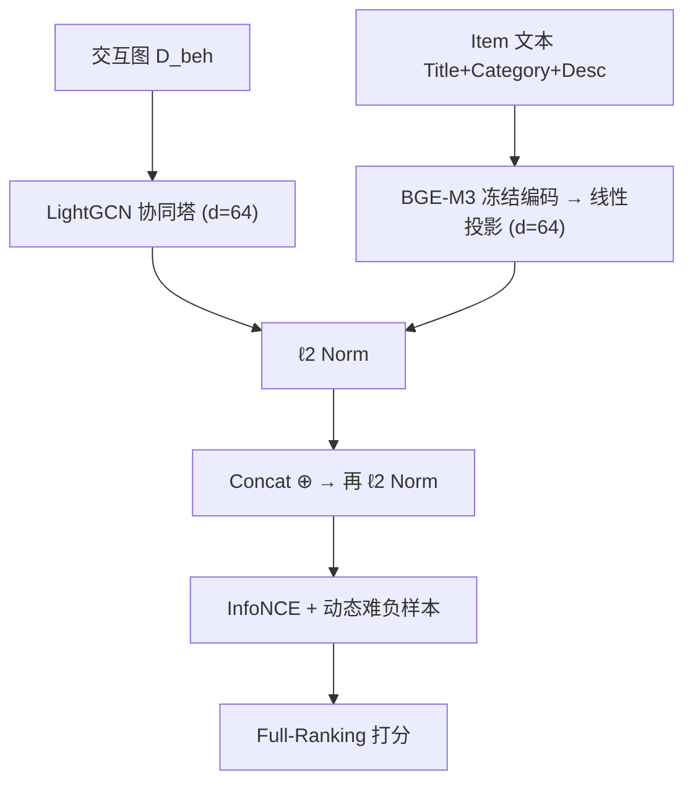

# Rethinking Semantic–Collaborative Integration: Why Alignment Is Not Enough (重思语义–协同融合：为何对齐并不足够)

- **会议/期刊**: SIGIR 2026
- **作者与机构**: Maolin Wang, Dongze Wu, Jianing Zhou, Hongyu Chen, Beining Bao, Yu Jiang, Chenbin Zhang, Chang Wang, Jian Liu, Lei Sha（香港城市大学 HK Institute of AI for Science、北航人工智能学院、港中文、京东）
- **推荐链路定位**: 召回（双塔表征层）
- **研究方向**: 大语言模型推荐 / 协同过滤与双塔召回
- **论文原文**: [https://arxiv.org/abs/2604.22195v1](https://arxiv.org/abs/2604.22195v1)
- **开源代码**: [https://github.com/MorinW/Semantic-Collaborative-Integration](https://github.com/MorinW/Semantic-Collaborative-Integration)

## TL;DR (1分钟核心速览)

当前 LLM4Rec 主流做法是把 LLM 语义向量通过低容量映射"对齐"到协同空间，隐含假设两视图是同一潜变量的两种参数化。本文将其形式化为"全局低复杂度对齐假设"，指出其过强：语义与协同实为"共享+私有"的异质视图。作者提出互补性诊断（Hit Jaccard、CompRatio、UUB 上界），在 Amazon 三域（稀疏度 >99.9%）上发现两视图命中重叠仅 6.4%–19.2%、独有命中占比 >55%；一个仅做 Norm-Concat-Norm 的最小融合即在 Full-Ranking 下全面超越 RLMRec/CARec/AlphaRec，Movies Recall@20 相对最佳单视图提升 41.7%。

## Background & Motivation (背景与核心矛盾)

- **主流范式**: 以 RLMRec、CoLLM、AlphaRec 为代表，用线性层或浅层 MLP 将 BGE/LLM 语义向量投影至协同空间，以对比对齐损失（式 4 的 InfoNCE）强制两空间几何一致，视"对齐越强 = 融合越好"。
- **前人局限**: ①语义由语言建模目标塑造（属性连贯、概念相似），协同由交互图塑造（共现、曝光偏置、流行度动力学），二者生成过程不同，存在无对应维度的私有因子；②稀疏区间协同嵌入本身被噪声主导，强行对齐会把语义结构拉向噪声，并压缩掉语义视图独有的长尾信号。
- **核心洞察 (Key Insight)**: 作者用"共享+私有"潜结构 $z_i=(z_i^{shared}, z_i^{CF\text{-}only}, z_i^{SEM\text{-}only})$ 替代式 (5) 的单潜变量假设——既然任一视图都含对方不可观测的信息，则"从一空间恢复另一空间"在数学上就是欠定的，全局对齐只能把私有方差压进人造的秩-1 共享子空间（图 1）。
- **本文切入点**: 不做新模型，而是用三类诊断指标 + 受控对齐探针 + 最小融合基线，实证"并集 > 交集"，把融合从"对齐的副产品"提升为独立设计原则。

## Method (核心方法设计)

### 1. 整体框架 (Overall Architecture)

论文是"诊断驱动"的立场文：先训练两个**完全独立**的视图编码器作为干净代理（CF 视图 = LightGCN + BPR；语义视图 = 冻结 BGE-M3 1024d 线性投影至 64d + 用户历史均值池化 + InfoNCE），在无任何强制对齐的受控条件下测量二者的重叠度、独有命中贡献与理论融合上界；再用冻结编码器 + 仅学映射的"对齐探针"检验低容量映射能否恢复协同几何；最后用一个刻意做弱的 Norm-Concat-Norm 双塔融合验证互补性可被简单兑现。

### 2. 关键设计拆解 (Key Designs)

1. **互补性诊断三指标（把"是否冗余"变成可测量量）**：痛点是对齐类工作只报整体 Recall，无法判断增益来自新信息还是重排旧候选。作者定义命中集 Jaccard、互补率与并集上界：

$$\text{CompRatio}@K=\frac{1}{|\mathcal{U}|}\sum_{u}\frac{|\mathcal{H}_u^{(A)}\triangle \mathcal{H}_u^{(B)}|}{|\mathcal{H}_u^{(A)}\cup \mathcal{H}_u^{(B)}|},\quad \text{UUB}@K=\frac{1}{|\mathcal{U}|}\sum_u\frac{|\mathcal{T}_u\cap(L_u^{(A)}\cup L_u^{(B)})|}{|\mathcal{T}_u|}$$

直觉：CompRatio 高说明两视图在解**不同子集**的用户需求；UUB 给出"不改进单塔、只做并集"的天花板，融合模型离 UUB 越近，说明互补潜力被兑现得越充分。

2. **Norm-Concat-Norm 对称融合（防协同塔吞并语义塔）**：痛点是在稀疏数据上协同塔更易拟合、量级更大，朴素 concat 会让语义分支沦为装饰。作者在拼接**前后各做一次 $\ell_2$ 归一化**，强制两视图等模贡献：

$$z_u=\text{Norm}\big(\text{Norm}(\text{GCN}(u))\oplus \text{Norm}(W_s\bar{e}_u^{SEM}+b_s)\big)$$

物理直觉：归一化把融合从"按能量加权"改为"按方向投票"，使语义塔在协同信号判别力不足的冷启/长尾区间仍能主导梯度。

3. **动态难负样本与训练目标**：总损失为融合表征上的 InfoNCE，负样本在每个 batch 内取**当前融合打分最高**的物品（Dynamic Hard Negative），而非均匀或纯 in-batch 采样。关键效应是跨视图协作：当协同信号弱时，难负样本的梯度被迫由语义分支消解，两塔在训练中自然分工而非相互同化。推理阶段为双塔内积 + ANN 检索，无额外在线开销。

## Experimental Setup & Evaluation Protocol (实验设置与评估协议)

- **数据集与预处理**: Amazon Reviews'23 三域，标准 `5-core` 过滤，语义文档 = Title + Category + Description 拼接后经 BGE-M3 编码。

| 数据集 | #Users | #Items | #Interactions | 稀疏度 | 特征/场景说明 |
| :--- | :---: | :---: | :---: | :---: | :--- |
| Movies | 27,292 | 24,608 | 331,049 | 99.95% | 影视，IP 系列强 |
| Books | 70,679 | 23,777 | 815,780 | 99.95% | 图书，用户最多 |
| Games | 43,430 | 11,767 | 383,477 | 99.92% | 游戏，物品最少 |

- **数据划分与防穿越 (Splitting Strategy)**: 采用 `Leave-One-Out` 式留出（每用户最后交互为测试、倒数第二为验证），训练/验证/测试严格按用户切分，语义编码器全程冻结以避免信息泄漏。
- **排名评测协议 (Ranking Protocol)**: 无偏 `Full-Ranking`（全库未交互物品排序），报告 Recall@{10,20} 与 NDCG@{10,20}；训练侧语义塔用全局负采样 InfoNCE（$\tau=0.15$），融合模型用动态难负样本。
- **对比基线与超参设置**: 两类范式共 6 个基线——ID-CF（LightGCN、SimGCL、NCL）与对齐/映射（CARec、RLMRec、AlphaRec）；统一 $d=64$，Adam（LR=1e-3，Batch=2048，Weight Decay=1e-4），每 5 epoch 评估、验证 Recall@20 连续 5 次不升即早停。

## Key Experimental Results (实验关键数据)

### 1. 主实验对比 (Main Results)

| 范式 | 模型 | Books R@20 | Books N@20 | Movies R@20 | Movies N@20 | Games R@20 | Games N@20 |
| :--- | :--- | :---: | :---: | :---: | :---: | :---: | :---: |
| ID-CF | LightGCN | 0.1891 | 0.0936 | 0.1100 | 0.0583 | 0.1766 | 0.0800 |
| ID-CF | SimGCL | 0.1947 | 0.0969 | 0.1105 | 0.0582 | 0.1890 | 0.0870 |
| ID-CF | NCL | 0.1990 | 0.1001 | 0.1092 | 0.0583 | 0.1871 | 0.0848 |
| 对齐/映射 | CARec | 0.1902 | 0.0948 | 0.1178 | 0.0565 | 0.1810 | 0.0803 |
| 对齐/映射 | RLMRec | 0.1998 | 0.1021 | 0.1210 | 0.0601 | 0.1850 | 0.0846 |
| 对齐/映射 | AlphaRec | 0.2247 | 0.1147 | 0.1507 | 0.0794 | 0.2000 | 0.0900 |
| 融合 | **Naive Fusion** | **0.2404** | **0.1248** | **0.1579** | **0.0902** | **0.2177** | **0.1026** |
| | *Improv. vs 最佳基线* | *+7.0%* | *+8.8%* | *+4.8%* | *+13.6%* | *+8.9%* | *+14.0%* |

### 2. 消融实验 (Ablation Study)

| 配置 | Books R@20 | Movies R@20 | Games R@20 | 说明 |
| :--- | :---: | :---: | :---: | :--- |
| 仅语义视图 (Sem.) | 0.1618 | 0.1115 | 0.1358 | 冻结 BGE-M3 + 线性投影 |
| 仅协同视图 (Collab.) | 0.2120 | 0.1108 | 0.1795 | LightGCN 分支 |
| **Fused（完整）** | **0.2404** | **0.1580** | **0.2178** | 双塔 + Norm-Concat-Norm |
| UUB（并集上界） | 0.2670 | 0.1594 | 0.2396 | 理论上限，非可训练模型 |
| 对齐探针 Linear Map（测试物品 $R^2$） | — | 0.166 | — | 低容量映射拟合不足 |
| 对齐探针 MLP-2（测试物品 $R^2$） | — | **−0.487** | — | 高容量映射过拟合并负迁移 |

### 3. 关键实验发现 (Key Findings)

1. **互补性远大于重叠性，且集中在头部排名**：两视图 List Jaccard 仅 6.37%（Movies）/14.53%（Books）/19.20%（Games），CompRatio 稳定 >55%（Movies 达 63.03%），且在 $K=5$ 时峰值 66%–69%——说明两塔在**高置信预测**上分歧最大，融合收益恰好落在最关键的 Top 位；语义独有命中的平均 log 流行度比协同命中低 18.4%（Movies），证实语义塔是长尾补偿器。
2. **低容量对齐在分布偏移下结构性失效**：训练物品上 MLP-2 可达 $R^2=0.977$、ListJac 0.767，但迁移到未见测试物品时 $R^2$ 跌至 **−0.487**、Cos 从 0.988 降至 0.290，投影后 Recall 仅 0.0564（协同上限 0.1005）——高容量映射只是记忆了训练对应关系，协同空间的私有因子无法由语义恢复，直接证伪"全局可对齐"。
3. **融合逼近并集上界，且增益来自"保留"而非"对齐"**：Movies 上 Fused 0.1580 距 UUB 0.1594 仅差 0.0014（兑现 99% 的互补潜力），相对最佳单视图 +41.7%；融合后内部两分支 List Jaccard 仍 <0.1，独有命中占比 21%–44%，说明模型没有把两塔压成同一模态。分层看，Mid 组协同增益最大（Books +36.8%），Cold 组语义主导（Books Cold：语义 0.0690 vs 协同 0.0399），Hot 组协同主导（0.2720 vs 0.1917），呈现清晰的分工边界。

## Highlights, Limitations & Rating (亮点、对比与审稿评价)

- **与代表作对比 (vs. Prior Work)**: RLMRec/CoLLM 用对比损失把语义拉向协同几何，本质是求**交集**；AlphaRec 主张协同信号可由 LM 表征经低容量投影隐式恢复，本质是**语义替代协同**；本文则主张保留两视图独立性、在打分层求**并集**，并用 UUB 上界给出"融合是否真的引入新信息"的可证伪判据——这是方法论层面而非模型层面的差异。
- **可迁移亮点**: ①CompRatio + UUB 这套诊断可直接移植到多模态推荐、跨域推荐等任何"双视图融合"场景，用于判断该做对齐还是做融合；②Norm-Concat-Norm 的对称归一化是抑制强势分支吞并的零成本技巧，可迁移至多任务/多场景联合建模。
- **审稿级局限批判**: ①融合策略本身极简（concat + 难负样本），未显式做共享/私有因子解耦，作者自承"隐式并集"限制可解释性，且未与 VAE/信息瓶颈类解耦方法对比；②实验仅限 Amazon 三域、$d=64$、离线 Full-Ranking，缺少工业级大规模与在线 A/B 验证，也未讨论语义编码器换用不同 LLM 时的敏感性；③对齐探针的负结果依赖"冻结编码器 + 仅学映射"的设定，若允许联合微调语义塔，结论强度可能被削弱。
- **四维评分**: 创新性 ⭐⭐⭐⭐ | 实验扎实度 ⭐⭐⭐⭐ | 方法清晰度 ⭐⭐⭐⭐⭐ | 落地价值 ⭐⭐⭐⭐

