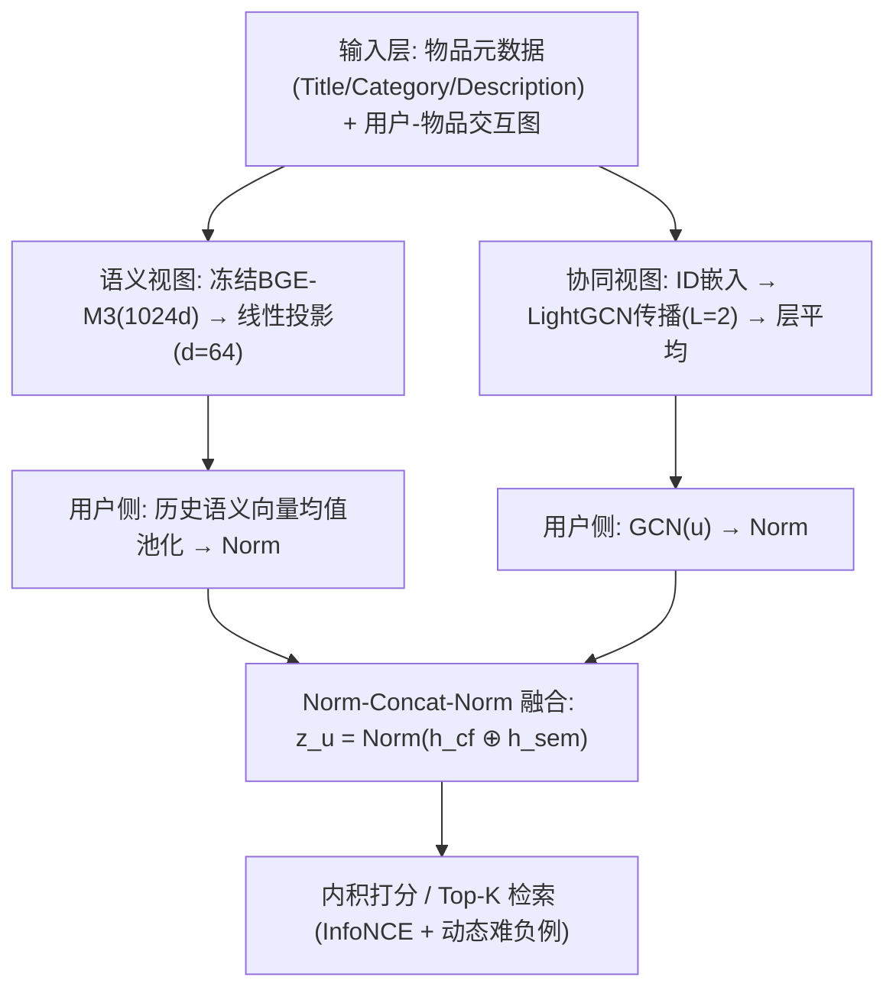
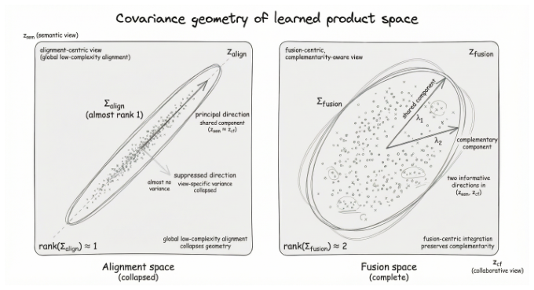
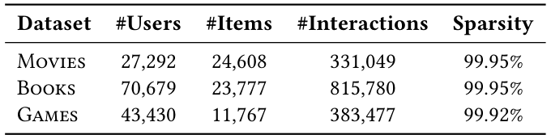
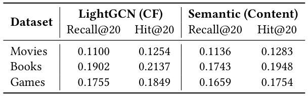
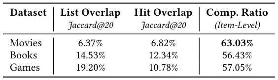
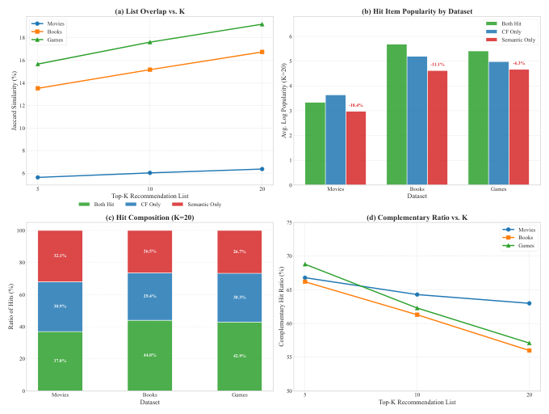
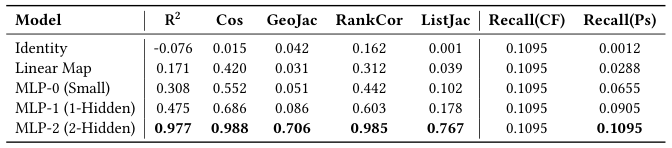
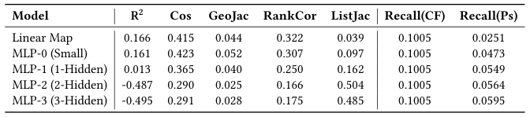
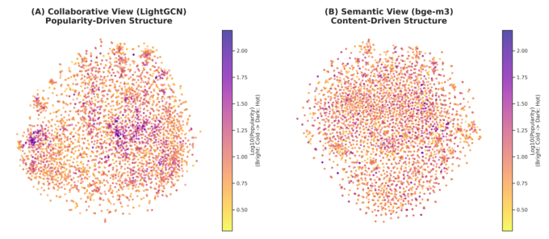

# Rethinking Semantic–Collaborative Integration: Why Alignment Is Not Enough (重思语义–协同融合：为何对齐并不足够)

- **会议/期刊**: SIGIR 2026
- **推荐链路定位**: 召回 (Retrieval) — 双视图表征融合与 Top-K 检索
- **研究方向**: 大语言模型推荐 (LLM4Rec) / 协同过滤与双塔召回
- **论文原文**: [https://arxiv.org/abs/2604.22195v1](https://arxiv.org/abs/2604.22195v1)
- **开源代码**: [https://github.com/MorinW/Semantic-Collaborative-Integration](https://github.com/MorinW/Semantic-Collaborative-Integration)

## TL;DR (核心速览)

本文挑战 LLM 增强推荐中"语义表征应与协同表征全局对齐"的默认假设，形式化为"全局低复杂度对齐假设"并论证其过强。作者提出"共享+私有"潜结构视角，设计重叠度、互补比、Union-TopK 上界等诊断指标，在 Amazon 三个极端稀疏数据集（稀疏度 >99.9%）上证明两视图命中重叠极低（List Jaccard 仅 6.37%–19.20%）、互补比 >55%；一个仅做"Norm-Concat-Norm"的最小融合模型在 Full-Ranking 协议下全面超越 LightGCN/SimGCL/NCL 及 CARec/RLMRec/AlphaRec 等对齐范式，Movies 上 Recall@20 相对最强基线提升 +4.8%（0.1579 vs 0.1507），相对最佳单视图提升 +41.7%。

## Background & Motivation (背景与动机)

- **领域背景与主流范式**: LLM 已成为现代推荐系统的重要语义基础设施。主流做法是将 LLM 派生语义嵌入通过嵌入初始化、轻量 adapter、对比对齐目标或显式表征匹配注入协同过滤架构。其核心设计范式是**表征对齐**：将语义嵌入投影/变换/正则，使其逼近交互嵌入的几何结构。
- **现有方法局限 (Limitations of Prior Work)**:
  1. **假设过强**：对齐范式隐含"语义与协同是同一潜因子的两种参数化，存在低复杂度（线性/浅层 MLP）变换 $T$ 使 $e^{CF}_i \approx T(e^{SEM}_i)$"。但语义由语言建模目标与内容统计塑造，协同由共现、曝光机制、流行度动态塑造，二者生成过程不同。
  2. **几何坍缩**：全局对齐迫使表征几何坍缩到共享秩-1 子空间，压制视图私有方差（见图 1）。
  3. **稀疏区噪声放大**：稀疏/长尾区域的交互表征被噪声主导，强行对齐语义到此类信号会扭曲语义结构、降低鲁棒性。
- **核心挑战 (Key Challenge)**: 若两视图仅部分共享，全局对齐会扭曲局部邻域结构、压制视图特有信号、降低信息多样性——系统最终只捕获信息源的"交集"而非"并集"。简单的特征拼接或加深网络无法解决，因为问题出在**优化目标本身**（以一致性为目标）而非容量不足。
- **核心洞察与切入点 (Key Insight)**: 作者提出**共享+私有潜结构**：$z_i = (z^{shared}_i, z^{CF-only}_i, z^{SEM-only}_i)$。协同嵌入含流行度动态、曝光偏置、反馈回路、位置效应等系统诱导信号；语义嵌入含风格变化、细粒度内容属性，在冷启动/长尾场景提供互补线索。由此提出三条主张：Claim 1（互补性）、Claim 2（低复杂度对齐的局限）、Claim 3（范式转移：从对齐中心转向互补融合中心）。

## Problem Formulation & Method (问题定义与方法架构)

### 1. 符号定义与输入表征 (Notations & Input Representations)

- 用户集 $\mathcal{U}$、物品集 $\mathcal{I}$；行为数据 $\mathcal{D}_{beh}$，物品内容 $x_i$。
- 协同嵌入 $e^{CF}_i = f^{CF}(\mathcal{D}_{beh})$；语义嵌入 $e^{SEM}_i = f^{SEM}(x_i)$。
- 投影头 $z^{CF}_i = g^{CF}(e^{CF}_i)$，$z^{SEM}_i = g^{SEM}(e^{SEM}_i)$，$g$ 为线性层或浅层 MLP。
- 语义编码器：BGE-M3，输出 1024 维，线性投影至 $d=64$；协同编码器：LightGCN，$d=64$，$L=2$ 层传播。
- 输出：用户/物品融合表征 $z_u$，用于内积打分与 Top-K 检索。

### 2. 整体流水线 (Overall Architecture)

数据流：物品元数据（Title, Category, Description）拼接为文档 $\to$ BGE-M3 编码（冻结）$\to$ 线性投影至 $d=64$；用户侧对历史物品语义向量均值池化。协同侧：随机初始化 ID 嵌入 $\to$ LightGCN 式二部图传播（$L=2$）$\to$ 层平均。两路各自 $\ell_2$ 归一化后拼接，再归一化得融合表征，内积打分。

### 3. 核心模块设计与数学原理 (Key Designs & Formulations)

**(1) 对齐范式的形式化与批判（第 2 节）**

主流对齐目标为物品级对比损失：

$$\mathcal{L}_{align} = -\sum_i \log \frac{\exp(\text{sim}(z^{CF}_i, z^{SEM}_i)/\tau)}{\sum_j \exp(\text{sim}(z^{CF}_i, z^{SEM}_j)/\tau)}$$

其中 $\text{sim}$ 为余弦相似度，$\tau>0$ 为温度系数。其结构假设是：存在低复杂度 $T: \mathbb{R}^{d_{SEM}} \to \mathbb{R}^{d_{CF}}$ 使 $e^{CF}_i \approx T(e^{SEM}_i)$。作者指出在共享+私有结构下，从一视图恢复另一完整空间是**病态问题**（每视图含对方不可观测的信息），全局对齐需将私有因子压缩进人造共享几何，扭曲两空间（图 1 左 vs 右）。

**(2) 互补性诊断指标（第 3.1.3 节）**

设 $\mathcal{H}^{(A)}_u$、$\mathcal{H}^{(B)}_u$ 为模型 A/B 对用户 $u$ 的 Top-K 正确命中集：

- **Hit Jaccard**：$\text{Jaccard@}K = \frac{1}{|\mathcal{U}|}\sum_u \frac{|\mathcal{H}^{(A)}_u \cap \mathcal{H}^{(B)}_u|}{|\mathcal{H}^{(A)}_u \cup \mathcal{H}^{(B)}_u|}$，越低说明两视图解决不同子集需求。
- **互补比 CompRatio**：$\text{CompRatio@}K = \frac{1}{|\mathcal{U}|}\sum_u \frac{|\mathcal{H}^{(A)}_u \triangle \mathcal{H}^{(B)}_u|}{|\mathcal{H}^{(A)}_u \cup \mathcal{H}^{(B)}_u|}$，$\triangle$ 为对称差，越高互补性越强。
- **Union-TopK 参考上界 UUB**：$\text{UUB@}K = \frac{1}{|\mathcal{U}|}\sum_u \frac{|\mathcal{T}_u \cap (\mathcal{L}^{(A)}_u \cup \mathcal{L}^{(B)}_u)|}{|\mathcal{T}_u|}$，衡量两单视图候选列表并集的最大可挖掘命中潜力，用于诊断融合是否真正引入新信息而非仅重排。

**(3) 最小融合基线 "Norm-Concat-Norm"（第 3.4.1 节）**

语义侧：$e^{SEM}_u = \text{Norm}\left(\frac{1}{|N_u|}\sum_{i \in N_u} x_i\right)$，$h^{sem}_u = \text{Norm}(W_s e^{SEM}_u + b_s)$；协同侧：$h^{cf}_u = \text{Norm}(\text{GCN}(u))$；融合：

$$z_u = \text{Norm}(h^{cf}_u \oplus h^{sem}_u)$$

拼接前后均做 $\ell_2$ 归一化，保证两视图等幅贡献（$\|\cdot\|=1$），防止更易拟合的协同信号主导融合池。物品侧同理。该设计刻意**不含**任何对齐损失或生成式微调，用于隔离"融合 vs 对齐"的因果效应。

### 4. 训练目标、负采样与推理复杂度 (Optimization, Negative Sampling & Complexity)

- **损失函数**: 端到端 InfoNCE + **动态难负例挖掘**（Dynamic Hard Negative Mining）：每 batch 内以当前融合表征打分最高的物品作为负例。当协同信号判别力弱（稀疏交互）时，梯度推动语义分支去解决难负例，促使两视图互补。语义单视图基线用 InfoNCE（$\tau=0.15$）+ 全局负采样；协同基线用 BPR。
- **训练负采样策略**: 融合模型采用 batch 内动态难负例；语义基线采用全局负采样；协同基线 BPR 隐式负采样。
- **时间与空间复杂度**: 语义编码器 BGE-M3 冻结，仅训练线性投影（$1024 \to 64$），离线编码可预计算；协同侧 LightGCN $L=2$ 传播复杂度 $O(|\mathcal{E}| \cdot d)$。在线推理为双塔内积，支持 ANN 检索，无需 Beam Search。原文未报告具体训练单 epoch 耗时、推理延迟（ms/request）与峰值显存。

## Experimental Setup & Evaluation Protocol (实验设置与评估协议)

- **数据集统计与预处理**: 三个 Amazon Reviews'23 稀疏基准，标准 **5-core 过滤**，语义文档由 Title + Category + Description 拼接，BGE-M3 编码。

| 数据集 (Dataset) | 用户数 (#Users) | 物品数 (#Items) | 交互数 (#Interactions) | 稀疏度 (Sparsity) | 模态/辅助特征说明 |
| :--- | :---: | :---: | :---: | :---: | :--- |
| Movies | 27,292 | 24,608 | 331,049 | 99.95% | 文本元数据 → BGE-M3 (1024d) |
| Books | 70,679 | 23,777 | 815,780 | 99.95% | 文本元数据 → BGE-M3 (1024d) |
| Games | 43,430 | 11,767 | 383,477 | 99.92% | 文本元数据 → BGE-M3 (1024d) |

- **数据划分方式 (Splitting Strategy)**: 原文正文未明确说明划分策略（未提及 LOO / Ratio / Global Temporal Split 的具体比例），仅提及"validation set 上 Recall@20 早停"与"test set items"。对齐探针实验中对物品做 80%/20% 随机划分（$I_{train}$ 为随机 80% 物品）。**审稿注**：划分细节缺失，无法排除未来信息泄露风险，属可复现性短板。
- **排名评测协议 (Ranking Protocol)**: 原文未显式声明 Full-Ranking 或 Sampled Ranking；从指标（Recall@10/20、NDCG@10/20）与"test set items"表述推断为全库排序，但未明确正负例构造细节。
- **评价指标与显著性检验**: Recall@10/20、NDCG@10/20、Hit@20；诊断指标 List Jaccard、Hit Jaccard、CompRatio、UUB；对齐探针用 $R^2$、Cos、GeoJac、RankCor、ListJac。Embedding 维度统一 $d=64$。**原文未报告**多随机种子方差或配对显著性检验（$p<0.05$）。

## Key Experimental Results (核心实验结果)

### 1. 主实验对比 (Main Results)

表 6 给出三大范式对比（ID-CF / 对齐映射 / 融合），$K=10,20$：

| 数据集 | 指标 | 最强 ID-CF (NCL/SimGCL) | 最强对齐基线 (AlphaRec) | 本文 Naive Fusion | 相对提升 (Improv.) |
| :--- | :--- | :---: | :---: | :---: | :---: |
| Books | Recall@20 | 0.1990 (NCL) | 0.2247 | **0.2404** | +6.99% |
| Books | NDCG@20 | 0.1001 (NCL) | 0.1147 | **0.1248** | +8.81% |
| Movies | Recall@20 | 0.1105 (SimGCL) | 0.1507 | **0.1579** | +4.78% |
| Movies | NDCG@20 | 0.0583 (NCL) | 0.0794 | **0.0902** | +13.60% |
| Games | Recall@20 | 0.1890 (SimGCL) | 0.2000 | **0.2177** | +8.85% |
| Games | NDCG@20 | 0.0870 (SimGCL) | 0.0900 | **0.1026** | +14.00% |

关键结论：无任何对齐损失或生成式微调的最小融合，全面超越 RLMRec、CARec 等"重对齐机器"，直接挑战几何对齐的必要性——保留视图互补（Union）优于强制一致（Intersection）。

表 7 组件分析显示融合模型逼近 UUB：Movies Recall@20 融合 0.1580 vs UUB 0.1594（几乎触顶），相对最佳单视图提升 +41.7%（NDCG@20 +38.3%）；Books +13.4%，Games +21.3%。

### 2. 消融实验与控制变量分析 (Ablation Study)

本文未采用传统"逐模块移除"消融，而是以**范式级对照**替代：

- **单视图基线对照**（表 2）：LightGCN 与语义模型性能相当（Movies 上语义 Recall@20 0.1136 甚至略高于 CF 0.1100），排除"稻草人"比较。
- **对齐探针容量扫描**（表 4/5）：训练物品上 MLP-2 可达 $R^2=0.977$、ListJac 0.767（高容量可强行拟合）；但测试物品上 MLP-2 $R^2=-0.487$、MLP-3 $R^2=-0.495$，Recall(Ps) 仅 0.0564/0.0595，远低于协同上界 0.1005——证明高容量映射是**记忆训练对应关系**而非学到可迁移几何。这是对 Claim 2 最有力的控制变量证据（冻结双编码器，仅学映射，排除优化伪影）。
- **融合内部命中构成**（表 9）：融合模型内部两分支 List Jaccard <0.1（Books 0.0931、Movies 0.0390、Games 0.0861），语义独有命中 21.44%–31.55%、协同独有 32.68%–43.58%、共同命中仅 30.93%–36.79%，说明融合保留了强互补而非坍缩为单一模态。

### 3. 稀疏度/冷启动分桶与超参敏感度 (Sparsity Buckets & Hyperparameters)

- **流行度分桶**（表 8，Head 20% / Mid 20% / Cold 60%）：
  - Cold 组：语义视图显著优于协同（Books 0.0690 vs 0.0399；Movies 0.0880 vs 0.0469；Games 0.0830 vs 0.0311），融合保持语义主导（Books 0.0664、Movies 0.0877），避免纯 CF 在长尾的坍缩。
  - Mid 组：融合展现强协同，Books 上较最佳内部单视图提升达 **+36.8%**（0.1270 vs 0.0928）。
  - Hot 组：协同主导（Books 0.2720），融合进一步提升至 0.2983。
- **流行度偏移诊断**（图 2b）：语义独有命中的平均 Log-Popularity 显著低于 CF 命中（Movies −18.4%、Books −11.1%、Games −6.3%），证实语义视图是长尾补偿器。
- **置信度效应**（图 2d）：CompRatio 在 $K=5$ 达峰（66%–69%），即高置信预测处两视图分歧最大，融合对 Top 排名最关键。
- **关键超参数**: $\tau=0.15$（语义基线 InfoNCE）、$d=64$、LightGCN $L=2$、Adam（LR $1e-3$、Batch 2048、Weight Decay $1e-4$）、每 5 epoch 评估、Recall@20 连续 5 次不升则早停。原文未做 $\tau$、$L$、$d$ 的敏感度曲线。
- **线上 A/B 测试**: 原文仅包含离线实验，无线上结果。

## Highlights, Limitations & Critiques (亮点、局限与审稿级批判)

- **核心亮点与可迁移性**:
  1. **诊断指标体系（CompRatio、UUB、Hit Jaccard）具有强普适性**，可直接迁移到任何多视图/多模态推荐融合评估，回答"融合是否真正引入新信息"这一常被忽视的问题。
  2. **对齐探针协议（冻结编码器 + 容量扫描 + 训练/测试物品分离）** 是检验"表征可桥接性"的干净实验设计，可复用于跨域迁移、模态对齐等场景。
  3. **"Norm-Concat-Norm + 动态难负例"** 是极简且有效的融合基线，工程落地成本低，可作为 LLM 语义增强召回的默认强基线。
  4. 图 3 的"流行度核心"可视化直观揭示协同空间的向心性偏置，为长尾去偏提供几何视角解释。
- **局限性与审稿视角批判 (Critical Limitations)**:
  1. **定位偏"立场论文"而非方法论文**：核心贡献是视角与诊断，融合模型刻意保持极简（线性投影 + 拼接），未提出真正"因子分解式"的共享/私有解耦架构（作者自己在 2.4 节列为未来方向），方法新颖性有限。
  2. **评估协议披露不足**：数据划分策略（LOO/Ratio/Temporal）未明确，Ranking Protocol 未显式声明 Full-Ranking，存在数据泄露不可排除的风险；无多随机种子方差与显著性检验，表 6 中部分差距（如 Movies Recall@20 的 +4.78%）在无方差报告下说服力打折。
  3. **基线覆盖偏窄**：对齐基线仅 CARec/RLMRec/AlphaRec，未与更新的 LLM4Rec 对齐方法（如 CoLLM、UniSRec、ZESRec 等 ID-free 范式）对比；语义编码器仅 BGE-M3，未验证对其他 LLM 编码器的泛化性。
  4. **"对齐有害"结论的边界未充分刻画**：作者承认高交互用户（>50 交互）协同主导，但未给出"何时该对齐、何时该融合"的定量判据；表 8 中 Games Cold 组融合（0.0594）反而低于语义单视图（0.0830），说明朴素融合在极端冷启动下并非总优，与"融合全面胜利"的叙事存在张力。
  5. **效率数据缺失**：未报告训练耗时、推理延迟与显存，工业落地价值难以量化评估。

## Rating (四维评分)

- **方法创新性 (Novelty)**: ⭐⭐⭐（视角与诊断指标有新意，但融合方法本身极简，属"反直觉实证 + 概念重构"型工作）
- **评估协议与实验扎实度 (Protocol & Experiments)**: ⭐⭐⭐（诊断实验设计精巧、探针控制严格，但划分协议披露不足、缺显著性检验、基线覆盖偏窄）
- **写作与数学规范度 (Clarity & Rigor)**: ⭐⭐⭐⭐（形式化清晰，Claim 1/2/3 与实验一一对应，图表论证链条完整）
- **工业落地与复现价值 (Industrial & Practical Value)**: ⭐⭐⭐⭐（Norm-Concat-Norm 融合可直接落地，代码开源，诊断工具对工业多视图融合评估有直接价值）

## 论文图表

<figure class="paper-figure" markdown="span">
  <figcaption>图1：学习到的乘积空间中协方差几何的示意图。以对齐为中心的观点（左）与所提出的以互补融合为中心的观点（右）之间的概念比较。全局对齐迫使表示几何坍缩为共享的秩1子空间（抑制视图特定方差），而以互补融合为中心的方法同时保留共享（𝜆1）和互补（𝜆2）分量，维持协作视图与语义视图两者的信息完整性。椭圆和坐标轴为清晰起见进行了风格化处理，并不代表真实</figcaption>
</figure>

<figure class="paper-figure" markdown="span">
  <figcaption>表1：数据集统计。极端稀疏性凸显了纯协作学习的挑战。</figcaption>
</figure>

<figure class="paper-figure" markdown="span">
  <figcaption>表2：单视图基线的性能比较。两个模型达到相当的性能水平，确保了公平的诊断比较。</figcaption>
</figure>

<figure class="paper-figure" markdown="span">
  <figcaption>表3：互补性诊断。极低的重叠和较高的互补比（&gt;55%）表明两个视图捕获了基本正交的信号。</figcaption>
</figure>

<figure class="paper-figure" markdown="span">
  <figcaption>图2：互补性诊断。(a) 所有K下的低列表重叠表明排序逻辑不同。(b) “流行度下降”：语义模型的独特命中（红色）流行度显著低于CF命中（蓝色），证实其在长尾上的优势。(c) 独特命中占总命中的&gt;60%。(d) 互补比在低K时达到峰值，表明两个视图在高置信预测上差异最大。</figcaption>
</figure>

<figure class="paper-figure" markdown="span">
  <figcaption>表4：训练物品上的对齐探测结果。低容量映射（Linear、MLP-0）拟合较差；高容量模型可在已见物品上强制对齐。</figcaption>
</figure>

<figure class="paper-figure" markdown="span">
  <figcaption>表5：测试物品上的对齐探测结果。无法泛化（负𝑅2、召回率下降）表明语义不足以重建未见过的协作信号。</figcaption>
</figure>

<figure class="paper-figure" markdown="span">
  <figcaption>图3：按对数流行度着色的全局t-SNE可视化，从亮黄色（冷门/尾部）到深紫色（热门/头部）。(a) 协作视图呈现“流行度核心”，其中深色点紧密聚集在中心。(b) 语义视图显示更均匀的分布，流行度梯度混合，表明结构独立于交互频率。</figcaption>
</figure>

