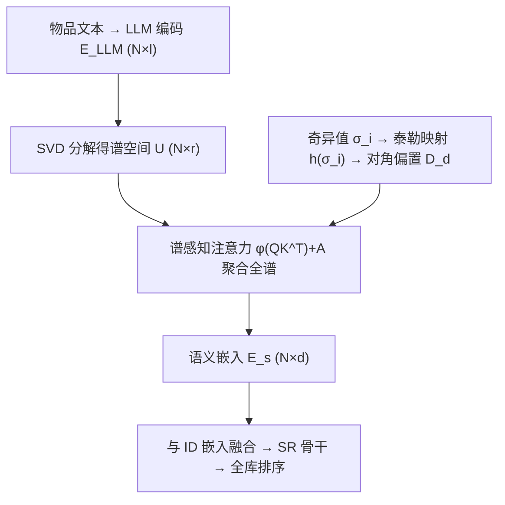
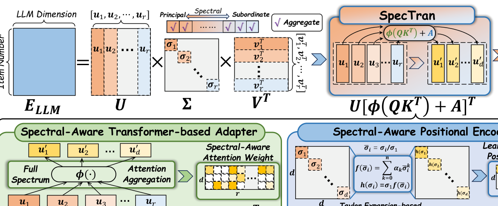

# SpecTran: Spectral-Aware Transformer-based Adapter for LLM-Enhanced Sequential Recommendation (谱感知 Transformer 适配器用于 LLM 增强序列推荐)

- **会议/期刊**: SIGIR 2026
- **作者与机构**: Yu Cui, Can Wang, Jiawei Chen 等（浙江大学）；Feng Liu, Zhaoxiang Wang, Changwang Zhang, Jun Wang（OPPO 研究院）
- **推荐链路定位**: 召回（序列召回中的物品表征增强）
- **研究方向**: 大语言模型推荐 / 序列推荐
- **论文原文**: [https://arxiv.org/abs/2601.21986v2](https://arxiv.org/abs/2601.21986v2)
- **开源代码**: [https://github.com/istarryn/SpecTran](https://github.com/istarryn/SpecTran)

## TL;DR (1分钟核心速览)

LLM 语义嵌入（4096 维）注入低维 ID 空间（64 维）时，MLP 适配器出现严重**谱维度坍缩**（前 10 维奇异值占约 95%），而 SVD 类方法只保留前 $d$ 个主成分、丢弃次谱信息且权重静态手工。SpecTran 在谱域用可学习注意力对**全谱**做选择聚合，并以基于泰勒展开的谱位置编码注入奇异值先验。在 4 个 Amazon 数据集、3 个 SR 骨干上，采用 Leave-One-Out + 全库排序协议，相对最强基线 AlphaFuse 平均提升 9.17%。

## Background & Motivation (背景与核心矛盾)

- **主流范式**: 用 LLM 编码物品文本得到高维语义嵌入，再经"变换 + 融合"注入传统 ID 嵌入序列推荐模型。变换分两派：MLP 适配器（MoRec/UniSRec/RLMRec/LLM-ESR）与 SVD 截断（WhitenRec/LLMInit/AlphaFuse）。
- **前人局限**: ① 适配器虽可学习，但投影后协方差矩阵前 10 维奇异值占比约 95%，绝大多数维度近乎为零，语义信号被压缩至极少数方向；② SVD 类方法只取前 $d$个主成分，次谱（$d{+}1$到$r$）被整体丢弃，且权重由奇异值或方差静态给定，无法按推荐任务自适应。
- **核心洞察 (Key Insight)**: 一个反直觉现象——静态手工的 SVD 方法竟普遍优于可学习适配器（如 Toy 上 HSTU 骨干的适配器甚至弱于 Base）。作者据此判断：问题不在"是否可学习"，而在"可学习的方式破坏了谱结构"。次谱分量虽在语言空间"信息量小"，但在协同空间仍可能携带有效语义。
- **本文切入点**: 保留 SVD 的谱域操作优势，但把固定的对角谱滤波矩阵换成可学习注意力，让每个输出维度对全谱做软选择。

## Method (核心方法设计)

### 1. 整体框架 (Overall Architecture)

输入为 LLM 编码的物品语义矩阵 $\mathbf{E}_{\text{LLM}}\in\mathbb{R}^{N\times l}$，先做 SVD 得谱空间$\mathbf{U}=[\mathbf{u}_1,\dots,\mathbf{u}_r]\in\mathbb{R}^{N\times r}$（$r$可达 4096）。SpecTran 以$\mathbf{U}$直接作为 Value，用可学习 Query/Key 计算"输出维度 × 谱维度"的注意力分数，经 Softshrink 稀疏门控后聚合全谱，得到$d$维语义嵌入$\mathbf{E}_s$；同时把奇异值经泰勒多项式映射为对角偏置$\mathbf{D}_d$加到注意力分数上，形成谱位置编码。最后$\mathbf{E}_s$ 与 ID 嵌入按各基线原融合策略（拼接/相加/初始化/零空间学习）合并，送入 BERT4Rec/SASRec/HSTU 骨干训练与全库排序推理。

<figure class="paper-figure" markdown="span">
  <figcaption>图2：所提出的SpecTran的整体框架。</figcaption>
</figure>

### 2. 关键设计拆解 (Key Designs)

1. **谱感知注意力聚合（全谱软选择）**：痛点在于 SVD 的截断是硬 0/1 滤波、适配器又坍缩。SpecTran 令每个输出维度作为一个 query 去 attend 全部 $r$ 个谱分量：
$$\mathbf{E}_s=\mathbf{U}\,[\phi(\mathbf{Q}\mathbf{K}^{\top})+\mathbf{A}]^{\top},\quad \mathbf{Q}\in\mathbb{R}^{d\times r},\ \mathbf{K}\in\mathbb{R}^{r\times r}$$
其中 $\mathbf{U}$直接充当 Value，避免沿物品维$N$（百万级）做$\mathbf{W}\mathbf{U}$投影，参数量与延迟可控。当注意力退化为$[\boldsymbol{\Sigma}_d;\mathbf{0}]$或$[\mathbf{I}_d;\mathbf{0}]$ 时，该式恰好还原为 AlphaFuse/LLMInit，故本文是既有谱截断策略的严格泛化。

2. **Softshrink 稀疏激活替代 Softmax**：痛点在于谱维极高（4096），Softmax 归一化后权重平坦，次谱 $r-d$个分量的累计权重轻易压过前$d$ 个主成分，选择器失效。改用不归一化的软阈值算子：
$$\text{Softshrink}(x)=\begin{cases}x-\lambda, & x>\lambda\\ x+\lambda, & x<-\lambda\\ 0, & \text{otherwise}\end{cases}$$
$\lambda$ 作为可学习参数（初值 0），既抑制小幅噪声分量、又保留幅度建模能力，充当稀疏谱门控。

3. **泰勒展开谱位置编码 + 训练目标**：注意力本身对"哪个谱分量更重要"无先验，故仅在主谱 $d$维注入对角偏置$\mathbf{A}=[\mathbf{D}_d,\mathbf{0}_{d\times(r-d)}]$，$\mathbf{D}_d=\text{diag}\{h(\sigma_1),\dots,h(\sigma_d)\}$，其中$h(\sigma_i)=\sigma_1 f(\bar{\sigma}_i)$、$\bar{\sigma}_i=\sigma_i/\sigma_1$，$f$为可学习系数的$n$阶多项式。归一化保证数值稳定，乘回$\sigma_1$ 恢复相对量级；不同输出维度获得不同（近似正交）偏置，从而鼓励维度间分工、抑制坍缩。总损失即骨干原推荐损失（统一 InfoNCE，64 负样本），无额外辅助损失，推理时适配器为一次性离线预计算。

## Experimental Setup & Evaluation Protocol (实验设置与评估协议)

- **数据集与预处理**: 4 个 Amazon 子集，沿用 AlphaFuse 的预处理：

| 数据集 | #Users | #Items | #Interactions | 密度 | 场景说明 |
| :--- | :---: | :---: | :---: | :---: | :--- |
| Toy | 19,124 | 11,757 | 141,630 | 0.0630% | Toys & Games |
| Beauty | 22,332 | 12,086 | 168,446 | 0.0624% | 美妆 |
| Clothing | 39,230 | 22,948 | 266,481 | 0.0296% | 服饰鞋履 |
| Office | 4,895 | 2,414 | 41,462 | 0.3509% | 办公用品 |

- **数据划分与防穿越**: `Leave-One-Out`（最后一项为测试目标，其余为历史），序列按时间戳升序后以 8:1:1 切分训练/验证/测试。
- **排名评测协议**: 全库未交互物品排序（Full-Ranking），指标 HR@{10,20} 与 NDCG@{10,20}；训练负采样统一 InfoNCE + 64 负样本，保证骨干间公平。
- **对比基线与超参**: 骨干为 BERT4Rec / SASRec / HSTU；基线含 4 个适配器类（MoRec、UniSRec、RLMRec、LLM-ESR）与 3 个 SVD 类（WhitenRec、LLMInit、AlphaFuse）。ID 嵌入维度 128、batch 256、学习率 1e-3、最大序列长 10、LLM 用 LLaMA3-8B 编码标题；早停基于 NDCG@20（patience=10）。

## Key Experimental Results (实验关键数据)

### 1. 主实验对比 (Main Results)

以 SASRec 与 HSTU 骨干为例（NDCG@10 / HR@10，加粗为最优）：

| 骨干 | 方法 | Toy N@10 | Toy H@10 | Beauty N@10 | Clothing N@10 | Office N@10 |
| :--- | :--- | :---: | :---: | :---: | :---: | :---: |
| SASRec | Base | 0.0246 | 0.0482 | 0.0239 | 0.0079 | 0.0309 |
| SASRec | UniSRec | 0.0261 | 0.0550 | 0.0268 | 0.0108 | 0.0399 |
| SASRec | RLMRec | 0.0269 | 0.0565 | 0.0267 | 0.0111 | 0.0357 |
| SASRec | LLM-ESR | 0.0230 | 0.0454 | 0.0233 | 0.0106 | 0.0308 |
| SASRec | WhitenRec | 0.0295 | 0.0597 | 0.0290 | 0.0134 | 0.0438 |
| SASRec | AlphaFuse | 0.0358 | 0.0754 | 0.0336 | 0.0163 | 0.0401 |
| SASRec | **SpecTran** | **0.0390** | **0.0856** | **0.0340** | **0.0175** | **0.0471** |
| SASRec | Improv. | +8.94% | +13.53% | +1.19% | +7.36% | +7.53% |
| HSTU | AlphaFuse | 0.0327 | 0.0699 | 0.0306 | 0.0157 | 0.0384 |
| HSTU | **SpecTran** | **0.0369** | **0.0796** | **0.0339** | **0.0170** | **0.0445** |
| HSTU | Improv. | +10.48% | +13.39% | +10.78% | +8.28% | +10.97% |

BERT4Rec 骨干上 Toy 提升更显著（N@10 +17.15%），四数据集三骨干平均提升 9.17%。

### 2. 消融实验 (Ablation Study)

SASRec 骨干，NDCG@10：

| 变体 | Toy | Beauty | Clothing | Office |
| :--- | :---: | :---: | :---: | :---: |
| SpecTran 完整 | **0.0390** | **0.0340** | **0.0175** | **0.0471** |
| w/o $\phi(\mathbf{QK}^\top)$ | 0.0385 | 0.0327 | 0.0169 | 0.0464 |
| w/o Softshrink（换 Softmax） | 0.0379 | 0.0328 | 0.0170 | 0.0456 |
| w/o $\mathbf{D}_d$（→$\boldsymbol{\Sigma}_d$） | 0.0366 | 0.0309 | 0.0162 | 0.0435 |
| w/o $\mathbf{D}_d$（→$\mathbf{I}_d$） | 0.0282 | 0.0258 | 0.0110 | 0.0384 |
| w/o $\mathbf{A}$（全零偏置） | 0.0267 | 0.0259 | 0.0107 | 0.0328 |

### 3. 关键实验发现 (Key Findings)

1. **谱位置编码是命门，且"均匀化"最致命**：去掉整个 $\mathbf{A}$使 Toy N@10 从 0.0390 跌至 0.0267（−31.5%），比去掉注意力聚合（0.0385）严重得多；而把$\mathbf{D}_d$换成单位阵$\mathbf{I}_d$ 跌幅最大（0.0282），说明主谱分量间的相对幅度差异不可抹平，AlphaFuse 式白化会损失判别信息。
2. **次谱确实有用，且低维时更关键**：案例研究（表 6）显示次谱累计权重在 Beauty 达 527.95，远超主谱的 72.00；维度敏感性实验中，$d$ 从 256 降到 16 时 SpecTran 相对 AlphaFuse 的优势持续扩大（Toy N@10：0.0398 vs 0.0361 → 0.0260 vs 0.0212），印证低维下被截断的次谱信息占比更高。
3. **轻量且高效**：SpecTran 仅 2.21M 可训练参数，低于 RLMRec（9.60M）与 LLM-ESR（9.52M），训练 24.84s / 推理 0.61s，甚至优于 SASRec 骨干的 23.46s / 0.57s 量级，说明增益并非来自参数膨胀。

## Highlights & Limitations (亮点、对比与审稿批判)

- **与代表作对比 (vs. Prior Work)**: 与 RLMRec/LLM-ESR 等 MLP 适配器相比，本文在谱域操作，从结构上规避了维度坍缩；与 AlphaFuse 相比，本文不做硬截断与白化，而是全谱软聚合 + 可学习主谱重加权，且公式上严格包含后者为特例；与 WhitenRec 相比，避免了"SVD + MLP"的二次坍缩。
- **可迁移亮点**: ① "SVD 谱空间 + 轻量 Query/Key 注意力"的适配器范式可迁移到任何高维预训练嵌入（多模态、图嵌入）降维注入场景；② 用泰勒多项式对归一化标量做可学习单调映射，是注入"数值先验"的通用轻量技巧。
- **审稿级局限批判**: ① 依赖离线 SVD，物品集增量更新时需重分解或增量 SVD，工业流式场景成本未讨论；② 仅在 Amazon 四个公开集、离线全库排序下验证，无线上 A/B 与延迟实测；③ 泰勒阶数 $n$、Softshrink 初值等超参的敏感性分析较薄，且 LLM 固定为 LLaMA3-8B，未验证对其他编码器的鲁棒性。

## Rating (四维评分)

- **方法创新性 (Novelty)**: ⭐⭐⭐⭐ （把 SVD 截断重写为可学习谱注意力并给出严格泛化关系，视角清晰，但 Transformer 化本身不算颠覆）
- **评估协议与实验扎实度 (Protocol & Experiments)**: ⭐⭐⭐⭐ （4 数据集 × 3 骨干 × 7 基线 + 消融/维度/效率/案例五问齐全，缺线上验证与显著性检验细节）
- **写作与数学规范度 (Clarity & Rigor)**: ⭐⭐⭐⭐ （公式 7–12 推导连贯、与 SVD 基线对应关系交代清楚，部分符号如 $\phi$与$\lambda$ 的耦合分析略简）
- **工业落地与复现价值 (Industrial & Practical Value)**: ⭐⭐⭐⭐⭐ （代码开源、参数与延迟均低于同类基线、适配器可离线预计算，插件式接入多骨干，落地门槛低）
